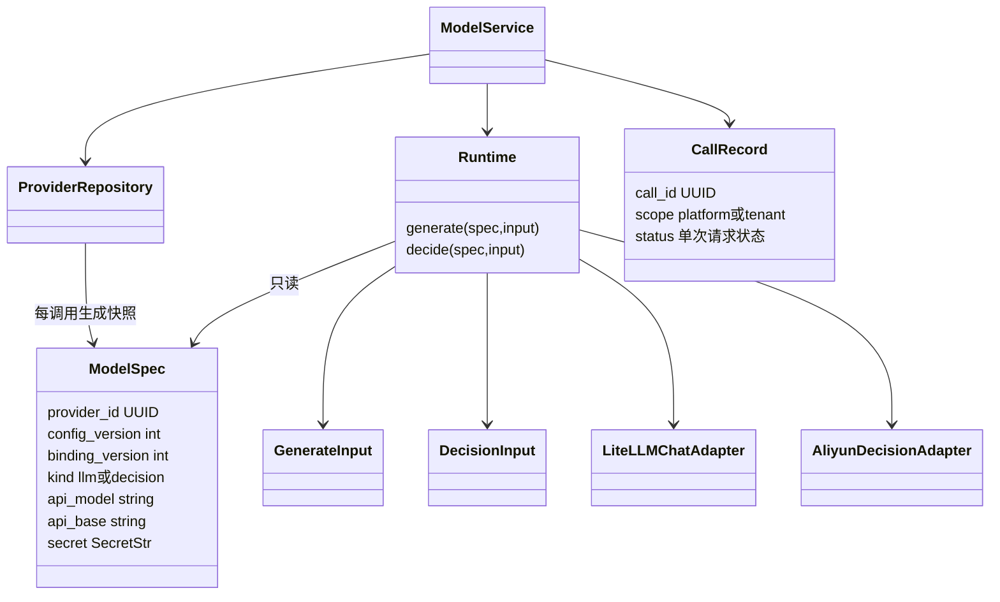

# 993 核心代码设计

[返回技术方案](TECH_DESIGN.md) · [需求与 AC](../spec/PRD.md)

本文是供评审的设计片段，尚未写入应用、运行或通过功能测试。Python/TypeScript 片段表达拟新增符号及关键分支；仓储 SQL、DTO 完整序列化和 UI 样式由实施补齐。伪代码调用的操作语义在相邻文字中定义，不以空函数代表待定逻辑。公共 HTTP DTO 仍集中在 Agent `schemas.py`；`llm/contracts.py` 只放进程内类型并引用这些 DTO。

## A. 核心对象与生命周期



应用启动只建立无用户凭据的服务对象和只读目录。每次请求创建 ModelSpec、adapter 调用资源和结果累积器；调用结束释放。ModelService 直接依赖具体仓储和 Runtime，两个 adapter 由 kind/adapter 的明确分支选择；不建立注册中心或可插拔依赖容器。

```python
# 拟新增 llm/contracts.py；内部值对象，repr 不显示凭据
@dataclass(frozen=True)
class ModelSpec:
    provider_id: UUID
    config_version: int
    binding_version: int
    kind: Literal["llm", "decision"]
    adapter: Literal["litellm_chat", "aliyun_decision"]
    api_model: str
    sdk_model: str | None
    api_base: str
    secret: SecretStr = field(repr=False)

# 拟新增 schemas.py；这里列出关键字段，全部输入模型 extra="forbid"
class TenantScope(BaseModel):
    model_config = ConfigDict(extra="forbid")
    kind: Literal["tenant"]
    tenant_id: UUID
    workspace_id: UUID

class PlatformScope(BaseModel):
    model_config = ConfigDict(extra="forbid")
    kind: Literal["platform"]

class TrustedContext(BaseModel):
    model_config = ConfigDict(extra="forbid")
    actor_user_id: UUID
    scope: Annotated[TenantScope | PlatformScope, Field(discriminator="kind")]
    purpose: Literal["test", "chat", "manage", "module_read"]

class Usage(BaseModel):
    input_tokens: int | None = None
    output_tokens: int | None = None
    reasoning_tokens: int | None = None

class CallOutcome(BaseModel):
    call_id: UUID
    provider_id: UUID
    config_version: int
    status: Literal["completed", "failed", "canceled", "incomplete"]
    duration_ms: int
    usage: Usage
    error_code: str | None
    upstream_outcome_unknown: bool
```

`GenerateInput(kind="generate")` 和 `DecisionInput(kind="decision")` 按主文第 5 节字段构成判别联合。GenerateInput 顶层可带 continuation_token（加密后最大 1 MiB）；消息 role 仅 system/user/assistant/tool；文本输入，不接受远程图片/文件 URL。工具调用/响应 ID 必须匹配当前历史，工具名和参数 Schema 有界。决策问题联合按 type=choice/noul/score 校验 criteria。平台 TestCallInput 接受该联合；ChatCallInput 只接受 GenerateInput。HTTP 外壳携带 call_id/provider_id，可信 context 由 BFF 另行填入。

`CallResponse` 为 outcome + 判别型输出；SSE `final` 只发送 outcome、finish_reason、validation 及必要 continuation_token，不重复正文或工具参数。UI 根据本流累积的 delta 和 final 组合结果。非流式返回完整 CallResponse。事件 DTO 使用带 `type` 的联合，JSON Schema 从同一 Pydantic 源生成；不让浏览器解析供应商原始事件。

## B. BFF：授权事务结束后出站

拟修改 `server/composition.ts`，通过现有 identity/access 公开接口增加 `authorizeModelOperation`。以下为 TypeScript 伪代码；`execute` 是现有函数，回调只包含数据库操作。

```typescript
async function authorizeModelOperation(ctx: ModelAccessContext) {
  const actor = await ctx.identity.requireActor(token);
  if (routeScope === "platform") {
    if (!actor.isPlatformAdmin) reject("forbidden");
    return {
      actor_user_id: actor.userId,
      purpose: routePurpose, // 路由常量 manage 或 test
      scope: { kind: "platform" as const },
    };
  }
  const access = await ctx.access.current(actor, tenantId);
  const workspace = await ctx.access.workspace(tenantId, workspaceId);
  if (!workspace || workspace.status !== "active") reject("forbidden");
  const scope = { tenantId, workspaceId };
  if (routePurpose === "chat") {
    requirePermission(access, "module.analysis", scope);
    requirePermission(access, "models.invoke", scope);
  } else {
    requirePermission(access, "module.admin.capabilities", scope);
  }
  return {
    actor_user_id: actor.userId,
    purpose: routePurpose,
    scope: { kind: "tenant" as const, tenant_id: tenantId, workspace_id: workspaceId },
  };
}

const authorized = await execute(token, "query", (services) =>
  services.models.authorizeModelOperation(validatedRouteScope),
);

// 此处 execute 已提交。服务端配置、可信上下文均不取自浏览器 body/headers。
const upstream = await agentModelClient.invoke({
  input: validatedBusinessDto,
  context: authorized.value,
  signal: request.signal,
});
return validateAndRelay(upstream, {
  viewRevision: authorized.viewRevision,
  expectedCallId: validatedBusinessDto.call_id,
});
```

`ModelAccessContext` 组合 identity/public.ts 的 IdentityStore 和 access/public.ts 的 AccessStore，由 composition.bind(client) 绑定给 models/public.ts；上例省略已校验路由参数的传递样板。requirePermission/Scope 从 access/public.ts 导出，models 不导入跨模块私有 domain。现有 queries.validateContext 未检查 archived，access.workspace 应用用例额外要求 workspaces.read，均不直接代替此授权检查。禁止 UI 导入 pg store。Agent 的 authenticate_service 读取专用 token 并恒时比较；manage/test 路由只接 platform，Chat 只接 tenant/chat，module 摘要只接 tenant/module_read。持有服务凭据的 BFF 是可信边界，无浏览器 header 透传。

所有 BFF 模型路由先通过现有 Origin/CSRF 和严格有界 JSON 读取；模型测试/Chat POST 单独允许 2 MiB，其他路由保留 64 KiB。发起模型请求不进入通用 `run()` 的事务回调。授权异常直接拒绝；Agent 断线映射安全 503。返回 viewRevision 后前端继续复用现有版本判断。鉴权失败沿 execute 既有审计；输入校验、版本冲突及代理阶段拒绝经同一失败审计能力写安全 code/对象 ID，避免同请求重复记录，禁止写消息/密钥/token。

## C. 配置保存和调用占位

拟新增 `models/repository.py`。以下是带 SQL 语义的伪代码，事务全部在现有同步 SQLAlchemy 线程池工作单元中执行。

Chat 准入函数拟放在 llm/capabilities.py，由保存、列表和调用共用；UI 读取派生的 chat_supported 与原因，不自行维护名单。以下同时展开改绑和直接 API 调用的检查。

```python
def chat_supported(binding):
    return (
        binding.kind == "llm"
        and binding.adapter == "litellm_chat"
        and binding.vendor == "deepseek"
        and binding.api_model in {"deepseek-v4-pro", "deepseek-flash"}
        and binding.sdk_model == "deepseek/" + binding.api_model
    )

def save_provider(command, actor):
    fingerprint = mac_canonical(command)  # HMAC，含操作语义，不写原始 payload
    with transaction() as tx:
        previous = tx.change_by_operation(command.operation_id)
        if previous is not None:
            require_same_actor_and_mac(previous, actor, fingerprint)
            return Saved(previous.provider_id, previous.after_version)
        if command.is_create:
            row = Provider.new(uuid4(), version=1, binding_version=1)
            before_version = None
        else:
            row = tx.provider_for_update(command.provider_id)
            if row is None:
                raise NotFound()
            if row.version != command.expected_version:
                raise VersionConflict(row.version)
            before_version = row.version
            row.version += 1
        old_binding = binding_fields(row)
        apply_validated_fields(row, command)
        if row.chat_visible and not chat_supported(row):
            raise InvalidParameters("chat_model_not_supported")
        if command.api_key is not None:
            row.api_key_ciphertext = seal_key(row.id, command.api_key)
        require_key_for_create(row)
        if command.is_create or binding_changed(old_binding, row, command.api_key):
            row.binding_version = row.version
        tx.store_provider(row)  # alias 的规范化唯一约束在库内检查
        tx.insert_change(command.operation_id, actor, fingerprint,
                         row.id, before_version, row.version,
                         changed_field_names(command))
    return Saved(row.id, row.version)
```

相同 operation_id 的并发事务可能同时未读到 previous。唯一键冲突须回滚整笔事务，再读取已提交操作核对 actor/MAC并返回其结果；其它 alias 冲突返回 409，不当作重复保存成功。改变字段的操作记录与配置写入原子提交。密文 payload 包含 purpose=`provider_key`、provider_id、key；解密复核前两项。

```python
def begin_call(command, context):
    with transaction() as tx:
        row = tx.provider_for_share(command.provider_id)
        if row is None:
            raise NotFound()
        if context.purpose == "chat":
            if not chat_supported(row) or command.input.kind != "generate":
                raise InvalidParameters("chat_model_not_supported")
            if context.scope.kind != "tenant" or not row.enabled or not row.chat_visible:
                raise ModelUnavailable()
        elif context.purpose != "test" or context.scope.kind != "platform":
            raise Forbidden()
        require_matching_kind_and_capabilities(row, command.input, context.purpose)
        require_allowed_endpoint(row.base_url, row.adapter)
        snapshot = snapshot_fields(row)  # 包括当前密文；事务结束后才解密
        tx.insert_call(
            call_id=command.call_id,
            provider_id=row.id,
            config_version=row.version,
            binding_version=row.binding_version,
            requested_model=row.api_model,
            context=context,
            status="running",
            deadline_at=utcnow() + timedelta(seconds=180),
        )
    return snapshot
```

available 对 chat/module 两种租户视图均只返回 chat_supported(row) and row.enabled and row.chat_visible 的条目；平台管理列表保留全部模型。ChatCallInput 在 BFF/Agent DTO 两处拒绝 DecisionInput，begin_call 仍校验 Provider 绑定，全部检查在插入调用记录与出站前完成。改绑使用合并后的完整配置校验；UI 明示隐藏影响后提交 false，服务端拒绝仍为 true 的非法组合。

`FOR SHARE` 与配置 UPDATE 互斥，多个调用可并行读取。call_id 主键冲突回滚本次事务：统一返回 call_already_exists；仅同一 actor/purpose/scope 可读取关联状态，无任何再次出站。调用防重直接使用唯一键，不额外保存 payload HMAC。读取调用元信息时必须匹配 actor/purpose/scope。端点检查、输入能力校验失败不插入可执行任务。结束时保存实际 response_model，缺失为 null。无后台消费者。

调用结束用 `UPDATE model_call SET ... WHERE call_id=:id AND status='running'`。数据库不可用时不回滚上游行为、不重发；生成安全 record_write_failed 状态。过期 running 的“结果未知”在读取时根据 deadline 派生，不额外建设恢复任务。

## D. 适配与能力映射

拟新增 `llm/litellm_chat.py`，参数由代码明确构造。设计片段的调用参数要在 T01 用锁定发行版验证。

```python
def deepseek_kwargs(spec, request, context):
    validate_generate_input(request)
    validate_capability_combination(spec, request)
    if not request.thinking and request.reasoning_effort is not None:
        raise InvalidParameters("thinking_effort_conflict")
    body = {"thinking": {"type": "enabled" if request.thinking else "disabled"}}
    params = {
        "model": spec.sdk_model,
        "api_base": spec.api_base,
        "api_key": spec.secret.get_secret_value(),
        "messages": restore_validated_continuation(
            spec, context, request.messages, request.continuation_token
        ),
        "stream": request.stream,
        "max_tokens": request.max_tokens,
        "num_retries": 0,
        "max_retries": 0,
        "drop_params": False,
        "timeout": 180,
        "extra_body": body,
    }
    if request.thinking:
        params["reasoning_effort"] = request.reasoning_effort or "high"
    if request.stream:
        params["stream_options"] = {"include_usage": True}
    if request.tools:
        params["tools"] = validated_tool_definitions(request.tools)
    if request.output_format in {"json", "schema"}:
        params["response_format"] = {"type": "json_object"}
        params["messages"] = with_json_instruction(params["messages"], request.output_schema)
    return params
```

请求无 `extra_body` 输入通道，SDK 调用 kwargs 不能合并任意用户字典。Schema 模式由明确的 system 消息要求 JSON 和目标 Schema，结果在本地验证；UI 标记“JSON + 本地 Schema 校验”。一般目录模型走各自已实现的 chat 映射；DeepSeek 特有 thinking 字段不得发送给其它供应商。

`AliyunDecisionAdapter` 直接按阿里官方协议：

```python
async def decide(spec, request, resources):
    validate_decision_request(request)  # 题数、类型、criteria 和 body 大小
    payload = request.model_dump(mode="json")
    endpoint = validated_systemone_url(spec.api_base)
    async with httpx.AsyncClient(
        timeout=httpx.Timeout(180, connect=10),
        follow_redirects=False,
        transport=httpx.AsyncHTTPTransport(retries=0),
    ) as client:
        resources.register_client(client)
        resources.mark_sent()  # 紧邻首次出站；此后取消时上游结果可能未知
        async with client.stream(
            "POST", endpoint,
            headers={"Authorization": "Bearer " + spec.secret.get_secret_value()},
            json={"model": spec.api_model, "state": payload["state"],
                  "questions": payload["questions"]},
        ) as response:
            resources.register_response(response)
            require_success_or_safe_error(response.status_code)
            body = bytearray()
            async for chunk in response.aiter_bytes():
                if len(body) + len(chunk) > 1024 * 1024:
                    raise ProviderProtocolError("response_too_large")
                body.extend(chunk)
            result = parse_json_bytes(body)
    validate_decision_answers(request.questions, result.answers)
    return normalize_decision_result(result)
```

实现须在读取 body 时执行上限，不能先无限读取后再判断长度；错误 HTTP 状态直接关闭响应，不读取供应商错误正文。响应验证：问题 ID 集合与请求相等、类型匹配；choice 是提供的候选；noul∈[0,1]且允许无 probabilities；score∈[0,N-1]。choice/score 的 probabilities 必须覆盖完整候选/等级键集，值有限非负且总和容差 1e-3；score.legend 的键及描述与请求等级对应，界面展示请求中提供的等级含义；confidence 如存在∈[0,1]。字段缺失和非法结构均为 provider_protocol_error，保留安全字段路径，不返回原始错误 body。

## E. 流式终结与取消

模型服务在执行 scope 内同时观察 disconnect 和结果任务。以下为伪代码，`disconnect` 由 Agent 请求连接监听提供，覆盖非流式和首包前等待。

```python
async def run_owned_call(command, context, disconnect):
    snapshot = await run_in_threadpool(begin_call, command, context)
    outcome = canceled_outcome(command.call_id, upstream_unknown=False)
    resources = CallResources()  # 本请求 task/client/response 引用，无跨请求注册
    try:
        spec = decrypt_snapshot(snapshot)
        async with asyncio.timeout(180):
            result_task = resources.start(runtime.invoke(spec, command.input, context, resources))
            disconnect_task = resources.start(disconnect.wait())
            done = await wait_first(result_task, disconnect_task)
            if disconnect_task in done:
                raise asyncio.CancelledError()
            outcome = result_task.result()
    except asyncio.CancelledError:
        outcome = canceled_outcome(command.call_id, upstream_unknown=resources.sent)
        raise
    except TimeoutError:
        outcome = timeout_outcome(command.call_id, resources.has_partial, resources.sent)
    except KnownModelError as error:
        outcome = safe_failure(error.code, resources.has_partial, resources.sent)
    except Exception:
        outcome = safe_failure("internal_error", resources.has_partial, resources.sent)
    finally:
        try:
            await resources.close_in_bounded_cancel_shield(max_seconds=2)
        finally:
            recorded = await finish_in_bounded_cancel_shield(outcome, max_seconds=2)
            if not recorded:
                outcome = safe_failure("record_write_failed", resources.has_partial, resources.sent)
    return outcome
```

`runtime.invoke` 按输入类型调用生成/决策分支，向 adapter 传入本次 resources；adapter 在首次HTTP调用前 mark_sent，注册真实 client/response，发送可见正文/工具 delta 前 mark_partial。生成流产生规范事件经有界回压通道向 HTTP 响应传递，取消服务任务同时结束生产者。回压通道最多 16 个事件，无持久队列；消费者关闭会唤醒并取消阻塞的生产者。所有终结由同一个调用 scope 决定，禁止 catch-all 吞掉 CancelledError。未预期异常映射 internal_error 并同样结束记录；不得输出异常原文。

close_in_bounded_cancel_shield 在最多 2 秒内取消/等待任务并关闭已登记资源，捕获关闭错误做安全日志；finally 始终尝试终态写入。`finish_in_bounded_cancel_shield` 返回 bool，只保护终态写入；独立短事务 statement_timeout≤2 秒，失败返回 false 并保留过期 running 记录。它不能触发模型重试、开启新调用或把取消改成成功。服务主动返回正常 final 前须完成记录写入；若失败，final 为 record_write_failed。客户端已断连时仅完成本地记录，无法再发送 final 属于正常断连边界。取消异常在 finally 后继续传播。

生成累积器的终结规则：

```python
def finalize_generation(acc):
    if not acc.normal_eof or acc.finish_reason is None:
        return incomplete("stream_interrupted", acc)
    if acc.finish_reason == "length":
        return incomplete("output_truncated", acc)
    if acc.refusal or acc.finish_reason == "content_filter":
        return failed("model_refused", acc)
    if acc.finish_reason not in {"stop", "tool_calls"}:
        return failed("provider_protocol_error", acc)
    if acc.tool_calls:
        validate_complete_tool_arguments(acc.tool_calls, acc.declared_tools)
    if not acc.text.strip() and not acc.tool_calls:
        return failed("empty_output", acc)
    if acc.output_format in {"json", "schema"}:
        parsed = parse_json_or_fail(acc.text)
        if acc.output_format == "schema":
            validate_local_schema_or_fail(parsed, acc.schema)
    return completed(acc, usage=acc.usage)  # usage 可为未知；不提前猜为 0
```

已收到 final 后禁止再追加事件。尾 usage 必须在正常上游 EOF 前收集；SDK 若不暴露 [DONE]，需以该版 SDK 对正常结束的行为及故障 stub 验证 normal_eof 的判定，不只凭 Python 迭代器退出判成功。

## F. 协议私有状态与前端清理

工具测试续接 token 的明文封装字段：purpose=`tool_continuation`、actor、scope、provider_id、binding_version、issued_at、visible_history_digest、private_assistants、allowed_tool_call_ids。只在生成结果含完整工具调用时生成 token，放到 CallResponse.continuation_token 或 SSE final.continuation_token。private_assistants 保存当前工具轮次所需的 assistant 索引/私有协议字段，支持多次手工工具回填；不包含别的模型或会话状态。加密后先检查 1 MiB token 限制，再检查含 envelope 的 2 MiB 响应/事件预算；超限返回 continuation_too_large，不产生无法回传的成功状态。客户端提交前与 BFF/Agent 同样检查 2 MiB 请求限制。Fernet 密文不可直接当作 API Key 密文读取，两类解密后均复核 purpose 和绑定 ID。页面只能回传，不能看到推理内容。

恢复顺序固定：验证 token/TTL → 比较 actor/scope/provider/binding_version → 比较此前完整可见历史摘要（仅规范化可见消息，排除 token） → 核对新增手工 tool 消息 ID 集合与上一轮工具调用一致且不重复 → 按索引还原相应 assistant → 按用户主动点击发起新 call_id。restore_validated_continuation 必须接收 TrustedContext，所有比较在出站前完成。更换模型、租户或密钥后旧 token 无效；普通用户新问题开始新轮时丢弃 token。无单独 token 库，短期同范围重复使用视为用户新调用并使用新 ID。

拟扩展 `DocumentSession.modelRequest` 的关键流程：

```typescript
const generation = this.generation;
const controller = this.ownedController();
try {
  const response = await fetch(url, {
    method: "POST",
    body: JSON.stringify(input),
    headers: this.csrfHeaders(),
    signal: controller.signal,
  });
  this.requireCurrentRevision(response, generation);
  for await (const event of parseValidatedModelEvents(response, input.call_id)) {
    if (controller.signal.aborted || generation !== this.generation) return;
    this.requireDisplayLease();
    onEvent(event);
  }
} finally {
  controller.abort();
  this.releaseController(controller);
}
```

此片段中的 controller/revision/lease 操作接入现有 DocumentSession 生命周期，具体方法名在实施时沿用现有内部符号；不得复制状态到新 session 类。JSON 非流式同样走该 ownership。停止后先冻结当前结果、标取消，再 abort；延迟到达的片段因 generation/abort 检查被丢弃。敏感输入、结果、token 均注册 clear 回调，导航/撤权统一清除。

## G. 必须验证的设计分支

1. Web 事务重试 2 次时上游请求仍只有一次；Agent 记录冲突不出站；取消任意阶段均释放连接。
2. 配置更新与 begin_call 并发时获得某个完整版本；密钥替换不能污染在途调用。
3. SDK 400/429/5xx/timeout/断流实际 HTTP 出站数为 1；禁止通过 SDK 兼容逻辑隐式补发。
4. 最后一个 token 后还有 usage、空 usage、错误 EOF、多工具分片交错、JSON/Schema 错误、截断均可区分。
5. 私有状态的 actor、tenant、workspace、provider、版本、可见历史、TTL 任一不符均拒绝；不落日志或浏览器持久存储。
6. Web 0003/Agent 0002 的真实 PostgreSQL 迁移、源摘要、runtime 最小授权与恢复；旧权限无静默新增。
7. Chat 仅列两款 DeepSeek LLM；决策及其他目录模型不能开启展示、通过改绑保留开放状态或直调 Chat API，出站计数为 0；平台管理员仍能使用 DecisionInput 进行真实决策测试。

以上属于实施验证清单，本次未执行应用功能测试。
