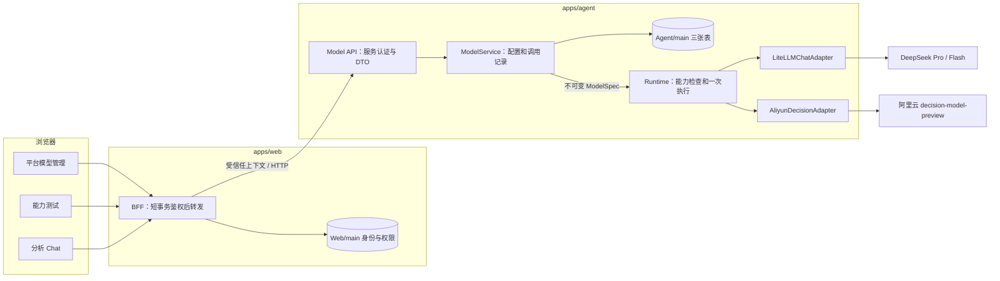
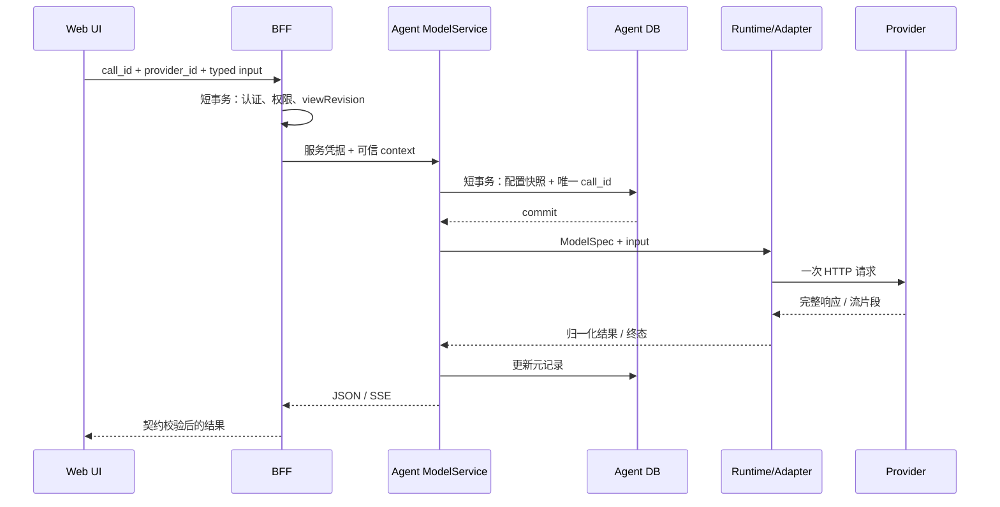

# 第 11 课 LLM Runtime 技术方案

> Feature：993｜Profile：standard｜状态：技术范围通过独立复评，产品范围已确认｜日期：2026-11-03
> 需求真源：[PRD](../spec/PRD.md)｜模板：[项目标准模板](../../_templates/TECH_DESIGN.tmpl.md)  
> 代码基线：`main@0972e295`，同时核对当前工作区；本次只设计，不修改应用实现。  
> [返回 BRIEF](../BRIEF.md) · [代码设计](CODE_DESIGN.md) · [数据库规范](../../../docs/database-migrations.md)

## 1. 目标、范围与选型

以 Agent 内的薄 Runtime 完成三条路径：平台管理员保存模型配置；管理员测试模型能力；租户用户在分析 Chat 手动选择两款 DeepSeek LLM 并调用。阿里云决策模型仅在管理端配置和测试。平台统一供给模型，Web 复用已有身份与授权，Agent 拥有配置、密钥和调用元记录。需求和验收条件继续由 PRD 的 FR-993-01～14、AC-993-01～30 维护。

### 1.1 本课交付边界

| 领域  | 本期实现                                                                   | 后续课程再实现                                                    |
| ----- | -------------------------------------------------------------------------- | ----------------------------------------------------------------- |
| 配置  | 平台 Provider CRUD（无删除）、目录选择、加密凭据、启停/Chat 展示、整数版本 | 租户自有模型、分配策略、发布审批与配置中心                        |
| 选择  | 按用户指定的 `provider_id` 读取一份配置快照                                | 第 12 课规则/智能路由、任务画像、负载均衡                         |
| 执行  | 单次请求、能力检查、协议映射、总超时、取消、基本结果检查                   | 第 13 课 Retry/Fallback、LogicalCall/Attempt、补偿、Deadline 编排 |
| 观测  | 一条调用元记录、配置变更记录、耗时与上游用量                               | 第 14 课 Trace、预算/成本账本、Replay、治理平台                   |
| Agent | 文本对话；工具声明和手工回填测试；结构化决策测试                           | Agent Loop、真实工具/SQL、Memory、Sandbox、持久任务               |

本课展示完整架构地图，并只实现表中第一列。无独立 Runtime 服务、Proxy、Redis、消息队列、Worker 接入、共享 SDK 包、通用 Hook/Sink、空适配器、费用估算或自动修复。`config_version` 用于编辑冲突和记录关联，不引入配置发布生命周期。

课程范围对齐 [第 11 课页级大纲](../../../../../../lessons/v5/formal/lesson_11_llm_runtime_boundary/brief/lesson_outline.md) C04、C06～C14。其当前状态仍为 `in_review`；本方案不调整课程大纲及统计。

### 1.2 选型决策（本 Feature 的 ADR）

| 决策     | 采用方案与当前理由                                                                         | 代价、备选与重新考虑条件                                                                                                        |
| -------- | ------------------------------------------------------------------------------------------ | ------------------------------------------------------------------------------------------------------------------------------- |
| SDK      | Agent 直接依赖 `litellm-core==1.106.6`，导入名 `litellm`；两款 DeepSeek 使用 `acompletion` | 与已有 Python 3.13 在实施首步验证并锁定；同环境不同时安装 `litellm`。SDK 升级需复测参数映射及出站次数                           |
| 宿主边界 | Web/BFF → Agent HTTP → app 内 Runtime                                                      | 两个现有服务足够；只有出现独立部署/SLA/多应用真实消费者时再讨论网关或共享包                                                     |
| 决策接入 | `AliyunDecisionAdapter` 用 `httpx.AsyncClient` 调官方 System One 接口                      | LiteLLM 当前公开决策 Provider 清单未列阿里云；小型显式适配器避免依赖未核验映射。以后 SDK 明确支持且契约测试通过时可替换内部实现 |
| 配置     | Agent PostgreSQL 是唯一可编辑来源；每次调用读库后固定快照                                  | 无 TOML 双源、热更新总线或配置缓存；增加一次短读库即可满足当前规模                                                              |
| 身份     | BFF 每请求查现有权限；服务端专用共享凭据保护 Agent 新接口                                  | 信任已授权 BFF 构造的上下文；不建 JWT 委托体系或跨库查询。独立对外开放 Agent 时重新设计身份边界                                 |
| 持久化   | 三张 Agent 表：接入配置、配置变更、调用记录；Web 只追加权限迁移                            | 三张表分别满足配置、保存核对/操作审计、调用诊断；没有消息表、任务表、Attempt 表                                                 |
| UI       | 复用现有页面、Dialog、权限编辑器和 DocumentSession                                         | 流式读取扩展现有会话控制，避免维护第二套撤权/取消逻辑；四张高保真图继续作为布局依据                                             |

## 2. 架构与代码归属

Runtime 不查询数据库、不理解租户权限、不写审计。它接收已授权的上下文和不可变 `ModelSpec`，只在适配器边界接触凭据。ModelService 管理配置解析、调用记录与超时/取消资源。配置和调用网络期间均不占用数据库事务。

| 模块         | 现有入口 / 拟新增路径                                                                                                         | 责任                                                                                        |
| ------------ | ----------------------------------------------------------------------------------------------------------------------------- | ------------------------------------------------------------------------------------------- |
| Web 页面     | 修改 `src/lib/page-catalog.ts`、`components/product-content.tsx`、`components/analysis-composer.tsx`；新增 `features/models/` | 平台入口、租户摘要、表单、测试与调用展示                                                    |
| Web 授权     | 修改 `server/modules/access/domain/permissions.ts`；新增 `server/modules/models/public.ts`、`application/authorize.ts`        | `models.invoke` 动作；复用 identity/access 的公开接口                                       |
| Web HTTP     | 修改 `server/http/handler.ts`、`server/agent-api.ts`、`server/composition.ts`                                                 | 短授权事务、服务调用、生成契约校验；demo 保持原有 5 秒调用路径                              |
| 前端请求     | 修改 `client/request-scope.ts`                                                                                                | 在 DocumentSession 中增加 `modelRequest`；所有控制器和片段受同一 generation/revision 管理   |
| Agent API    | 修改 `compass_agent/main.py`、`schemas.py`；新增 `model_api.py`                                                               | 新路由、Pydantic DTO、服务凭据检查；现有 demo 独立                                          |
| 配置应用服务 | 新增 `compass_agent/models/{service,repository,entities,secrets}.py`                                                          | 三张表、版本、加密、元记录；使用现有 SQLAlchemy 同步栈的短线程池工作单元                    |
| Runtime      | 新增 `compass_agent/llm/{contracts,runtime,capabilities,catalog,litellm_chat,aliyun_decision}.py`                             | app 内类型与函数；两个有实际消费者的适配器；无插件注册框架                                  |
| 契约         | 修改 `scripts/export-contracts.py`、`scripts/contracts.mjs`                                                                   | 从 Agent DTO 导出 JSON、事件联合类型与 JSON Schema；生成 `contracts/` 和 Web generated 文件 |

表中的 `src/` 相对 `apps/web/`，`compass_agent/` 相对 `apps/agent/src/`；新增目录随实现写 README。设计代码及核心分支见 [CODE_DESIGN](CODE_DESIGN.md)。

## 3. 三模型绑定与能力

### 3.1 实际绑定

| 产品模型            | 实际 API model           | adapter / SDK 名称                          | Base URL（保存到版本化配置）                                                                     |
| ------------------- | ------------------------ | ------------------------------------------- | ------------------------------------------------------------------------------------------------ |
| deepseek v4 pro     | `deepseek-v4-pro`        | `litellm_chat` / `deepseek/deepseek-v4-pro` | `https://api.deepseek.com`                                                                       |
| deepseek v4.1 flash | `deepseek-flash`         | `litellm_chat` / `deepseek/deepseek-flash`  | `https://api.deepseek.com`                                                                       |
| 阿里云决策模型      | `decision-model-preview` | `aliyun_decision` / 无 LiteLLM 调用映射     | `https://{WorkspaceId}.{region}.maas.aliyuncs.com/compatible-mode/v1`，适配器仅追加 `/systemone` |

阿里云 region 为 `cn-beijing` 或 `ap-southeast-1`，WorkspaceId 与地域需由接入账号确定。配置使用真实厂商名称；不把阿里云记录登记为 TypeSafe 厂商。协议字段依据阿里云官方文档核实后使用。

### 3.2 目录与能力维护

SDK 启动前固定 `LITELLM_LOCAL_MODEL_COST_MAP=True`，读取随锁定发行版交付的 `litellm.model_cost`。目录 API 返回供应商、目录 ID、模式、适配状态、能力来源和 SDK 版本。无需在线抓取目录、后台定时同步或目录数据库。SDK 升级随应用发布更新目录。

以 `catalog.py` 内少量有来源的补充项覆盖三模型缺项，标记 `source=project_verified`；LiteLLM 原项标记 `source=litellm`。别名使用保存的实际 API model；目录变化不重写既有配置。目录里未支持的调用模式可见且不可新增；已支持 chat 协议的其他项允许配置，标为“未联调”。自定义模型名仅限所选协议，不接受用户指定适配器类、模块路径或任意 SDK kwargs。

能力最终由 Agent `capabilities.py` 计算，API 返回同一描述供 UI 绘制；Web 不维护平行兼容矩阵。每项包含 `supported / unsupported / unknown` 和原因。已知不支持的参数在出站前拒绝；unknown 只允许平台管理员对该适配器已实现的参数做显式诊断，不能通过未知参数注入端点/身份/凭据。

| 能力          | 两款 DeepSeek                                                                                                           | 阿里云 decision-model-preview      |
| ------------- | ----------------------------------------------------------------------------------------------------------------------- | ---------------------------------- |
| 非流式 / 流式 | 两者支持；SDK async 承载两种响应方式                                                                                    | 非流式；流式控件禁用               |
| 工具          | 声明、返回参数、手工回填；不运行工具                                                                                    | 不支持                             |
| Thinking      | 显式 `thinking.type=enabled/disabled`；开启时 effort=`low/high/max`                                                     | 不支持                             |
| JSON 输出     | `response_format={type:json_object}`；消息中要求 JSON                                                                   | 决策结果自身有结构，不开放生成参数 |
| JSON Schema   | DeepSeek 当前 Chat API 无原生 `json_schema`；本地校验模式：JSON 输出 + 用户 Schema 检查，明确标注，禁止宣称上游严格约束 | 校验官方决策响应结构及语义         |

关闭 Thinking 时省略 effort；开启时默认 high；两者冲突直接 422。组合限制由适配器逐项检查，不能 `drop_params=True`。Schema 校验采用 `jsonschema` Draft 2020-12，仅本地 `$ref`，禁止联网解析引用；无自动修复或二次调用。工具参数以工具 ID 聚合，完整终止后解析 JSON 并校验关联 Schema；未闭合参数显示部分结果。

### 3.3 决策契约与管理端测试边界

决策请求为 `state: string | object | array` 与 1～16 个命名 `questions`。每题是 choice（1～255 个命名选项）、noul（是否判断）或 score（2～255 级有序描述）。响应保留逐题答案、概率、可选 confidence、上游 request_id、latency_ms 和 input_tokens。noul 表示 P(yes)，score 是等级索引的期望值；不转换成生成文本、不填造 output_tokens。

用户已确认 decision-model-preview 本期仅在管理端测试，Chat 只开放两款 DeepSeek LLM。管理员测试页使用状态输入框、问题编辑器和决策结果视图，直接提交此结构；不增加 Chat 决策表单或自动 LLM 转换。OQ-993-01 已关闭，AC-993-24 改为 Chat 范围防护和管理端决策测试验收。

### 3.4 设计时核验

访问日期 2026-11-03，以下为接口设计依据；真实账号和网络联调仍属实施验证。

- [DeepSeek Chat API](https://api-docs.deepseek.com/api/create-chat-completion/)：模型标识、参数、JSON 输出与流协议；[Thinking 指南](https://api-docs.deepseek.com/guides/thinking_mode/)：工具续接需要保留的协议状态。
- [阿里云决策 API](https://help.aliyun.com/en/model-studio/decision-model-api)：System One 端点、输入、答案与用量；[模型能力](https://help.aliyun.com/en/model-studio/decision-model-preview)：可用能力边界。
- [LiteLLM SDK](https://github.com/BerriAI/litellm/blob/main/README.md)、[决策接口](https://docs.litellm.ai/docs/decisions)、[发行包](https://pypi.org/project/litellm-core/1.106.6/)：发行选择及适配边界。文档 main 分支可能领先锁定版本，T01 以锁定包实测为准。

## 4. 数据、凭据与并发

### 4.1 Agent/main 三张表

| 表               | 必要字段与约束                                                                                                                                                                                                                                                                                                                                 | 用途                                                                                                |
| ---------------- | ---------------------------------------------------------------------------------------------------------------------------------------------------------------------------------------------------------------------------------------------------------------------------------------------------------------------------------------------- | --------------------------------------------------------------------------------------------------- |
| `model_provider` | UUID id；alias ≤80，`lower(btrim(alias))` 唯一；catalog_id、vendor、api_model、nullable sdk_model ≤200；kind、adapter 两种枚举；base_url ≤2048；api_key_ciphertext；enabled/chat_visible 默认 false；version 正整数；binding_version；created/updated_at、updated_by                                                                           | 一行是一项可调用接入。alias/开关改动增 version；模型/目录绑定/端点/密钥变化同步更新 binding_version |
| `model_change`   | UUID operation_id 主键；provider_id 同库引用；actor_user_id 逻辑 ID；request_mac；action；before_version/after_version；changed_fields；created_at                                                                                                                                                                                             | 与配置写入同事务；只存字段名和安全状态，不存值/密钥。核对丢失响应及防止重复保存；不提供历史配置回放 |
| `model_call`     | UUID call_id 主键；provider_id；config_version、binding_version；requested_model、nullable response_model；purpose=test/chat；actor_user_id、tenant_id/workspace_id（平台为空）；capability_summary；status；started_at、deadline_at、finished_at；duration_ms；nullable usage；safe_error_code；upstream_request_id；upstream_outcome_unknown | 单次调用元记录；不存消息、工具参数、决策 state、原始响应或推理内容                                  |

`model_call` 建 `(provider_id,purpose,started_at DESC)` 和 `(tenant_id,actor_user_id,started_at DESC)` 索引；`model_change(provider_id,created_at DESC)`。跨 Web 的身份 ID 只作逻辑关联，无跨库外键。无删除接口，历史记录始终保留 Provider ID/版本。列表查询 20/50/100 条，排序 `updated_at DESC,id`；Chat 摘要按 alias/id 排序。

requested_model 保存当次实际 API model，response_model 保存上游实际返回值，缺失为 null；配置改绑后仍可解释旧调用。拒绝、输入错误、保存冲突与代理失败复用 Web 既有失败审计的独立短事务，记录请求/操作/对象 ID 和安全 code；Agent 返回的前置拒绝也进入这条路径。已有 execute 失败留痕不重复追加，不新增审计表或系统。

Chat 准入由 Agent 的 capabilities.py 中 chat_supported(binding) 统一计算：kind=llm、adapter=litellm_chat、vendor=deepseek，且 api_model 为 deepseek-v4-pro 或 deepseek-flash，保存的 sdk_model 与之匹配。该值只读派生，不允许管理员编辑。新增/修改配置、available 列表及 Chat 调用使用同一规则；Chat 展示开启还要求符合准入。决策模型及其他目录模型的开关固定关闭，非法开启返回 422 chat_model_not_supported。表约束 CHECK(kind='llm' OR chat_visible=false) 防止决策记录误开放；两款具体模型的准入规则只在代码维护。

改绑后不符合 Chat 准入时，UI 明示“更换后将从 Chat 隐藏”并提交 chat_visible=false；API 校验合并后的完整配置，若仍为 true 则拒绝保存，不保留越界开放状态。

最近测试从 model_call 取该 Provider 的最新测试，显示实际能力组合及 binding_version。别称变化不失效；绑定变化显示待重测。成功不把未知能力自动认证为全部支持，无全量认证状态机。

新增/改绑时解析并保存完整 sdk_model（如 deepseek/deepseek-flash）；阿里 adapter 此字段为 null。执行从保存的 adapter/sdk_model/api_model 生成 ModelSpec，目录移除不影响绑定解析。能力来自适配器规则；缺失目录元信息显示 unknown，仍可使用已知协议的基础调用，不能以目录缺项删除已有配置。

### 4.2 写入、重入与快照

保存携带浏览器生成的 `operation_id`；修改另带 `expected_version`。短事务内先查操作记录，再锁定配置、验证版本、更新配置和追加 model_change；操作 ID 重用且 payload 不同返回 409。同一操作已成功时返回原 provider_id/after_version，界面随后读取当前配置；旧操作重发不覆盖后来的更改。`request_mac` 是对规范化输入的服务器 HMAC，避免在记录中保留明文密钥或可直接猜测的摘要。

调用携带客户端生成的 `call_id`；同一 ID 的并发请求只允许首次插入者出站。重复请求返回 409 `call_already_exists` 与可授权查询的状态，不重放正文、不重新调用。显式重发使用新 ID，界面提示可能产生新用量。这解决重复提交；本期不提供业务上的 exactly-once 或崩溃重试。

ModelService 在一笔短事务中读取配置、检查开放状态、生成不可变 ModelSpec、登记 running 记录，提交后解密并出站。相同配置行的变更与快照读取按行锁序列化；放行时间点为该事务提交。调用中的快照和凭据只活在请求内存，改名、换 key、停用不改变在途请求。禁止复用可变的全局 SDK key/baseurl。

### 4.3 凭据与端点

- API Key 新增必填，长度 1～4096；修改 `api_key=null` 表示保持，非空表示替换；读接口只返回 `has_api_key`。关闭表单、导航和保存完成清除输入。
- 使用 `cryptography.Fernet` 加密，主密钥 `COMPASS_MODEL_ENCRYPTION_KEY` 由部署环境提供。记录 purpose/provider_id 防止密文错绑；备份数据库同时独立备份主密钥。本期无 KMS/自动轮换平台。
- Base URL 仅 HTTPS、无 userinfo/query/fragment；允许管理员修改为部署明确列出的 origin 和该 adapter 接受的路径。`COMPASS_MODEL_ALLOWED_ORIGINS` 是精确 origin 清单；默认只有 DeepSeek，阿里 Workspace 网关由部署加入。禁止自动跟随 redirect；未登记 origin 保存和调用均拒绝。浏览器业务调用从不携带 URL/key。
- 本期公网供应商接入无任意内网模型入口。允许范围与部署出网规则共同维护；本地故障测试使用进程内 transport stub，不向正式 origin 清单加入 localhost。
- 禁用 SDK debug/请求正文回调；异常只映射安全 code 和固定文案。Web、Agent、代理均不记录请求体、Authorization、密钥或续接 token。

## 5. 权限与接口

### 5.1 权限边界

平台页面 `platform/models` 增加到现有 platform group，可无租户成员关系访问。工作区 `admin/capabilities/models` 保留，租户上下文仅返回已开放摘要。平台管理员从此入口可跳至平台管理；进入租户 Chat 仍须有该租户/空间资格。

新增 `models.invoke`，scope=both、可显式授予；`PERMISSION_CATALOG_VERSION` 从 1 升 2。Chat 列表与调用要求 `module.analysis` + `models.invoke`；模块只读列表要求 `module.admin.capabilities`，不授予执行。沿用现有 tenant admin 在自身有效范围的管理语义，旧普通成员和模板不自动增加权限。

Web 在短只读事务中复用 requireActor、access.current，显式按 tenantId/workspaceId 查询空间并确认存在、归属正确且 active，然后校验对应权限，提交后才请求 Agent。该空间检查对租户管理员同样生效，不额外要求 workspaces.read。现有 execute/withTransaction 会重试事务，严禁将外部模型 HTTP 放入回调。BFF 构造 TrustedContext：actor_user_id、purpose、platform 或 tenant scope。专用服务凭据通过 Authorization Bearer 发送到固定 AGENT_API_URL；Agent 恒时比较，并按路由检查 context。浏览器自报的身份/header 全部丢弃；Agent 不读取 Web 表或回调 Web 授权。

共享部署的服务凭据只能由 Web/Agent 持有，连接走私网 HTTPS；本机保持 loopback。服务配置缺失时模型接口 503，既有登录/组织/演示功能可继续运行。授权库不可用时不出站。

### 5.2 HTTP 契约

BFF 前缀 `/api/web/v1`；Agent 前缀 `/v1/models`。以下均为拟新增；DTO 真源写入 Agent `schemas.py`，Web 使用生成类型和 JSON Schema 校验；浏览器请求另排除可信上下文字段。请求、成功、错误与流响应全部 no-store。

| BFF / Agent 路由（方法）                                      | 输入 / 输出                                                                    | 权限                                  |
| ------------------------------------------------------------- | ------------------------------------------------------------------------------ | ------------------------------------- |
| `/platform/models/catalog` / `/catalog` GET                   | q、vendor、page/page_size →目录项、能力、来源、SDK 版本                        | 平台                                  |
| `/platform/models` / `/providers` GET                         | q、kind、page →配置列表，包含端点/has_key，不含 key                            | 平台                                  |
| `/platform/models` / `/providers` POST                        | operation_id + ProviderCreate →id/version                                      | 平台                                  |
| `/platform/models/:id` / `/providers/:id` GET/PATCH           | 详情；operation_id、expected_version、明确 patch 字段 →version                 | 平台                                  |
| `/platform/models/operations/:id` / `/operations/:id` GET     | 保存结果摘要或 404                                                             | 平台                                  |
| `/models/available` / `/available` GET                        | tenant/workspace、view=chat/module →两款 LLM 已启用且可见的摘要，绝无端点/凭据 | 对应租户入口权限                      |
| `/platform/models/:id/tests` / `/providers/:id/tests` POST    | call_id + GenerateInput 或 DecisionInput →JSON / SSE                           | 平台诊断，可测试停用模型              |
| `/models/calls` / `/calls` POST                               | tenant/workspace、provider_id、call_id、GenerateInput →JSON / SSE              | Chat 双权限；必须启用且可见           |
| `/models/calls/:id` / `/calls/:id` GET                        | 本人的当前 tenant/workspace/chat 调用元记录                                    | Chat 双权限且本人同范围               |
| `/platform/models/calls/:id` / `/test-calls/:id` GET          | 本人的 platform/test 调用元记录                                                | 平台资格且本人；拒绝 tenant/chat 记录 |
| `/platform/models/:id/changes` / `/providers/:id/changes` GET | 分页配置变更元记录                                                             | 平台                                  |

调用 DTO 不接收任意 kwargs。`GenerateInput` 包含 messages、stream、thinking、reasoning_effort、tools、output_format、output_schema、max_tokens，以及可选顶层 continuation_token；该 token 只从完整工具调用结果返回。`DecisionInput` 包含 state/questions，stream 固定 false。平台测试的请求种类必须匹配 Provider.kind；Chat DTO 仅接受 GenerateInput，Agent 在配置解析时再次检查 chat_supported，违规 Provider ID 或 DecisionInput 均在出站前拒绝。平台审计不新增租户正文读取路径。

调用结果共有 call_id、provider_id、config_version、status、duration_ms、usage、error、upstream_outcome_unknown；生成分支含 text/tool_calls/validation/公开 reasoning 元信息，决策分支含 answers。未知用量为 null，且不计算金额。原始上游错误字符串、请求头和私有推理状态不返回。

HTTP 错误复用 Web `{error:{code,message,requestId,currentVersion?}}`。422 输入或能力错误；401/403 身份/范围；404 不可见对象；409 冲突/重复请求；429 上游限流；503 模型认证/不可用/契约损坏/超时，timeout 用稳定 model_timeout code 区分。新增模型 code 在 Web platform/errors.ts 与 HTTP responses.ts 显式登记，保持已有状态集合。BFF 只接受已生成的领域 code，其余上游错误统一安全 503。调用开始后失败通过终结事件返回，HTTP 状态不再变更。

## 6. 一次执行、流与页面状态

### 6.1 调用顺序与失败

`running → completed | failed | canceled | incomplete`，终态仅条件更新一次。准备中属于 UI 状态，预校验拒绝不调用 Provider。记录插入失败时禁止出站；结束记录失败时返回安全 `record_write_failed`，告知上游结果可能已产生，不自动重试。遗留 running 超过 deadline_at 后查询显示 incomplete/结果未知，无后台重发或恢复任务。

单次总上限 180 秒（含建立连接与消费流），connect 上限 10 秒；BFF 190 秒、浏览器 200 秒作为外围兜底。到期关闭上游并结束本地任务。取消并不承诺上游撤销计费。`asyncio.CancelledError` 必须向上传播，finally 关闭响应/HTTP client，短屏蔽取消区最多 2 秒写元记录。首包前也监测断连，不能仅依赖流迭代时感知。

`litellm.acompletion` 显式 `num_retries=0`、`max_retries=0`，不传 fallback，不用 Router，不自动丢参数。T01 验证锁定版本是否仍存在底层兼容重发；发现多次出站须在适配器限定该路径，未解决前不得通过一次调用验收。每请求独立参数/client，不修改 SDK 全局配置来承载用户接入。

### 6.2 流协议与内容限制

流式使用 POST + fetch 读取 SSE，无 EventSource 自动重连。事件只有 start、text_delta、tool_delta、reasoning_meta、final；共同携带 call_id，final 具有明确状态、可得 usage、校验信息及必要的 continuation_token，不重复正文或工具参数。无断点续传、事件存储、重放或后台任务。工具分片按 index/id 聚合并检查稳定标识；可见片段不作为 completed 依据。

适配器先收 finish_reason 和尾部 usage，直到正常上游流终止后发 final。EOF 前没有正常结束标记、length 截断、工具 JSON 不完整均不能标 completed。正常 stop/tool_calls 分别检查正文/完整参数；拒绝、空正文（且无工具）、JSON/Schema 错误为 failed。尾部没有 usage 时仍可成功，usage=null。

普通 CRUD 保持现有 64 KiB 请求上限；仅模型测试/Chat POST 允许 2 MiB（包括续接密文），由 Web 路由在通用 readJson 前选择有界读取参数，Agent 使用相同上限。可见消息/工具/Schema 合计 64 KiB，最多 64 条消息、16 个工具，Schema 单项 16 KiB，key 4 KiB。单轮输入框保持 8000 字。默认 max_tokens=8192，用户最多 32768；可见返回累计上限 1 MiB，continuation_token 加密后上限 1 MiB，生成时即检查，超限返回 continuation_too_large 并提示减少输入或重新开始。SSE 单帧与非流式响应最大 2 MiB（含 envelope）；超限明确失败，不静默截断。BFF 校验每个事件；未知事件、错误 call_id、二次 final 均关闭流并显示不完整。

Thinking 原始内容只在 adapter 请求内存用于协议续接，不展示或落库。需要手工工具结果续接时，用加密的 `continuation_token` 携带该轮必要隐藏状态，绑定 actor、scope、provider、binding_version、可见历史摘要，15 分钟有效，受 1 MiB 限制；服务端校验后还原原 assistant 消息。跨模型/作用域/过期拒绝，用户可重新开始测试。普通 Chat 文本历史不包含私有状态。此 token 只在页面内存存在，既不生成持久会话，也不自动执行下一轮。

### 6.3 前端集成

平台模型页复用当前模型路由布局及 [高保真图](../spec/visuals/README.md)。新增/编辑使用同一表单；目录请求失败可重试，现有记录可独立读取。保存中禁重复；409 留下安全草稿；响应丢失先按 operation_id 查询，密钥不回填。测试只能针对已保存配置，主动点击才出站。

`DocumentSession.modelRequest` 共用 controller 集合、generation、CSRF、viewRevision 与 retire/clear。模型调用不沿用普通 JSON 请求 15 秒超时。每个片段写 UI 前复核 generation；隐藏/离线/撤权/导航沿现有策略清屏、取消。保留 15 秒权限探测、30 秒显示期限，重连先取有效会话；禁止另起脱离会话控制的 fetch。

Chat 下拉仅使用后端过滤后的两款 DeepSeek LLM Provider；无决策输入组件。Chat 页面维护选择、可见历史和正在发送 ID；不写 localStorage/IndexedDB/服务端消息表。发送前重新验证权限和开放状态，进行中禁换模/重复发送。换模结束旧上下文，结果仍在当前页可查；新建、换租户/空间清空。工具测试结果通过明确按钮提交新 call_id；单条工具输出与对应完整 call_id 匹配，禁止自动调用业务工具。

## 7. 配置、迁移、发布与恢复

### 7.1 必要部署配置

| 配置                                                            | owner / 用途                       | 缺失与生效                                        |
| --------------------------------------------------------------- | ---------------------------------- | ------------------------------------------------- |
| `AGENT_API_URL`                                                 | Web，复用现有服务地址              | 服务端读取                                        |
| `COMPASS_AGENT_SERVICE_TOKEN`                                   | Web/Agent，专用随机服务凭据        | 无值时新模型接口 503；重启生效                    |
| `COMPASS_MODEL_ENCRYPTION_KEY`                                  | Agent，Fernet 主密钥与内部目的隔离 | 无值不能保存/调用模型；契约导出和 demo 无需该 key |
| `COMPASS_MODEL_ALLOWED_ORIGINS`                                 | Agent，精确 HTTPS origin 列表      | 默认 DeepSeek；阿里云 Workspace origin 显式加入   |
| `LITELLM_LOCAL_MODEL_COST_MAP`                                  | Agent，固定 True                   | 启动 SDK 前设置，离线目录和契约导出不联网         |
| `DATABASE_URL`                                                  | Agent，保留名称、改用应用运行角色  | 无 DDL/跨库权限                                   |
| `AGENT_MIGRATION_DATABASE_URL` / `AGENT_PROVISION_DATABASE_URL` | Agent，迁移/角色供应专用           | 仅受管工具读取，运行容器不持有                    |

`httpx`、`cryptography`、`jsonschema` 在 Agent pyproject 声明直接运行依赖，准确版本由 uv.lock 冻结；不借用根 dev 依赖。配置只在应用运行入口校验，导入 API/导出契约不连库、不加载 key、不调用模型。

### 7.2 数据库登记

| owner / database-key | 起点 → 目标                                                 | 唯一源与工具                                                                                  | 完整/增量 SQL（拟交付）                                                              |
| -------------------- | ----------------------------------------------------------- | --------------------------------------------------------------------------------------------- | ------------------------------------------------------------------------------------ |
| agent/main           | `0001` → `0002`；空库从 empty                               | 追加 `apps/agent/migrations/versions/0002_llm_runtime.py`，Alembic；0001 保持原样             | `apps/agent/db/main/sql/bootstrap.sql`、`upgrades/0001__0002.sql`、`manifest.json`   |
| web/main             | `0002_readable_routes` → `0003_model_invocation_permission` | 追加 `apps/web/db/main/migrations/0003_model_invocation_permission.sql`，沿用 node-pg-migrate | 更新 `apps/web/db/main/sql/bootstrap.sql`、追加对应起止版本 upgrades SQL 与 manifest |

Web 新迁移只改 tenant_member/workspace_member 的 permission_keys CHECK：加入 models.invoke，数组上限从 22/16 到 23/17。无权限数据回填；旧角色模板保持。`composition.ready()` 同步新版本检查，权限 catalogVersion=2 使旧页重新验证。

Agent 首次为运行配置增加受管 SQL 交付，必须同时补工具；沿用现有 `DATABASE_URL` 和 `public.demo_daily_sales`，保留演示数据。新增 owner(NOLOGIN)/migrator/runtime 三类角色。provision 只接受已登记空库或精确符合旧 0001 的教学库，核对现有对象后登记 agent/main 所有权标识并授予最小权限，遇未知对象停止。既有 0001 revision 不改写。

拟新增 `apps/agent/scripts/database.py` 与 package 入口 `db:provision`、`db:sql`、`db:sql:check`、`db:apply-sql`；将现有 db:migrate 包装为受管入口。根任务已支持这些任务名；实现时补参数/环境隔离测试。Alembic env 支持注入同一连接，迁移、起点检查及 advisory lock 共用事务。SQL 由 migration 离线生成，包含版本登记；manifest 记录来源/SQL SHA、工具版、前置条件、事务与恢复方式。

受管 apply 检查目标归属、expected from/to 和完整源摘要；相同目标重复执行 no-op，错误起点拒绝；不接受覆盖任意数据库。bootstrap 仅用于受管空库，增量仅用于 0001。SQL 生成不依赖实际数据库、供应商账号或密钥。

### 7.3 发布与恢复顺序

1. 备份 Web/Agent 库，独立保存加密主密钥；记录现有版本与运行连接，不移动或删除旧库。
2. 补 Agent 角色供应和迁移配置；先升 Web 0003，再升 Agent 0002；任一失败停止本功能发布，保留已完成库的实际版本，不作跨库事务假设。
3. 发布 Agent，再发布 Web。新 Web 连接旧 Agent 的模型接口返回明确不可用；旧 Web 继续使用既有功能。Web readiness 恰好版本校验要求迁移窗口内重启配套版本。
4. 显式配置三模型、授予测试成员使用权限，运行本期验证。不开启默认可用 Provider，不在 seed 写密钥或调用真实模型。
5. 应用恢复优先保留已扩展 schema。Web 恢复构建保留 0003 readiness、v2 权限目录及 models.invoke 的读写 Schema，仅停用模型功能，验证已获授权成员仍可打开/修改权限且不丢授权。旧二进制不兼容新权限值，不能直接回滚；需要完整旧状态时恢复升级前备份到新库再切换，升级后授权变更按维护窗口记录处理。
6. Agent 恢复到新受管库时恢复数据与原加密主密钥，核对版本、角色权限、配置可解密后切换连接；旧库保留。禁止自动 downgrade/drop 配置表或仅恢复密文丢失 key。

本期只实现这两个 app 的必要工具与变更，不推广全项目数据库框架。Compose 的 Agent migration 命令和凭据同步替换现有直接 alembic/共享超级用户路径。

## 8. 实施任务与验收映射

任务均未实施；本次交付为设计与评审。每项完成后执行相应检查，真实模型调用使用接入负责人提供的专用配置。

| 任务                      | 文件与交付                                                                                                                    | 依赖          | 对应 AC / 验证                                                                      |
| ------------------------- | ----------------------------------------------------------------------------------------------------------------------------- | ------------- | ----------------------------------------------------------------------------------- |
| T01 锁定依赖与协议样本    | Agent pyproject、uv.lock；`tests/test_model_adapters.py`；核对锁定 SDK 的目录/参数/重试/关闭资源                              | 无            | 04～05、10～16、18；Python3.13 离线stub必须按HTTP出站计数=1；三个官方样例映射       |
| T02 两库迁移与 Agent 工具 | 两份新增迁移；Agent database.py、env.py/package、db/main README/SQL；Web SQL/ready；deploy compose                            | T01           | 02、06、28、30；真实 PG 空库、旧库、错误版本、重复执行、SQL一致、权限、恢复         |
| T03 平台管理与配置服务    | Agent models模块/model_api/schemas；Web models授权/BFF、access/public导出、platform/errors.ts/http/responses.ts；服务凭据配置 | T02           | 01～09、19、21、27；保存冲突、响应丢失、密钥脱敏、平台无租户、无效空间拒绝          |
| T04 统一 Runtime          | llm模块、ModelService调用/元记录；生成契约脚本与生成结果                                                                      | T01、T03      | 10～21、26～27；取消、尾用量、参数矩阵、版本快照、服务故障                          |
| T05 模型管理与测试 UI     | features/models、page-catalog、product-content、DocumentSession.modelRequest                                                  | T03～T04      | 01～06、09～18、29；三类问题、工具手工续接、键盘与三尺寸                            |
| T06 权限与 LLM Chat       | permissions、权限迁移/编辑器回归、analysis-composer/Chat组件                                                                  | T02、T04～T05 | 07～09、22～23、25、27、30；双租户隔离、撤权、重复发送与换模                        |
| T07 Chat 范围防护         | Agent capabilities.py、配置保存/available/调用入口、Web Chat DTO 与模型开关；仅两款 LLM 可开放，决策模型保留管理端测试        | T03～T06      | 24；非法开启、改绑、伪造 Provider ID/DecisionInput 均出站前拒绝，管理端决策测试成功 |
| T08 集成与课程演示        | `apps/agent/tests`、Web domain/integration/e2e；README/.env.example/deploy说明；Feature实施记录链接真源                       | T01～T07      | 01～30；三模型真实调通、故障回归和用户路径，演示目录→保存→测试→开放→授权→Chat       |

检查命令使用项目已登记入口：`pnpm contracts`、`pnpm contracts:check`；Web/Agent 各自 lint/typecheck/test；跨应用集成完成后 `pnpm check` 与 `pnpm build`；迁移用专用 PostgreSQL 验证。新增 Agent SQL 工具命令在 T02 交付前不可报告已存在或已通过。三模型真实联调单独记录，stub 成功不替代接入成功。M0 smoke 继续回归。

现有 Web 权限、BFF、migration、foundation E2E 测试作为基线；补模型执行/流、平台作用域、双租户及凭据测试。后续业务测试计划需要覆盖上述新增路径，本次不生成空测试目录。

## 9. 待决与实施前验证

| 项目                | 当前状态                                                  | 影响与动作                                            |
| ------------------- | --------------------------------------------------------- | ----------------------------------------------------- |
| OQ-993-01 决策 Chat | 已关闭：用户确认仅管理端测试决策模型，Chat 只开放两款 LLM | T07 与 AC-993-24 已改为范围防护；产品选择不再阻塞设计 |
| OQ-993-02 阿里协议  | 官方协议已核实，工作区/地域/账号权限待接入方提供          | 适配设计可评审；真实请求在实施时验证                  |
| OQ-993-03 兼容性    | API 标识和公开能力已核实；锁定SDK参数与流关闭行为待 T01   | 库中路径如有差异只修 adapter；不可降级验收            |
| OQ-993-04 真实联调  | 尚无本轮授权使用的专用凭据/调用额度                       | 不在本次设计中调用付费模型；实施联调前配置            |

本方案的关键评审点是：课次边界、可信 BFF 与事务分离、三表是否足够、参数差异、取消/单次出站、迁移恢复。评审发现由本次连续授权修正并复评；设计通过不等同于实现验收或 Feature 完成。
