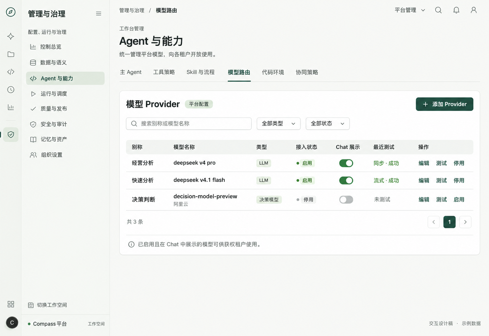
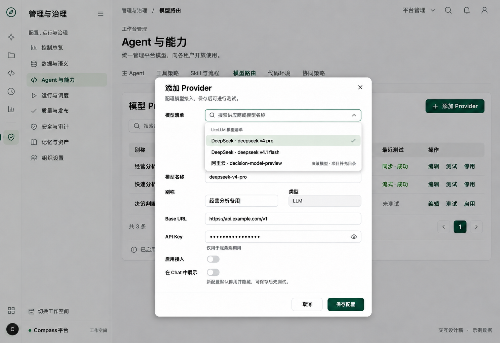
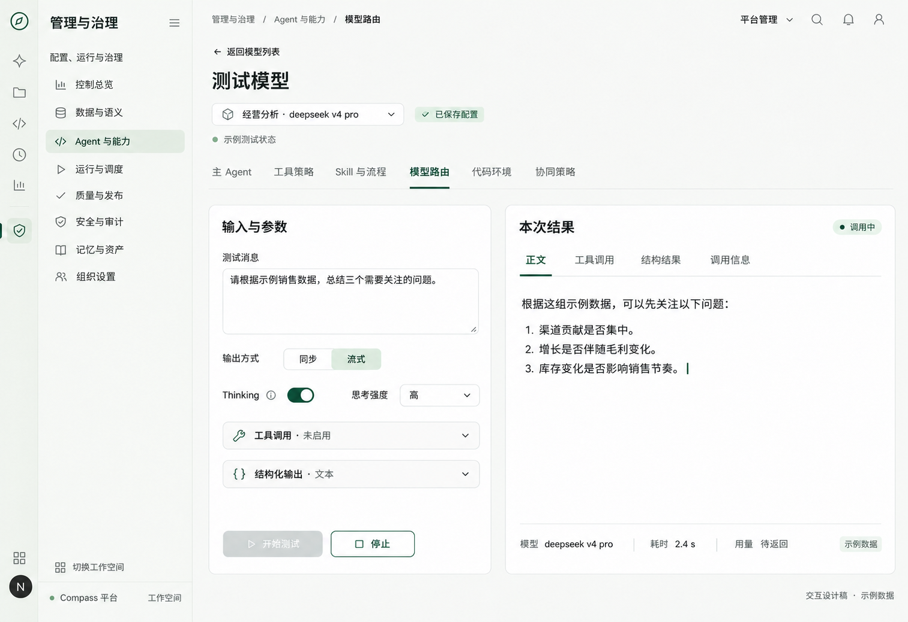
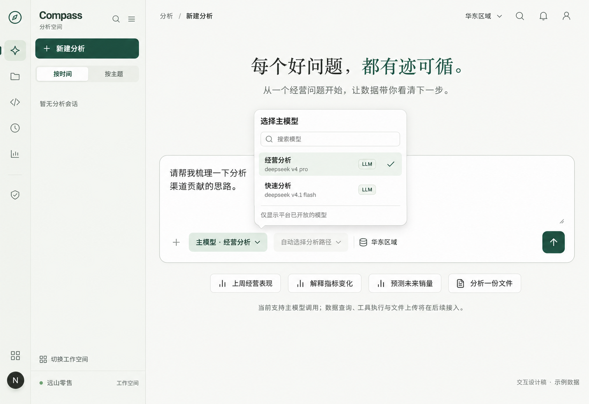

# PRD：LLM Runtime、多模型接入与轻量管理

> 状态：review（待需求负责人评审）｜Feature：993｜Phase：draft｜Profile：standard｜负责人：andy｜更新：2026-11-03

[返回需求简报](../BRIEF.md)。采用项目 [标准 PRD 模板](../../_templates/PRD.tmpl.md)；本文维护本 Feature 的功能需求、业务规则、交互文案和验收标准。后续设计与测试引用本文编号，BRIEF 保留需求概览与来源记录。

## 1. 背景与目标（Why）

### 1.1 需求依据与现状

用户已明确：支持 deepseek v4 pro、deepseek v4.1 flash、阿里云 decision-model-preview；在现有模型路由模块提供数据库持久化的 Provider 管理、LiteLLM 模型清单选择、界面能力测试；在分析 Chat 中手动选主模型；完成 DataAgent LLM Runtime 分层架构与 Web—Agent API—Runtime 贯通。2026-11-03 进一步确认，模型由**平台统一管理，向各租户提供**；随后明确 **decision-model-preview 本期仅在管理端测试，分析 Chat 只开放两款 DeepSeek LLM**。

本次核对的工程现状：

- Web 已有平台管理员、本地登录、租户与空间、个人权限、表单、弹窗、审计和导航框架。“模型路由”位于工作区的 `admin/capabilities/models`，当前为空页。
- 分析页已有问题输入框和工具栏，模型选择与发送尚未接入；没有可直接复用的真实对话执行链路。
- Agent 当前提供健康检查与固定演示查询；模型调用、模型配置持久化和可信服务间授权需在本 Feature 中交付。
- [架构材料](../context/DataAgent_LLM_Runtime_Architecture_v1.0.md) 用于分层思路参考。材料中的静态文件配置、决策厂商待定以及高级治理建议，按本 PRD 的数据库管理、指定阿里云模型和课程切片落实。

### 1.2 本期目标与完成口径

1. 平台管理员通过界面添加和维护模型，重启应用后配置仍可使用，无需编辑部署配置完成日常模型切换。
2. 管理员能逐项测试已接入模型的适用能力，看到结果、能力限制与可恢复的错误。
3. 获权租户用户能选择平台开放的两款 DeepSeek LLM Provider 作为主模型，实际调用与所选 Provider 一致。
4. 三个指定模型分别完成真实调用；两个 DeepSeek 模型覆盖适用的文本、流式、工具、Thinking 和结构化能力，决策模型通过管理端测试完成真实调用并保留自身语义。
5. 交付第 11 课所需的架构选型、职责分层、统一契约和可演示工程链路；详细设计由后续技术设计阶段完成。

本 PRD 是可评审方案。明确确认项、产品方案约定和待确认问题分别登记；外部模型的 API 标识、能力组合与端点以实际接入核验为准。功能通过条件见第 9 节，文档完成与功能验收分别记录。

## 2. 用户与场景（Who / When）

| 用户故事 ID | 目标用户     | 触发场景                 | 用户故事                                                               | 关联需求          |
| ----------- | ------------ | ------------------------ | ---------------------------------------------------------------------- | ----------------- |
| US-993-01   | 平台管理员   | 首次接入或更换供应商配置 | 在模型清单中选定模型，填写端点与密钥，保存为可维护的接入配置           | FR-993-01、02、03 |
| US-993-02   | 平台管理员   | 验证接入和能力           | 使用界面测试同步、流式、工具、Thinking、结构化或决策能力，定位失败原因 | FR-993-05、06、07 |
| US-993-03   | 平台管理员   | 开放、收回或停用模型     | 控制租户用户可选的主模型，同时保留后台测试入口和历史关联               | FR-993-04、09     |
| US-993-04   | 获权租户用户 | 在分析 Chat 发起调用     | 选择主模型并获取真实结果，知道本轮使用哪个模型和是否完整结束           | FR-993-12         |
| US-993-05   | 租户管理员   | 为成员开通使用能力       | 授予模型调用权限，并查看平台开放的模型，不接触平台凭据                 | FR-993-13         |
| US-993-06   | 开发者与学员 | 完成第 11 课实践         | 沿统一入口走通三模型，解释模块职责、错误行为和后续演进位置             | FR-993-08、10     |

## 3. 总体业务流程

### BF-993-01：配置、测试与开放

```text
平台管理员进入模型路由
  → 添加 Provider → 搜索并选择模型 → 填写别称、Base URL、API Key
  → 保存配置（默认停用、Chat 隐藏；不自动发起付费调用）
  → 打开模型测试 → 选择能力与参数 → 主动开始测试
      ├─ 成功：查看结果及本次能力记录 → 两款 DeepSeek LLM 可按需启用并开放至 Chat
      └─ 失败：查看错误 → 修改配置或输入 → 保存后重新测试
```

保存配置、测试能力、启用接入和开放至 Chat 是独立动作。一次成功测试记录具体能力与配置版本。未测试状态可保存并展示；两款 DeepSeek LLM 是否开放 Chat 由平台管理员决定；决策模型的 Chat 展示固定关闭并说明“本期仅支持管理端测试”。界面同时显示最近测试状态。关联 FR-993-01 至 FR-993-07。

### BF-993-02：用户选择主模型并调用

```text
用户进入获权租户工作区的分析页
  → 加载平台已启用且允许 Chat 展示的模型
  → 手动选择主模型 → 填写本次输入 → 发送
  → 服务端复核身份、权限、模型状态与能力
      ├─ 通过：Agent API → LLM Runtime → 所选 Provider → 返回结果
      └─ 拒绝或失败：显示原因，保留安全输入，由用户修正或重新发起
```

没有可用模型时禁用发送；模型失效时要求重新选择。请求发出后固定本轮模型和配置版本，后续切换只影响下一次调用。重试由用户显式发起，不自动换模型。Chat 列表和调用仅允许两款 DeepSeek LLM；决策模型通过独立管理端测试调用，服务端拒绝将其用于 Chat。

### BF-993-03：编辑、撤回开放与停用

```text
平台管理员打开已有 Provider
  → 修改配置 / 替换密钥 / 撤回 Chat 展示 / 停用
  → 查看影响说明 → 保存
      ├─ 成功：新请求采用新配置与状态，已有调用保留原记录
      └─ 冲突：显示配置已变化，重新加载核对后提交
```

撤回 Chat 展示只禁止新增 Chat 调用，平台管理员仍可测试；停用禁止新增普通调用，管理员仍可进行接入诊断。已发出的调用按原参数完成或由调用者停止，停用操作不追溯撤销已产生的费用。详情见 BR-993-04、05。

## 4. 功能需求（What）

### 4.1 新增需求

| 需求编号  | 触发条件                       | 输入                                                     | 预期行为                                                                                                                               | 输出/结果                                                              | 关联需求编号          |
| --------- | ------------------------------ | -------------------------------------------------------- | -------------------------------------------------------------------------------------------------------------------------------------- | ---------------------------------------------------------------------- | --------------------- |
| FR-993-01 | 平台管理员查看或维护接入       | 模型名称、别称、类型、Base URL、状态等                   | 查看列表；添加、编辑、搜索；持久化保存，保持配置身份稳定；处理重复提交与版本冲突                                                       | 重开页面或重启应用后配置可读取，变更明确反馈                           | FR-993-02、03、04、11 |
| FR-993-02 | 添加或修改模型绑定             | LiteLLM 模型目录选择、实际模型名称                       | 下拉列表支持按供应商与名称搜索，显示类型与适配支持状态；自动填充可获得的名称、端点建议，允许维护 Base URL                              | 选中目录项与实际调用模型名称可辨认，目录加载失败可重试                 | FR-993-01、05、06     |
| FR-993-03 | 新增或替换凭据                 | API Key                                                  | 安全保存；读取仅返回是否已配置；编辑默认保留原密钥；替换须明确输入新值                                                                 | 密钥可供服务端调用，列表、Chat、日志和审计不返回原文                   | FR-993-01、09         |
| FR-993-04 | 启停接入或改变开放范围         | 启用状态、在 Chat 中展示开关                             | 两款 DeepSeek LLM 的两个开关独立保存且平台全局生效；决策模型及其他目录模型本期 Chat 展示固定关闭，越界设置在服务端拒绝；保留管理端测试 | 各租户按权限获得两款 LLM 已开放的 Provider 摘要                        | FR-993-12、13         |
| FR-993-05 | 管理员测试 LLM                 | 测试消息、输出方式、工具声明、Thinking/强度、输出 Schema | 按已知能力显示选项并检查组合，发起真实调用；展示正文、工具调用、结构结果及允许展示的推理信息                                           | 六类能力均有测试路径，错误和不支持明确反馈                             | FR-993-07、08         |
| FR-993-06 | 管理员测试决策模型             | 按实际协议定义的决策上下文、问题、候选或约束             | 使用阿里云 decision-model-preview 对应协议；展示真实决策结果、字段含义与可用的用量；不套用其他厂商专有字段                             | 可独立配置、测试、识别错误的决策调用流程                               | FR-993-07、08         |
| FR-993-07 | 发起、停止或等待模型调用       | 已保存配置、本次输入、停止动作                           | 表达准备、调用中、成功、失败、取消、输出不完整；支持流式与非流式；超时和停止后清理连接                                                 | 界面有明确终态，保留本次已收到但不完整的结果标记                       | FR-993-05、06、12     |
| FR-993-08 | 测试或 Chat 调用进入 Agent API | 可信身份、Provider 配置引用、调用输入                    | 经过统一 Runtime 解析配置、校验能力、适配协议并归一化结果；三个指定模型分别真实调通                                                    | 同一工程入口承接生成与决策调用，身份与配置不串用                       | FR-993-05、06、10、12 |
| FR-993-09 | 配置变更或调用结束             | 操作者、配置、调用结果元信息                             | 记录配置变更和诊断所需元信息；平台管理记录与租户调用记录按权限隔离                                                                     | 能定位对象、配置版本、调用者、耗时、用量与错误；内容与密钥默认不落日志 | FR-993-01、03、04、07 |
| FR-993-10 | 第 11 课工程交付               | 本 PRD、参考架构与现有工程                               | 输出选型理由、分层与职责、公共契约、调用时序和后续扩展边界，并落地最小运行链路                                                         | ADR/技术设计与三模型接入演示可相互对应                                 | FR-993-08、14         |
| FR-993-14 | 首次安装或已有部署升级         | 现有应用库、配置与代码版本                               | 在所属应用交付迁移、完整/增量 SQL、升级及恢复入口；保留已有账号、租户与数据                                                            | 空库可安装、旧库可升级、配置与凭据安全可恢复                           | FR-993-01、03、09、13 |

### 4.2 既有界面与权限的变更

| 需求编号  | 触发条件                         | 输入                                              | 原行为 → 本次行为                                                                                         | 输出/结果                                                      | 关联需求编号           |
| --------- | -------------------------------- | ------------------------------------------------- | --------------------------------------------------------------------------------------------------------- | -------------------------------------------------------------- | ---------------------- |
| FR-993-11 | 进入模型路由模块                 | 当前身份与入口上下文                              | 工作区空页 → 平台管理视图与租户只读视图；平台管理员另可从平台上下文进入同一管理模块                       | 无租户成员资格的平台管理员仍可管理；保留既有导航术语与相邻空页 | FR-993-01 至 FR-993-06 |
| FR-993-12 | 在分析 Chat 选择与发送           | 两款 DeepSeek LLM 的所选 Provider、输入、输出模式 | 编辑问题且发送禁用 → LLM 下拉选择、真实发送和结果展示；决策模型仅在管理端测试，无 Chat 决策表单或自动转换 | 显示本轮模型及状态，支持停止与显式重新发送                     | FR-993-04、07、08、13  |
| FR-993-13 | 管理员授予调用权限或成员发起调用 | 现有角色、个人权限与空间范围                      | 仅有模块入口权限 → 增加可单独授权的“使用模型”动作；平台配置管理与租户调用严格分离                         | 进入页面不自动获得调用权限；既有用户无静默提权                 | FR-993-04、08、11、12  |

### 4.3 配置与生命周期

下表定义产品字段与校验，数据库结构由技术设计确定。

| 字段           | 要求与默认值                                     | 编辑与展示规则                                                                                           |
| -------------- | ------------------------------------------------ | -------------------------------------------------------------------------------------------------------- |
| 模型目录项     | 从 LiteLLM 清单选择；记录供应商及目录模型标识    | 可搜索；保留当前已配置但从新版目录移除的项并提示，已有记录不自动删除                                     |
| 模型名称       | 必填，保存实际请求使用的模型名称；目录选择可预填 | 保留原始大小写；去除首尾空白；更换后重新显示能力信息                                                     |
| 别称           | 必填，平台范围内去除首尾空白并忽略大小写后唯一   | 用于列表和 Chat 主模型选择；允许同一上游模型配置不同端点/密钥，但别称须不同                              |
| 模型类型       | LLM / 决策模型                                   | 来自目录及适配能力；无法确定时明确待配置，提交前完成校验                                                 |
| Base URL       | 必填，可用目录建议值预填，允许管理员覆盖         | 校验 URL 与允许的连接范围；禁止把凭据写入 URL；对租户用户隐藏                                            |
| API Key        | 三个指定模型首次配置必填                         | 密码输入；保存后仅显示“已配置”；编辑留空表示保持，显式替换后覆盖旧值                                     |
| 启用接入       | 默认关闭                                         | 控制新增 Chat 调用；管理员可测试停用配置；开启不自动开放 Chat                                            |
| 在 Chat 中展示 | 默认关闭；仅两款 DeepSeek LLM 可开启             | 决策模型及其他目录模型本期固定关闭，界面禁用并说明原因；服务端拒绝越界开启；最终可选还要求启用及用户获权 |
| 最近测试结果   | 系统维护，初始为未测试                           | 显示测试时间、具体能力和配置版本；模型/端点/密钥变化后标记待重新测试；别称变化不使接入测试失效           |

字段输入上限、URL 允许范围和模型参数限制在技术设计中统一登记，前后端使用同一规则；本 PRD 不引入自定义请求头、任意脚本、复杂路由策略或 Proxy 管理配置。

### 4.4 能力测试契约

| 能力            | 输入与操作                                          | 必须可见的结果与异常                                                                                      |
| --------------- | --------------------------------------------------- | --------------------------------------------------------------------------------------------------------- |
| 同步（非流式）  | 输入消息并发送，等待完整响应                        | 正文、结束状态和元信息；等待中仍能停止；超时、拒绝、空响应明确分类                                        |
| 流式            | 选择流式并发送                                      | 增量展示正文；正常结束与断流区分；停止后不继续追加；尾部用量可更新                                        |
| 工具调用        | 填写工具名称、描述及参数 Schema；可提交多条工具声明 | 显示调用标识、工具名和完整参数，区分部分参数；允许手工补入带关联标识的测试工具结果再调用；不执行真实工具  |
| Thinking 与强度 | 显式开关；按模型支持范围选择强度                    | 显示实际采用的选项、可用的推理用量或公开摘要；不支持的选项禁用或在发送前拒绝，不静默忽略                  |
| 结构化输出      | 选择 JSON 或 Schema 模式并填写约束                  | 展示结构结果及 JSON/Schema 校验状态；拒答、截断、字段不符分别反馈；保留失败输出供本次检查，不自动修复重发 |
| 决策调用        | 输入阿里云接口所需的上下文、问题和约束              | 按实际响应展示决策值、可用的评分与语义说明；检查必需字段和取值范围；不支持的流式等能力明确禁用            |

工具、Thinking、流式、结构化等组合按模型实际支持能力验证。界面保留能力不可用原因；若目录元信息未知，显示“能力待核验”，可由管理员发起受支持协议内的诊断测试，普通调用仍遵守服务端能力校验。各支持项需有独立结果，单次普通对话测试不批量改写其他能力状态。

### 4.5 Chat 的最小可用范围

- 首次进入显示主模型占位项，用户显式选择后才允许发送；同一页面内后续调用保留选择。跨租户、空间或新建对话时清空选择并重新加载列表。
- 列表显示别称、模型名称和类型。按别称稳定排序，不向租户展示 API Key、Base URL 或平台管理信息。
- LLM 模式承接现有自然语言输入，支持页面内连续对话和可见历史；本期不建设服务端会话历史、侧栏会话存储或跨刷新恢复。离开或刷新前对未保存的输入和对话给出提示。
- 请求进行中禁用切换主模型与重复发送；支持停止。调用结束后可切换主模型并开始新对话，保留切换前结果供当前页面查看；旧模型的私有状态不传给新模型。
- Chat 调用使用本轮选定 Provider；不自动做模型路由、工具执行、SQL 查询或经营报告生成。已有“自动选择分析路径”和文件上传继续保持待接入；更新页面提示为本期实际可用能力。
- 用户已确认：decision-model-preview 仅在管理端配置和测试，Chat 只开放两款 DeepSeek LLM。决策模型不出现在 Chat 列表，直接提交其 Provider ID 或决策输入到 Chat API 时在出站前拒绝；不建设 Chat 决策表单或自然语言自动转换。

## 5. UI 视觉与交互

### 5.1 现有依据与布局约定

2026-11-03 已从运行中的 Compass 页面截取[模型路由实际界面](visuals/reference-models.jpg)和[分析实际界面](visuals/reference-analysis.jpg)，并以截图作为内置 image_gen 的参考输入生成下列高保真交互状态图。保留现有双侧栏、导航、浅色背景、深绿色主操作及组件风格，结合 RES-993-03 中的源码约束形成方案。

图中模型、测试结果、耗时与开关为设计示例；图稿用于评审布局和交互状态，具体文案、权限与操作规则由本文维护。设计图为静态图，相关点击、关闭、提交及异常行为见各图下方说明。用户已确认 Chat 只开放两款 DeepSeek LLM；当前 Chat 图与这一范围一致。决策模型仅保留管理端配置和测试。

截图来源、图稿与完整生成提示词见[视觉材料说明](visuals/README.md)。

### UI-993-01：模型路由列表与配置

**IMG-993-01｜平台模型列表**



“添加 Provider”进入 IMG-993-02；每行“编辑”打开已保存配置，“测试”进入 IMG-993-03。Chat 展示开关与接入状态分别控制，停用与隐藏均按 COPY-993-15、16 提示影响后提交。

**IMG-993-02｜添加 Provider 与模型清单下拉**



图示为模型清单展开状态。选择模型后关闭下拉并预填模型名称与类型；别称、Base URL 和 API Key 可填写，两个开关默认关闭。“保存配置”只保存，“取消”或关闭按钮按未保存内容规则处理。示例 URL 使用 example.com，实际端点在接入阶段核实。

| 区域/控件  | 新增/变更与交互说明                                                                                                 | 关联需求          |
| ---------- | ------------------------------------------------------------------------------------------------------------------- | ----------------- |
| 管理入口   | 保留用户指定的模块与页签；平台管理员可从“平台管理”进入同一模型路由管理视图，无需租户成员资格；具体 URL 在设计中登记 | FR-993-11         |
| 租户视图   | 有入口权限的租户用户仅见平台开放模型的别称、名称、类型和能力摘要；管理按钮、端点、凭据及跨租户统计不展示            | FR-993-04、11、13 |
| 列表       | 复用列表搜索、分页与状态组件；默认 20 条/页，允许 50、100；空列表和搜索无结果分别表达                               | FR-993-01         |
| 表单       | 默认停用且隐藏；保存只持久化；关闭安全草稿前确认；字段错误就近显示，保存失败保留非敏感输入                          | FR-993-01、03     |
| 目录下拉   | 可搜索，键盘选择，显示供应商/名称/类型；本期未接入的调用类型标注不可添加及原因；目录失败不影响已有配置查看和调用    | FR-993-02         |
| 启停及展示 | 启用、停用和 Chat 展示按当前保存值显示；停用或撤回展示前说明对新调用的影响，确认后提交                              | FR-993-04         |

平台列表加载中显示占位且禁用修改；加载失败保留页面框架并提供重试。创建成功选中新记录；编辑成功刷新记录；保存中禁重复提交。请求响应丢失时先按同一操作标识核对保存结果，避免重复创建。版本冲突不覆盖他人修改，保留安全草稿供重新核对；密钥输入在关闭、导航离开或保存完成后清除。

### UI-993-02：模型测试

**IMG-993-03｜模型能力测试**



图示为流式测试进行中：开始按钮禁用，停止可用，用量待返回。工具调用和结构化输出区域提供各自的配置入口，本图未将所有能力同时启用。切换模式后的适用参数、非流式等待、工具参数、结构校验及失败反馈遵守 4.4 节和状态表。

决策模型使用同一测试布局，左侧按实际协议显示决策上下文、问题与约束，右侧展示决策结果；普通 LLM 参数不适用时隐藏或禁用并解释原因。

测试使用已保存配置。编辑草稿未保存时先提示保存，不提交隐藏的草稿端点或密钥。进入页面、切换能力、修改参数均不触发模型调用；用户点击“开始测试”才发起一次请求。调用中锁定本次参数，防止重复点击；停止后显示取消状态。重新测试保留安全输入，明确产生新调用。响应未知、鉴权失败或断流均不自动重发。返回或关闭运行中的测试前提示并取消本地请求；已有上游用量仍按可获得信息记录。

### UI-993-03：分析 Chat

**IMG-993-04｜分析 Chat 主模型选择**



图示为选模菜单向上展开，当前选择“经营分析”，用户可切换至“快速分析”。选择后菜单关闭，发送前复核当前模型状态；发送后锁定本轮模型并将发送按钮切换为停止。图中决策模型保持 Chat 隐藏；实际实现中该模型的 Chat 开关禁用，提示“本期仅支持管理端测试”。

主模型选择在现有输入框工具栏内独立展示，保持“自动选择分析路径”的后续能力边界。下拉只列当前可用模型；选择和重新选择不发起请求。没有模型、没有调用权限、输入为空或调用未结束时，发送按钮禁用并显示对应原因。每轮结果显示模型别称/名称与状态；错误在对应轮次内表达。更换主模型时提示将开始新对话，避免旧协议状态进入新 Provider。本期不增加 Chat 决策模式的图稿或字段，管理端决策测试按 UI-993-02 实现。

### 5.2 状态、可访问性与文案引用

| 状态            | 管理端                      | Chat                                     | 文案            |
| --------------- | --------------------------- | ---------------------------------------- | --------------- |
| 默认/空         | 无 Provider 时可添加        | 无开放模型时禁发送                       | COPY-993-01、02 |
| 加载中          | 表格/目录加载，不显示伪成功 | 加载可选模型，暂禁发送                   | COPY-993-03     |
| 权限不足        | 隐藏写入口，深链和接口拒绝  | 可读输入框，禁调用；撤权时清除受保护内容 | COPY-993-04     |
| 保存成功/失败   | 刷新结果或保留安全草稿      | 无保存动作                               | COPY-993-05、06 |
| 版本冲突        | 重新加载后核对，不覆盖      | 发送前模型失效则重新选择                 | COPY-993-07、08 |
| 运行/取消       | 显示进度、停止及终态        | 本轮锁定，停止后可重新发起               | COPY-993-09、10 |
| 断流/输出不完整 | 标明已收到的部分内容        | 本轮标为未完成，保留输入                 | COPY-993-11     |
| 能力不适用      | 禁用选项并说明限制          | 提示改选模型或参数                       | COPY-993-12     |

遵循现有键盘与焦点规范：弹窗聚焦首个可操作字段，Tab 在弹窗内顺序移动，Esc 触发关闭流程并处理未保存内容；关闭后回到触发按钮。模型下拉支持输入、方向键、Enter 和 Esc。图标按钮提供“关闭”“停止调用”等可访问名称；错误关联具体字段，流式输出使用可读的状态播报，避免逐 token 打断读屏。桌面测试区左右分栏，窄屏改为输入/结果页签；在 375、768、1440 px 下验证主操作不被遮挡。

## 6. 业务规则与约束（Rules）

### 6.1 身份与权限

| 身份/权限                          | 可执行操作                                                       | 范围                                                                         |
| ---------------------------------- | ---------------------------------------------------------------- | ---------------------------------------------------------------------------- |
| 平台管理员                         | 配置、凭据替换、启停、开放、测试、查看平台管理记录               | 全平台模型配置；平台测试记录可不绑定租户；平台资格不自动授予租户业务内容访问 |
| 租户管理员                         | 查看开放模型摘要，授予本租户成员使用权限，在自己的有效工作区调用 | 当前租户；无平台模型配置和密钥维护权限                                       |
| 有“分析入口”和“使用模型”权限的成员 | 读取可选模型、在 Chat 调用                                       | 当前获权租户/工作区；不能查看其他用户调用正文                                |
| 仅有“Agent 与能力入口”的成员       | 在租户视图查看开放模型摘要                                       | 不获得平台管理、测试或 Chat 调用权限                                         |
| 无有效身份、成员关系或所需权限者   | 拒绝受保护读取和调用                                             | 直接 ID、深链、绕过 UI 请求遵循相同约束                                      |

“使用模型”为本期新增可授权业务动作，权限标识由技术设计登记。遵循既有租户/空间允许项合并规则；旧用户不因升级自动获得新动作，租户管理员通过现有个人权限界面明确授予。新分析师模板可包含该动作，模板变更只作用于之后显式应用模板的操作。平台管理员业务调用仍须有效租户身份和权限；平台测试使用明确的平台测试上下文，不构造虚假租户。

### 6.2 业务规则

| 规则 ID   | 规则                                                                                                                                                                                                                                     | 关联需求                  |
| --------- | ---------------------------------------------------------------------------------------------------------------------------------------------------------------------------------------------------------------------------------------- | ------------------------- |
| BR-993-01 | Provider 配置属于平台统一模型目录；不维护租户自有密钥或逐租户分配。Chat 仅开放 deepseek v4 pro、deepseek v4.1 flash 的已启用且可见 Provider；decision-model-preview 仅管理端配置和测试。其他目录项保留管理/适用测试能力，本期不开放 Chat | FR-993-01、04、06、12、13 |
| BR-993-02 | 名称与配置身份分开：调用提交稳定的 Provider 引用，别称改名不改变身份；服务端解析模型、Base URL 和密钥，Chat 请求不得覆盖这些字段                                                                                                         | FR-993-01、08、12         |
| BR-993-03 | 保存配置不自动调用或收费；一次按钮操作最多创建一项配置或一次本地调用。响应未知时提示核对，调用重发需显式操作                                                                                                                             | FR-993-01、05、07         |
| BR-993-04 | 新配置默认停用且 Chat 隐藏；管理员测试允许停用配置。停用后的新增 Chat 请求拒绝，展示开关值保留；再次启用前提示是否恢复 Chat 可见性                                                                                                       | FR-993-04、12             |
| BR-993-05 | 每次调用固定配置版本；配置保存后，后续新调用须读取最新有效版本。停用/撤回展示不强制中止已发出的上游请求；禁止自动改路到其他模型                                                                                                          | FR-993-04、07、08         |
| BR-993-06 | 模型/端点/密钥变更使原测试结论成为旧版本结果；每项测试仅证明对应能力及组合。目录元信息与真实联调结果分别标识                                                                                                                             | FR-993-02、05、06、09     |
| BR-993-07 | API Key 原文仅在录入或替换时由管理员提交；读取、审计、错误、导出和浏览器持久化不包含原文；平台保存可恢复使用的受保护凭据                                                                                                                 | FR-993-03、09、14         |
| BR-993-08 | 能力不支持、参数冲突、鉴权失败、限流、超时、断流、拒答、格式校验失败应有稳定类别。禁止静默丢弃关键参数、自动降级或把不完整结果标为完成                                                                                                   | FR-993-05、06、07、08     |
| BR-993-09 | 本期默认一次上游尝试；关闭或明确管控 SDK 隐含重试，避免用户点击一次发生多次不可见付费调用。Retry/Fallback 策略在后续课程展开                                                                                                             | FR-993-07、08、09         |
| BR-993-10 | Tool Calling 返回工具请求与参数；测试可人工填写工具结果继续调用。Runtime 不执行工具或业务代码；未完整解析的工具参数不可展示为可执行成功结果                                                                                              | FR-993-05、08             |
| BR-993-11 | Thinking 开关和强度按模型能力明确传递；厂商协议所需状态可由服务端维护，用户展示只包含可公开的摘要或执行信息，不暴露模型私密原始思维链                                                                                                    | FR-993-05、08             |
| BR-993-12 | 请求使用可信身份；Agent 复核平台权限或当前租户/空间调用权限。Web、Agent 任一授权核验不可用时拒绝调用；用户输入不覆盖身份                                                                                                                 | FR-993-08、13             |
| BR-993-13 | 用户失权、切换租户或空间时停止本地请求并清除受保护内容；新请求实时复核，前台失权清屏沿用既有最长 30 秒约定，重连/恢复先复核                                                                                                              | FR-993-07、12、13         |
| BR-993-14 | 最小调用记录包含调用 ID、用途、操作者、适用的租户/空间、Provider ID、配置版本、请求/响应模型、状态、耗时、可得用量及错误类别。未知用量显示未知，金额估算不作为本期承诺                                                                   | FR-993-07、09             |
| BR-993-15 | 默认不持久化 Prompt、回复正文、Thinking 原文和测试工具结果；本页可见输入/输出只在授权页面生命周期内保留。配置与诊断元记录本期无自动清理，后续保留策略另行登记                                                                            | FR-993-09、12、14         |
| BR-993-16 | 管理审计覆盖创建、编辑、密钥替换、启停、开放范围、测试及拒绝操作，记录结果与对象版本并脱敏；租户用户不能读取平台测试内容或其他租户记录                                                                                                   | FR-993-09、13             |

### 6.3 数据所有权与兼容

| 对象/行为                                    | 所有者与持久化     | 保留及兼容要求                                                                             |
| -------------------------------------------- | ------------------ | ------------------------------------------------------------------------------------------ |
| 平台模型配置、受保护凭据、配置版本、测试摘要 | `agent/main`       | 数据库为配置维护源；模型停用保留引用；本期无永久删除入口；不把现有参考 TOML 建成平行配置源 |
| 模型调用及平台模型操作元记录                 | `agent/main`       | 与配置、调用版本关联；由 Agent 提供受权读取；Web 不直连 Agent 业务表                       |
| 账户、平台资格、租户/空间与动作授权          | `web/main`         | 复用现有体系；新增动作登记同步个人权限 UI；不重置旧清单或提升旧成员权限                    |
| Web 自有身份、权限与访问审计                 | `web/main`         | 保留现有审计语义；跨服务记录用关联 ID 定位，不假定跨库事务                                 |
| Chat 输入/输出与本页模型选择                 | 当前授权页面内状态 | 本期无服务端会话历史；切换上下文或离开时清理，凭据不进入浏览器存储                         |

迁移遵循 [数据库规范](../../../docs/database-migrations.md)。后续设计须登记各 app 的起止版本、不可变迁移源、完整/增量 SQL、执行与恢复顺序；实现验证空库、旧库、权限、SQL 生成一致性及恢复。既有 M0 演示、Web 登录与普通工程 CRUD 保持可用。Agent 或模型服务离线只影响相关管理/调用，Web 基础功能仍能独立运行。

### 6.4 非功能要求

| 非功能 ID  | 要求                                   | 验证口径                                                                                                                         |
| ---------- | -------------------------------------- | -------------------------------------------------------------------------------------------------------------------------------- |
| NFR-993-01 | 凭据隔离、输出转义、受管端点与可信身份 | 使用专用测试密钥检查 API、日志、审计、浏览器存储及异常路径；验证非法端点和跨租户/平台越权被拒绝                                  |
| NFR-993-02 | 调用可停止、等待有时限、流式资源可释放 | 覆盖首包前/后停止、断网、超时、消费者离开；最终状态明确，连接与本地任务释放；具体时限由技术设计给出配置与默认值                  |
| NFR-993-03 | 并发隔离与配置一致性                   | 两租户并行使用不同 Provider、配置修改期间调用；模型、密钥、输入、用量与响应不得串用；新请求按新版本执行                          |
| NFR-993-04 | 可访问与响应式                         | 键盘完成添加、选择、测试、停止；验证焦点、状态文案与 375/768/1440 px 布局                                                        |
| NFR-993-05 | 流式与列表可响应                       | 等待模型时界面保持可操作；不无界缓冲分片；列表分页；记录代表性长输出的首段时间、结束时间和取消响应，性能阈值在设计时结合环境确定 |
| NFR-993-06 | 安装、升级和回退可验证                 | 专用 PostgreSQL 上验证空库安装、旧库升级与数据保留、生成 SQL 一致性、最小权限及恢复；模块导入/启动不隐式迁移                     |

## 7. 范围与边界（Scope）

**包含**：FR-993-01 至 FR-993-14；平台统一接入管理、两个模型类别、六类能力测试、三模型真实接入、Chat 手动选模、最小连续对话、权限与元记录、Runtime 分层设计及本课演示。

**不包含**：LiteLLM Proxy 平台、Virtual Key 管理、逐租户模型采购与分配、租户自有 Provider、智能路由、负载均衡、多级自动 Fallback、全局限流与预算账本、价格运营、完整 Trace/Replay、模型发布审批、Agent Loop、工具/SQL 实际执行、Memory、文件上传、图片/音视频全覆盖、持久会话历史和后台长任务。

**依赖与门槛**：真实模型账号、API Key、端点和调用额度由有权人员提供；在获得这些条件前可完成本地契约与界面验证，三模型真实联调验收保持未执行。新接口必须同步生成契约、Web 校验和相关检查；具体 API、库版本及配置更新机制由技术设计负责。第 11 课教学页级大纲仍待负责人批准，本 PRD 不代替课程批准。

## 8. 研发资源

### 8.1 来源与现有资产

| 资源 ID    | 类型                   | 链接/位置                                                                                                                                                                                                                                                                                            | 用途与核验范围                                                                                    |
| ---------- | ---------------------- | ---------------------------------------------------------------------------------------------------------------------------------------------------------------------------------------------------------------------------------------------------------------------------------------------------- | ------------------------------------------------------------------------------------------------- |
| RES-993-01 | 需求输入               | [BRIEF](../BRIEF.md)、[上下文索引](../context/_INDEX.md)                                                                                                                                                                                                                                             | 已读取；2026-11-02 三模型、2026-11-03 产品范围及平台统一管理为明确用户要求                        |
| RES-993-02 | 架构参考               | [DataAgent LLM Runtime 架构](../context/DataAgent_LLM_Runtime_Architecture_v1.0.md)                                                                                                                                                                                                                  | 已读取；供后续选型参考，原文保留；决策协议及依赖候选尚未在本工程联调                              |
| RES-993-03 | 当前 UI 源码           | [页面目录](../../../apps/web/src/lib/page-catalog.ts)、[分析输入框](../../../apps/web/src/components/analysis-composer.tsx)、[表单组件](../../../apps/web/src/components/ui/entity.tsx)、[弹窗](../../../apps/web/src/components/ui/dialog.tsx)、[视觉 token](../../../apps/web/src/app/globals.css) | 已读取源码并截取运行中页面；高保真图沿用现有结构与视觉，未实施目标 UI                             |
| RES-993-04 | 权限基线               | [权限目录](../../../apps/web/src/server/modules/access/domain/permissions.ts)、[权限规则](../../../apps/web/src/server/modules/access/domain/access-policy.ts)、[995 PRD](../../995-web-management-foundation/spec/PRD.md)                                                                           | 已读取；平台资格、租户权限、空间允许项和默认拒绝保持兼容                                          |
| RES-993-05 | 产品目标               | [999 PRD](../../999-compass-product-course-landing-app/spec/PRD.md) 的 FR-11、AC-11.1、AD-14                                                                                                                                                                                                         | 本 Feature 落地模型配置与能力部分，复杂路由及预算仍在后续范围；原编号保留                         |
| RES-993-06 | Agent 现状             | [Agent README](../../../apps/agent/README.md)、[当前路由](../../../apps/agent/src/compass_agent/main.py)                                                                                                                                                                                             | 已读取；当前只有健康与演示接口，本期新增链路不能沿用历史联调结果结项                              |
| RES-993-07 | 数据约束               | [数据库规范](../../../docs/database-migrations.md)、[Web 数据库](../../../apps/web/db/main/README.md)                                                                                                                                                                                                | 用于所有权、迁移与恢复设计                                                                        |
| RES-993-08 | 目录与能力元信息参考   | [LiteLLM 模型目录](https://github.com/berriai/litellm/blob/main/model_prices_and_context_window.json)、[SDK 能力查询源码](https://github.com/berriai/litellm/blob/main/litellm/utils.py)                                                                                                             | 2026-11-03 经 Context7 核对官方仓库的模型目录与能力元信息机制；未据此确认三个目标模型的完整兼容性 |
| RES-993-09 | 既有验证入口           | [Web 浏览器测试](../../../apps/web/tests/e2e/foundation.spec.ts)、[权限测试](../../../apps/web/tests/domain/access-policy.test.ts)、[迁移测试](../../../apps/web/tests/integration/migrations.integration.ts)                                                                                        | 已定位；后续扩展复用，不作为本需求已通过记录                                                      |
| RES-993-10 | 高保真交互图与实际截图 | [视觉材料](visuals/README.md)、[生成提示词](visuals/prompts.json)                                                                                                                                                                                                                                    | 2026-11-03 实际浏览器截图与内置 image_gen 生成的四张静态交互状态图；已逐图检查，未运行目标交互    |

### 8.2 界面文案契约

以下为本 PRD 拟定的实施文案，集中维护；线框中的示例数据不作为初始化数据。动态值使用纯文本展示，长名称截断时可查看完整值；未知元信息显示“未知”，不显示零。

| 文案 ID     | 位置/触发状态      | 最终文字                                                              | 变量与规则                                           |
| ----------- | ------------------ | --------------------------------------------------------------------- | ---------------------------------------------------- |
| COPY-993-01 | 平台无配置         | 暂无模型 Provider。添加后可进行接入测试。                             | 主按钮：添加 Provider                                |
| COPY-993-02 | Chat 无可选模型    | 暂无可用模型，请联系管理员。                                          | 禁用发送                                             |
| COPY-993-03 | 模型目录加载失败   | 模型清单加载失败，请重试。                                            | 操作：重新加载；保留已有配置                         |
| COPY-993-04 | 无调用权限         | 你暂无使用模型的权限，请联系租户管理员。                              | 管理拒绝使用：仅平台管理员可管理模型接入。           |
| COPY-993-05 | 保存成功           | 模型配置已保存。                                                      | 不使用“连接成功”                                     |
| COPY-993-06 | 保存失败           | 保存失败，请检查提示后重试。                                          | 字段错误就近展示，密钥原文不出现在错误中             |
| COPY-993-07 | 版本冲突           | 配置已被更新，请重新加载并核对修改。                                  | 操作：重新加载                                       |
| COPY-993-08 | 所选模型失效       | 当前模型已不可用，请重新选择。                                        | 保留本页安全输入                                     |
| COPY-993-09 | 调用中             | 正在调用 {alias}…                                                     | alias 为已保存别称；操作：停止                       |
| COPY-993-10 | 取消完成           | 已停止本次调用，已产生的用量仍可能计费。                              | 已知用量按实际展示                                   |
| COPY-993-11 | 输出中断           | 输出未完成。你可以检查当前结果后重新发送。                            | 不自动重发；已收到内容标记为部分结果                 |
| COPY-993-12 | 能力不支持         | 当前模型不支持 {capability}，请调整选项或更换模型。                   | capability 使用界面能力名                            |
| COPY-993-13 | Chat 模型选择      | 请选择主模型                                                          | 控件可访问名：主模型                                 |
| COPY-993-14 | 新建/编辑凭据      | API Key                                                               | 编辑提示：已配置。留空保持原密钥；替换时输入新密钥。 |
| COPY-993-15 | 停用确认           | 停用“{alias}”后，将拒绝新的 Chat 调用。已发出的调用继续按原配置处理。 | 操作：取消 / 停用                                    |
| COPY-993-16 | 撤回展示确认       | 从 Chat 中隐藏“{alias}”后，用户将无法发起新的调用。管理员仍可测试。   | 操作：取消 / 隐藏                                    |
| COPY-993-17 | 鉴权失败           | 模型认证失败，请检查 API Key 与接入权限。                             | 不回显上游认证原文                                   |
| COPY-993-18 | 超时               | 本次调用已超时，请检查服务状态或稍后重试。                            | 保留输入，不自动重发                                 |
| COPY-993-19 | 结构校验失败       | 输出不符合指定结构，请检查结果或调整输出要求。                        | 可定位字段，不包含密钥                               |
| COPY-993-20 | 未保存测试         | 请先保存配置，再开始测试。                                            | 操作：返回编辑                                       |
| COPY-993-21 | 配置改动后         | 配置已变化，请重新测试。                                              | 展示原测试时间与能力，标注旧版本                     |
| COPY-993-22 | 更换主模型         | 更换主模型将开始新对话，当前结果保留在本页。                          | 操作：取消 / 更换模型                                |
| COPY-993-23 | 离开未保存内容     | 离开后将清除本页未保存的输入和对话。                                  | 操作：继续编辑 / 离开                                |
| COPY-993-24 | 搜索无结果         | 没有匹配的模型。                                                      | 操作：清除筛选                                       |
| COPY-993-25 | 本期 Chat 能力提示 | 当前支持主模型调用；数据查询、工具执行与文件上传将在后续接入。        | 替换既有整段“分析执行待接入”说明                     |
| COPY-993-26 | 调用结果未知       | 尚未确认本次调用结果。重新发送可能产生新的用量。                      | 禁止自动重试；操作：重新发送                         |
| COPY-993-27 | 上游限流/不可用    | 模型服务暂不可用，请稍后重试。                                        | 调用信息分别标记限流/服务不可用                      |
| COPY-993-28 | 保存结果未知       | 尚未确认配置是否已保存，请先刷新核对。                                | 操作：核对保存结果                                   |

### 8.3 模型与状态枚举

| 项目       | 值与含义                                                         | 默认/验证要求                                                |
| ---------- | ---------------------------------------------------------------- | ------------------------------------------------------------ |
| 首期模型一 | deepseek v4 pro：旗舰模型                                        | 具体 API 标识待接入核实；不写入虚构密钥或自动创建可调用账号  |
| 首期模型二 | deepseek v4.1 flash                                              | 与 Pro 分别记录能力参数及测试结果                            |
| 首期模型三 | decision-model-preview：阿里云决策模型                           | 厂商已确定；不采用参考材料中的 TypeSafe/JEV 字段作为既定契约 |
| 接入状态   | 启用 / 停用                                                      | 新增默认停用                                                 |
| Chat 展示  | 展示 / 隐藏                                                      | 新增默认隐藏；与接入状态共同决定可选性                       |
| 测试状态   | 未测试 / 测试中 / 成功 / 失败 / 已取消 / 输出不完整 / 待重新测试 | 绑定能力、组合与配置版本；不作为所有能力的统一成功标记       |
| 调用状态   | 准备中 / 调用中 / 已完成 / 失败 / 已取消 / 输出不完整            | 一次调用最终只形成一个确定的本地终态，另保留上游结果是否未知 |
| 用量       | 厂商返回 / 可解释估算 / 未知                                     | 本期以实际可得值展示；未知不记零，不承诺费用估算功能         |

三个模型是本期必须联调的集合，Provider 新增能力继续支持已接入协议覆盖的其他目录模型。目录收录、适配能力和真实联调状态分别显示；本期不声称全部 LiteLLM 目录模型均已通过验证。目录中缺失指定模型时，在技术设计核实协议后提供有来源的补充目录项，仍通过相同下拉与配置流程接入。

## 9. 验收标准（Acceptance Criteria）

以下均为待实现验收场景。表中“前置 / 操作 / 预期”分别对应 Given / When / Then。新增编号归本 Feature 维护；未将参考架构的测试建议直接登记为通过。

| AC 编号   | 前置 / 操作                                                                                                            | 可判定预期                                                                                                                           | 关联需求/规则                    | 验证方式                           |
| --------- | ---------------------------------------------------------------------------------------------------------------------- | ------------------------------------------------------------------------------------------------------------------------------------ | -------------------------------- | ---------------------------------- |
| AC-993-01 | 平台管理员没有任何租户成员关系；从平台上下文进入模型路由并新增配置                                                     | 可管理与测试；配置为平台范围；新建默认停用且隐藏；不要求伪造租户                                                                     | FR-993-01、11；BR-993-01         | 浏览器 + API                       |
| AC-993-02 | 配置保存成功；刷新页面并重启相关应用                                                                                   | 别称、名称、端点、开关仍存在，服务端仍能解析凭据；未产生自动模型请求                                                                 | FR-993-01、03、14；BR-993-03     | PostgreSQL 集成 + 浏览器           |
| AC-993-03 | 双击保存、两个标签页并发编辑、保存响应丢失                                                                             | 无重复配置；后提交的旧版本不覆盖新值；可按原操作核对结果并恢复安全草稿                                                               | FR-993-01；BR-993-03             | API 并发/故障 + 浏览器             |
| AC-993-04 | 添加 Provider；搜索供应商/模型、键盘选择、更改端点并保存                                                               | 可找到受支持目录项，名称与类型明确，端点保存为输入值；未经支持的类型不能提交                                                         | FR-993-02                        | 浏览器 + 目录契约                  |
| AC-993-05 | 目录加载失败、无匹配项或升级后条目移除                                                                                 | 错误与无结果可区分；已有配置不丢失，仍可读取与调用；目录补充项有来源                                                                 | FR-993-02；BR-993-06             | 目录故障/升级样本                  |
| AC-993-06 | 新建密钥、留空编辑、替换密钥；读取页面、API、日志与浏览器存储                                                          | 留空保持旧密钥，替换只影响新调用；各读取通道不含密钥原文，异常日志同样脱敏                                                           | FR-993-03；BR-993-07             | 专用测试密钥 + 安全断言            |
| AC-993-07 | 平台开放同一模型；两个租户的获权成员加载列表                                                                           | 两租户均可选择；只能获得开放模型摘要；无端点、密钥和其他租户信息                                                                     | FR-993-04、12、13；BR-993-01     | 两租户 API + 浏览器                |
| AC-993-08 | Chat 已选模型后被隐藏或停用；用户再发送；另有在途调用                                                                  | 新调用被拒绝并要求重新选择；在途调用不被重新路由；启用与展示开关效果可分别验证                                                       | FR-993-04、07、12；BR-993-04、05 | 并发配置/调用测试                  |
| AC-993-09 | 普通租户管理员、仅入口权限成员直达平台管理 API 或测试 API                                                              | 写入、凭据操作和平台测试拒绝；租户视图仅见开放摘要；不因入口权限获得执行权                                                           | FR-993-11、13；BR-993-12         | 角色矩阵 + 深链测试                |
| AC-993-10 | 两款 DeepSeek 各自配置；在界面发起非流式测试                                                                           | 分别返回实际模型结果，结束状态、请求标识、耗时和可得用量可见；空/拒绝结果单独表达                                                    | FR-993-05、08                    | 两模型真实联调 + 故障样本          |
| AC-993-11 | 两款 DeepSeek 发起流式测试，覆盖正常结束、尾部用量和中途断流                                                           | 正常逐步展示且用量不丢；断流标不完整，保留部分内容，不重发或拼接其他调用                                                             | FR-993-05、07；BR-993-08、09     | 真实流式 + 可控断流                |
| AC-993-12 | 为支持工具能力的模型提交多个工具声明，模拟参数分片，补入测试工具结果                                                   | 工具标识与参数不串线；完整参数通过检查，半截结果标不完整；结果回填关联正确；没有业务工具执行                                         | FR-993-05；BR-993-10             | 真实工具调用 + 适配契约            |
| AC-993-13 | 分别切换 Thinking、选择模型支持的不同强度及不支持组合                                                                  | 请求参数按选择生效；不支持组合在发送前明确拒绝；界面不显示私密原始思维链；协议所需状态可正确往返                                     | FR-993-05、08；BR-993-11         | 参数契约 + 真实联调                |
| AC-993-14 | 提交 JSON/Schema 输出要求，覆盖正常、格式错误、字段缺失、拒绝和截断                                                    | 区分 JSON 解析与 Schema 校验结果；不合规结果不标成功，不自动修复重发                                                                 | FR-993-05、07；BR-993-08         | 真实结构输出 + 故障样本            |
| AC-993-15 | 调用模型不支持的能力或目录未知能力；尝试通过请求覆盖关键参数                                                           | UI/API 按同一能力规则反馈；没有静默丢参数；请求不能覆盖服务端端点、密钥或身份                                                        | FR-993-05、06、08；BR-993-02、08 | 参数与权限负例                     |
| AC-993-16 | 配置阿里云 decision-model-preview；提交合法与非法决策输入                                                              | 真实合法请求返回类型化结果及字段含义；非法输入/异常响应明确失败；仅按其实际协议展示能力                                              | FR-993-06、08                    | 阿里云真实联调 + 响应样本          |
| AC-993-17 | 首包前、输出中点击停止，或离开测试/Chat 页面                                                                           | 本地最终状态取消，停止追加结果，连接/任务释放；不自动重发；用量未知时显示未知                                                        | FR-993-07；NFR-993-02            | 前后端取消/资源测试                |
| AC-993-18 | 上游鉴权失败、限流、超时、拒绝、不可用、响应丢失；用户重复点击                                                         | 稳定错误类别和可执行提示；无无界等待、隐藏多次调用或自动换模型；显式重发产生新调用 ID                                                | FR-993-07、08；BR-993-03、08、09 | 可控 Provider 故障                 |
| AC-993-19 | 两租户并发调用不同 Provider，过程中替换配置                                                                            | 请求使用正确身份/配置/密钥；响应和元记录不串用；新请求采用更新后版本，在途请求保持原版本                                             | FR-993-08、09；NFR-993-03        | 并发集成                           |
| AC-993-20 | Web 发起测试与 Chat；跟踪 Agent API、Runtime 和上游                                                                    | 两入口均经过统一 Runtime；实际调用模型匹配选择；公共结果与错误可由 Web 校验；Demo 接口保持隔离                                       | FR-993-08、10、12                | 契约生成检查 + 链路集成            |
| AC-993-21 | 创建、改名、替换密钥、启停、开放、测试成功/失败                                                                        | 操作与调用元信息可按关联 ID 定位；旧配置关联保留；记录无正文/密钥，未知用量非零；平台与租户读取范围正确                              | FR-993-09；BR-993-14、15、16     | 审计/记录集成                      |
| AC-993-22 | 获权用户首次打开 Chat、无可用模型、选择 LLM 后发送                                                                     | 未选时禁发送；有选择后真实调用并显示模型；连续对话保留本页历史；“数据查询/文件上传”仍准确标示未接入                                  | FR-993-12；UI-993-03             | 浏览器端到端                       |
| AC-993-23 | LLM 调用中重复发送、结束后换模型、切租户/空间或离开                                                                    | 在途禁重复和换模；换模以新上下文开始；切空间清空选择与敏感内容；离开给出提示；无后台自动持久化正文                                   | FR-993-12；BR-993-13、15         | 浏览器状态与存储检查               |
| AC-993-24 | 已保存阿里云决策模型；查看 Chat 列表、尝试开启其 Chat 展示、直接向 Chat API 提交决策 Provider/输入；再以平台管理员测试 | Chat 不列出决策模型及两款 LLM 以外的模型；非法开启或调用在出站前拒绝；配置改绑为非 Chat 模型时须关闭展示；管理端决策测试仍可真实调用 | FR-993-04、06、12；BR-993-01     | 浏览器 + API 负例 + 阿里云真实联调 |
| AC-993-25 | 旧成员仅有分析入口；管理员显式授予/撤销使用权限；绕过 UI 调用                                                          | 升级不授予新动作；授予后仅在获权范围调用；撤销后新请求拒绝，在线前台最长 30 秒清屏，重连先复核                                       | FR-993-13；BR-993-12、13         | 权限/撤权回归                      |
| AC-993-26 | 完成架构设计与实现，演示三模型入口                                                                                     | 选型、职责、契约和调用链可对应实际代码；业务调用未散落 SDK；后续路由/可靠性/治理边界明确                                             | FR-993-10                        | 技术设计审查 + 工程演示            |
| AC-993-27 | 直接伪造平台资格、租户/空间、配置 ID 或上游端点；授权服务不可用                                                        | 拒绝越权和非受管端点；身份来源可信；平台资格不读取租户私有对话；授权异常不继续调用                                                   | FR-993-03、08、13；NFR-993-01    | API 安全与故障测试                 |
| AC-993-28 | 专用 PostgreSQL 空库与带旧业务数据的库分别安装/升级/恢复                                                               | 原生迁移及 SQL 一致；旧账号/租户/数据不丢；配置和受保护凭据可恢复；运行凭据无额外跨库权限                                            | FR-993-14；NFR-993-06            | 数据库集成与恢复演练               |
| AC-993-29 | 375/768/1440 px，纯键盘操作管理、目录选择、测试与 Chat                                                                 | 控件可达、焦点可回、状态可读、主操作可见；危险或影响开放范围的动作有明确确认                                                         | FR-993-11、12；NFR-993-04        | 浏览器可访问与视觉检查             |
| AC-993-30 | Agent/模型服务离线或启用本需求后运行原功能                                                                             | 模型相关页显示真实错误；登录、组织管理、既有权限及 M0 合成演示按原契约工作；错误不显示假成功                                         | FR-993-08、11、14                | 基座回归 + 故障集成                |

业务测试需覆盖 BF-993-01 至 BF-993-03。后续测试规划优先复用 Web 的权限、页面、迁移基线，再补平台作用域、跨应用授权、目录、流式取消、Chat 选模和三模型真实联调；Mock 与真实调用结果分别记录。当前未创建测试计划或执行功能测试，技术设计完成后再按稳定契约细化场景。

## 待确认事项

| 问题/假设                                                             | 来源与当前建议                                                                                                                                   | 影响范围                                  | 是否阻塞                                   | 决策人/状态              |
| --------------------------------------------------------------------- | ------------------------------------------------------------------------------------------------------------------------------------------------ | ----------------------------------------- | ------------------------------------------ | ------------------------ |
| OQ-993-01：决策模型的 Chat 范围（已关闭）                             | 2026-11-03 用户确认“本期仅在管理端测试决策模型，Chat 只开放两款 LLM”；已同步配置约束、Chat 入口与 AC                                             | FR-993-04、06、12、UI-993-03、AC-993-24   | 不再阻塞设计；管理端决策测试仍为必做       | 需求负责人，已确认       |
| OQ-993-02：阿里云模型的实际协议、端点、账号权限及请求样例             | 2026-11-03 已按阿里官方文档核实 System One 协议及工作区端点，见[技术方案](../design/TECH_DESIGN.md)第 3 节；实际工作区/地域/账号权限待接入方配置 | FR-993-06、08、AC-993-16、24              | 协议设计已收口；账号条件阻塞真实联调       | 接入负责人，实施前配置   |
| OQ-993-03：三模型 API 标识、支持参数与能力组合                        | 三模型 API 标识及公开能力已核实，映射与限制见[技术方案](../design/TECH_DESIGN.md)第 3 节；锁定 SDK 的参数与流行为纳入 T01                        | FR-993-02、05、06、AC-993-10 至 AC-993-16 | 实施首步验证 SDK 兼容性，再完成真实联调    | 实施负责人，T01/T08 验证 |
| OQ-993-04：联调环境、凭据提供方式和调用费用额度                       | 不在仓库登记真实密钥；由获权人员配置到测试环境                                                                                                   | 三模型真实联调                            | 阻塞付费真实调用；不阻塞规格与离线测试设计 | 接入负责人，实施前确认   |
| A-993-01：默认停用/隐藏、无硬删除、手动初选、页面内对话、正文不持久化 | 本 PRD 为控制本课范围提出的产品方案；未表述为用户逐项确认                                                                                        | FR-993-01、04、09、12                     | 可随本次 PRD 评审调整                      | 需求负责人，待评审       |
| A-993-02：平台开放即供所有获权租户使用，无逐租户分配                  | 依据用户“平台统一管理，向各租户提供模型”及轻量管理要求细化                                                                                       | FR-993-04、13                             | 可随评审调整；若增加分配须同步权限和 AC    | 需求负责人，待评审       |

## 变更记录

| 日期       | 变更及依据                                                                                                         | 影响范围                                                     |
| ---------- | ------------------------------------------------------------------------------------------------------------------ | ------------------------------------------------------------ |
| 2026-11-03 | 基于 BRIEF、用户补充、参考架构及现有工程生成首版标准 PRD；纳入用户确认的平台统一管理；登记决策模型 Chat 交互待确认 | FR-993-01 至 FR-993-14、AC-993-01 至 AC-993-30               |
| 2026-11-03 | 按用户要求，用运行中页面截图及 image_gen 高保真图替换 UI 文字线框；关联视觉来源与生成提示词                        | UI-993-01 至 UI-993-03、IMG-993-01 至 IMG-993-04、RES-993-10 |
| 2026-11-03 | 技术设计核实三模型公开协议与 API 标识，更新 OQ-993-02/03 的进展；决策 Chat 的业务选择继续待用户确认                | 待确认事项；功能与 AC 范围保持                               |
| 2026-11-03 | 用户确认决策模型仅管理端测试、Chat 只开放两款 DeepSeek LLM；关闭 OQ-993-01，明确展示/调用拒绝规则并改写 AC-993-24  | FR-993-04、06、12、BR-993-01、UI-993-03、AC-993-24           |
