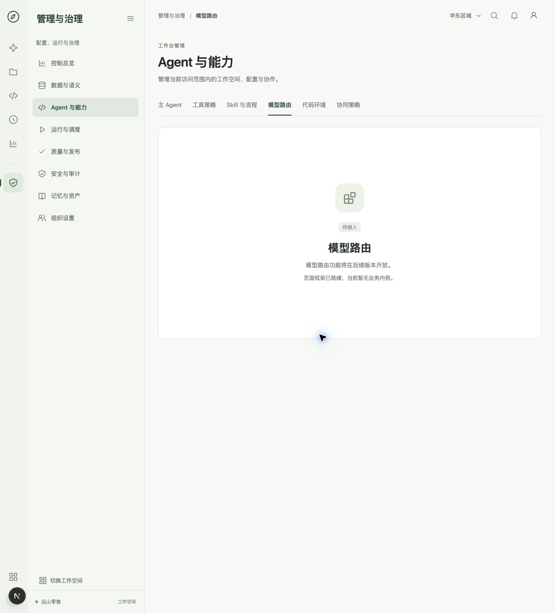
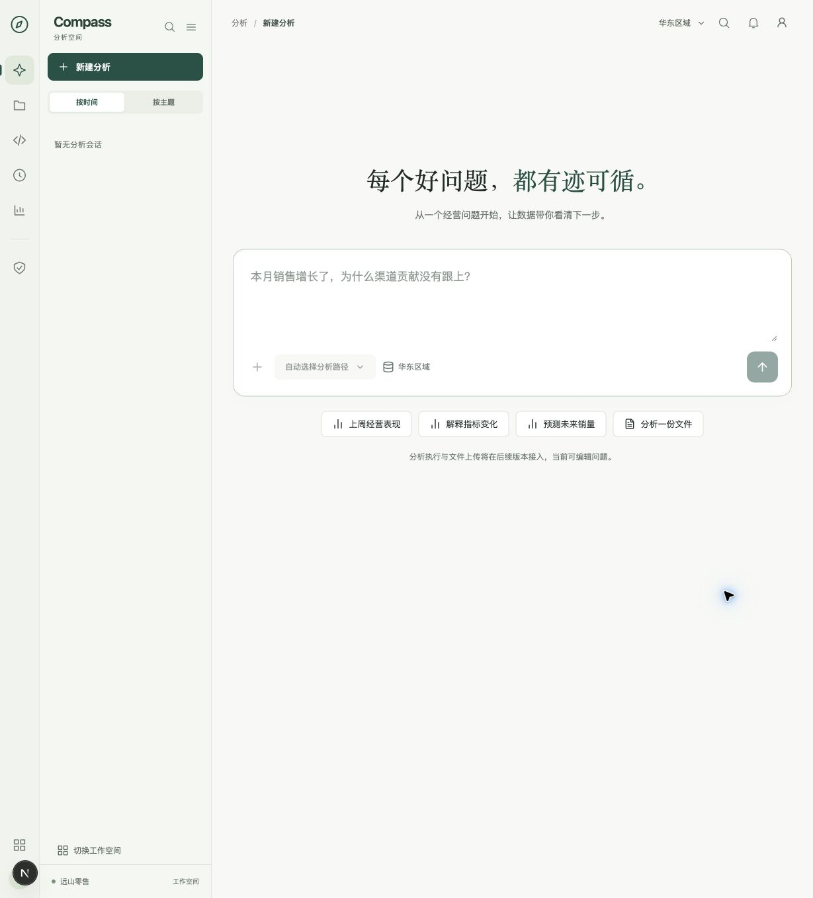
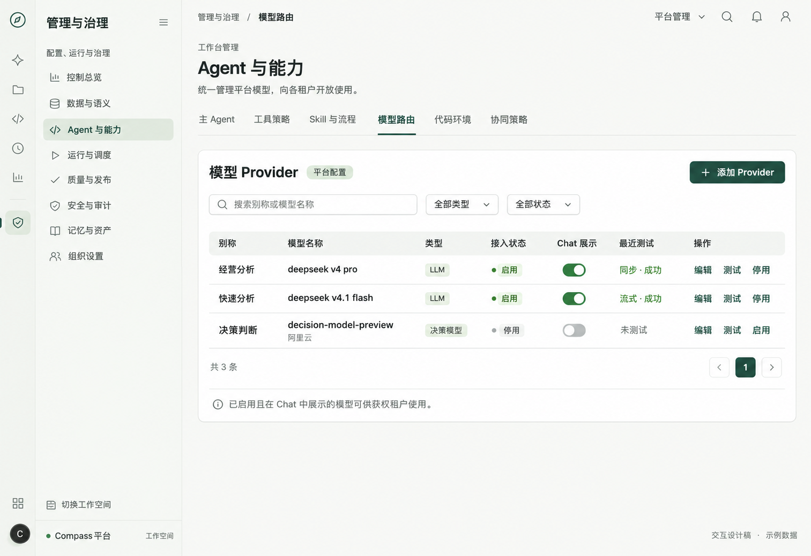
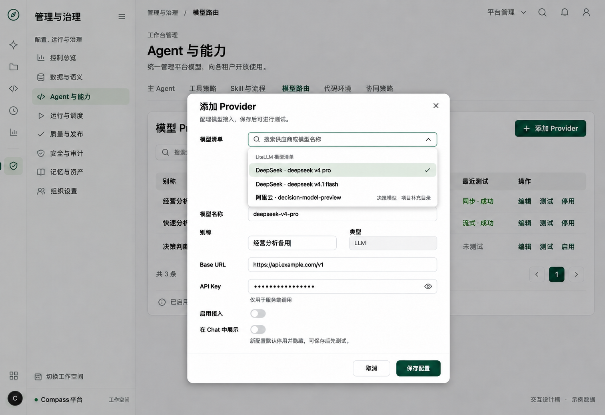
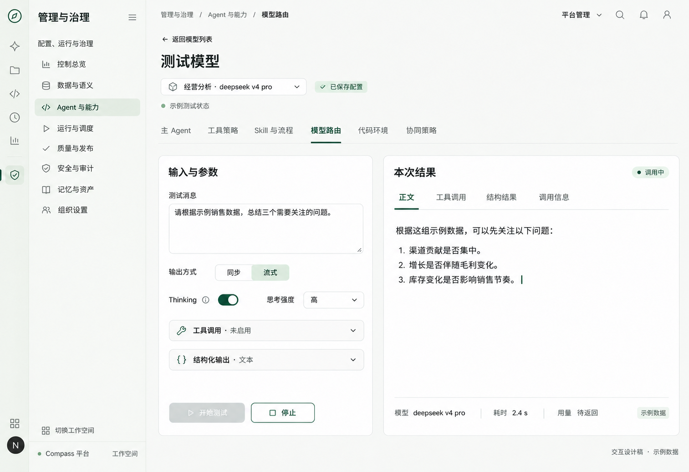
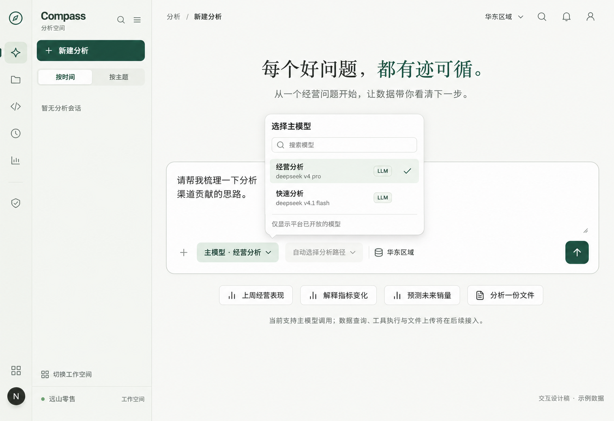

# Feature 993 视觉材料

[返回 PRD](../PRD.md)。本目录保存运行中界面的原始截图、基于截图生成的高保真交互状态图，以及对应提示词。需求规则和文案继续由 PRD 维护。

## 实际界面截图

2026-11-03 使用浏览器截图能力，从已登录的本机 Compass 获取页面可见区域；未更改页面内容或应用数据。完成后恢复至原模型路由页面。

| 文件                                             | 实际页面                                       | 来源                                                                   |
| ------------------------------------------------ | ---------------------------------------------- | ---------------------------------------------------------------------- |
| [reference-models.jpg](reference-models.jpg)     | 管理与治理 → Agent 与能力 → 模型路由，当前空页 | `http://127.0.0.1:3000/t/yuanshan/w/huadong/admin/capabilities/models` |
| [reference-analysis.jpg](reference-analysis.jpg) | 分析 → 新建分析，当前输入框架                  | `http://127.0.0.1:3000/t/yuanshan/w/huadong/analysis`                  |

### 当前模型路由页

### 当前分析页

## 高保真交互状态图

由内置 `image_gen.imagegen` 生成。管理相关图以模型路由截图为视觉参考，Chat 图以实际分析截图为参考；保留双侧栏、导航和绿色浅色视觉体系。图中所有配置状态、测试结果和耗时为设计示例。图稿为静态图片，操作行为由 PRD 的 UI 与业务规则章节定义。

| 图号       | 图稿                                        | 覆盖状态                                                           | 对应 PRD  |
| ---------- | ------------------------------------------- | ------------------------------------------------------------------ | --------- |
| IMG-993-01 | [模型 Provider 列表](models-management.png) | 三模型列表、两种模型类型、启用/停用、Chat 展示、编辑与测试入口     | UI-993-01 |
| IMG-993-02 | [添加 Provider](provider-editor.png)        | 弹窗、模型目录展开、名称/别称/端点/密钥、默认停用与隐藏、取消/保存 | UI-993-01 |
| IMG-993-03 | [能力测试](model-playground.png)            | 流式进行中、Thinking 与强度、工具/结构配置入口、结果与停止         | UI-993-02 |
| IMG-993-04 | [Chat 主模型选择](chat-model-selector.png)  | 选模菜单展开、已选模型、两个开放 LLM、发送入口                     | UI-993-03 |

### IMG-993-01｜模型 Provider 列表

### IMG-993-02｜添加 Provider

### IMG-993-03｜模型能力测试

### IMG-993-04｜Chat 主模型选择

## 提示词与维护

- 完整提示词及参考文件映射维护在 [prompts.json](prompts.json)。四张图分别使用内置 image_gen 生成；添加 Provider 和模型测试图另做定向修订，统一平台管理上下文。首轮使用真实截图作为参考输入，修订沿用生成图。
- PNG 为选定交互图，JPG 为真实截图；原始截图保持只读。修改设计时同步提示词和 PRD 对应说明。
- 图稿中的示例端点使用 `example.com`，不含真实密钥。DeepSeek 的具体 API 标识、参数兼容组合和阿里云决策协议仍需按 PRD 在接入阶段核实。
- 2026-11-03 用户确认决策模型仅管理端测试，Chat 只开放两款 DeepSeek LLM。现有 Chat 图已符合此范围；决策配置的 Chat 开关在实现中禁用并提示“本期仅支持管理端测试”，独立管理和测试范围保持有效。
- 当前覆盖桌面主要交互状态。加载、空、错误、权限、关闭确认与窄屏布局采用 PRD 状态契约，未逐一生成图片；本次未修改应用代码或执行目标功能测试。
