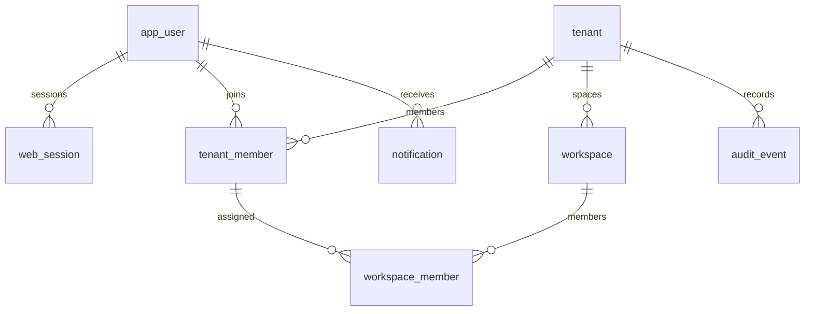

# Feature 995 Web 数据设计

> 状态：`review` · 更新：2026-10-26 · 用户确认简化方案后修订；以下全部为拟实现。[返回技术方案](TECH_DESIGN.md)

## 1. 所有权与简化边界

Owner 为 `apps/web`，逻辑库 `web/main`，PostgreSQL 17。本期 **8 张业务表**；迁移账本与源校验元数据另计。唯一迁移源、SQL交付与恢复见[主方案](TECH_DESIGN.md#4-迁移部署与工程入口)。当前没有已发布的 Web 业务库，不存在本轮删除旧数据的操作。

相对前稿：principal 改为 app_user；平台资格合入用户；membership 改为 tenant_member；新增直接 workspace_member。删除 auth_flow、platform_operator、组两表、动态角色三表、invitation、service_identity、mutation_receipt。未来 region/brand/channel 元数据和租户默认空间反向 FK 同时移除。不建立 Agent/Memory、文件或执行身份占位表。

图仅展示核心关系；字段表定义可空历史作用域和实际 FK。稳定用户 ID 贯穿业务，未来接 SSO 时另加外部身份映射即可，本期不预建映射表。

## 2. 公共约定

- UUID、UTC `timestamptz`；可编辑实体带 `version bigint > 0 DEFAULT 1` 和 created_at/updated_at。API version 为十进制字符串。审计和通知不机械增加编辑版本。
- 字段中的 `?` 表示可空。名称 trim 后1–80字、说明≤500字；状态用 text + CHECK。JSON只用于固定个人偏好和白名单事件摘要，个人授权使用有界text[]，无任意配置编辑器。
- 同租户关系使用复合 FK/唯一键；引用 RESTRICT。用户/租户/空间/租户成员停用或归档，保留历史；空间成员可物理解除关系，历史由审计保存。
- 普通业务接口不能提交操作者、平台资格或密码哈希；仅登记的成员创建/角色调整/权限管理DTO接收permissionKeys，写入需租户admin。服务端 scope 从当前会话与成员关系核验，不信任用户传入的“已授权”。

### 2.1 领域模型与持久化映射

本轮在八表方案中为tenant_member和workspace_member增加permission_keys；DDD模块与单库一致性边界继续沿用。表是持久化结构，领域模型按当前规则选取字段；不逐表制造类或通用 Repository。

| 模块 / 模型                  | 对应表           | 状态与行为边界                                                                                  |
| ---------------------------- | ---------------- | ----------------------------------------------------------------------------------------------- |
| identity / AppUser           | app_user         | 账号状态、平台资格、显示名及固定偏好；本人编辑与受管管理有不同入口，不携带所有成员/会话集合     |
| identity / WebSession        | web_session      | 到期与撤销；有效性同时依赖当前用户，密码重置与会话撤销使用本地事务                              |
| access / Tenant              | tenant           | 租户启停、名称/时区；authz_version是派生失效标识，不存完整权限快照                              |
| access / Workspace           | workspace        | 归档、恢复、写入条件；用tenantId关联租户，不加载全部空间成员                                    |
| access / TenantMember        | tenant_member    | 账号在租户内的管理员资格、个人权限与启停；最后管理员依赖跨成员/账号事实，由策略与租户锁共同保证 |
| access / WorkspaceMember     | workspace_member | 一个成员在一个空间中的个人权限分配与初始模板；同租户/唯一关系由用例与数据库约束保证             |
| audit / AuditEntry           | audit_event      | 不可改历史的安全记录，采用追加与查询服务；不建立带复杂行为的审计聚合                            |
| notifications / Notification | notification     | 收件人可见性与未读→已读，采用局部规则与存储；无事件队列模型                                     |

`TenantRole`、`WorkspaceRole`、`Scope` 是有限管理员资格/默认模板/范围值；`CurrentAccess` 为请求内派生授权视图。它们均不需要新表。模型通过ID引用；写路径的Repository只装载当前用例需要的状态，查询直接生成安全投影。

聚合用于界定状态修改入口；当前租户创建与首管理员、最后管理员保护、密码重置与撤销、成功审计/通知都使用显式的单库跨模型事务。这是本方案的既定一致性选择，不将整租户包装成大聚合，不增加Outbox或最终一致性补偿。

写入owner与应用模块对应，SQL放所属模块适配器；`platform/db`只管理连接/事务。公开协作接口绑定外层同一事务连接，不得自行commit或从连接池另取连接。身份与审计等模块的协作由composition注入，domain不接触事务对象。

允许的同库只读依赖限于当前真实查询：access成员列表/搜索/管理员计数可JOIN app_user的id/status/login_name/display_name；audit与notifications为当前可见范围可JOIN tenant/tenant_member/workspace_member及必要状态；notifications读取用户偏好通过identity最小查询接口。条件和字段变更由owner一起评审，不能据此任意读写对方表。密码列只供identity认证/受管管理路径读取，跨app数据库边界不变。

SQL迁移继续统一放 `apps/web/db/main/`，按 `web/main` 发布；模块拆分不增加schema、迁移账本或数据库。数据库权限仍按runtime与管理角色控制，应用内模块所有权由入口、导入约束与行为测试落实。

## 3. 八张表

| 表               | 核心字段                                                                                                                                                                                                          | 约束、索引与必要性                                                                                                                                                                                                                                    |
| ---------------- | ----------------------------------------------------------------------------------------------------------------------------------------------------------------------------------------------------------------- | ----------------------------------------------------------------------------------------------------------------------------------------------------------------------------------------------------------------------------------------------------- |
| app_user         | id PK；login_name text；password_hash text；display_name text；status(active/disabled)；is_platform_admin bool DEFAULT false；preferences jsonb DEFAULT '{}'；version；created_at/updated_at                      | login_name 规范化为小写ASCII，匹配 `[a-z0-9][a-z0-9._-]{2,63}`，UNIQUE；密码只存带算法/参数/盐的哈希串。运行账号只能更新显示名/偏好/相应version；密码、登录名、状态与平台资格由受管命令写                                                             |
| web_session      | id PK；user_id FK app_user；token_hash bytea；created_at；expires_at；revoked_at?；device_label text                                                                                                              | token_hash UNIQUE，32 bytes；INDEX(user_id,created_at DESC)、INDEX(expires_at)。只存随机token的SHA-256；固定12小时有效期，不存当前租户/角色、Provider token、密码或CSRF明文                                                                           |
| tenant           | id PK；name text；status(active/disabled)；timezone text；authz_version bigint DEFAULT 1；version；created_at/updated_at                                                                                          | 无 default_workspace_id；authz_version只用于失效检测，所有实际授权仍查当前关系。平台创建租户与首管理员同事务；名称不作为跨租户身份键                                                                                                                  |
| workspace        | id PK；tenant_id FK tenant；name text；description text；status(active/archived)；version；created_at/updated_at                                                                                                  | UNIQUE(tenant_id,id)、UNIQUE(tenant_id,lower(trim(name)))；INDEX(tenant_id,status,id)。含归档记录的名称不释放；使用租户时区，无本期独立时区配置                                                                                                       |
| tenant_member    | id PK；tenant_id FK tenant；user_id FK app_user；role_key(admin/member)；permission_keys text[] NOT NULL DEFAULT '{}'；status(active/disabled)；version；created_at/updated_at                                    | UNIQUE(tenant_id,user_id)、UNIQUE(tenant_id,id)；INDEX(user_id,status,tenant_id)。一个账号可加入多个租户，单个租户一个admin/member资格及一份个人权限清单；admin清单必须为空（由受保护资格提供完整权限），member可配置登记权限                         |
| workspace_member | id PK；tenant_id；workspace_id；tenant_member_id；role_key(analyst/viewer/auditor)；permission_keys text[] NOT NULL DEFAULT '{}'；version；created_at/updated_at                                                  | UNIQUE(tenant_id,workspace_id,tenant_member_id)；复合FK指向workspace(tenant_id,id)、tenant_member(tenant_id,id)；INDEX(tenant_id,tenant_member_id)。role_key只记录填充模板，鉴权读取permission_keys；解除后显式重加用新id，避免旧version/审计事件混淆 |
| audit_event      | id PK；event_key text；actor_user_id? FK app_user；tenant_id? FK tenant；workspace_id?；action text；target_type text；target_id? uuid；outcome(success/denied/failed/generated)；safe_summary jsonb；occurred_at | event_key UNIQUE；workspace/tenant复合FK，CHECK workspace非空时tenant必非空；INDEX(tenant_id,occurred_at DESC,id DESC)、INDEX(actor_user_id,occurred_at DESC)。目标是历史逻辑引用，无任意请求载荷；运行账号仅SELECT/INSERT                            |
| notification     | id PK；recipient_user_id FK app_user；tenant_id? FK tenant；event_key text；kind text；safe_payload jsonb；read_at?；created_at                                                                                   | UNIQUE(event_key,recipient_user_id,kind)；INDEX(recipient_user_id,created_at DESC,id DESC)和未读部分索引。event_key逻辑关联已提交事件，不依赖审计保留期；只允许未读→已读                                                                              |

preferences 为固定 schema：sidebarPinned、pageSize(20/50/100)、lastTenantId?、lastWorkspaceId?、authorizationNotifications。近期上下文失权时忽略；新设置时须验证两者归属与当前权限。个人会话/安全通知不可关闭，不新增 schemaVersion 或偏好表；需要字段演进时做明确迁移。

password_hash 的格式和参数只由服务端密码模块维护，算法库选型见主方案；不得用通用 SHA-256 替代密码哈希。会话 token 适用随机高熵值的SHA-256，两者用途不同。CSRF 值由 HttpOnly token 派生并经同源 session API 返回，数据库无需 csrf_hash 副本。

## 4. 授权、状态与并发

权限目录、默认模板与范围语义唯一维护在[页面/API附录](ROUTES_AND_API.md#2-权限目录默认模板与个人授权)。平台资格不绕过租户成员检查；停用用户、租户或租户成员一律拒绝对应访问。tenant admin保留完整权限，普通member的权限来自tenant_member.permission_keys与目标workspace_member.permission_keys的并集；租户清单覆盖全租户及全部空间，空间清单只覆盖具体空间。只有明确租户授权时，普通成员才可在没有空间分配行时访问相应空间能力。

两份permission_keys分别是本范围最终直接允许集合，不存deny、继承表达式或任意策略JSON。输入从目录校验、去重并排序；空数组表示无直接授权，不能回退角色模板。数据库CHECK允许空数组，非空时限制一维、无NULL元素、有界长度、属于当前作用域的权限ID白名单，且不得包含保留的members.write；tenant admin的数组必须为空。目录/允许值在首次迁移中记录固定快照，后续新增权限显式追加迁移，已有用户不自动获权。数组无需独立GIN索引，当前查询先按成员关系和tenant收敛。

添加空间成员时，界面应用模板形成显式permissionKeys并一起保存；后续role_key只标记模板来源。切换模板须同时提交权限清单，普通编辑权限保留来源并显示“自定义”。删除空间关系删除其直接权限；再次添加用新ID，权限从新表单明确提交。tenant member停用后保留清单，恢复须确认将恢复的权限。租户admin降为member时提交明确的租户permissionKeys并确认原空间分配仍在；升为admin清空租户直接清单，保留空间分配供以后显式降权确认。

个人权限修改复用成员行version，并递增tenant.authz_version；专用PUT及成员角色/状态PATCH还携带expectedAuthzVersion，防止租户授予/目标资格变化后在旧预览上保存。清单替换、版本、审计和通知同事务提交，空清单更新同样审计。相同清单的重提在版本检查后可返回当前结果，不产生第二次事件。成功审计记录范围、目标和增减权限ID，不存请求载荷。

authz_version的写入覆盖为：租户启停、空间创建/归档/恢复、租户成员创建/角色/状态/权限、空间分配创建/变更/删除；这些访问相关变更均在业务事务中递增所属租户版本。名字、说明和时区等普通展示修改不递增授权版本。全站账号停用或会话撤销由当前身份检查直接拒绝，平台资格变化由当前账号属性判断。客户端viewRevision是由可信用户/session、平台资格、目录版本和本人有效租户版本派生的摘要，算法仅在[代码设计 §6.1](CODE_DESIGN.md#61-展示版本与一次页面读取)维护；没有新增表或字段，也不将客户端摘要作为查询授权。

列表、计数、总览和审计根据具体动作的当前权限过滤；SQL不得继续用role_key推导空间权限。tenant-level audit.read允许读取本租户全部审计，space-level只读所分配空间；导出逐条同时满足audit.read和audit.export，不能将两个不同空间的权限合成。组织名单和配置读取按相应tenant动作检查，成员/授权写入仍只给tenant admin。无权总览卡片标记不可用。

最后租户管理员定义为 active user + active tenant_member(role_key=admin)。个人清单不能授予members.write或改变admin资格；因此继续在租户锁内校验这个明确集合。最后平台管理员为 active user + is_platform_admin=true；受管变更串行保护。租户停用不删除其管理员结构。

写事务统一锁定需要的用户行（UUID升序）→ 当前session → tenant → 目标行；每次取得锁后重验状态和version。成员添加先共享锁目标用户再锁tenant，避免与全站停用反向等待。普通资料修改只锁本人，不锁无关租户。全站停用/重置密码由受管命令处理：用户排他锁下撤销会话；停用还按UUID顺序锁其所属租户并检查最后管理员。平台资格维护另用固定advisory锁；事务遇到死锁则整笔回滚并有界重试，不能继续部分提交。

成员状态恢复需显式操作，确认保留的空间分配；添加同一个已停用成员返回冲突，不隐式恢复。空间归档后允许获权读取和具tenant范围workspaces.write者恢复，禁止其他空间业务写入；租户治理仍可调整或解除既有空间成员及其权限，新增空间分配需空间active。

## 5. 写入、防重复与审计

创建 tenant/workspace/tenant_member/workspace_member 时，客户端为一次逻辑创建生成稳定UUID并在结果确定前保留；数据库PK与业务唯一键防止重复。重复ID/关系返回409，响应不泄漏无权对象，客户端重新GET核对实际结果；不直接返回“保存成功”，也不把POST换一个ID自动重发。刷新丢失创建上下文时先查现有记录，不自动重建。

更新/停用使用 `UPDATE ... WHERE scope AND id AND version=expected RETURNING ...`；不匹配返回可见版本冲突或通用404。权限专用PUT及成员角色/状态PATCH同时校验目标version与expectedAuthzVersion；删除空间成员同样检查version；重复删除已不存在关系返回404，无重复通知。通知已读、退出采用自然幂等状态转换，无通用回执表或持久化请求哈希。

需审计的成功管理写入与audit_event在同一PG事务中提交；属于已登记通知来源的事件在该事务内写notification。event_key可用 `action:resourceId:newVersion`，新会话或删除事件用首次事务内分配的唯一事件UUID；回滚不会留下成功通知。重复请求没有产生新业务变更时，不生成第二个成功事件。事件收件人是受影响用户，不建立消息总线。通知已读仅更新read_at，不产生审计或新通知，避免递归事件。

失败/拒绝在业务事务回滚后写独立安全审计；DB整体不可用时返回503并记录脱敏进程日志，不声称审计已落库。登录失败不保存明文登录名/IP/口令；可按已核实用户记录主体，未知账号不产生用户记录。全局登录、CLI和个人事件tenant为空；本人通过个人会话页面查询自己的安全事件，租户管理员不会因此读取他人在其他企业的事件。

列表/计数在请求内同一有界只读快照使用当前授权范围；先过滤后分页。组织列表采用page/limit（20默认、100上限）及固定排序；审计采用时间/id游标。SQL参数化，搜索长度≤80且转义LIKE通配符。无需通用scope查询语言、全文或向量索引。

事务入口明确区分：普通查询为 `REPEATABLE READ READ ONLY`，身份/权限、items/count、展示版本和跨模块只读协作绑定同一连接；普通管理写入为 `READ COMMITTED READ WRITE`，锁后重验；审计导出为 `REPEATABLE READ READ WRITE`，有界生成完整CSV、写generated审计并确认提交后才返回文件。导出失败/提交结果未知丢弃buffer，不在只读事务中INSERT，也不先响应后补审计。该区分不修改八表结构，具体顺序和失败行为见[代码设计 §5.1](CODE_DESIGN.md#51-查询快照与审计导出)。

## 6. 迁移、账号与恢复

首次仅 `empty → 0001_web_foundation`，包含8表（含两份个人权限数组）、索引/约束和明确权限授权。当前尚未发布该迁移，本次更新拟议0001；已有共享历史在实施后继续不可改。迁移唯一源为 `apps/web/db/main/migrations/0001_web_foundation.sql`，固定node-pg-migrate 9.0.0；后续真实变更再追加revision，已共享历史不可改。

元数据：原生 `web_meta.pgmigrations` 与 `web_meta.migration_source(revision,sha256)`。第二张仅记录已应用源摘要，服务于项目的不可变历史/SQL一致性检查，不属于业务模型。完整SQL从同一up片段派生；首次增量清单直接引用该原生SQL，不再预制0001/0002到0003的升级包。固定版工具账本薄适配保留到真实PG等价验证通过，不另建通用迁移框架。

本地同一PG实例的独立compass_web库；owner可为NOLOGIN角色，迁移登录账号受控取得所有权，runtime只具自身必要DML。清理/建号/重置等管理命令复用受管管理连接，不新增maintenance登录角色；运行进程绝不持有该凭据。密码/平台资格列不授予runtime更新权限，审计无runtime UPDATE/DELETE，schema限定并撤销PUBLIC创建权限。跨app不得访问对方业务表，不改变其他app已有授权。

发布前核对版本、SQL/源摘要、目标账号、备份；迁移后启动Web。恢复走pg_dump到新库恢复、核对权限和版本、切换连接/重启，统一失效会话；已有数据不使用DROP/down伪装恢复。首版没有生产旧库，仍验空库安装、重复执行、拒绝错误起点/未知对象、SQL与原生一致、运行权限和带数据备份恢复。

## 7. 简单保留策略

| 数据                                | 默认保留与执行                                          |
| ----------------------------------- | ------------------------------------------------------- |
| session                             | 固定12小时有效；撤销/过期记录7天后可清                  |
| notification                        | 已读30天、未读90天；删除前按固定截止时间预览            |
| audit                               | 默认365天；仅受管清理命令可按日期删除，保留该次清理摘要 |
| user/tenant/workspace/tenant_member | 保留停用/归档记录及历史主体，本期无通用销毁             |

清理为显式管理命令，默认dry-run、apply才删除；不依赖Worker或额外调度平台。部署前备份和一次真实恢复演练保留；日常备份频率由部署说明选择，不把定时备份系统列为教学app启动条件。恢复数据不公开密码哈希或原凭据。

## 2026-11-02 分析交互与可读地址修订

用户要求分析侧栏顶部随模块显示标题，新建分析使用按钮打开聊天输入界面；移除全部分析会话、分析案例、待我决定入口；时间/主题作为会话列表分组选项。空列表不生成模拟会话，分析执行和上传保持后续范围。页面路径使用持久化租户/空间 slug，旧 UUID 和已移除分析入口兼容重定向。一级及二级导航的图标、描边、选中/悬停/焦点样式对齐原型。此修订覆盖前文对应的四个分析页面及 UUID 页面路径描述。数据库仍为 8 表，新增两列和唯一/格式约束；API、外键、权限使用 UUID。具体迁移、发布和恢复约定见 [技术方案](TECH_DESIGN.md#2026-11-02-分析框架与可读地址修订)。
