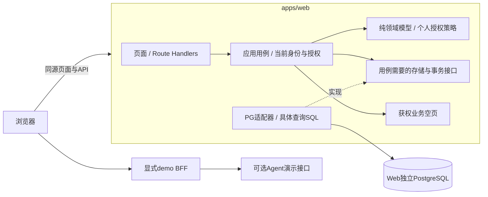

# Web 工程基座与完整界面框架技术方案

> Feature：995 · Profile：`standard` · 状态：`review` · 更新：2026-10-26
>
> 有效需求：[PRD](../spec/PRD.md)，10组本期FR、21项本期AC；沿用[项目标准模板](../../_templates/TECH_DESIGN.tmpl.md)增量修订。基线为 main / 0972e2959095cb22b72b212beba356e020ccdffc 加当前未提交工作区；应用仍为M0，本轮未写生产实现。

[返回 BRIEF](../BRIEF.md)

2026-11-02 用户要求修复导航闪烁，普通导航改为共享框架内的 SPA 切换；当前方案以[代码设计 SPA 修订](CODE_DESIGN.md#2026-11-02-spa-导航修订当前有效)为准。完整文档导航用于登录、退出和失权恢复；2026-10-26 的日期记录保留历史决策。

## 需求依据与验收

用户明确同意[教学复杂度评审](../review/design_review.md)中的8表方案。本期交付本地登录、会话、直接成员关系、默认角色与个人权限、设置、通知、审计和完整原型框架。分析、报告、看板、插件、定时及Agent/Memory业务为空页；文件上传/解析/OCR/抽取仅登记Memory职责。

本版替代前稿的OIDC/Keycloak、组/动态角色/委派、邀请、服务身份登记和通用回执设计；这些能力移至后续需求。本地账号、8表、默认模板/个人权限与首个真实迁移同步到PRD和代码附录。原型的五业务入口、八管理域、31页签、4规划空页及个人入口保持完整。

2026-10-26 用户要求先读取简化后的数据设计，再将 DDD 理念与代码组织融入整份方案。当次以这 8 张表和有效 PRD 为边界，采用**业务模块化单体 + 局部领域建模**：明确规则归属、用例、依赖和事务，不增加业务表、服务、业务权限或验收范围。代码附录与实施任务同步调整；此前讨论中的动态 Role 聚合、Invitation、委派策略已不适用于当前范围。

2026-10-26 用户追加按用户配置权限的自由度，并确认web_session继续存PostgreSQL。本版在8表内增加两份成员permission_keys，保留默认角色用于初始填充，以个人清单计算权限；新增AC-995-44。角色作为初始模板是本版明确的设计取舍，用户已确认的是按人配置能力。权限目录仍限定本期真实功能，未恢复自定义角色CRUD、组、邀请或委派引擎。

2026-10-26 按技术评审 D01/D02 修订：明确授权变化的展示版本、请求世代与旧文档退役，受保护页面采用完整文档导航并在恢复时重新核验；补齐查询快照和先提交审计再返回 CSV 的导出顺序。保持既有 10 组 FR、21 项 AC、8 张业务表和 11 项任务；本轮只修订设计并复评，不写生产实现。

| 文件                                   | 唯一维护内容                                                 |
| -------------------------------------- | ------------------------------------------------------------ |
| 本文                                   | 方案取舍、行为、配置/部署、任务与验收映射                    |
| [DATA_DESIGN.md](DATA_DESIGN.md)       | 8表字段、关系、约束、状态、事务与保留                        |
| [ROUTES_AND_API.md](ROUTES_AND_API.md) | 全部原型路由、权限目录/默认模板、HTTP契约                    |
| [CODE_DESIGN.md](CODE_DESIGN.md)       | 关键类型、登录/授权/并发、防重复、清屏及迁移薄适配的评审代码 |

## 1. 架构与必要取舍

### 1.1 当前工程与本期改动

| 已存在入口                                                                                                                | 当前事实                                 | 本期处理                                                         |
| ------------------------------------------------------------------------------------------------------------------------- | ---------------------------------------- | ---------------------------------------------------------------- |
| [Web页面](../../../apps/web/src/app/page.tsx)、layout/globals                                                             | 只有演示页，全局main/header/button样式   | 演示移到/demo并隔离样式，根入口解析登录上下文，新增React应用框架 |
| [演示BFF](../../../apps/web/src/app/api/demo/overview/route.ts)、[Agent客户端](../../../apps/web/src/server/agent-api.ts) | flag、schema、404/503/no-store已有测试   | 保留原契约；普通页面不调用Agent                                  |
| [Web package](../../../apps/web/package.json)、[配置](../../../apps/web/next.config.ts)                                   | Next16.4.0/React19.3.0，无登录/DB        | 使用当前App Router和standalone，新依赖仅在app内声明              |
| [任务](../../../scripts/tasks.mjs)、[Turbo](../../../turbo.json)、[Compose](../../../deploy/compose/compose.yaml)         | 根env任务和变量尚不含WebDB；Web依赖Agent | 增加真实WebDB工具入口/隔离环境，Web支持独立profile               |
| [Web Turbo](../../../apps/web/turbo.json)                                                                                 | build/typecheck静态生成Agent契约         | 保留构建工具依赖；运行时无需Python/IdP                           |

页面服务端与 Route Handlers 调用同 app 的应用用例；浏览器调用同源 `/api/web/v1`。领域规则由用例调用，页面不跳过用例直接访问存储。服务端入口与 PG 适配器使用 `server-only`；纯领域代码不依赖 Next、数据库或环境变量。共享 UI/BFF 算一个消费者，不新增 shared package。Web 与 Agent 可共享 PG 实例，库/账号/迁移独立，禁止跨 app 源码/表访问。图中虚线为接口实现关系，具体对象由组装入口注入。

### 1.2 决策与复杂度控制

| 决策     | 当前选择                                                                               | 代价、退出条件                                                                 |
| -------- | -------------------------------------------------------------------------------------- | ------------------------------------------------------------------------------ |
| 代码架构 | 按 identity/access/audit/notifications 划分模块；应用用例、纯领域规则与 PG 适配分开    | 增加少量接口与组装代码以隔离关键规则；简单查询/设置按需分文件，不建通用框架    |
| 认证     | 本地用户名密码，Node24内置异步scrypt；DB opaque session                                | 无IdP依赖；承担安全哈希、限速、重置撤销责任。真实企业SSO需求出现时再接外部身份 |
| 授权     | 租户admin/member；默认空间模板＋按用户/范围保存最终权限清单                            | 增加成员数组和编辑用例；保留有限目录与管理员授权边界，无组/deny/委派引擎       |
| 持久化   | pg8.23.1参数化SQL，node-pg-migrate9.0.0 SQL-first                                      | 8业务表，保留必要FK/版本/事务；原生SQL与离线交付需固定工具薄适配               |
| UI       | 原型视觉与交互，app内Radix1.8.1、Tailwind4.3.3、Lucide1.59.0，必要时生成本地shadcn组件 | 不套默认后台主题、不跨app导入Home组件、不引入独立UI包                          |
| DTO      | Zod4.6.7输入/响应schema与TS推导                                                        | 单app无需另一套全局OpenAPI；Agent contracts保持原唯一源                        |
| 写入     | 唯一键/稳定创建ID + version + 本地事务/审计                                            | 无通用mutation receipt；未知结果先重取，未来外部副作用仍需owner独立幂等        |
| 客户端   | URL上下文、页内fetch/草稿、世代与展示版本；共享框架内SPA导航                           | Next Link/router 驱动路由；每次页面载荷独立复验，保留框架 DOM                  |
| 运维     | 一个初始revision，受管管理命令复用迁移连接                                             | 不预造三个版本，无独立maintenance凭据、Keycloak、Redis或Worker依赖             |

依赖候选沿用前轮已核对的锁文件/npm固定版本；本轮未安装新增依赖。Node密码原语在当前24.12.0做了内存合成值正反例探针；这不代表认证集成已通过。既有编排/规范要求的SQL交付、受限runtime和恢复保留。

### 1.3 业务边界与统一语言

Web 的领域是账号、组织访问及本地治理；分析 Runtime 和 Memory 继续由对应 app 建模。应用内先确定四个业务模块及公开契约，保持一个部署单元、一个 `web/main` 数据库和一条迁移历史。模块目录不自动成为微服务或独立数据库；当前也不把每个目录宣称为完整独立限界上下文。

| 模块            | 数据写入所有权                                     | 业务语言与公开能力                                                               |
| --------------- | -------------------------------------------------- | -------------------------------------------------------------------------------- |
| `identity`      | app_user、web_session                              | 账号、平台资格、会话、个人资料/偏好；登录、撤销会话、读取最小身份摘要            |
| `access`        | tenant、workspace、tenant_member、workspace_member | 租户、空间、租户成员、空间分配；默认模板、个人授权、组织管理、可见范围与总览查询 |
| `audit`         | audit_event                                        | 安全审计条目、结果、可见范围；事务内追加、授权查询与有界导出                     |
| `notifications` | notification                                       | 收件人、站内通知、已读；事务内写入、本人查询和标已读                             |

个人偏好随账号由 `identity` 维护，租户名称/时区随租户由 `access` 维护；不建立独立配置领域。`AppUser` 表示全站账号，`TenantMember` 表示账号在一个租户中的身份，`WorkspaceMember` 表示该成员在一个空间的分配，三者通过 ID 关联。平台资格属于账号属性，只授权平台用例；管理员资格与默认模板是代码中的有限值，个人清单随成员关系持久化；不建立自定义角色表或通用策略引擎。

每个模块从 `public.ts` 暴露用例工厂、输入/输出类型和必要的事务内协作契约；其他模块不导入其私有实现。Web 的 `composition.ts` 组装具体依赖，是允许同时引用各模块适配器的位置。应用用例只声明所需接口，不反向导入组装入口。身份检查、审计写入和通知写入通过接口注入，避免 identity/access/audit 互相导入并形成环。组装时不连接数据库、不读取请求身份，配置与连接在实际调用时惰性获取，保留无环境构建能力。

### 1.4 规则、用例与存储的分工

| 层 / 位置                       | 负责什么                                                                                                   | 依赖约束                                                                         |
| ------------------------------- | ---------------------------------------------------------------------------------------------------------- | -------------------------------------------------------------------------------- |
| `app` 与 `server/http`          | 请求格式、Cookie、Origin/CSRF、HTTP 错误与响应 DTO；RSC 构造请求身份输入                                   | 调用组装后的用例；不执行 SQL、不决定成员权限或状态转换                           |
| `modules/*/application`         | `login`、`changeTenantMember`、`archiveWorkspace` 等完整用例；当前鉴权、事务顺序、调用领域规则及本地副作用 | 依赖纯领域代码和按实际用例定义的接口；不依赖 Next/pg，不接受浏览器声明的授权结果 |
| `modules/*/domain`              | 权限目录/合并规则、成员/空间状态、最后管理员等规则；必要模型与有业务含义的值                               | 纯 TypeScript；时间和所需事实由调用方传入，无网络、SQL、Cookie、环境读取         |
| `modules/*/infrastructure`      | 参数化 SQL、行到模型的映射、密码原语、查询投影与接口实现                                                   | 使用 `platform/db`，只在外层提供的连接上执行；不自行提交或另开业务事务           |
| `composition.ts`、`platform/db` | 显式组装；连接池、事务开始/提交/回滚与有界重试                                                             | 用普通工厂/参数注入；按请求构造上下文，不保存全局当前用户/租户                   |

DDD 用于集中业务规则，函数和不可变对象即可表达模型。只为用例实际需要的持久化/身份/审计能力定义接口；无需为每张表创建 Repository 类、通用 BaseEntity、事件总线、DI 容器或一套 CommandBus。`audit`、`notifications` 等简单模块先用 `service.ts`、`ports.ts`、`pg-store.ts`，复杂度出现后再拆分目录。完整目录与代表性代码唯一维护在[代码附录](CODE_DESIGN.md#1-代码组织与依赖)。

`contracts` 只表达浏览器安全的传输 schema/type；请求 DTO、领域状态与数据库行按边界显式映射。默认角色模板、权限目录与动作 ID 的唯一可执行定义放在 `access/domain/permissions.ts`；`contracts/authorization.ts` 仅以允许的纯类型/常量导入生成校验，UI 从 session/roles DTO 获取权限结果。禁止另抄一份浏览器矩阵或把 DTO 任意字段透传给存储。

### 1.5 一致性、查询与集成

`TenantMember`、`WorkspaceMember`、`Workspace` 和 `Tenant` 各自保留必要状态和小范围修改边界；加载成员时不加载整个租户对象图。最后管理员跨成员和账号状态，使用纯策略配合租户锁；租户创建与首管理员、成员变更与审计/通知在同一个本地事务完成。**本方案明确允许这些用例跨小模型原子写入**，属于当前单库的工程取舍；不宣称满足严格的一聚合一事务约束，也不为此增加异步补偿。模型、表与一致性范围的对应见[数据附录](DATA_DESIGN.md#21-领域模型与持久化映射)。

应用层通过事务接口控制工作顺序，PG 实现绑定同一连接的 identity/access/audit/notifications 协作对象。成功审计或必须写入的通知失败会回滚业务；领域规则只表达允许的结果和变更事实，应用用例显式追加本地记录，无隐式异步监听器。锁序、版本和重试约束仍见数据附录 §4–5。

普通查询用例使用 `REPEATABLE READ READ ONLY`，在同一有界事务/连接内核验身份、权限，并读取 items/count 与展示版本；单独设置只读不足以保证同一快照。普通管理写入使用 `READ COMMITTED READ WRITE` 与已定义锁序；导出因需追加审计使用单独的 `REPEATABLE READ READ WRITE`，不复用只读事务。专用 SQL 输出查询投影，无需重建聚合，也不新增读库或物化同步。纯策略计算同一用户的租户/空间允许项并集；SQL读取当前permission_keys并使用相同scope语义，在分页/计数前约束范围，禁止按模板role_key反推权限。为当前成员列表、有效管理员计数、审计过滤允许固定的同库只读 JOIN：access 查询可读 app_user 的 id/status/login_name/display_name；audit/notifications 查询可读当前成员资格。字段依赖登记到数据附录，由各 owner 协同维护，业务写入仍通过所有者适配器。`password_hash` 只供身份认证/受管管理读取；跨 app 直连继续禁止。

RSC 直接调用页面查询用例，在一次快照中取得导航、页面数据与 viewRevision；Route Handler 复用相同查询能力，在其事务内取得响应版本，无本机 HTTP 绕行。各模块协作共用外层连接，不拼接不同时点的授权与数据。登录与已登记命令均在应用层重新核验资格；layout 只承担展示，敏感内容受 §2.3 边界统一控制。受管 CLI 保留独立管理凭据和入口，复用纯领域规则，数据库操作遵循相同 owner 与锁序；不导入含 `server-only` 的 Web 入口。Agent 演示客户端保持现有 `server/agent-api.ts`，只有真实后续集成出现时才按需增加适配器，内部模型不通过跨 app 源码共享。

上述边界是结合本项目简化范围作出的设计选择。DDD 的模型边界参考 [Bounded Context](https://martinfowler.com/bliki/BoundedContext.html)，聚合与一致性约束参考 [DDD Aggregate](https://martinfowler.com/bliki/DDD_Aggregate.html)；查询单独建模并共用单库参考 [Microsoft 简化 CQRS](https://learn.microsoft.com/en-us/dotnet/architecture/microservices/microservice-ddd-cqrs-patterns/apply-simplified-microservice-cqrs-ddd-patterns)（访问：2026-10-26）。本期仅分开命令与查询函数，不引入 CQRS 框架。

## 2. 核心行为

### 2.1 本地认证与账号供应

账号由 `db:manage` 的受管子命令创建，默认无平台资格；平台资格必须显式授予。租户管理员只向自身租户添加已存在账号，不维护全站密码，不提供全站用户搜索。教师测试账号与共享环境账号分开，真实密码不提交Git、不放CLI参数或日志；通过TTY/受控stdin输入。无注册、短信、邮件验证、密码找回邮件或默认万能账号。

登录名按数据附录规范化；密码按原字节校验，不trim或静默截断。新密码12–128字符且UTF-8≤512字节。本期选择Node24内置scrypt，N=131072/r=8/p=1、16字节随机盐、64字节结果、maxmem=256MiB；保存版本化格式，比较使用timingSafeEqual。未知用户执行同参数dummy校验，返回同一失败文案；仅接受代码登记参数，不能从存储串触发任意计算量。[Node24文档](https://nodejs.org/docs/latest-v24.x/api/crypto.html#cryptoscryptpassword-salt-keylen-options-callback)与[OWASP参数依据](https://cheatsheetseries.owasp.org/cheatsheets/Password_Storage_Cheat_Sheet.html#scrypt)。选择成熟内置实现以减少本期原生依赖，并未扩建密码平台。

单进程教学实例默认每登录名每分钟10次、实例每分钟60次、最多2个并行哈希，超限429，无无限等待队列；限速表有容量/TTL。无需登录尝试业务表或Redis。多副本共享环境应在入口提供聚合限速，本期不承诺跨副本计数。密码核验在事务外；建会话前锁用户并复核hash/状态，防止与重置/停用竞争。

登录成功产生32字节随机token，DB只存SHA-256；新登录不复用会话ID。共享HTTPS使用__Host-compass-session、HttpOnly/Secure/SameSite=Lax/Path=/，本地loopback用专用开发cookie名。默认固定12小时到期，不续期；旧浏览器会话若属于当前登录用户则撤销，其他设备会话保留。本人退出或撤销其他会话立即生效。密码重置/全站停用在同一事务撤销全部该用户会话，留下审计/通知。

所有登录/修改均为同源JSON POST/PUT/PATCH/DELETE，检查固定public origin与Fetch Metadata，不开放CORS；已登录写入另校验session派生的CSRF。回跳只接受目录中登记的本地相对URL，拒绝协议、//、反斜线及编码逃逸，登录后重验授权。session API no-store且不泄漏token/hash。没有成员资格仍可进入本人设置和退出，不自动建租户或成员。

### 2.2 直接成员、默认模板与个人权限

权限目录与初始模板见路由附录。判定顺序为当前会话/用户有效 → tenant/tenant_member有效 → admin资格或个人权限清单 → 动作scope与资源状态。平台标记只用于平台API。tenant admin保留完整Web管理权限；普通member可在租户范围获得全租户权限，或通过具体空间关系获得局部权限。

tenant_member与workspace_member各增加 `permission_keys text[] NOT NULL DEFAULT '{}'`，空数组是无直接允许项。空间role_key只保留analyst/viewer/auditor初始模板标识；初次创建或显式“应用模板”时保存完整permissionKeys，日后模板变化不回写已有关系。个人权限采用本范围最终直接清单；空间有效权限取租户与空间清单并集，无deny/覆盖表达式。查询不读取角色模板推导已有成员权限。

权限目录包含scope适用性与personalGrantable标志。members.write保留给tenant admin，覆盖成员/角色资格/空间分配/个人权限管理；平台账号、密码和资格不进入目录。管理员可为普通成员授予其余当前已登记的读写/module权限，tenant-only动作不能放进空间清单。自助资料和会话仍只按self。当前默认viewer无审计权，但可为某用户增加具体空间audit.read/export；导出始终按同一事件scope同时满足两项权限过滤。

新增 `GET/PUT .../members/:id/permissions` 与空间对应入口；PUT只允许tenant admin，携带permissionKeys、expectedVersion和expectedAuthzVersion。应用用例按既有用户→session→tenant→目标行锁序复验，校验目录、scope、当前版本及admin目标只读限制，再替换清单、递增成员version/tenant.authz_version、追加增减权限审计与通知。同内容在版本核验后可no-op，冲突409不覆盖草稿；不隐式启用停用成员。权限编辑器的租户继承项只读，移除租户授权须回租户范围操作。

租户admin不能通过个人清单被静默削权；需显式降为member并提交租户个人清单，确认原空间分配将继续生效。升级为admin清空租户直接清单并保留空间分配记录。最后租户admin仍按active user/member+admin计算，租户锁内保护并发；平台最后管理员沿用受管规则。

所有列表/计数/搜索/导出先按个人权限筛选，module进入不代替操作检查。总览/安全可聚合获权空间；tenant级audit.read覆盖全租户事件，仅空间授权时不读取其他空间或tenant-only事件。不同用户即使模板相同，其结果也可以不同。撤权下一请求生效，在线清屏继续满足AC-995-42。

### 2.3 页面框架、上下文和原型设计

以[路由清单](ROUTES_AND_API.md#1-页面与路由清单)落实所有入口。数据/Memory新增四空页、组/服务身份说明、默认角色与个人权限保留原型信息位置，去掉尚未实现的提交按钮。页面目录驱动导航、面包屑、导航搜索和空页；未知路径404，不为任意字符串生成占位页。成员行与角色页共用个人权限编辑器；默认模板只读说明、应用到草稿后可增减，交互/文案见PRD §4.3.1。

布局沿原型：一级60px、二级260px，暖白/墨绿Token、系统字体、控件密度、页签顺序；≤900px浮层、≤720px菜单抽屉，hover120ms/leave240ms，独立滚动、键盘/触屏等价和焦点恢复。迁移React组件，保持原型真源/Home分发独立；演示CSS不得污染新框架。视觉验收在375/768/1440px逐屏对照。

tenant/workspace、过滤和分页来自URL；最近上下文只是个人偏好。两个标签页不共享可变“当前租户”。产品、个人和平台页使用 Next Link/router 局部导航，共享布局保留侧栏和顶部框架；表单写入使用同源 fetch，正常保存后 router.refresh。导航前确认未保存草稿，接收新载荷时销毁旧请求作用域并重新验证身份、页面权限及展示版本。前进后退的缓存载荷遵循相同门禁。框架不向 localStorage 或 Service Worker 存储私有数据，私有响应 no-store。

保留AC-995-42：前台每15秒复验，期限从成功请求的发起时刻算最多30秒，并受session到期约束。每次复验检查当前页面权限，返回即时派生的 viewRevision；该摘要覆盖用户/session、平台资格、权限目录版本及本人有效租户的authz_version，不入库、不授予权限。成员编辑的expectedAuthzVersion继续使用租户版本。即使session返回200，viewRevision变化也先同步遮蔽并禁写、清理DTO/草稿/CSRF、abort并增加请求世代，再重新加载完整文档；旧心跳和数据的成功/错误回调均不能恢复内容或续期。

每份新文档的敏感根节点在服务端HTML中默认hidden/inert，初始复验及本次RSC载荷版本一致后才开放。hidden/pagehide/offline、到期或当前401/403立即清理并退役旧文档；前台/BFCache/online恢复通过完整文档重新加载、当前鉴权及初始核验后再显示。初始版本不一致或加载失败保留安全重试，禁止旧内容回退和自动重载循环。本地广播只加速清理；[代码附录 §6](CODE_DESIGN.md#6-原型框架与客户端失效)唯一维护版本计算、状态机、RSC接入及实施反例。真实浏览器验证安排在T07最小接入及T11，当前不宣称已通过。

默认入口依次选择安全回跳、有效个人偏好、当前个人权限下首个可进入页面；平台资格优先平台租户页，未修改模板时analyst默认分析、viewer默认报告、auditor默认总览；自定义后按实际可用入口回退。无空间的租户admin先进入组织空间管理；无模块权限进入本人设置，不循环跳转。

### 2.4 写入、个人设置、审计和通知

数据库事务保持状态/version检查、管理写入及其审计一致；属于通知来源的事件同时写入通知。创建使用稳定UUID/唯一键；重复409后重新查询，客户端不自动换ID重试或误报成功。更新与删除需expectedVersion；停用、归档保留历史。无通用回执表，后续Agent副作用去重独立设计。

个人设置只含显示名、侧栏、页大小、最近上下文和可关闭的普通授权通知；无任意JSON/安全资格编辑。上下文更新只改本人两个偏好字段，不覆盖其他设置；个人资料仍有version冲突检查。通知来自真实成员/角色变化、会话撤销，事件key唯一去重；读取过滤当前获权tenant，用户退出租户后不泄漏其名称。通知已读仅更新read_at，不生成新审计或通知。

Web审计覆盖登录/退出、拒绝、管理变更、上下文和导出。成功事务内写入，失败/拒绝回滚后另记；DB故障503加脱敏进程日志。全局个人事件只本人可查；租户admin或获tenant级audit.read的成员可读本租户事件，仅获空间audit.read的成员只读对应空间事件。scope谓词在列表/计数/导出前应用。同步CSV导出最多10000行/10MiB，超限要求缩小过滤，不静默截断；转义引号和公式前缀，仅记录generated，无后台任务或下载送达承诺。

导出采用一次 `REPEATABLE READ READ WRITE` 事务：当前授权及有界查询、内存完成CSV与限制检查、同连接写generated审计、确认COMMIT，再由HTTP层返回buffer。此前不发送文件字节；审计失败或提交结果未知均丢弃buffer并按错误契约返回。完整顺序与反例见[代码附录 §5.1](CODE_DESIGN.md#51-查询快照与审计导出)，复用T09/T11与AC-995-30/36。

## 3. 接口与配置

普通API使用 `/api/web/v1`，Node runtime；Zod strict输入与响应schema。401/403/404/409/422/429/503含安全错误码/requestId，不返回SQL、口令、cookie或stack。API不返回登录HTML；已有demo错误契约保持原样。可见版本冲突保留草稿，失权立即清除敏感内容。

| 拟新增配置                             | 读取与约束                                          |
| -------------------------------------- | --------------------------------------------------- |
| WEB_PUBLIC_ORIGIN                      | 显式本地127.0.0.1:3000或共享HTTPS，不由Host推断     |
| WEB_DATABASE_URL                       | Web runtime专用连接，无Agent DATABASE_URL回退       |
| WEB_MIGRATION_DATABASE_URL             | 只给迁移/账号管理/清理任务，绝不透传runtime         |
| WEB_SESSION_TTL_SECONDS                | 默认43200，正数且上限43200；不配置idle或心跳续期    |
| WEB_AUTH_ALLOW_LOCAL_HTTP              | 默认false，只允许明确loopback开发环境使用开发cookie |
| WEB_AUDIT_RETENTION_DAYS               | 默认365，固定受管清理策略                           |
| WEB_TEST_DATABASE_URL                  | 独立可丢弃PG17，拒绝与正式/迁移目标相同             |
| 原AGENT_API_URL / COMPASS_DEMO_ENABLED | 仅显式demo使用                                      |

删除前稿全部WEB_OIDC_*、WEB_AUTH_KEY、WEB_INVITE_TTL_SECONDS、WEB_MAINTENANCE_DATABASE_URL和idle配置。根.env只由受管运行/集成任务加载，构建/静态检查不连库、不创建账号、不迁移。缺少配置只让对应业务503，healthz表示进程存活；readyz校验WebDB、目标版本和必要配置，不依赖IdP/Agent/Memory。

## 4. 迁移、部署与工程入口

### 4.1 唯一源与交付

| 项目      | 设计值（待实施）                                                                |
| --------- | ------------------------------------------------------------------------------- |
| Owner/key | web/main，PG17，compass_web库，web + web_meta schema                            |
| 原生源    | apps/web/db/main/migrations/0001_web_foundation.sql；固定Up/Down标记            |
| 首次范围  | empty → 0001_web_foundation；以后真实结构变化再追加，不改共享历史               |
| 工具      | node-pg-migrate9.0.0 + 项目受管目标/版本/checksum校验                           |
| 完整SQL   | apps/web/db/main/sql/bootstrap.sql，同源up片段、账本与校验记录                  |
| 增量交付  | 首次清单直接引用原生0001 SQL及hash，不生成虚假的历史升级包                      |
| 清单      | sql/manifest.json登记owner/from/to/source/hash/工具/PG/事务/恢复和commit/工作区 |

[数据库规范](../../../docs/database-migrations.md)要求完整SQL和可验证版本。固定工具dryRun会准备版本表，不能用于纯离线导出；因此保留前轮已核对的薄SQL loader及账本适配，业务DDL只维护一份。原生与SQL共用up/hash内容、项目锁、前置检查和版本登记；已达目标且hash一致才no-op。无效起点、源漂移、未知对象拒绝。8业务表之外的两张迁移元数据不扩成治理系统。

V03必须以真实PG证明原生/完整SQL一致及工具可识别已应用版本。若验证失败，暂停该交付路径，修正工具适配；不以少一张元数据表为理由降低源校验。无需预建0002/0003、两条区间包或部署尚未存在的旧Web库。

### 4.2 初始化与恢复顺序

1. 显式供应独立库、owner/migrator/runtime；本地provision拒绝未知既有对象，共享环境由部署者供应。runtime无DDL/审计删除/平台资格和密码列更新权。
2. 校验目标/版本/源，迁移初始版本。已有库先备份；首次空库无旧数据导入，原型存储不迁入。
3. 受管创建首个用户并显式授平台资格；通过获权UI创建租户与首管理员。测试fixture只在显式本地/测试参数下执行，重复seed不重置密码/角色。
4. 部署Web，验证readyz/本地登录/CRUD和独立运行。账号管理工具使用单独tools镜像target，runtime仅standalone，不携带管理凭据。
5. 故障恢复到新库，核对数据/权限/版本后切换连接并重启，撤销全部恢复会话。保留一次真库备份恢复演练，不以down/drop替代数据恢复。

清理通过固定受管子命令preview/apply，复用管理连接，无maintenance新账号或后台调度依赖。读写不依赖清理已运行。日常备份频率留给部署配置，本期不创建备份平台。

### 4.3 拟新增根任务与部署变化

以下是**待实现入口**，沿用generic tasks + app scripts，无手工app短名别名表。

| 命令                                                              | 职责                                                                                          |
| ----------------------------------------------------------------- | --------------------------------------------------------------------------------------------- |
| pnpm db:provision -F web                                          | 显式本地教学目标供应，运行任务、不缓存                                                        |
| pnpm db:migrate -F web -- --to 0001_web_foundation                | 独立迁移凭据和版本校验，不缓存                                                                |
| pnpm db:manage -F web -- <子命令>                                 | create-user/reset-password/set-user-status/set-platform/cleanup；白名单参数，口令仅TTY或stdin |
| pnpm db:seed -F web -- --fixture teaching                         | 仅本地/测试显式fixture，真实合成用户与两租户/空间；不默认提权或改既有用户                     |
| pnpm db:sql -F web                                                | 无env、无DB的离线派生                                                                         |
| pnpm db:sql:check -F web                                          | 临时生成比对，源摘要一致性                                                                    |
| pnpm db:apply-sql -F web -- --from empty --to 0001_web_foundation | 同受管锁/前置检查应用SQL，不缓存                                                              |
| pnpm test:integration -F web                                      | 专用PG的登录/组织/权限/迁移验证，不缓存                                                       |
| pnpm test:e2e -F web                                              | Playwright1.64.1，专用WebDB/本地账号，无IdP                                                   |

根tasks/Turbo按任务透传runtime或migration/test环境，静态检查不读取secret。Web注册后未过滤db:migrate/seed的意义会变化：CI/演示文档明确使用-F agent；Web seed未指定--fixture时无数据库操作并成功退出，明确提示未写入；teaching fixture只在显式参数下执行，不能被默认根seed悄悄创建。更新相关README、.env.example、脚本测试和CI；Home独立开发不依赖Web工具。

Compose的Web支持app/web profiles，依赖postgres + web-migrate，移除Agent硬依赖；不增加identity profile。保留旧app profile与demo smoke，增加Web独立登录/CRUD smoke。CI提供隔离WebDB/账号，执行SQL检查、原有check/build、PG集成和浏览器验收；缺专用环境报告未执行，不能计作通过。

## 5. 代码评审点与待验证风险

代码附录覆盖：密码格式与会话创建、个人授权、直接关系SQL、稳定创建ID/版本、最后管理员、页面失效及SQL适配。片段是设计示意，非已实现代码；不再保留OIDC、委派或邀请的待实现函数。

| 风险                               | 验证与完成时点                                                                                                          |
| ---------------------------------- | ----------------------------------------------------------------------------------------------------------------------- |
| V01 Node/新增库/无环境构建兼容     | T01/T04锁定依赖，检查server-only、构建；scrypt原语正反例已在Node24.12.0通过，格式解析/登录集成仍待实现                  |
| V02 本地账号/重置竞态与限速        | T04覆盖错误密码、未知用户、429、重置与登录并发、旧会话撤销；此ID替代前稿IdP验证                                         |
| V03 SQL与工具版本不一致            | T02真实PG比较空库原生/完整SQL、源hash、权限、重放/错误起点和带数据恢复                                                  |
| V04 直接成员仍可能越权或失去管理员 | T05/T06验证跨租户ID、跨空间、角色越权输入、并发降权和全站停用                                                           |
| V05 客户端旧数据恢复               | T07/T11按代码§6.4验证200局部撤权、迟到数据/心跳、换身份、初始失败、完整文档/RSC恢复、BFCache与离线；目前未执行          |
| V06 原demo/工程链路回归            | T10/T11保留404/503/no-store/schema，Agent-only迁移与旧app smoke，Home独立build                                          |
| V07 分层后绕过规则或破坏事务       | T01/T05/T06/T11验证导入边界、RSC/API复用、同连接审计回滚、纯权限规则与SQL实际范围；CLI复用纯规则且不加载server-only入口 |

减法结果：没有企业身份平台、通用角色引擎、邀请状态机、服务身份空模型、通用回执、未来业务scope、虚构迁移历史。必要隔离、原型框架、审计和SQL交付保留；未来恢复这些业务须由具体需求触发。

## 6. 文件级任务与验收映射

任务编号沿用，内容已按简化数据与 DDD 模块边界更新；本表维护设计交付和前置关系，实际执行进度由[实施记录](../IMPLEMENTATION.md)维护。本轮设计修订期间出现并行实施，本轮不修改其源码或验收结果。T03静态框架可先进行，但真实登录/权限通过前不能宣称基座可用。T04交付身份基础及最小成功审计/通知协作，默认回跳与组织资格在T05接通后一起验收；T08/T09再完成通知/审计查询界面，不能等到这些页面完成才给管理写入补审计。

| 任务               | 新增/修改文件或模块                                                                                                                                  | 前置        | 交付                                                                                            |
| ------------------ | ---------------------------------------------------------------------------------------------------------------------------------------------------- | ----------- | ----------------------------------------------------------------------------------------------- |
| T01 依赖与最小验证 | apps/web/package.json、pnpm-lock.yaml、server/README、eslint.config.mjs、tests/architecture                                                          | 无          | pg/Zod/UI依赖，V01/V07；建立模块/层级导入约束，不预建空实现                                     |
| T02 数据与迁移     | web/db/main/{README.md,migrations,sql}、scripts/db-{migrate,sql,apply-sql,provision,manage}.mjs、server/platform/db                                  | T01         | 8业务表含成员权限数组、一个初始revision、事务/只读快照、SQL与恢复，AC37                         |
| T03 原型框架       | lib/page-catalog、components/shell/ui、styles/tokens、app/(product)、demo/page、globals                                                              | T01         | 全导航/31页签/4规划空页/个人入口，AC05/35/39/40/43                                              |
| T04 本地认证       | server/modules/identity、server/http、server/composition、audit/notifications最小事务写入、login页/auth API、db:manage账号分支                       | T02         | 账号/会话规则与登录用例、PG/密码适配、受管管理、审计/通知，AC01/02                              |
| T05 个人授权       | server/modules/access/{domain/permissions,domain/access-policy,application/ports,infrastructure/pg-access}、contracts/authorization                  | T04         | 权限目录/模板、个人清单与范围查询、最后管理员，AC03/08/44                                       |
| T06 组织UI/API     | server/modules/access/{domain,application,infrastructure,public}、composition、features/organization、platform/tenants、tenant/workspace/members路由 | T03/T05     | 具名用例、同事务存储/审计/通知、CRUD/个人权限编辑/模板说明，AC04/07/08/34/44                    |
| T07 上下文与清屏   | client/api、request-scope、shell/session-boundary/context-switcher/search、session/context/search API、RSC页面查询与受保护导航                       | T03/T04/T05 | viewRevision、请求/心跳世代、默认遮蔽、200变化清理与完整文档恢复；代码§6.4，AC03/05/35/36/42/44 |
| T08 个人设置与通知 | server/modules/identity/application/update-profile、modules/notifications、settings、me API                                                          | T04/T06     | 固定偏好、通知查询/已读/去重，AC06/34/35                                                        |
| T09 总览与审计     | server/modules/audit、modules/access/application/get-overview、security和overview页、me/audit、导出                                                  | T05/T06     | 查询只读一致快照；导出读写快照、有限buffer与审计提交后响应；代码§5.1，AC19/30/36                |
| T10 工程与部署     | 根package/tasks/Turbo、Web Dockerfile/Compose、.env.example、smoke、课程CI及README/manifest                                                          | T02/T04/T09 | Web独立运行与旧demo兼容，AC38/41；无identity容器                                                |
| T11 验证记录       | Web tests/{architecture,domain,application,integration,e2e}、现有demo测试、实际实施记录                                                              | T03–T10     | 下表全部AC与V07；行为反例和PG原子性/并发证据，失败/未执行如实记录                               |

| 本期 AC       | 设计位置与验证                                                                        |
| ------------- | ------------------------------------------------------------------------------------- |
| AC-995-01、02 | §2.1/代码附录；T04真实本地登录、受管重置、到期/撤销、非法回跳                         |
| AC-995-03     | §2.2/数据复合FK；T05/T07两租户两空间的直接ID/查询/计数/导出                           |
| AC-995-04     | §2.2–2.3；T06/T07归档、停用、脏表单与迟到响应                                         |
| AC-995-05     | 完整页面目录＋固定独立module标识；T03/T07深链/历史/刷新                               |
| AC-995-06     | §2.4；T08偏好/已读持久化及事件去重                                                    |
| AC-995-07     | 直接成员唯一键和启停；T06跨租户、重复添加、不自动恢复                                 |
| AC-995-08     | 个人授权与最后管理员；T05/T06保留权限、越权字段、并发降权                             |
| AC-995-19     | Web总览及独立profile；T09/T10停Python服务后真实统计                                   |
| AC-995-30     | §2.4/代码§5.1；T09审计授权/不可修改、导出先审计后响应、提交失败/未知不发送CSV         |
| AC-995-34     | 稳定ID、唯一键、version和PG事务；T06/T08断线、重复与冲突                              |
| AC-995-35     | PRD文案、表单状态/焦点；T03/T11真实错误和恢复                                         |
| AC-995-36     | scope SQL与分页；T07/T09代表性数据观测、并发下items/count同快照及导出限制，无虚构SLO  |
| AC-995-37     | §4/数据附录；T02/T11初始PG迁移、SQL一致/权限/重放/恢复                                |
| AC-995-38     | §1.1/§4.3；T10/T11旧demo行为和新页面无业务请求                                        |
| AC-995-39、40 | 路由矩阵；T03/T11全部入口与高级身份待接入说明                                         |
| AC-995-41     | 本地账号＋WebDB；T10/T11无需IdP/Agent/Memory/Worker                                   |
| AC-995-42     | 代码§6.1–6.4；T07/T11逐项验证200撤权、旧心跳/数据、换身份、加载失败和完整文档/RSC恢复 |
| AC-995-43     | 原型视觉/响应式；T03/T11三视口截图与键盘/触屏                                         |
| AC-995-44     | §2.2/数据与代码附录；T05/T06/T11个人编辑、清空、继承、版本/越权/重登和SQL范围一致     |

AC-995-09随服务身份延期，不再列本期实施。其他延期编号由PRD唯一维护。现有测试只覆盖demo；身份/权限/PG/浏览器仍是明确测试缺口，技术复评后按本版AC细化业务测试计划。实施触及根编排时执行pnpm check/build及profiles smoke；文档检查和原语探针不能代替这些验收。

本次分层对应的验证分工：domain测试权限目录/允许项合并/范围、状态转换和最后管理员规则；application测试用例调用顺序、拒绝路径与副作用选择；真实PG集成测试验证并发降权、成员添加与全站停用竞争、version/唯一键、成功审计或通知失败整笔回滚、查询范围与计数；HTTP/RSC与浏览器验证认证入口、DTO、撤权及完整页面。mock事务只能支持编排单测，不能作为原子提交证据。导入约束以允许/拒绝样例验证，继续运行现有demo测试。测试计划后续细化这些缺口，并新增对AC-995-44的场景覆盖：同模板不同人、同人不同空间、继承/清空、模板变更不追改、跨scope导出权限不可拼接、权限版本冲突与审计回滚。

## 7. 本轮证据与阶段状态

前次简化修订读取当前工程入口、安装版Next认证/Route Handler/cookies文档和数据库规范；固定node-pg-migrate9.0.0的loader/账本检查沿用前轮记录，薄适配代码保留在附录。版本升级必须重验，未将官网其他版本文档当成该工具运行证据。

前次简化修订在Node24.12.0用合成口令、随机盐内存执行scrypt参数探针，正确口令匹配、错误口令拒绝；没有创建用户、连接DB或安装新依赖。本次个人权限设计沿用该历史证据，不声称重新执行密码探针。个人design偏好已按场景召回，无新的长期记忆。

2026-10-26 前次简化修订的文档校验：10 份文档的 Prettier 和空白检查通过；111 个相对链接及其中 11 个锚点有效。Feature 产物路径检查通过；10 组有效 FR、20 项有效 AC 与设计映射一致，11 项任务齐全；数据表核对为 8 张，原型源码的 31 页签和 4 个规划空页均有路由映射。旧专项评审正文与修订前副本逐字一致。这些是历史文档证据，未代替当前文档检查或真实 PostgreSQL、登录、UI 验收。

前次DDD修订补充模块/层级依赖、八表模型映射、同事务协作、成员变更代表代码、接口到用例映射及T01–T11任务。当次7份修改文档的Prettier、差异空白检查（包含未跟踪文件）及Feature设计路径校验通过；60个内部链接、6个锚点有效。与当次开始时的工作副本比对：PRD/既有评审逐字保留，8表字段、权限矩阵、HTTP接口表与20项AC映射一致，11项任务编号完整。未创建生产模块/迁移，未执行新增用例的编译、PG或浏览器验收；V01–V07仍是实施验证事项。

用户批准了简化方向；文档仍为review、Feature Phase保持draft。前轮问题的文档修订映射登记到评审报告，不表示实现已完成或本版已独立通过技术复评。

本次个人权限更新同步PRD、四份设计、任务与入口；仍为8表，权限字段及API按新需求扩展，当前10组FR、21项AC。历史文档检查与密码探针不计作本次验证，新增授权模型和SQL尚未编译或进行功能验收。

本次个人权限文档验证：10份修改文档的Prettier、git diff --check及未跟踪文件的差异空白检查通过；88个相对链接和7个锚点有效，PRD/design产物路径校验通过。10组FR、21项AC与11项任务映射齐全；业务表仍为8张，仅两张成员表新增permission_keys，web_session和其余表字段保持本次修改前定义，默认角色预设不变。历史评审正文逐字保留；以上仅为文档证据，个人权限的编译、PostgreSQL与浏览器验收均待实施。

2026-10-26 D01/D02 修订：主方案、数据/HTTP/代码附录同步了展示版本、generation/sequence失效、完整文档导航与默认隐藏门禁，以及查询/导出的明确事务模式。新增内容服务既有AC-995-30/35/36/42/44，没有变更PRD、八表字段或任务编号。T07/T09/T11和V05已登记相应反例。版本摘要只用于显示失效，服务端当前授权不变。新增状态机与导出片段均为设计示意，本轮未编译、未执行数据库或浏览器验收；本轮文档检查与复评结论见[最新评审](../review/design_review.md)。

## 2026-11-02 分析框架与可读地址修订

分析侧栏顶部显示当前模块，分析入口保留新建按钮与时间/主题分组，不再登记会话总表、案例和待决定页面。旧路径重定向至新建分析。主区域提供问题编辑器和快捷问题；执行、上传及会话存储保持后续范围，不生成模拟分析结果。图标统一使用 Lucide 线性风格并对应原型语义。

页面地址采用持久化 slug；UUID 保持数据库主键、API 与授权上下文。租户 slug 全局唯一，空间 slug 在租户内唯一，格式为 2–32 位小写字母/数字/连字符、字母开头。创建时可指定，省略时生成短随机标识；创建后保持不变。已有教学数据回填 yuanshan/xinghe、zongbu/huadong/dianshang。其他已有记录分配唯一短标识。路由先解析到 ID，再执行原有当前权限校验；导航、回跳和搜索返回 slug 地址。旧 UUID 地址经鉴权后重定向到规范地址并保留查询参数。

数据库 owner 为 `web/main`，版本 `0001_web_foundation → 0002_readable_routes`，新增 tenant.slug 与 workspace.slug、唯一及格式约束，无新增表。唯一源为 [0002 SQL](../../../apps/web/db/main/migrations/0002_readable_routes.sql)，历史 0001 不修改；完整 SQL 和区间 SQL 通过 `pnpm db:sql -F web` 生成于 [SQL 目录](../../../apps/web/db/main/sql/)。迁移工具扩展到按顺序验证两版源摘要和版本前缀，空库重放及旧库升级共用源。

发布先备份，再执行 `pnpm db:migrate -F web`，最后重启 Web；运行凭据不授予 DDL。恢复从已验证备份还原至新的受管库，核对版本/数据/权限，撤销恢复会话后切换连接；回退旧代码可保留新增列，禁止 down 删除字段。验收覆盖空库原生/完整 SQL 一致性、旧库原生/增量升级、历史摘要、唯一约束、运行权限及恢复，并验证跨租户 slug 拒绝、旧链接兼容和 SPA 导航。
