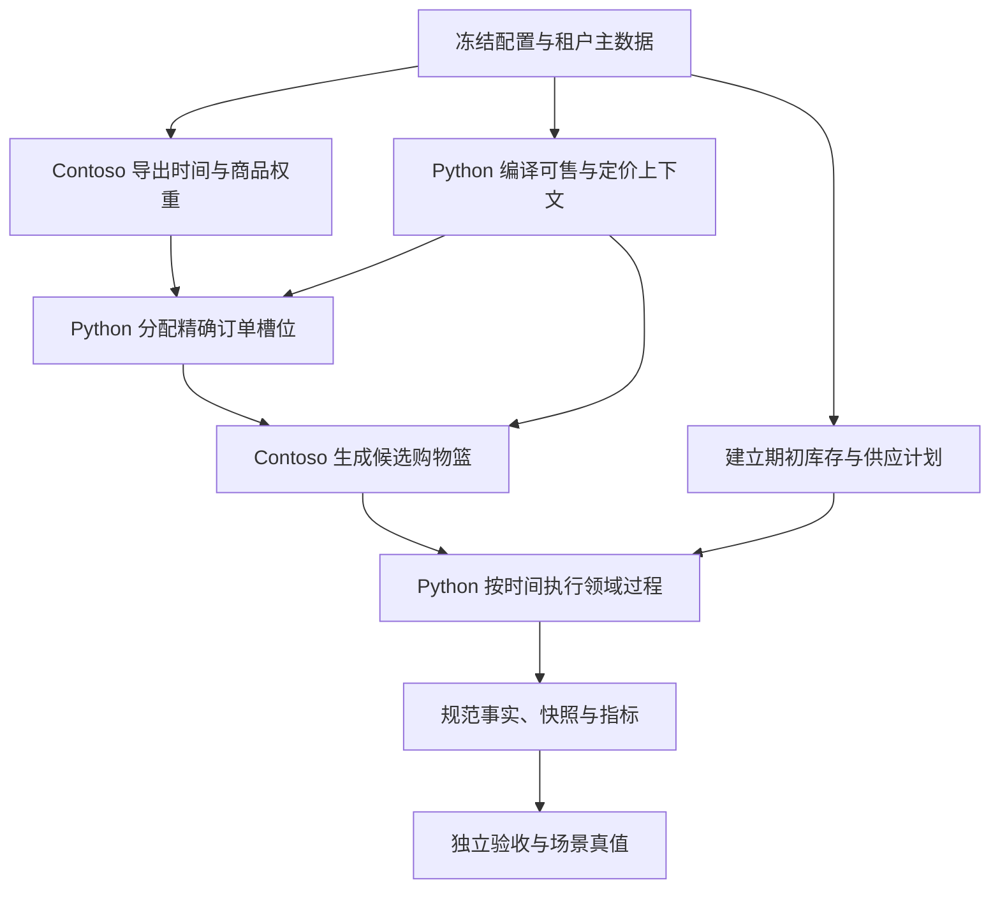

# Contoso V2 百万订单数据生产方案

> 本章是待实现的技术设计，不代表已经开发、运行或验证了生成器，也不代表已经下载或生产百万订单数据。本文只定义生产流程、文件接口、复现与恢复办法；最终业务表及字段名以主方案的 PostgreSQL 17 DDL 为准。

与当前 63 表模型的逐表落地关系、库存源事件腿与可见时间规则见 `docs/generation_mapping.md`；C# 文件改动和精确中间字段契约见 `config/contoso_patch_contract.json`。

## 1. 锁定的生产口径

采用 **Contoso V2 有限 fork 生成候选购物篮，Python 统一执行业务过程**。Contoso 继续负责日历权重计算，以及订单行数、商品与数量的加权抽样；Python 负责中国运动户外业务上下文、精确订单配额、金额、库存、支付、履约和售后。渠道、门店、客户、地区、活动上下文在候选购物篮产生之前确定。

“100 万数据”在本方案中指 **成功持久化的 1,000,000 个订单头**，不是 Sales 明细行数，也不是支付成功单量，更不是所有表的总行数。

| 项目 | 锁定值或规则 |
|---|---|
| 主租户订单头 | 900,000 |
| 隔离租户 B 订单头 | 50,000 |
| 隔离租户 C 订单头 | 50,000 |
| 新建订单业务日期 | 2023-01-01 至 2025-12-31，共 36 个月 |
| 履约及售后尾窗 | 2026-01-01 至 2026-03-31；不创建新订单 |
| 业务时区 | Asia/Shanghai；持久化时间戳使用 UTC，同时保存或确定性派生业务日期 |
| 金额 | CNY 整数分；不含税，不建立 VAT 模型 |
| 计入订单配额 | 创建成功后待支付、支付失败、取消、履约、部分退款、全部退款的订单 |
| 不计入订单配额 | 浏览、加购、未提交的 checkout intent，以及提交前因配置或数据校验失败而未创建的记录 |
| 精确控制对象 | 订单头；支付成功量、出库量、退货量、明细量和事件量是过程结果 |

本课程采用明确的 OMS 契约：**先创建订单，后异步尝试锁库存**。锁库失败产生 `STOCK_LOCK_FAILED` 取消原因，订单头仍保留并计入配额。该契约属于本课程系统设计，并非关于所有真实电商系统的行业断言。库存不足不得通过重新抽商品、重复抽客户、换日期或补造有货订单来隐藏。这样既能严格保留 100 万个订单头，又能观察缺货对取消率、支付销售、出库销售和潜在损失的影响。

默认业务流程的最大时长必须通过配置校验，确保正常路径可在尾窗内结束。当前 `profile_1m.yaml` 设置最长正常业务与采集路径为 81 天、尾窗 90 天，并禁止未结尾窗；出库上限从订单创建计算且包括支付窗口。该数值是课程配置上限，不是实测行业 SLA。若未来场景刻意设置超过尾窗的未履约或未结售后，必须另行升级配置并显式允许，按截止时点的真实状态截断；不能为了让状态全部终结而提前签收或提前退款。

## 2. 为什么采用候选生成 fork

### 2.1 真正复用的部分

官方 Contoso V2 的 `Sales` 与 `Orders + OrderRows` 是相同交易的两种输出表示；不能把它们当作销售、订单和发票三套独立业务过程。上游模型并未提供本方案需要的中国运动户外 SPU/SKU 体系、独立支付过程、库存流水和完整退款链路。因此，直接下载成品 Sales 再添加租户、渠道和活动标签，无法形成所需的因果关系。[S1][S2][S4]

本方案的“基于 Contoso”必须能在工程产物中核验：

1. vendor 目录保留固定提交的上游源代码、原始许可证和来源清单。
2. fork 复用 `Engine_Setup.cs` 中的日历及权重计算、`Engine.cs` 中的订单行数和数量分布语义，以及 `MyRnd.cs` 中的累积权重抽样思路。
3. 中国运动户外的品类、商品、渠道和生命周期参数由配置输入；Contoso 的电子家电默认主数据不被伪装成真实运动户外数据。
4. 每个订单候选及其明细都来自该 fork 的 proposal 阶段，并有可回溯到上下文槽位的标识。
5. 留存 `upstream_commit → fork_commit → build_digest → proposal partition → order_id` 的血缘。

生成后的数据应称为“使用 Contoso V2 派生生成器生产的课程合成数据”，不能标成未经修改的官方 Contoso 数据。若只复制表名、再完全独立随机造数，不能满足这里定义的复用验收。

### 2.2 有限 fork 的边界

| 模块 | 在哪里实现 | 改造范围 |
|---|---|---|
| 日历曲线、周期及商品日期权重 | Contoso C# | 暴露纯权重导出接口；不运行默认客户及汇率下载逻辑 |
| 订单行数与购买数量分布 | Contoso C# | 保留上游加权抽样语义，接入明确版本的随机源 |
| 条件商品抽样 | Contoso C# | 接收 Python 编译的可售集合与权重；不得根据实时库存筛商品 |
| 中国地区、客户、租户、渠道、店铺、SPU/SKU | Python | 生成并冻结主数据；写出供 C# 使用的兼容投影及 ID 映射 |
| 精确订单数与业务上下文 | Python | 对日历权重做总量守恒配额；提前绑定渠道、客户、店铺和活动 |
| 折扣、成交价、经营费用、成本口径 | Python | 单一金额权威；v1 不向客户收运费，不把 Contoso 的 double 金额当作生产账本 |
| 库存、支付、出库、配送、退货、退款 | Python | 按事件时间统一推进状态机 |
| 数据库导入、指标与场景真值 | Python/SQL | 根据已提交的规范事实计算；不得回写修正订单以凑结果 |

这个边界避免把完整中国电商领域模型搬进 C#。新增的 C# 代码只处理“给定购物上下文，生成候选篮子”，不实现支付、库存和财务系统。上游 `BuildOrder` 中自行选择外国客户、地区和门店的路径在 proposal 模式下不调用；其原始金额、交付日期及随机折扣也不是最终业务事实。[S4][S5]

## 3. 固定来源、构建与离线输入

### 3.1 已核验的上游基线

| 项目 | 固定值 |
|---|---|
| 上游仓库 | https://github.com/sql-bi/Contoso-Data-Generator-V2 |
| 基线提交 | `eaeb57a9eaa6ad0cdab4fb527552102685434ee0` |
| 固定源代码归档 | https://github.com/sql-bi/Contoso-Data-Generator-V2/archive/eaeb57a9eaa6ad0cdab4fb527552102685434ee0.tar.gz |
| 项目文件 | `DatabaseGenerator/DatabaseGenerator.csproj` |
| 已核验目标框架 | `net8.0` |
| 许可证 | MIT；保留该提交中的 LICENSE 与版权声明 |

该提交的项目文件直接固定了 CsvHelper 31.0.3、ExcelDataReader.DataSet 3.6.0、MathNet.Numerics 5.0.0、Parquet.Net 4.23.5。它的 `PreBuild` 使用 Windows `cmd` 语法，因此不能声称在 Linux 上原样 `dotnet publish` 即可成功。有限 fork 必须将这一步改成跨平台的构建元数据生成，或者把提交信息统一写入外部 manifest。[S3]

`net8.0` 不是完整工具链锁。实现阶段应冻结经过实际构建验证的 .NET SDK 精确补丁版本、Python 精确版本、依赖锁文件和容器 digest；本设计不编造尚未构建的镜像摘要或下载文件 SHA-256。第一次取得源码后计算 SHA-256，连同上游提交写入 source lock；复建时必须校验，不能重新追随 `main` 或 `latest`。

### 3.2 首次生产前的资产准备

1. 下载或检出上述固定提交，验证 `git rev-parse HEAD`，保存源码归档哈希。
2. 创建课程 fork，并把有限补丁、构建元数据步骤、依赖锁和配置解析器提交到 Git。
3. 冻结中国运动户外主数据、租户配置、场景配置和指标口径版本。中国客户与地区使用课程自行构造的合成数据，不依赖上游八国客户文件。
4. 将本地客户、商品、日历和汇率策略显式指定为输入。候选模式禁止悄悄回退到默认在线下载，避免相同 seed 因外部文件更新而产生不同结果。本方案只有 CNY，汇率不进入成交金额计算。[S5]
5. 执行很小的结构检查样本，确认契约、配额和事件守恒后，再进行基准生产；本轮交付只提供设计，不执行这些步骤。

官方已有 CLI 采用 `configfile datafile outputfolder cachefolder [param:OrdersCount=nnn]` 的形式。以下章节中的 `weights`、`plan`、`proposals`、`simulate`、`validate`、`publish` 都是**拟新增的生产阶段名或包装器接口**，不能误写成上游现成命令。[S6]

## 4. 不循环依赖的生产 DAG

权重导出与候选生成是 Contoso 的两个入口：先导出确定性的分布参数，再消费 Python 生成的上下文。Python 不需要先看已经完成的 Sales 再推断渠道，C# 也不需要等待未来库存结果才能选择商品，因此不存在生产阶段互相等待的循环。

各个阶段的输出在发布前均不可变；后续阶段如果发现配置错误，应该失败并产生报告，不能修改前一阶段来凑预期结果。

## 5. 中间文件契约

以下为生成器内部契约，不要求增加同名数据库业务表。表内 `tenant_id` 是主方案定义的租户主键类型；其余本地 ID 使用无歧义的字符串或整型标识。时间戳为带明确 UTC 语义的微秒时间戳；浮点只用于概率和权重，金额一律为整数分。

### 5.1 运行清单

`run_manifest.json` 至少包含：

| 字段组 | 必须记录的内容 |
|---|---|
| 版本 | `contract_version`、`generator_version`、`upstream_commit`、`fork_commit`、`random_spec_version` |
| 输入 | 解析后的配置规范化哈希、每个原始输入文件 SHA-256、主数据哈希、场景哈希、权重哈希 |
| 环境 | 工具链锁文件、镜像 digest、平台/架构、关键运行库版本 |
| 身份 | 内容配置决定的 `run_id`，与每次重试独立的 `attempt_id` |
| 口径 | 租户配额、新单日期范围、尾窗截止、Asia/Shanghai、CNY、fen、不含税 |
| 随机 | `master_seed`；不能只记录“默认 seed” |
| 分区 | 预期分区列表、输入依赖、输出记录数、逻辑行哈希、文件 SHA-256、完成状态 |
| 血缘 | fork 补丁版本、Contoso 投影字段映射、候选到规范事实的映射规则版本 |

`run_id` 可由内容哈希生成，但不能把它加入每次随机抽样的种子；否则仅修改一个库存场景就会扰动所有需求样本，难以做受控比较。`attempt_id` 也不得参与 ID、随机数或业务时间的生成。

### 5.2 输入与 proposal 文件

| 文件 | 粒度与关键字段 | 强制约束 |
|---|---|---|
| `calendar_weights.parquet` | 租户 × 业务日；`tenant_id, business_date, raw_weight, weight_version` | 覆盖 36 个月；权重有限且非负；租户总权重大于零 |
| `product_id_map.parquet` | 租户 × Contoso 商品；`tenant_id, contoso_product_id, sku_id` | 两侧映射在租户内唯一；不能指向其他租户 SKU |
| `assortment_profiles.parquet` | 配置的可售集合；`profile_id, tenant_id, contoso_product_id, category_id, subcategory_id, valid_from, valid_to, selection_weight` | 表达上架、渠道、地区、适用品类及变体条件；不包含 available_stock 过滤 |
| `context_plan.parquet` | 一个拟创建订单槽位；`tenant_id, order_slot_id, order_id, created_at_utc, business_date, identity_id, customer_id, segment_code, org_unit_id, region_id, demand_geo_id, channel_id, selling_site_id, campaign_context_id, source_session_id, assortment_profile_id, pricing_context_id, fulfillment_policy_id` | 恰好 100 万条；identity_id 必填，customer_id 可空；线上 selling_site_id 为空；租户配额精确；选定实体都属于该租户且在创建时有效 |
| `order_proposals.parquet` | 一个订单候选；`tenant_id, order_slot_id, proposal_id, line_count, contract_version` | 与 context 一一对应；不得缺失、重复或跨租户；不写支付/履约状态 |
| `order_proposal_lines.parquet` | 一条候选明细；`tenant_id, proposal_id, proposal_line_no, contoso_product_id, quantity, draw_profile_id` | 行号在订单内唯一且连续；quantity 为正整数；商品在指定上下文的可售集合内 |
| `source_to_order_line.parquet` | 一条原始候选行到规范订单行的血缘；`tenant_id, proposal_id, proposal_line_no, order_id, order_line_id, source_quantity, canonical_unit_no_from, canonical_unit_no_to` | 每条候选行恰好映射一次；多条原始行可以合并到同一规范行；数量区间不得重叠或遗漏 |

商品投影保留 Contoso 所需的分类、子分类、商品标识及必要基础属性。SPU、颜色、尺码、运动场景、季节、性别适用范围等完整模型由 Python 主数据拥有，通过 `product_id_map` 回连；在 Excel 随意增加列并不会自动扩展上游 C# 模型。[S7]

`campaign_context_id` 表示创建前已知的触达或规则上下文，不表示优惠一定适用。满减门槛、优惠互斥、最终券核销及实付金额要在购物篮生成后由 Python 定价阶段计算。非营销归因订单允许此字段为空，不能让所有自然购买都被随机分到活动。

百万版每个 `core.campaign` 必须有且仅有一个非空 `target_channel_id`；跨承接渠道的活动拆成多条活动记录。广告日报应到集合为“与活动有效区间相交的中国本地日 × 该租户全部 `geo_level='REGION'` 大区”，渠道固定为活动的 target_channel_id。未投放的大区也生成明确的零报告，不能省略；迟到或缺报与零花费是不同事实。活动日用半开区间相交判断：`starts_at < day_end AND ends_at > day_start`。日报版本追加，查询只选择知识截止前可见的最新版本；应到、已到不一致时 `ads_complete=false`，完整广告费与经营贡献返回 NULL，同时保留已观测花费。这与 `sql/03_metrics.sql` 的应到集合一致。

第一版完整保留原始 proposal 行，但规范业务表按主 DDL 的 `tenant_id + order_id + sku_id` 唯一约束合并同一 SKU。只有相同 SKU 的 `price_id`、渠道商品版本和优惠适用性一致时才允许合并；v1 定价规则保证同一订单上下文中同一 SKU 满足此条件，若不满足则报配置错误，不能静默吞并差异。合并后按稳定 SKU 顺序编排规范行，并写出 `source_to_order_line.parquet` 多对一血缘。原始数量相加必须等于规范行 quantity，后续锁库和整分分摊均按规范行及 `core.order_unit` 执行。Contoso 的原始行数分布可以保留，但最终规范行数不再与原始行数相同，也不是精确配额。

### 5.3 proposal 的责任边界

C# 只承诺“在这个上下文中提出这些商品及数量”。它不承诺有货、支付成功、促销可叠加、已经交付或已经赚取收入。Python 是以下字段的唯一权威：成交单价、分摊折扣、应付、实收、退款、经营费用、库存数量和最终履约节点。订单状态写入事件表并按业务与知识时点推导，不写可变的当前状态列。v1 不向客户收取运费；物流费用写入 `core.order_fee`，不增加订单应付额。

读取 proposal 时应检查 schema 版本、分区哈希、引用有效性和一对一覆盖。错误是确定性的失败，不能跳过坏行后另补随机订单。

## 6. 精确订单配额与上下文生成

### 6.1 配额算法

对租户 \(t\)，目标订单数为 \(N_t\)，有效业务日为 \(d\)，Contoso 权重及已配置场景共同确定的日权重为 \(W_{t,d}\)。先计算：

\[
x_{t,d}=N_t\frac{W_{t,d}}{\sum_d W_{t,d}},\qquad q_{t,d}=\lfloor x_{t,d}\rfloor
\]

再把 \(N_t-\sum_d q_{t,d}\) 个剩余名额，按 `小数部分降序、业务日期升序` 每日补一个。最终必须满足：

\[
\sum_d q_{t,d}=N_t,\quad \sum_t N_t=1{,}000{,}000.
\]

如果要精确控制渠道配额，可在已经确定的日配额内继续做相同的守恒分配；每层分配总和必须等于父节点。不能独立四舍五入日、渠道、地区后指望总量自然一致。只有明确定义为硬配额的维度才如此处理，其他分布按条件概率抽样并验收容差。

原始 Contoso 的每日订单数含整数截断、日随机浮动和后续筛选，因此 `OrdersCount=1000000` 不能直接等同于恰好一百万订单。[S4][S6] 本 fork 保留其时间权重形状，但百万版 `additional_day_randomness=0`，关闭额外日级扰动；不得再次调用上游日订单数量的随机浮动改变配额。`profile_1m.yaml` 的星期数组是 ISO 周一至周日，投影到上游从周日开始的 `WeekDaysFactor` 时必须旋转为 `[iso[6],iso[0],iso[1],iso[2],iso[3],iso[4],iso[5]]`。[S6]

配额计算采用整数 `divmod` 的最大余数法。若日权重来自已冻结的 float64 导出值，按每个值的精确二进制有理数表示，统一分母后等比化为非负整数权重，再计算商和余数；不再选择十进制截断位数。余数相同按业务日期升序分配。所有场景日权重应在这一步之前合成一次，日期配额确定后不再次重抽数量。

### 6.2 预先确定业务上下文

每个租户、业务日的槽位编号从零递增。`order_slot_id` 由 `tenant + business_date + slot_index` 无歧义编码产生，成为后续稳定 ID 的根。按顺序确定：

1. 日内时间分布及 `created_at_utc`；门店订单只能落在配置的营业时段，线上订单采用独立日内分布。
2. 渠道与店铺；渠道有效期、地区服务范围及租户边界必须满足。
3. 地区、客户群和渠道购买身份；会员 ID 可以未知，不能为所有渠道身份虚构统一会员映射。门店客流、会员复购与线上获客使用各自条件分布。客户是否可购买仅依赖创建时已存在的主数据，不能依赖未来订单总额；创建后才发生的会员绑定不回填订单头。
4. 创建前的营销触达或自然来源，以及适用的活动规则上下文。
5. 可售集合、定价上下文和履约策略。商品上架与尺码等条件在这里过滤，实时库存不参与过滤。

自有渠道的成功创建订单必须回连同渠道、同 `identity_id` 的已识别会话；该身份在 `web_session.started_at` 已存在，企业会员 `customer_id` 仍可以未知。v1 的 `identity_id=NULL` 匿名会话仅用于浏览或未成功创建订单的漏斗分母，不产生成功创建订单。中途登录如需模拟，另开一个已识别会话；不能把之后才识别到的身份回填旧匿名会话。归因触点还须在创建前已可见，不借未来会员绑定跨身份合并历史。

不可售集合为空属于配置错误，生产在创建订单之前整体报错；它不是库存取消。库存为零则是合法业务状态，订单仍按固定槽位创建，并进入后续锁库过程。

### 6.3 固定总量与场景冲击的边界

当总槽位固定为 100 万，活动或季节权重的上升会重新分配 36 个月内的订单需求，不能同时宣称“在既定 100 万之外净增一批订单”。需研究净增需求时，应设计不同总量的另一运行配置；需研究库存或履约因果影响时，可共享同一 `context_plan + proposals`，只改变库存或履约机制。场景参数不是最终 GMV 或转化提升的真值，最终真值应从生成事实或受控反事实运行计算。

## 7. Contoso proposal 算法

每个槽位固定输入自己的上下文，C# 按以下步骤执行：

1. 验证上下文及当日的可售集合。
2. 按 Contoso `OrderRowsWeights` 的分布语义抽样订单行数：`1 + weighted_index`。
3. 对每个候选行，按租户/渠道/客户群/日期可售集合中的品类、子品类、SKU 条件权重抽样；保留 Contoso 的层级加权结构和日期权重能力。
4. 按 Contoso `OrderQuantityWeights` 的分布语义抽样数量：`1 + weighted_index`。
5. 写出候选头和候选行，并保持稳定行号与槽位对应关系。

所有数组在抽样前按稳定 ID 排序；零权重项目先移除，剩余权重之和必须为正。相同上下文不得为了找到有库存的商品而重跑此阶段。可售和在库是两个不同概念。

商品多样性不能靠单个全局权重解决。例如门店童装场景、成年跑步会员和户外露营活动需要不同的有效品类/变体集合。条件集合由 Python 编译一次并复用，避免每个订单临时扫描全商品表；C# 不必增加完整的营销、会员和商品领域类。

## 8. Python 库存、支付、履约与售后闭环

### 8.1 初始状态与供应过程

生产前建立租户独立的 SKU、仓库/门店、可售路由、期初库存和供应计划。期初库存与计划到货量根据配置中的预测需求、库存覆盖目标、安全库存和供应能力确定；可以使用配置的需求期望，但不能在看完实际未来订单后反推“刚好够卖”的库存。

补货有两类来源：业务开始前已知的计划到货，以及按当时库存、在途和预测触发的再订货。后者必须在时间推进中产生，交期和延迟从独立供应随机流抽样。供应中断、门店限售和库存损耗作为有时间边界的场景事件进入队列，不直接修改最终库存快照。

同一租户内多个渠道可以共享规定的仓库库存，这正是全渠道缺货联动的来源。租户之间默认不共享库存、客户、采购单或订单；不同租户即使出现相同的商品名称，也必须拥有独立的业务 ID、可售规则与库存状态。

### 8.2 事件推进与订单创建

各租户维护独立的事件优先队列，排序键固定为：

`event_time_utc, phase_priority, stable_entity_id, event_sequence`

`phase_priority` 按最终 profile 固定为供给/回库 10、取消/到期 20、创建/预留 30、支付 40、出库 50、交付 60、售后 70、报表 80。支付恰好发生在截止时刻按超时拒绝；不得使用线程实际完成顺序决定库存归属。

每个槽位到时：

1. 从 proposal 建立订单头与行，计算创建时价格快照；提交一次 `ORDER_CREATED`，计入一百万配额。
2. 根据事先绑定的履约策略确定合法节点或节点组合。第一版使用确定性的地区/渠道路由，不在缺货时改 SKU。
3. 调度异步锁库请求。先按规范行、逻辑单件和库存节点建立完整临时计划，在每个节点按 `(received_at, lot_id)` 对尚未被占用的可售批次数量做 FIFO 分配。整个订单所有节点的计划均验证成功后，才在同一逻辑事务提交全部预留流水及 RESERVED 事件；允许分仓时也不做各仓独立成功、失败后遗留部分预留的提交。
4. 任一必需项不足时，全部临时计划作废，不写部分 RESERVE，记录缺货项与缺口，订单及其单件以 `STOCK_LOCK_FAILED` 取消。创建记录和原候选篮子保持不变。
5. 预留成功则进入待支付，并设定支付期限。

每次锁库的节点×SKU 证据写入 `core.stock_allocation_attempt`。成功组全部为 COMMITTED；失败组中实际不足的项为 INSUFFICIENT，其余未提交项为 ROLLED_BACK。成功预留的所有库存腿共享一个 business_txn_id；全订单分仓事务的 allocation_group_id 与该次预留 business_txn_id 使用同一稳定 ID。库存腿通过 `source_kind + source_event_id + source_leg_no` 唯一识别，不能仅凭写入了几条流水就声称全单原子提交。

若以后加入按可用量自动改派其他仓的功能，必须把它建模为显式的 allocation attempt 过程，保留尝试轨迹与路由优先级；不能把它藏在候选商品重抽里。本期不需要通过这个扩展保证配额。

### 8.3 支付、取消与出库

支付尝试由渠道、客户及支付场景决定。百万版每单最多 4 次支付尝试；成功扣款、重试和幂等键必须严格对应，不能每重试一次就增加一份收入。支付截止后未成功的订单取消并释放预留。

本 v1 的 payment.attempted_at 和 refund.attempted_at 都是本次即时完成尝试的发生时刻，status=SUCCEEDED 即该时刻现金成功；采集晚到只影响 available_at。没有异步长期悬而未决的支付/退款状态。若未来增加延迟成功，必须扩展 completed_at 或独立结果事件，不能在旧 attempted_at 上提前认现金。

成功支付累计达到订单应付后才安排出库，POS 也遵循先支付后交付的事件顺序；没有货到付款类型。仓库产能或促销期间的拥塞影响任务等待与履约时间，而不是回写订单创建时间。出库时同时减少 `sellable_qty` 与对应 `reserved_qty`；预留本身不减少物理可售库存。取消发生在出库前时释放预留，若已实收则另建退款过程；出库后走交付异常或退货路径，不直接把订单改成从未发生。

第一版采用主 schema 的 FIFO 批次成本：`core.cost_period` 只决定新采购批次的成本，`core.inventory_lot.unit_cost_cent` 冻结该批成本，`core.shipment_item.lot_id` 固化原出库批次；交付时确认收入及 COGS，可售退货回库时冲回原出库成本。售后新批次通过 parent_lot_id 保留来源与相同单位成本。损坏不可售退货不冲回 COGS，也不再重复扣一遍销售成本。不能使用 Contoso 默认随售价变化的成本重估旧库存。[S4]

### 8.4 退货与退款

售后触发只能作用于已经达到相应状态的订单行。例如实物退货数量不得超过已交付且尚未退回的数量，申请时间不得早于相应交付时间。质量、尺码和物流场景可以提高特定子群的申请概率，但最终数量由状态与随机过程共同决定。

v1 售后申请先分为两条路径：REQUESTED → REJECTED 仅在客户寄回之前发生，不生成 RECEIVED 事件、RETURN_RECEIVE 流水或 quarantine；实际寄回的路径为 REQUESTED → RECEIVED → ACCEPTED，接受后按质检结果生成 RESTOCKED，或先生成 DAMAGED、后生成 SCRAPPED。收到实物后拒收并寄回客户的过程留待 v2，不在本版生成。ACCEPTED 冲减原单件收入，RESTOCKED 才冲回原成本；DAMAGED 把隔离库存转入仍在库的损坏桶，SCRAPPED 才把损坏实物移除，两者均不再重复扣交付 COGS。现金退款另记 `core.refund`。退款与实物回库是两个独立事实，退款成功不等于商品必然重新可售。v1 一个逻辑单件最多一条售后申请，不新增“仅退款”“先退款”产品类型；出库前取消的现金返还使用 CANCEL 退款，不伪造实物退货。

实际退货收货时，在真实接收地点新建 RETURN 批次，parent_lot_id 指向原发货批次，unit_cost_cent 沿袭原批次成本。RETURN_RECEIVE 只增加该新批次的 quarantine，不增加 sellable；ACCEPTED 不转桶。RESTOCKED 在同一个退货批次内减少 quarantine、增加 sellable，restocked_lot_id 引用这个已接收的退货批次，不能届时另建批次或从其他批次扣隔离量。成本冲回仍引用原发货批次及原成本；损坏路径也从这个退货批次转入 damaged。

退款金额引用原 `core.order_unit.net_cent`，不能按售后当天的售价重算。每次退款通过 `core.refund_allocation` 分配到单件；若原订单由多笔成功支付完成，可按原支付拆分退款，单笔原支付和单个订单单件的累计成功退款都不能超额。行净额必须在创建时按整数分完整分配到逻辑单件。v1 没有向客户收取的运费，因而没有客户运费退款分摊。

未成功交付后退回原仓的 RTO 使用 `shipment_event.RETURNED_TO_ORIGIN` 和 `inventory_movement.RTO_RECEIPT`，不伪造普通消费者售后。没有 DELIVERED 就不确认交付收入/COGS，也不生成相应冲回；v1 只模拟完好退回，现金按取消退款处理。

### 8.5 不可破坏的数量与金额关系

库存数量按节点及 SKU 的五个独立桶校验，`core.inventory_movement` 是唯一流水真值，其中 reserved 是占用状态而非额外实物：

\[
closing_b = opening_b + \sum movement\_delta_b,
\quad b \in \{sellable, quarantine, damaged, reserved, in\_transit\}.
\]

`available_qty = sellable_qty - reserved_qty`；quarantine 和 damaged 是独立物理库存，已经不在 sellable 中，不能再减一次。现场实物数是 sellable + quarantine + damaged，不能再加 reserved；在途另列。预留量使用“新增预留 − 释放 − 出库消耗”关系。任何事件之后各桶不得为负，并满足 reserved 不超过 sellable；跨仓调拨必须具有成对出入和目的地点的在途变化，不能直接在目的仓增加库存。按物理地点统计时使用 site.region_id，订单和收入按原订单 region_id，跨区履约不可混用。

文中“待检”是 quarantine 的简称，其完整含义是隔离实物，既含待检，也含已经接受退货但尚未恢复可售的实物。ACCEPTED 本身不移出该桶；RESTOCKED 或 DAMAGED 才决定它的下一去向。

订单金额以分为单位计算，先将订单级优惠按适用规范行的金额权重，以最大余数法分到行；再把各行剩余净额按相同价格的逻辑单件等权分配，稳定排序键依次为规范行号和 unit_no。每次优惠的单件分摊等于该单件优惠前后净额之差。因此 100 分行净额的 3 个单件为 34/33/33 分，501 分行净额的 2 个单件为 251/250 分；不能另行把总优惠独立分摊到单件后改变余分归属。订单应付只包含商品净额。订单头、规范行、逻辑单件和优惠分摊四层必须完全对账；经营费用单列，不加到客户应付。v1 不生成免费赠品或零元订单，payable_cent 必须大于零。累计成功退款不得超过对应成功实收，支付失败本身不产生实收或退款。没有真实交付事件，不得凭订单最终状态补造收入或交付 COGS。

## 9. 随机种子与并行复现

### 9.1 上游实际能力与本 fork 新增能力

固定提交的 `Engine.Exec` 使用方法内的 `new Random(0)`，并明确注释不应使用静态全局 RNG；每日 `CreateDayOrders` 使用 `new Random(today.Year * 1000 + today.DayOfYear)`，客户洗牌另有局部 `new Random(0)`。`MyRnd` 的静态方法接收 RNG 参数，本身不拥有静态共享随机状态。因此不能把上游描述成“全局静态随机数”，也不能声称上游已经支持本方案的 master seed、命名随机流和跨分区复现协议。[S4][S5][S8]

本 fork 新增可注入随机源，协议固定为 `sha256_named_uniform52_v1`。每次抽样必须使用稳定命名键：

`(random_spec_version, master_seed, tenant_id, stage, entity_id, draw_name, draw_counter)`

7 个键字段全部转为字符串。版本、stage、entity_id、draw_name 仅使用 `[A-Za-z0-9_.:/-]+`；seed 为规范有符号十进制整数串，tenant_id 为正整数字符串，counter 为非负整数字符串；不允许前导零或 `-0`。编码固定为无额外空白的 UTF-8 JSON 数组。SHA-256 摘要前 8 字节按大端解释为 uint64，右移 12 位取 52 位整数 k，令 `u=(k+0.5)*2^-52`，在 float64 中严格满足 `0<u<1`。3 组已知答案位于补丁 JSON；协议变化必须升版。

CDF 运算也固定：候选先按稳定数值 ID 排序，剔除零权重，float64 从左到右逐项相加得到 S；禁止并行求和、重排或把乘加融合。S 必须有限且大于零。计算 `x=min(u*S,nextafter(S,-∞))`，选择首个从左到右累计和严格大于 x 的候选；等于分界时选择下一候选。不得改为 `>=`，也不能依赖不同容器的迭代顺序。

SKU 长尾权重由 Python 的固定命名均匀数 u1、u2 生成：`z=sqrt(-2*ln(u1))*cos(2*pi*u2)`，`w=exp(0+1*z)`，即 mu=0、sigma=1。每个 SKU 的两个抽样键固定，使用 cos 分支；不复用或缓存 sin 分支改变下一个 SKU 的抽样。按稳定 SKU ID 在租户及叶子品类内归一化，再与 profile 的 8 品类各自 12 月乘数组合。所有超越函数只由冻结 Python 工具链计算，固化 float64 权重供 C# 消费；Parquet 使用 double，CSV 至少 17 位有效数字并按 invariant culture 读写，保证二进制值往返。C# 不另算 log/cos/exp。

`tools/reference_algorithms.py` 是已提供的纯标准库协议参考：读取 3 组已知向量重算 SHA/k/u，验证 CDF 边界、ISO 星期权重旋转、整数分与日期配额。它不实现 Contoso fork 或领域生成器；报告中的精确百万配额是 3,288 个日期桶的整数和，不代表已经生成订单记录，也不代表 C# 已通过跨语言运行验收。

不宜把 SHA-256 简单截成 32 位再作为每个订单的唯一 RNG seed；百万实体场景不应依赖这么小的种子空间来区分随机流。命名例子包括 `line_count`、`line_0001.category`、`line_0001.sku`、`line_0001.quantity`、`payment.first_attempt`、`return.line_0001.request`。新增一次退款抽样不应改变同一个订单的商品或数量。

这种改造保留 Contoso 分布和加权抽样语义，不承诺与未经修改的上游 seed=0 输出逐行相同。C# 与 Python 不应同时为同一个业务字段各自随机一次。

### 9.2 允许并行的部分

主数据编译、日历权重、context 和 proposals 可以按租户、日期或稳定槽位范围并行，只要每次命名抽样与执行顺序无关。写出的分区按稳定主键排序，分区边界也由配置冻结。

第一版状态仿真按租户独立并行，同一租户按完整时间线推进。不能把一个租户的每个月分别从相同期初库存开始，再把结果拼接。主租户占 90% 订单，因而三个租户并发不意味着状态仿真获得三倍加速。

在未来确有性能瓶颈时，可以考虑按互不共享库存、资金、客户状态和履约资源的独立池分片，但必须先证明不存在跨池业务依赖；不把这种复杂并行作为百万规模首版的前置条件。

### 9.3 复现级别

首先保证规范逻辑行完全相同：排序后主键、金额、状态和事件时间逐行一致，逻辑行哈希一致。其次在相同依赖与文件写入配置下检查 Parquet 文件哈希。压缩库或文件元数据变化可能只影响字节编码，不能用文件大小相近替代逻辑复现，也不应把有意升级编码器误判为业务数据变化。

### 9.4 确定性 ID 分配

**确定性本地 ID 协议 `tenant_namespace_monotonic64_v1`：** 对每个 `(tenant_id, entity_namespace)` 独立维护正整数计数器，本地 BIGINT ID 就是该命名空间内的 ordinal，范围为 1 至 2^63−1；不依赖数据库 sequence、工作线程或截断哈希。普通实体的命名空间为其权威表名；单独的业务事务组使用 `BUSINESS_TXN`，同一次预留的 allocation_group_id 与 business_txn_id 复用其同一 ID。FK 字段复制父实体 ID，不在子表重新编号；日期、字符串、tenant_id 等自然键不套用本协议。

静态实体按冻结、无歧义的业务键排序分配；动态实体按本租户固定事件队列顺序和稳定子项顺序分配。同一个语义键再次出现时必须复用原 ID，若载荷不一致则报幂等冲突。队列中的 stable_entity_id 表示可在分配前构造的稳定业务键，例如“订单槽位＋事件类型＋业务尝试序号”，不依赖待分配的动态 ordinal。命名空间计数器、语义键→ID 映射与检查点一起原子保存，跨月不清零，达到 BIGINT 上界立即失败。随机抽样也使用稳定业务键，不使用动态 ordinal；增加其他业务事件不应扰动既有需求随机流。同配置重跑/恢复保证 ID 相同，不承诺改变场景后所有派生 ID 仍保持原编号。

## 10. 规模与性能预算

### 10.1 从订单数估计全库体量

令 \(N\) 为订单头数，\(L\) 为平均订单行数，\(E\) 为每单平均领域事件数，则：

\[
N_{lines} = N\times L,\qquad N_{events} \approx N\times E + N_{supply\ events}.
\]

\(L\) 和 \(E\) 必须由配置或小样实测得到，不能把“一百万订单”理解成“一百万行数据库”。流量事件还取决于会话与转化配置；库存快照取决于实际活跃 SKU × 节点 × 日期，可能比订单明细增长得更快。

只对实际可库存的 SKU/节点组合生成日快照，避免把全部 SKU、全部仓库门店、全部日期做笛卡尔积。需要大规模行为数据时，独立设置会话倍率和事件密度，并解释转换关系；不随意复制订单行来满足体量目标。

百万版只物化一套 `final_restated` 全时期日末数量快照，以及同域的一套估值快照，不同时物化全量 daily_operational 版本。历史 knowledge_as_of 的库存由事件重放，并按实际评测 cutoff 缓存；对最终重述快照简单过滤 available_at 不能重建过去已知的库存。profile 中约 29,412,800 行是单张快照表的容量参考，数量和估值两张表必须分别计入，实际行数仍取决于有效经营区间和残余库存域。

### 10.2 估时方法

本设计没有已测得的机器性能，故不承诺“几分钟完成”或固定 CPU/内存下的吞吐量。实现后先跑结构样本与分层小样，保留所有租户、渠道、主要状态及关键场景，再测量：

| 阶段 | 要测的指标 |
|---|---|
| Contoso proposals | 订单/秒、明细/秒、条件集合缓存命中、峰值内存 |
| Python 状态仿真 | 事件/秒、活跃订单量、待处理事件队列峰值、SKU/节点状态内存 |
| Parquet 输出 | 逻辑行/秒、未压缩和压缩字节、文件个数、峰值缓冲 |
| PostgreSQL 导入 | COPY 行/秒、索引构建耗时、分析统计耗时、磁盘峰值 |
| 验收 | 主外键、数量金额守恒、跨租户和真值查询耗时 |

按实测阶段吞吐量估算完整运行；串行阶段相加，重叠流水线取其关键路径。租户并发仿真耗时以最慢租户为主，不能把总事件数简单除以 worker 数。另计尾窗、校验、索引构建及失败恢复成本。

当前主 profile 采用 PostgreSQL 17 管理控制信息，并通过受信任查询代理访问 DuckDB 上的不可变 Parquet 分析数据；全量事实装入 PostgreSQL 只是可选一致性/小样路径。上表的 PostgreSQL 导入指标只用于实际选择装载的资产，不意味着必须把全部事件和库存快照同时装进 PostgreSQL；分析文件扫描与查询耗时需另按最终部署实测。

使用流式读取、有限批大小和追加分区输出，避免把全部订单、所有事件及宽维表合并到一个内存 DataFrame。常驻状态应主要是活跃库存组合、未结束订单、预留和未来事件；已终结事实尽快写出。

## 11. 检查点、失败恢复与发布

### 11.1 无状态阶段

权重、context 和 proposals 每个分区写入临时对象，校验 schema、记录数、引用与哈希后才列入完成 manifest。重试同一分区使用相同输入、ID 和随机键；不能因上一次失败而增加偏移量或改 seed。

本地文件系统可以用原子重命名发布一个完整文件。对象存储不假定目录重命名具有事务语义，应使用不可变对象前缀和最后提交的 manifest；消费者只读取 manifest 列出的完整分区。

### 11.2 有状态仿真

以租户业务日结束或显式配置的事件水位建立检查点，至少保存：

| 状态 | 必须保留的内容 |
|---|---|
| 库存 | sellable、quarantine、damaged、reserved、in_transit 五桶、FIFO 批次分配、预留归属与库存版本 |
| 订单 | 未终结订单及行、履约分配、取消/售后累积量 |
| 资金 | 成功支付、已退款金额、待处理操作及幂等键 |
| 事件 | 完整未来事件队列、最后已提交事件标识、业务时钟 |
| 供应 | 未收货采购、补货任务和下次检查时刻 |
| 输出 | 已提交分区、行数、逻辑哈希及输出水位 |
| 版本 | 所有输入、契约与状态序列化版本的哈希 |

先写状态与对应输出，再提交一个引用两者的原子完成标记。崩溃后从最后一个完整检查点恢复，重放未提交部分；领域操作使用确定性幂等键，避免重复扣款、出库或退款。不能只有订单 CSV 而没有预留和未来事件队列就声称可以断点续跑。

### 11.3 导入与发布

随包 SQL 以 PostgreSQL 17 为执行基准，不能宣称不经适配即可在 DuckDB 运行。使用 Parquet＋DuckDB 全量事实时，P2 实现同 H/B 编号的语义等价断言、PK/FK/CHECK 校验与金标查询，明确类型、NULL、时区及函数差异；P3 在相同小样上按稳定逻辑键排序，逐项对照 PostgreSQL 与 DuckDB 的违规数和指标结果。对照通过后执行完整 Parquet 全量验收，并保存适配版本和查询摘要；PostgreSQL 小样通过不能替代全量发布门禁。

先导入隔离的 staging schema 或运行分区，完成结构和业务校验后再发布 dataset release。失败运行不能覆盖上一份可用数据。数据库导入以 run/tenant/partition 作为幂等边界，避免重跑造成订单头翻倍。

提交的最终发布清单应列出源版本、输入哈希、精确订单数、各表行数、日期范围、验收状态、异常解释与真值版本。只要任一硬约束失败，发布应失败；不得通过最后截断若干行、复制订单或改状态来“修好”数字。

## 12. 生产阶段与退出条件

| 阶段 | 工作内容 | 必须通过的退出条件 |
|---|---|---|
| 0. source-lock | 固定 Contoso、fork 与工具链 | 提交、许可证、构建环境及输入哈希完整 |
| 1. compile | 编译租户主数据、商品投影、可售与价格配置 | 主键唯一；租户引用正确；日期有效；可售集合非空 |
| 2. weights-plan | 导出 Contoso 权重，分配槽位和上下文 | 总量 1,000,000，租户分别 900,000/50,000/50,000，无尾窗新单 |
| 3. proposals | Contoso 生成购物篮 | 逐槽位一对一；行数和数量合法；商品属于上下文可售集合 |
| 4. simulate | 按时间运行库存、支付、履约、售后 | 每个槽位恰好创建一次；事件合法；数量与资金守恒 |
| 5. materialize | 写出规范事实、快照与分析层 | 衍生数据可从底层事实重算；不生成第二份矛盾的业务真相 |
| 6. validate | 执行独立 SQL 和文件校验 | 所有硬约束通过，软分布偏差有报告，场景证据可重现 |
| 7. publish | 提交 manifest 与数据版本 | 读取者只能看到完整且验收通过的发布版本 |

这里的阶段名是拟实现接口，具体命令行由生成器实现时定义；本轮不提供虚构的“已经可运行”命令。

## 13. 关键验收与已知风险

### 13.1 必须为零的错误

- 订单头与槽位不一一对应、任何租户少单或多单、尾窗中新建订单。
- 跨租户客户、店铺、SKU、支付、库存或售后引用。
- proposal 中商品不属于创建时的可售集合；库存不足被商品重抽掩盖。
- 同一订单相同 SKU 未按 v1 规则合并，或规范行与 proposal 血缘数量不守恒；任一库存状态为负。
- 未全额支付即出库；未交付即发生普通消费者实物退货。
- 订单头和明细金额不一致，重复成功扣款，累计退款超过实收。
- 事件时间早于其前置条件；失败重试产生不同业务 ID 或重复事实。
- 相同配置与 seed 在不同 worker 数下产生不同规范逻辑行。

### 13.2 场景和多租户的独立验收

主租户与两个小租户应是三套完整的经营主体配置，分别具备客户、店铺、可售品类、价格、采购和库存过程。它们可以采用相近的商品概念，但不能把主租户记录复制一份后只修改 tenant_id。为隔离测试可故意复用相同的租户内业务编号或相似商品名，数据库和查询层必须仍然隔离。

场景文件保存干预位置、参数、开始与结束时间和受影响人群；“观察到的结果”由独立 SQL 在规范事实中计算。若要标记某个因素为因果原因，需要匹配的控制运行或可审计的机制证据，不能仅因为配置里提高了退货概率，就预先写死最终退货率。

至少做一次相同配置与 seed 的重跑，比较规范逻辑行哈希；再做一次在选定检查点中断并恢复的演练，比较无中断运行。并行复现只需覆盖计划支持的执行模式，不为了形式而扩展到尚未支持的任意机器组合。

### 13.3 需要在实现评审中明确接受的工程成本

有限 fork 仍然是一个真实开发任务：要增加无默认在线下载的候选模式、纯权重导出、结构化上下文输入、条件商品抽样和命名随机源。它并非修改一份 config.json 即可完成。双语言边界的代价通过稳定 Parquet 契约、版本锁和独立校验控制；支付、库存、履约和售后都留在 Python，不再形成两个竞争的领域实现。

如果实现中发现 C# 开始承载大批中国化领域状态，应停止扩大 fork，检查是否把本应由 context 或 Python 状态机承担的责任放错了层。这个评审不会削弱“基于 Contoso”的来源要求，而是维护已锁定的复用边界。

## 14. 一手来源

以下来源用于核验上游能力及改造边界；本文中的 OMS 契约、百万配额、文件协议、随机协议及恢复方案属于本课程设计，不是上游已经提供的功能。

- **[S1] 官方工具与文档**：https://www.sqlbi.com/tools/contoso-data-generator/ ；https://docs.sqlbi.com/contoso-data-generator/details
- **[S2] 固定版本输出模型**：https://github.com/sql-bi/Contoso-Data-Generator-V2/blob/eaeb57a9eaa6ad0cdab4fb527552102685434ee0/DatabaseGenerator/Models/Sale.cs ；https://github.com/sql-bi/Contoso-Data-Generator-V2/blob/eaeb57a9eaa6ad0cdab4fb527552102685434ee0/DatabaseGenerator/Models/Order.cs ；https://github.com/sql-bi/Contoso-Data-Generator-V2/blob/eaeb57a9eaa6ad0cdab4fb527552102685434ee0/DatabaseGenerator/Models/OrderRow.cs
- **[S3] 固定版本框架、依赖与 PreBuild**：https://github.com/sql-bi/Contoso-Data-Generator-V2/blob/eaeb57a9eaa6ad0cdab4fb527552102685434ee0/DatabaseGenerator/DatabaseGenerator.csproj
- **[S4] 原始订单、日期、行数、商品、数量、价格与随机源逻辑**：https://github.com/sql-bi/Contoso-Data-Generator-V2/blob/eaeb57a9eaa6ad0cdab4fb527552102685434ee0/DatabaseGenerator/Engine.cs
- **[S5] 初始化、客户下载与权重逻辑**：https://github.com/sql-bi/Contoso-Data-Generator-V2/blob/eaeb57a9eaa6ad0cdab4fb527552102685434ee0/DatabaseGenerator/Engine_Setup.cs
- **[S6] 已有 CLI 和配置说明**：https://github.com/sql-bi/Contoso-Data-Generator-V2/blob/eaeb57a9eaa6ad0cdab4fb527552102685434ee0/DatabaseGenerator/Program.cs ；https://docs.sqlbi.com/contoso-data-generator/config-json
- **[S7] 商品模型、Excel 读取与配置工作簿说明**：https://github.com/sql-bi/Contoso-Data-Generator-V2/blob/eaeb57a9eaa6ad0cdab4fb527552102685434ee0/DatabaseGenerator/Models/Product.cs ；https://github.com/sql-bi/Contoso-Data-Generator-V2/blob/eaeb57a9eaa6ad0cdab4fb527552102685434ee0/DatabaseGenerator/ExcelReader.cs ；https://docs.sqlbi.com/contoso-data-generator/config-data
- **[S8] 权重随机抽样帮助类**：https://github.com/sql-bi/Contoso-Data-Generator-V2/blob/eaeb57a9eaa6ad0cdab4fb527552102685434ee0/DatabaseGenerator/MyRnd.cs
- **[S9] 固定版本许可证**：https://github.com/sql-bi/Contoso-Data-Generator-V2/blob/eaeb57a9eaa6ad0cdab4fb527552102685434ee0/LICENSE
- **[S10] 官方成品数据仓库及发布页，仅作格式参照，本流程不依赖成品 Sales**：https://github.com/sql-bi/Contoso-Data-Generator-V2-Data ；https://github.com/sql-bi/Contoso-Data-Generator-V2-Data/releases
