# Contoso 百万订单数据准备技术方案

## 中国全渠道运动户外品牌 · 企业级多租户 Data Agent 课程项目

**版本：1.0.0　｜　设计日期：2026-10-19　｜　性质：可交付实施的数据生产设计与验证附件**

本方案的目标是生产一套可以支持经营问答、可视化、管理会议、定时看板和异常监测的合成数据。核心规模严格定义为 **1,000,000 个已创建订单头**，同时具备真实关联的商品、支付、履约、售后、库存、成本、营销和数据到达过程。

本交付包含模型编译器、完整 PostgreSQL DDL、63 表字段字典、ER 图、百万版配置、Contoso 改造契约、生产流程、只读指标函数、发布断言和独立金标验证。**百万订单生成器本身尚待按方案实现，本次没有生产百万订单，也没有测得全量吞吐或云部署性能。** “已验证”仅指随包验证报告列出的实际检查；后续生产的退出门禁单独列出。

### 交付文件与使用顺序

| 文件 | 用途 | 实施者应如何使用 |
|---|---|---|
| `docs/technical_design.md` / 完整 HTML | 主设计与决策依据 | 先冻结业务、规模、口径和实现边界 |
| `config/profile_1m.yaml` | 百万版参数 | 配置代码不能再另藏冲突默认值 |
| `config/schema_contract.json` | 权威模型 | 类型、主键、外键、权限分类的机器来源 |
| `tools/build_contract.py` | 模型编译器 | 修改模型后同时重新生成 DDL、字典和 ER 源码 |
| `sql/01_schema.sql` | 完整建表与约束 | PostgreSQL 17 空库执行；一库对应一个不可变发布版本 |
| `sql/02_security.sql` | 可执行权限策略 | 由数据库管理员部署；真实登录映射独立管理 |
| `sql/03_metrics.sql` | 可执行参考指标 | 固定业务区间与可知截止，拒绝默认使用当前时间 |
| `docs/schema_dictionary.md` | 63 表、643 字段字典 | 完整说明粒度、类型、可空、键、约束及索引 |
| `diagrams/` | 9 组 ER 图 | SVG/PNG 用于阅读，Mermaid/DOT 源码用于维护 |
| `config/contoso_patch_contract.json` | 有限 fork 的实施契约 | 区分上游已有能力和拟新增接口 |
| `docs/generation.md` / `docs/generation_mapping.md` | 详细生产与落表 | 从主数据到候选、状态机、快照、发布逐阶段执行 |
| `validation/acceptance.sql` / `assertions.json` | 77 条只读 SQL 门禁 | 全量候选发布上执行，任何违规都阻断发布 |
| `validation/golden_fixture.json` | 8 单独立金标 | 检查部分退货、跨期、迟到、重复回调和库存五桶 |
| `validation/question_catalog.json` | 30 道 Agent 评测题 | 绑定身份、口径、历史时钟、证据与结果形态 |
| `validation/*report.json` | 实际验证记录 | 区分已执行验证和待生产门禁 |

## 1. 必须先冻结的设计决策

| 决策 | 本方案选择 | 原因与影响 |
|---|---|---|
| 品牌电商行业 | 中国运动户外自有品牌集团 | 同时包含尺码颜色、季节性、活动、门店、仓配和退货，业务复杂度足够且能控制边界 |
| 地理范围 | 中国市场，7 个经营大区 | 首版固定一种币种、一种业务时区；全球币种、税与跨境履约留待扩展 |
| 租户边界 | 企业租户 101/102/103 | 同一企业的品牌、渠道、部门、地区不是独立租户 |
| 百万的含义 | 已创建订单，包含后续取消 | 库存不足不能被重抽有货商品隐藏；支付成功单量属于结果 |
| 时间 | 2023—2025 年下单，2026 年一季度尾窗 | 36 个月支持同比、季节性与生命周期；尾窗观察年末订单的履约与退货 |
| 成交金额 | CNY、不含税、整数分 | 避免浮点误差；不引入未建模税费，客户运费为零 |
| 收入/成本 | 交付确认；接受退货冲收入，可售回库冲原成本 | 支付、出库、交付、退货与退款跨期时仍能对账 |
| Contoso 复用 | C# 有限 fork 产出权重和候选购物篮，Python 管理经营过程 | 同时保留真实上游复用和唯一业务事实生产者 |
| 存储 | PostgreSQL 控制面；不可变 Parquet 分析面；DuckDB 经受信任查询代理访问 | 百万订单所附带的库存/行为事实远超百万行；不要求把所有明细塞进单一 OLTP 库 |
| 合成数据来源 | 机制模拟为主，配置参数与随机抽样为辅 | 优先保证因果顺序、业务守恒、可复现和可验证 |

这里的参数、品牌、概率、销售结构均为**课程设计值**，不是对任何真实企业的经营统计，也不是训练模型从真实客户数据学出的分布。

## 2. 虚构企业与经营范围

### 2.1 企业、品牌、角色

主租户“行野运动集团”拥有大众运动、专业跑步和户外三个品牌；两个辅助租户分别为“越岭户外”和“潮跃运动”。辅助租户拥有独立商品、客户、价格、采购与库存过程，可以故意复用相似商品名称或租户内业务编号，验证隔离是否真正依赖复合键。

| 角色 | 数据范围与典型任务 | 应获得的输出 |
|---|---|---|
| 集团经营负责人 | 本租户全区域销售、成本、库存与目标 | 周/月经营摘要，净销售额和毛利趋势，区域/渠道贡献分解 |
| 市场负责人 | 本租户营销、渠道与可观察流量 | 活动队列 ROAS、转化漏斗、费用与成交结构；无成本权限时不得推算毛利 |
| 区域负责人 | 获授权销售区域与当地库存作业 | 本区渠道/门店表现、缺货及退货风险；跨区履约的销售归属保持不变 |
| 商业分析师 | 本租户授权范围内的明细与指标 | 构建指标、仪表盘、定时复盘、对账和历史重述 |
| 数据/平台团队 | 独立管理面权限 | 采集水位、延迟、血缘、质量门禁、评测和资源观测；不作为业务问答身份 |

平台管理员不通过修改一个请求中的 tenant_id 临时扮演所有企业。业务数据库登录绑定明确的企业和角色；控制面调度身份与业务查询身份分开。

### 2.2 商品品类及 SPU/SKU 设计

| 一级品类 | 二级品类示例 | 主租户 SPU | 每 SPU 规格数 | 主租户 SKU | 关键经营特征 |
|---|---|---:|---:|---:|---|
| 运动服饰 | 运动上装、运动下装、保暖外套 | 180 | 12 | 2,160 | 尺码颜色、换季、折扣清仓 |
| 运动鞋履 | 跑步鞋、训练鞋、徒步鞋 | 120 | 12 | 1,440 | 核心尺码断货、尺码退货、不同价格带 |
| 户外露营 | 帐篷天幕、睡眠装备、露营家具 | 60 | 4 | 240 | 旺季、较高客单、体积与运输费用 |
| 包袋配件 | 跑步腰包、徒步背包、运动行李 | 60 | 4 | 240 | 容量规格、搭配购买、长尾商品 |
| 健身训练 | 力量训练、瑜伽普拉提、灵敏训练 | 60 | 4 | 240 | 重量规格、家庭训练需求 |
| 骑行装备 | 骑行服饰、安全头盔、骑行配件 | 40 | 6 | 240 | 型号/尺码、春秋需求 |
| 水上运动 | 泳装、泳镜泳帽、浮潜装备 | 40 | 4 | 160 | 夏季需求与季节库存 |
| 护具与运动小件 | 关节护具、球类小件、补水照明 | 40 | 2 | 80 | 低单价、搭配购、较低退货率 |
| **合计** | **8 个一级、24 个二级品类** | **600** | — | **4,800** | — |

每个 SPU 只挂一个财务可加总的叶子品类；“跑步、徒步、露营”等运动标签允许多对多。通过标签汇总销售时必须先去重，不能把一个商品收入重复归入多个标签后再当集团总额。

SKU 规格来自品类模板：鞋履使用颜色×鞋码，服饰使用颜色×服装尺码，背包使用容量，器材使用重量/型号。不要对所有品类统一做“颜色×尺码”的机械笛卡尔积。售价、采购成本、上架时间、上新和停售均有明确生命周期。

### 2.3 渠道、组织、地域和履约地点

渠道为 TMALL、JD、DOUYIN、MINIAPP、APP、POS、OUTLET。主租户预期需求权重分别为 22%、12%、18%、18%、12%、14%、4%；它们是抽样参数，只有租户总订单数是硬配额。

**销售渠道、获客来源、下单门店、履约仓/店、销售归属区域、实物所在区域分别建模。** 例如华东顾客在 APP 下单，可以由华南仓发货，并在华东门店退货。销售和交付成本归原订单华东区域，库存出入归实际地点；跨区域连接不能因为仓库区域不同就丢失销售。

自有 APP/小程序具有会话级轨迹。平台渠道仅生成其合理可观察的 SKU 日经营报告与投放报告；没有逐单触点证据的平台订单归因标为 `UNATTRIBUTABLE`。门店客流是进店人次，不冒充跨店去重会员数。

## 3. 百万版规模、时间和容量

### 3.1 精确规模

| 指标 | 租户 101 | 租户 102 | 租户 103 | 总计 |
|---|---:|---:|---:|---:|
| 已创建订单头 | 900,000 | 50,000 | 50,000 | **1,000,000** |
| SPU | 600 | 100 | 100 | 800 |
| SKU | 4,800 | 800 | 800 | 6,400 |
| 门店，含奥莱 | 24 | 4 | 4 | 32 |
| 其中奥莱 | 4 | 1 | 1 | 6 |
| 配送中心 | 3 | 1 | 1 | 5 |
| 会员主数据 | 200,000 | 15,000 | 15,000 | 230,000 |
| 渠道身份主数据 | 400,000 | 30,000 | 30,000 | 460,000 |

这是百万订单课程配置。更大企业画像中可以拥有几万 SKU、几百门店，但不应无解释地把那套规模原封不动地套进此版。辅助企业并非把主租户复制后改 tenant_id。

### 3.2 日期与三个时钟

- 新建订单：北京时间 `[2023-01-01 00:00, 2026-01-01 00:00)`，共 **1,096 天**，包括 2024 年闰日。
- 尾窗：`[2026-01-01 00:00, 2026-04-01 00:00)`，共 **90 天**；不新建订单，继续履约、售后、退款与采集。
- 数据库存储 UTC 的带时区时间戳；业务日期转换为 `Asia/Shanghai` 后获得，所有查询区间左闭右开。

| 时钟 | 含义 | 例子 |
|---|---|---|
| 业务时间 business time | 支付、交付、接受退货实际发生的时刻 | 12 月 31 日交付属于 12 月经营结果 |
| 可知时间 available_at / knowledge cutoff | 该记录进入分析数据源、且依赖证据齐备的时刻 | 1 月 2 日才收到交付记录，元旦报表当时看不到 |
| 语义时钟 reference_time | “昨天、上月、最近 30 天”的解释基准 | 课程运行在 2026 年，也能固定回答 2025 年 12 月的问题 |

查询固定 `business_start ≤ event_time < business_end`、`available_at < knowledge_cutoff`。来源父记录也必须满足可见性；收入分录的 available_at 不得早于交付、单件等必要来源的可见时间。首版正常最长路径含采集延迟为 81 天；出库最大 7 天从创建时算起，已经包含支付窗口。若未来开启超过尾窗的场景，必须显式允许并报告未决状态，不能强行把事件时间压到 3 月 31 日。

### 3.3 不把所有资产误算成百万行

下列是设计估算，用于规划试产；最终行数必须来自实际 manifest。

| 资产 | 预计数量级/计算方法 | 是否精确承诺 |
|---|---|---|
| 订单头 | 1,000,000 | 是 |
| 规范订单行 | 约 145—165 万，原始候选同 SKU 合并后产生 | 否 |
| 逻辑单件 | 约 175—195 万 | 否 |
| 自有渠道会话 | 约 200—300 万 | 否；由接受订单和未提交会话共同约束 |
| 行为事件 | 约 1,500—2,500 万 | 否；与同源会话路径和订单相连 |
| 订单/单件/履约/售后状态 | 多个千万以内或千万级事实资产 | 否；按状态机计算 |
| 单版本数量库存快照 | 参考值 24,800 个有效 SKU×地点组合 × 1,186 天 = **29,412,800** | 否；有效期和残余库存改变组合数 |
| 单版本库存估值快照 | 与数量快照同粒度，另有约 **29,412,800** 行 | 否；必须单独计容量 |

两张快照表合计参考值已接近 5,900 万行。百万订单全套资产会达到上亿行量级，实际总量由状态路径、行为倍率和稀疏经营组合决定。**默认只发布最终重述的完整快照版本；历史知识时点按流水重放、按评测与看板 cutoff 缓存。** 不能给所有 SKU×所有地点×所有日期生成无业务含义的笛卡尔积，也不能把缺货日的零库存行删掉。

容量估算使用 `Σ(各表实测压缩字节/行 × 预计行数) + 索引/临时空间 + 检查点 + 历史缓存`。建议先以 8—16 vCPU、32—64 GiB 内存、200 GB 空闲 SSD 作为试产资源预算，再用分层小样修正；这些是工程预留值，未实测，不是最低配置或性能承诺。

## 4. 数据资产清单与分层边界

### 4.1 分层

| 层 | 保存的资产 | 主责 | 是否可给业务 Agent |
|---|---|---|---|
| 来源与规则 | Contoso 固定源、许可证、构建锁、品类与情景配置 | 平台/数据工程 | 不直接开放 |
| 生产中间层 | 权重、上下文槽位、候选篮子、候选行到规范行映射 | 生成器 | 不开放；保留血缘 |
| 模拟源系统层 | PIM/OMS/POS/WMS/CRM/ADS/WEB/ERP 批次和原始业务事件 | 生成器与采集模拟 | 通过授权语义层使用 |
| 规范事实层 | `core` 的主数据、状态、现金、库存、收入和成本 | 数据工程 | 通过权限与时点控制 |
| 分析层 | 日经营、现金、状态快照、漏斗、库存风险、队列指标 | 分析工程 | 是；带指标版本与数据完整性 |
| 控制/评测层 | `ops`、`sec`、`eval`、manifest、检查点、金标 | 管理面 | 仅公开必要水位白名单 |

### 4.2 全部 63 张数据库表

| 数据域 | 表 | 粒度与主要用途 |
|---|---|---|
| 组织与日期，6 表 | `tenant`、`geo_area`、`org_unit`、`site`、`channel`、`calendar` | 企业、地理层级、经营组织、物理地点、渠道、自然日 |
| 商品与版本，10 表 | `brand`、`category`、`sport`、`spu`、`spu_sport`、`sku`、`channel_listing`、`assortment`、`price_period`、`cost_period` | 商品层级、标签、规格、渠道编码、地点经营范围、有效价格与采购成本 |
| 客户，3 表 | `customer`、`customer_identity`、`customer_identity_link` | 企业会员、不可变渠道身份、带时间的明确绑定；不含真实个人信息 |
| 交易，9 表 | `order_header`、`order_line`、`order_unit`、`order_status_event`、`order_unit_event`、`discount_allocation`、`payment`、`refund`、`refund_allocation` | 订单→行→逻辑单件；状态、优惠、支付与退款分摊 |
| 履约，3 表 | `shipment`、`shipment_item`、`shipment_event` | 包裹/线下交付、单件原库存批次、物流事件 |
| 售后，3 表 | `return_header`、`return_item`、`return_event` | 退货申请、原交付单件、收货/接受/回库/判损/报废 |
| 库存，7 表 | `inventory_lot`、`inventory_document`、`inventory_document_line`、`inventory_movement`、`inventory_snapshot`、`inventory_valuation_snapshot`、`stock_allocation_attempt` | FIFO 批次、供应调拨、库存五桶、日末数量/金额、成功与失败锁库证据 |
| 财务经营，3 表 | `revenue_entry`、`cost_entry`、`order_fee` | 独立收入、原成本及经营变动费用台账 |
| 行为，2 表 | `web_session`、`behavior_event` | 自有渠道同源行为链与订单提交关系 |
| 营销，6 表 | `campaign`、`promotion`、`campaign_daily`、`channel_product_daily`、`store_traffic_daily`、`order_attribution` | 活动、价格优惠、源报告版本、客流与可证实归因 |
| 目标，1 表 | `target_monthly` | 月×渠道×大区×指标×版本 |
| 治理，5 表 | `ops.dataset_release`、`ops.ingestion_batch`、`ops.generation_run`、`ops.file_manifest`、`ops.source_watermark` | 发布、采集、运行、文件指纹、完整性水位 |
| 权限，2 表 | `sec.principal`、`sec.principal_region` | 真实登录身份、企业与区域授权 |
| 评测，3 表 | `eval.scenario`、`eval.question`、`eval.expected_result` | 私有干预情节、评测题、独立金标结果 |

除显式写出 schema 的表外，上表均位于 `core`。完整字段和复合外键见附录数据字典。交易事实不是把同一份销售数据复制成多张不同名字的表；支付、交付、退款与库存事件分别代表独立业务过程。

## 5. 数据模型、ER 与物理 schema

### 5.1 全局约定

1. **业务主键使用 `(tenant_id, local_id)`。** 同一租户内 bigint ID 由稳定实体键产生，避免并行重试改变自增序列。不能把 tenant_id 只放在订单头而省略明细/资金/库存外键中的租户。
2. 每个可分析事实都有不可变业务事件时间；动态来源具有 available_at 和 load_batch_id。禁止 `order_header.current_status` 这种覆盖历史的字段。
3. 所有金额 `bigint`、单位为分；比例用明确的定点数或用于抽样的有限浮点，金额计算中间值用任意精度整数/Decimal。业务日 `date`、发生时刻 `timestamptz`。
4. 有效区间采用 `[valid_from, valid_to)`；价格、渠道映射、经营范围不得在同一业务键上重叠。区间和跨表时序由发布门禁补充，不能声称行内 CHECK 已经覆盖。
5. 原始候选行完整保留；同订单同 SKU 且价格/优惠上下文一致时合并为一个规范行。`order_unit` 是部分履约和退款的逻辑会计单位，不是商品实物序列号。
6. 暂时未知的 customer_id 保持 NULL。会员绑定单独成表，订单头保存当时已知会员快照，事后不回填。
7. 固定组织、地域和商品基础属性构成课程公开主数据；历史变化只发生于已建模的上架、价格、经营范围、会员绑定与报表版本。不假装支持未建模的组织迁移 SCD。

### 5.2 ER 分图

为保持可读性，关系拆为 9 组。每组展示本域主链及必要跨域节点；**全部 219 个 FK 以模型、DDL 与字段字典为准**。图中 `?` 表示可空 FK，父端 `0..1/1` 与子端 `0..N` 表示关联基数；成本表使用棕色表头。并不是所有子表都只能在单独来源表内判断业务正确性，跨事件的真实性仍需要门禁。

### 5.2.1 组织与授权

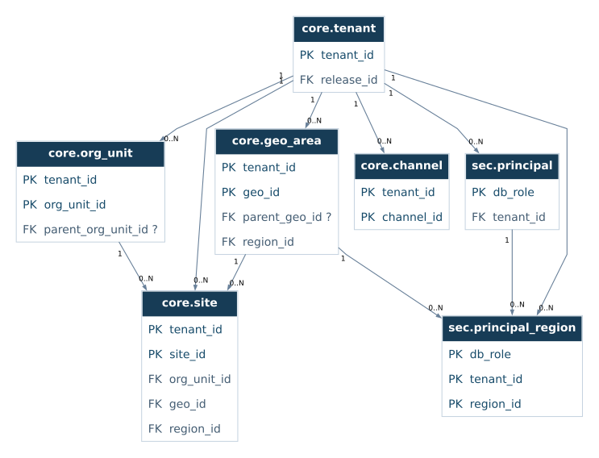

### 5.2.2 商品与有效版本

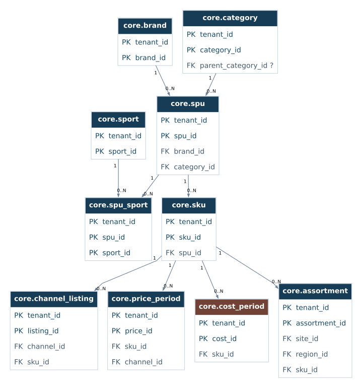

### 5.2.3 订单、身份、单件与优惠

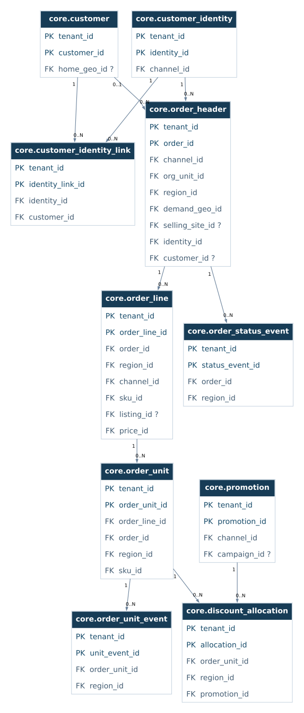

### 5.2.4 支付、退款与售后

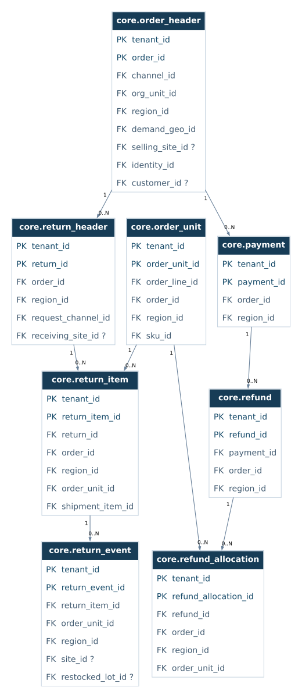

### 5.2.5 履约与锁库

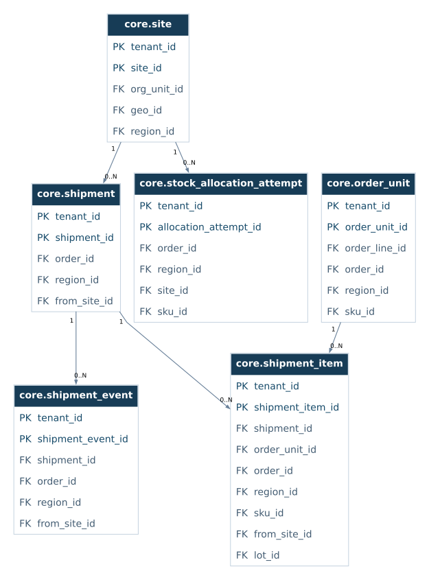

### 5.2.6 库存数量与估值

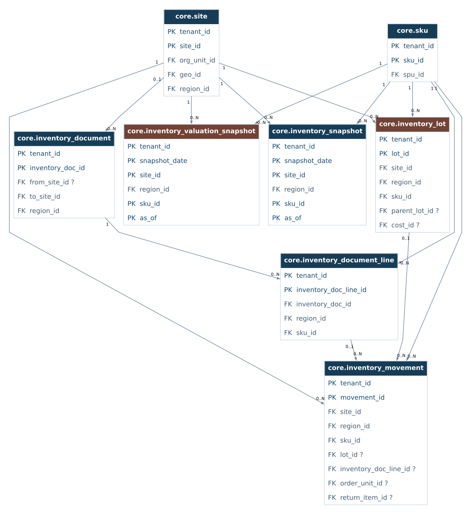

### 5.2.7 收入、成本和费用

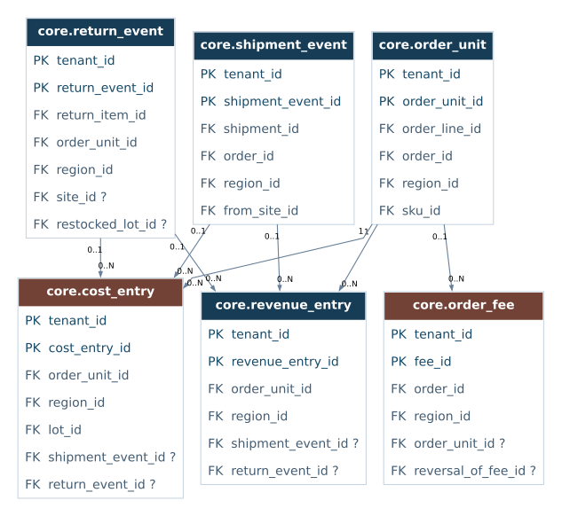

### 5.2.8 营销、流量与计划

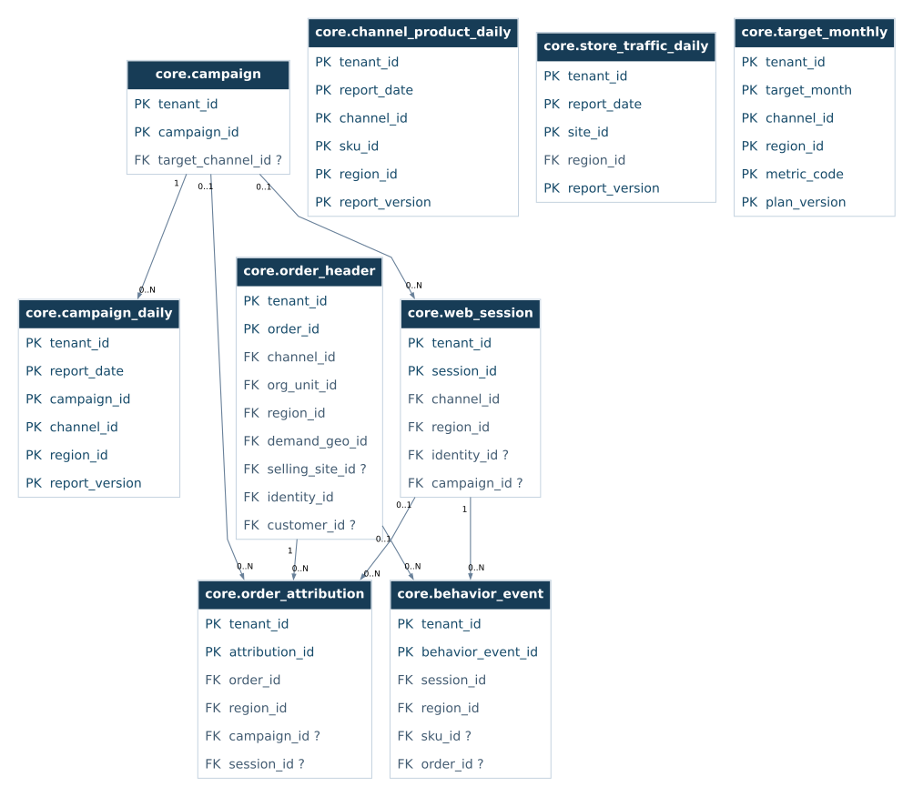

### 5.2.9 运行治理与评测

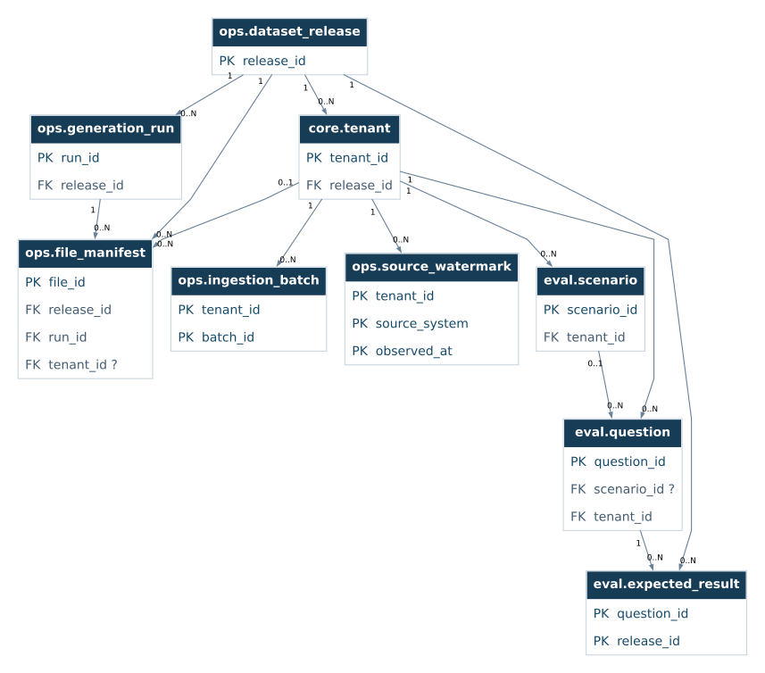

### 5.3 主外键能保障什么

现有复合 FK 已锁定租户、订单、原销售区域、单件、价格 SKU/渠道、履约地点与出库批次等关键关系。但 PostgreSQL FK 不能单独保证“这张收入分录引用的包裹事件真的交付了这个单件”，也不能保证累计退款不超过现金。必须执行 `acceptance.sql` 中对应的关联断言。

例如 H13—H20 检查 `单件 → shipment_item → 同包裹 DELIVERED` 的完整链、收入/成本金额与确认时点、退货回库新批次的 SKU、实际地点、父批次和原成本。H08—H11 同时检查原支付、退款分摊与业务退款依据；H35—H36 检查负费用沿袭与来源。违规不进入正式发布。

### 5.4 两种物理落地路径

**推荐教学路径：** PostgreSQL 承载发布、权限、任务/水位控制及小样规范数据；Parquet 保存全量规范事实和快照；DuckDB 仅由受信任查询代理读取已授权文件与时点关系。PostgreSQL 的 RLS 不能自动保护 Parquet，必须在代理/物化沙箱侧再次落实同等边界。

**对照验证路径：** 在 PostgreSQL 17 空库执行完整 DDL 后装载全部或分层小样，使用复合 FK、CHECK 和参考指标 SQL 验证兼容。百万版不默认对 5,900 万行快照再建立一套完整 PostgreSQL 索引副本。

Parquet 默认按 `release_id / tenant_id / business_month` 分区；大量日快照可按月份合并。禁止按每个 SKU/门店同时层层分区产生几十万小文件。目标文件 128—256 MiB、约 10 万行 row group 为初始调优参数。更新采用新版本分区或新 release，不原地覆盖已发布文件。主数据小表可单文件。

全量文件验收由 P2/P3 实现独立适配层：依据同一 schema_contract 在 DuckDB 上执行结构反连接及与 H/B 编号对应的语义等价断言，并在相同分层小样上与 PostgreSQL 结果逐项对照。PostgreSQL 的类型转换、JSON/时间函数、RLS 与错误码不能被假定在 DuckDB 中原样生效；适配后的断言版本、违规数和查询摘要一并写入质量报告。最终发布必须覆盖完整 Parquet 资产，不能仅凭 PostgreSQL 小样通过放行。

类型映射：smallint→int16，integer→int32，bigint→int64，date→date32，timestamptz→timestamp[us, UTC]，numeric→decimal128，text/name/char→UTF-8，jsonb→规范化 UTF-8 JSON。不要将数据库 bigint ID 自动转换成 JavaScript Number 后再序列化；超过安全整数范围时使用字符串或 BigInt。

## 6. 业务状态机和财务库存契约

### 6.1 订单、支付与履约

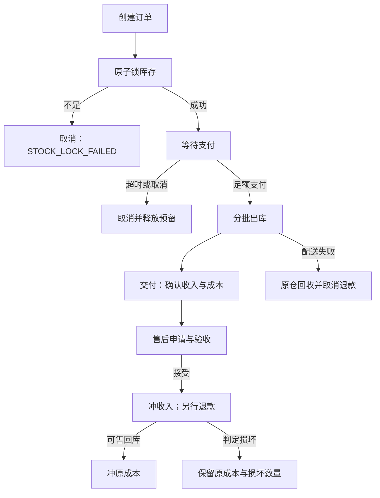

原子锁库先在临时计划中选定所有单件的候选地点和 FIFO 批次，再一起提交预留。任一必要 SKU 不足，整单不落成功预留，写锁库失败证据并取消。订单数保持精确，无需在生产最后补单。

支付与退款的 `attempted_at` 在 v1 表示**本次即时完成尝试的发生时刻**；状态为 SUCCEEDED 时，此时刻就是现金发生时刻。允许失败后重试与多笔支付，不允许用多个成功回调重复记钱。若扩展到异步挂起的支付，须新增完成时间和状态事件，不能继续把尝试时间当现金成功时间。

订单状态必须由单件状态汇总，不能用一个头状态掩盖部分出库/取消。首版每个逻辑单件最多一次出库，不含补发、换货重发、COD 或赊销。未交付退回原仓使用 RTO_RECEIPT 恢复库存，走取消退款，收入与 COGS 都为零，不套用普通已交付退货冲减。

### 6.2 整数分分摊

先算每行原价和适用优惠，再逐优惠按优先级做整数最大余数分摊。订单级优惠 D 对各行基数 b_i 分配：先取 `floor(D×b_i/Σb)`，再按余数降序、稳定行号升序补足剩余分。行净额再分到稳定 unit_no；退款永远引用固定的原单件净额。

3 件商品原价各 40 分，优惠 20 分，净额 100 分，单件净额固定为 **34、33、33**。退第 1 件就冲 34 分，不能临时取平均 33.33 后再四舍五入。头、行、单件、优惠分摊、退款分摊必须逐层对账，金额容差为 **0 分**。

### 6.3 五个库存桶

| 事件 | 可售实物 | 待检 | 损坏实物 | 预留 | 在途 | 财务影响 |
|---|---:|---:|---:|---:|---:|---|
| 采购/期初入库 q 件 | +q | 0 | 0 | 0 | 0 | 新建固定成本批次，不产生销售 |
| 预留 q 件 | 0 | 0 | 0 | +q | 0 | 无 |
| 释放预留 q 件 | 0 | 0 | 0 | −q | 0 | 无 |
| 已预留单件出库 | −1 | 0 | 0 | −1 | 0 | 固定原批次成本，此时不确认收入/COGS |
| 退货接收 | 0 | +1 | 0 | 0 | 0 | 接收本身不冲收入或成本 |
| 接受退货 | 0 | 0 | 0 | 0 | 0 | 冲原单件收入，库存不变 |
| 可售回库 | +1 | −1 | 0 | 0 | 0 | 冲原出库 COGS，新批次沿袭原成本 |
| 判定损坏 | 0 | −1 | +1 | 0 | 0 | 不再冲 COGS；损坏实物价值按本经营口径为零 |
| 实物报废移出 | 0 | 0 | −1 | 0 | 0 | 不重复扣已经保留的同一笔 COGS |

quarantine 是“隔离/待恢复可售”桶，既包括待检实物，也包括已接受退货但尚未完成可售上架的实物；接受退货本身不会把它移出该桶。可承诺数量 `available = sellable − reserved`，预留本来就在可售物理数中，出库不能重复扣两次物理库存。调拨拆成来源减可售、目的加在途、目的减在途并加可售；按原库存批次拆腿，目的新批次沿袭原成本。业务事务具有稳定 business_txn_id，每个源事件与腿号唯一。

每次**原子提交完成后**检查五桶非负、reserved≤sellable；同时检查 FIFO 批次数量。只检查日末数值会漏掉“白天卖成负库存、晚上补货补回去”的错误。

退货接收时为该退货单件在实际接收地点建立 origin_type=RETURN 的新批次，parent 指向原出库 lot、成本沿袭原批次；初始只有隔离数量，没有可售资产。随后 RESTOCKED 使用同一返回批次从隔离转可售，`restocked_lot_id` 指该批次；成本冲回分录仍引用原出库 lot。不得让接收流水记一个批次、回库时从另一个从未入过隔离的批次扣隔离数。批次数量重放和地点 SKU 五桶重放须同时一致。

v1 的 REJECTED 是实物寄回前的申请审核拒绝，不产生 RETURN_RECEIVE 或隔离数量；实物接收后走接受与可售/损坏分流。不模拟“验收拒收后再寄回顾客”的逆物流路径。损坏已鉴定且保留在损坏桶属于已完成售后，不因尚未物理报废而误判为尾窗未结。

### 6.4 指标口径

| 指标 | 定义 | 关键限制 |
|---|---|---|
| 创建订单数 | 创建时间窗口的 distinct order_id | 取消单计入；不是支付次数 |
| 实收现金 | SUCCEEDED payment 金额 | 按即时现金事件时间；重复回调去重 |
| 退款现金 | SUCCEEDED refund 金额 | 按退款事件时间；逐原支付不得超额 |
| 净现金 | 实收 − 退款 | 不等于净销售额 |
| 净销售额 | 已交付原单位净额 − 已接受退货原单位净额 | 收入确认时间属于交付/接受退货，不是退款时间 |
| 净销售成本 | 交付原批次成本 − 可售回库原成本 | 损坏退货保留原成本 |
| 商品毛利 | 净销售额 − 净销售成本 | 无成本权限输出不可用，不能把隐藏成本当零 |
| 经营贡献 | 商品毛利 − 经营变动费用 − 同粒度广告费 | 不含固定租金、人力和税，不称净利润；缺广告报告时不假定零花费 |
| 支付成功率 | 创建队列中足额支付订单 / 创建订单 | 明确队列与观察截止，不能混当日创建和当日支付 |
| 自有渠道提交转化率 | 有创建订单提交的会话 / 可观察会话 | 平台和线下不能塞入同一个用户级漏斗 |
| 30 日单位退货率 | 完整观察 30 天交付队列中，30 天内被接受退货单位 / 交付单位 | 排除未成熟队列，不能用尾窗不足的年末队列直接比较 |
| 30 日窗口内复购率 | 识别会员在窗口内首购后 30 天再购的队列比例 | 非终生首购；未识别身份不合并成一个客户 |
| 活动队列 ROAS | 指定投放期关联订单在观察截止的净销售额 / 同期活动花费 | 是归因效果，不凭此声称因果增量 |
| 库存金额 | 日末可售批次数量×原批次成本之和 | 预留含在可售物理中；不能跨日相加 |
| 存货周转天数 | 期间日均可售库存金额 / 期间净 COGS × 天数 | 净 COGS≤0 时返回不可解释/NULL；库存口径不含在途/待检/损坏 |
| 目标达成率 | 先按月×渠道×大区聚合实际，再关联当时获批目标 | 没有品类目标，不能把同一预算复制给每个品类 |

广告日报与订单明细不能直接连接后 SUM 花费。财务分录也分别聚合，再在共同粒度连接，避免收入×支付×退货形成倍增。`channel_product_daily.report_date` 固定为**订单创建日期 cohort**，后续支付通过 report_version 修订；含同 SKU 的订单数不可跨 SKU 求和当独立订单总数。

## 7. 基于 Contoso 的完整生产路线

### 7.1 真实复用边界

基线仓库为 [sql-bi/Contoso-Data-Generator-V2](https://github.com/sql-bi/Contoso-Data-Generator-V2)，固定提交 `eaeb57a9eaa6ad0cdab4fb527552102685434ee0`。固定提交的项目使用 net8.0，原 PreBuild 使用 Windows cmd；Linux 构建必须改为跨平台元数据步骤。保留 MIT 许可证、原始来源与 fork 补丁。官方 WeekDaysFactor 从周日开始，profile 使用 ISO 周一至周日；投影时必须旋转为 `[周日,周一,…,周六]`，不能直接传原数组。

官方配置支持时间分布、行数/数量权重及相关参数，商品输入使用固定模型列。官方 Sales 与 Orders+OrderRows 是相同交易的两种表示，不能被误认为本方案已经具备独立支付、库存和售后链。[官方配置](https://docs.sqlbi.com/contoso-data-generator/config-json) · [输入模型](https://docs.sqlbi.com/contoso-data-generator/config-data) · [项目说明](https://docs.sqlbi.com/contoso-data-generator/details)。

| Contoso C# 负责 | Python 负责 | SQL/独立验证负责 |
|---|---|---|
| 导出日历/商品权重；给定上下文抽候选行、商品和数量 | 中国企业主数据、精确槽位、价格优惠、库存资金状态机、采集到达模拟、规范事实 | 重算指标、关系和金额断言、独立金标、数据发布判定 |

新增 weights/proposals 接口是本方案要求开发的接口，不是上游已经存在的 CLI。`contoso_patch_contract.json` 列出了 6 个现有文件的改造、9 个拟新增文件、10 个中间资产以及验收项，供实施时逐项交付。

### 7.2 无循环的生产 DAG

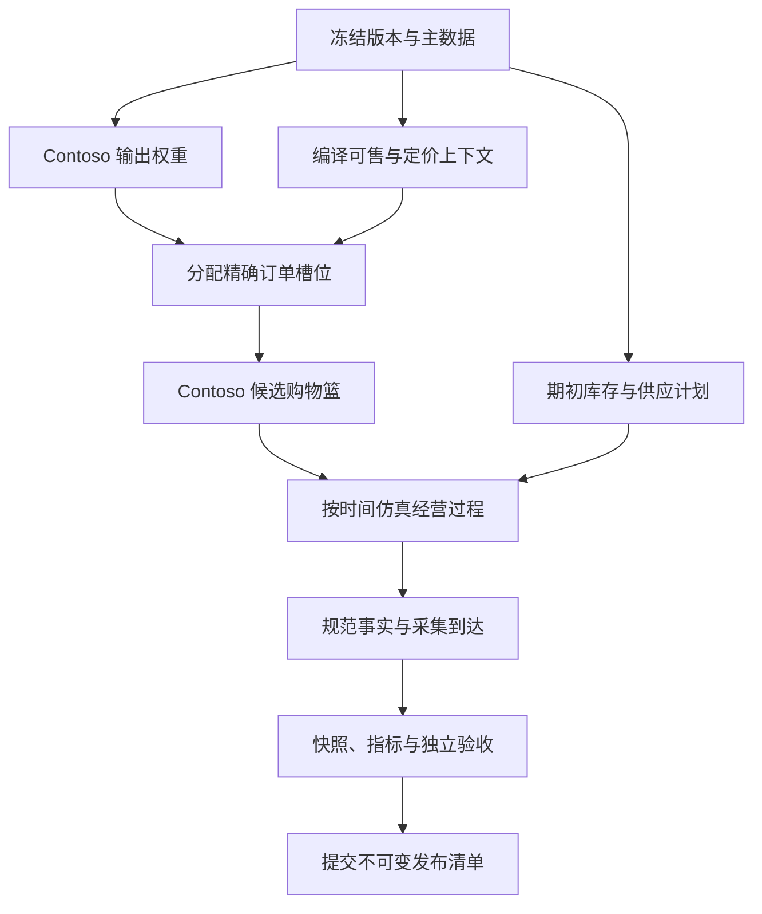

渠道、地区、身份、门店和营销上下文在候选购物篮之前确定。可售集合按上架、区域、渠道、品类/规格规则过滤，**不按实时是否有货过滤**。库存不足是仿真后的可观察经营结果。

### 7.3 主数据生产

先产生租户、区域/城市、组织、站点和渠道；再按品类模板生成 SPU/SKU、品牌与标签；随后产生有效上架、地点经营范围、售价和采购成本版本。会员与渠道身份使用合成令牌和分群，禁止引入真实姓名、手机号或收货地址。人口统计字段仅为课程分群标签。

为每个日期和业务上下文预编译非空的候选商品集合。每个商品必须有创建时有效且已发布的价格；停售只禁止新订单，不能把历史订单、退货或残余库存删掉。预算在月份开始前依计划产生，不用实际未来销售倒推出“正好达成 100%”的目标。

### 7.4 精确订单槽位

先把 Contoso 日权重、季节、年度增长和活动合成 W_d；百万版显式关闭额外日级噪声。对每个租户的 N_t 按 `N_t×W_d/ΣW` 求期望，取整数部分，再按小数余量降序补足剩余槽位。日期是相同余量时的稳定排序键。商品流行度采用 mu=0、sigma=1 的固定命名抽样与 Python Box–Muller 变换，生成后固化权重供 C# 消费；各品类另有自己的 12 月季节乘数。

这样恰有 900,000/50,000/50,000 个槽位。每个槽位在上下文计划中一一对应未来创建订单，整个过程中不靠最后 truncate/复制/补随机单来凑数。固定 100 万总量意味着活动提高某段需求会重分配其他时间的份额，不能同时声称额外净增总订单。

### 7.5 库存与状态推进

期初库存依据**配置需求期望**、库存覆盖天数和安全库存计算，不能先看完未来真实订单再精准配货。运行时依据当时可售、预留、在途和预测触发补货，独立抽取交期。全渠道共享库存池是缺货联动的来源。

每租户维护完整事件队列，排序键为 `(event_time, phase_priority, stable_entity_id, event_sequence)`。同一时间供给/回库、取消/到期、创建/预留、支付、出库、交付和售后采用固定优先级。支付恰好到截止时刻按超时处理；不能依赖线程完成顺序决定谁抢到库存。

所有规范金额和事件由一个 Python 领域状态机产生。收入、成本和库存快照从来源事件派生，不另抽一套随机数字。行为也与同一购物上下文耦合，接受创建的自有订单具有可回连会话；额外产生未提交、失败结算和浏览会话形成漏斗分母。

### 7.6 来源到达与报表修订

按源配置采集频率和正常延迟。available_at 至少为业务事件、采集批次到达和必要父记录可见时刻的最大值。WMS 同地点事务按提交顺序到达，防止“出库先到、期初入库后到”制造无业务含义的负库存快照。

广告、平台 SKU 和门店客流日报是带版本的源报告；迟到修订追加 report_version，不覆盖旧版。每个 campaign 只有一个非空 target_channel，跨渠道活动拆记录；每个活跃日为该租户全部经营大区生成报告，未投放地区也提供明确的零记录，确保应到粒度可枚举。完整性水位来自应到批次连续覆盖，**不是 MAX(event_at)**。故意注入门店/POS 延迟时，同时保留缺批和水位证据，使 Agent 能区分真实下滑和数据未到。

### 7.7 从源事实落到分析资产

依次执行：主数据与引用校验 → 订单/支付/履约/库存规范化 → 事件确认收入/成本 → 日末数量/批次金额快照 → 源日报版本选择 → 指标与评测结果。最终库存快照只能回答其 publication knowledge cutoff 下的状态；历史可知状态必须重放当时可见流水，不能简单过滤最终快照的 available_at。

全部 63 表逐表来源、转换与验收见 `generation_mapping.md`。生成阶段的输入输出、字段契约、种子、并行、恢复与原始源码位置见 `generation.md` 与补丁 JSON。

## 8. 可复现、恢复与幂等

**确定性本地 ID 协议 `tenant_namespace_monotonic64_v1`：** 对每个 `(tenant_id, entity_namespace)` 独立维护正整数计数器，本地 BIGINT ID 就是该命名空间内的 ordinal，范围为 1 至 2^63−1；不依赖数据库 sequence、工作线程或截断哈希。普通实体的命名空间为其权威表名；单独的业务事务组使用 `BUSINESS_TXN`，同一次预留的 allocation_group_id 与 business_txn_id 复用其同一 ID。FK 字段复制父实体 ID，不在子表重新编号；日期、字符串、tenant_id 等自然键不套用本协议。

静态实体按冻结、无歧义的业务键排序分配；动态实体按本租户固定事件队列顺序和稳定子项顺序分配。同一个语义键再次出现时必须复用原 ID，若载荷不一致则报幂等冲突。队列中的 stable_entity_id 表示可在分配前构造的稳定业务键，例如“订单槽位＋事件类型＋业务尝试序号”，不依赖待分配的动态 ordinal。命名空间计数器、语义键→ID 映射与检查点一起原子保存，跨月不清零，达到 BIGINT 上界立即失败。随机抽样也使用稳定业务键，不使用动态 ordinal；增加其他业务事件不应扰动既有需求随机流。同配置重跑/恢复保证 ID 相同，不承诺改变场景后所有派生 ID 仍保持原编号。

随机协议固定为 `sha256_named_uniform52_v1`。随机键 `(version, seed, tenant_id, stage, entity_id, draw_name, counter)` 的各项均为 ASCII 字符串，编码为无空白 UTF-8 JSON 数组。SHA256 前 8 字节按大端读取，右移 12 位取 k，`u=(k+0.5)×2^-52`，在 float64 中严格位于 (0,1)。CDF 选择按固定排序及补丁契约边界执行；附带 3 组跨语言已知答案向量和 Python 参考验证。新增一次退款抽样不能改变原订单的商品，禁止将摘要简单截成 32 位作订单独占 seed。超越函数的变换只在冻结 Python 工具链中执行，C# 读取已导出权重，不要求两种数学库的 log/cos 逐位相同。

上游有局部固定 seed 的 Random 使用，但没有本方案的全局 master seed、命名随机流或跨阶段恢复协议。有限 fork 会新增这些能力；它不保证与未经修改的 Contoso 逐行一致。

候选阶段可按租户/日期并行；状态模拟首版仅按租户并行，同一租户完整时间线串行推进。不能把 36 个月各自从同一期初库存重跑后拼接。主租户占 90%，三个 worker 不意味着三倍加速。

每天业务水位建立检查点，保存五桶库存、FIFO 批次、预留归属、未终结订单、累计支付退款、全部未来事件队列、在途采购、输出分区及输入哈希。检查点与事实输出一起由完成标记提交；失败后只恢复最后完整检查点并幂等重放。

业务复现标准是主键排序后的逻辑行哈希相同。相同依赖和写入器配置下再比物理 Parquet SHA256。attempt_id、实际机器时间、worker 编号不能参与业务 ID 和随机键。

## 9. 多租户、区域与历史时点访问

### 9.1 可执行数据库授权

`02_security.sql` 为 53 张 core 表建立显式白名单分类、ENABLE/FORCE RLS 和只读角色。身份从真实 `session_user` 查询 sec.principal 与区域授权，不信任业务 SQL 可以自由修改的 `SET app.tenant_id`。新增未分类 core 表会使安全部署失败。

成本表另外检查 can_view_cost。区域用户不能直接读客户/渠道身份源表，只能通过已授权订单关联的粗粒度客户视图。商品和地点名称是租户内共享维度，实际库存事实按地点区域过滤，销售/收入/成本按订单区域过滤。

业务角色不得拥有源表、SUPERUSER/BYPASSRLS/CREATEROLE、控制面表权限或 helper owner 角色。FORCE RLS 对超级用户/BYPASSRLS 无法提供同样限制，因此运行时连接不能借用加载/管理员登录。[PostgreSQL RLS](https://www.postgresql.org/docs/17/ddl-rowsecurity.html)。受控辅助视图有明确 owner 和安全策略；普通指标函数使用调用者权限，避免视图所有者意外扩大可见范围。[CREATE VIEW](https://www.postgresql.org/docs/17/sql-createview.html)。

### 9.2 Parquet 与 AsOf 的信任边界

一个 `tenant_id=101` 文件夹不是权限。业务 Agent 不持有底层对象存储凭证、DuckDB 任意文件读取能力或数据库管理员连接，只调用受信任查询代理。代理先认证身份、解析 reference_time，再绑定 business/knowledge cutoff 和允许访问的关系，最后执行只读查询。

建议实现两种受控方式之一：为已授权范围及历史 cutoff 物化独立只读沙箱；或由代理提供经 AST 白名单验证的 asof 关系与参数化 SQL。若采用后者，禁止用户 SQL 访问原始 core/eval/ops、文件读取函数、任意扩展、外部 URL、SET/COPY/ATTACH/DDL；拒绝多语句和绕过 asof 的函数。结果缓存键包含 release、principal/scope hash、business cutoff、knowledge cutoff、reference_time、metric_version 和查询参数。

这部分是生成器/查询服务实现任务，**现有 RLS SQL 不是一个已完成的时光回溯代理**。历史客户绑定、源报告、预算、订单状态和库存都必须遵守对应时点；只在收入表加一个时间 WHERE 并不够。

### 9.3 历史关系重建规则

| 资产 | 截止处理 |
|---|---|
| 订单头 | ordered_at<business cutoff，available_at<knowledge cutoff |
| 订单行/单件/优惠 | 自身可见且所属订单在快照内；不回填未来绑定 |
| 支付/退款/物流/售后/库存/收入/成本 | 业务事件小于 business cutoff，自身和必要来源可见 |
| 当前订单状态 | 双时钟过滤后，按 event_at/event_seq 选最后一个状态；无事件标 UNKNOWN |
| 客户身份绑定 | linked_at 与 available_at 均符合时点；订单已有 customer_id 快照保持不变 |
| 有效价格/上架/活动 | 只选已发布版本；按事件时点匹配有效区间，不拿最新价重算历史 |
| 日报/预算 | 先过滤可见时点，再按业务键选最新报告/计划版本 |
| 日末库存 | 从该知识时点可见的库存流水重放到业务日末；最终快照仅作为相应时点的加速结果 |
| 水位 | observed_at<knowledge cutoff 后取本源最新观测，不用未来补齐结果遮盖当时缺报 |

## 10. 经营情节、看板与监测任务

默认配置保留 8 类情节，每类具有明确干预点、日期、影响对象、可见证据与独立真值。具体 ID 在主数据冻结后由稳定代码解析为实际主键，解析失败必须报错。

| 情节 | 干预方式 | Agent 应观察的证据 | 不应出现的做法 |
|---|---|---|---|
| S01 大促增长但毛利承压 | 提高活动权重、折扣与投放花费 | 创建/支付/交付、原价与优惠、成本、投放报告 | 直接修改最终毛利表使它下滑 |
| S02 核心鞋码缺货 | 延迟目标 SKU 补货，需求槽位保持 | 采购计划/实际到货、锁库尝试、库存可承诺、取消原因 | 重抽成有货尺码，让缺货消失 |
| S03 某鞋款尺码退货升高 | 修改目标款/尺码的退货请求机制 | 原单位交付队列、SIZE 原因、成熟 30 日退货率 | 把未成熟队列和成熟队列混比 |
| S04 广告流量增但转化未改善 | 增加可观察自有会话/无购买轨迹 | 流量、提交/支付漏斗、广告花费与身份可识别率 | 为平台随造一套逐用户日志 |
| S05 区域渠道结构变化 | 改地区×渠道需求权重/门店运营范围 | 可比门店、渠道迁移、结构与总量分解 | 把所有变化归因成客单价变化 |
| S06 季末清仓与库存老化 | 对历史款优惠、降低采购/上新权重 | 折扣、原批次年龄、可售库存价值、净销售与毛利 | 最新采购成本覆盖旧库存成本 |
| S07 POS 数据迟到 | 延迟选定门店批次 available_at | 源水位、应到/已到批次、历史报表重述 | 直接把当天销售改少，又不给延迟证据 |
| S08 跨租户/权限诱导 | 复用相似订单编号，构造越权查询题 | 被拒绝/裁剪的结果与审计记录 | 将正确金标、scenario 参数暴露给业务 Agent |

“场景设定参数”不等于“最终结果数值”。如果没有受控对照运行，Agent 应用证据描述驱动因素，不宣称已估计因果增量。S02 等机制对照可共享 context_plan/proposals，只改供应过程，避免同时改变需求造成无法解释的比较。

| 工作负载 | 课程计划 | 所需数据就绪条件 | 输出 |
|---|---|---|---|
| 老板临时问答 | 自然语言按需 | 权限、指标定义、业务与可知时间明确 | 图表+指标口径+证据时间+缺失说明 |
| 日经营看板 | 每日 09:00 北京时间 | 昨日 OMS/POS/WMS/ERP 水位检查 | 净销售、毛利、区域/渠道、退货与库存风险 |
| 周经营会 | 周一 09:30 | 固定上周范围与会议观察截止 | 趋势、结构贡献、目标偏差、需下钻事项 |
| 库存监测 | 每小时 | 最新有效 WMS 水位 | 缺货 SKU、可承诺量、补货计划、持续异常时长 |
| 数据质量监测 | 每 15 分钟 | 应到批次计划 | 未到/迟到、影响指标范围、恢复后重述 |
| 月复盘 | 每月初固定截止，允许后续重述 | 明确初版与重述版 | 当时结果、修订差异、原因与版本 |

这些是项目工作负载设计，不是本次已创建的真实定时任务。数据生成器不替代 Agent 调度平台；它提供能支撑这些任务的事实、时间和证据。

## 11. 验收体系与实际验证边界

### 11.1 发布硬门禁

**结构门禁：** 63 表字段契约一致、PK/复合 FK、可空、类型、枚举、版本区间。Parquet 不会自动执行数据库 FK，必须按同一 schema_contract 运行反连接校验，并保留每个断言的违规数量与有限样例。

**业务门禁：** `acceptance.sql` 的 77 个只读断言涵盖订单配额、时间、金额/数量四层守恒、足额支付、退款三重上限、分录来源链、原批次成本、库存原子提交、事件来源幂等、归因证据和采集批次到达。其中 41 项逐审计资产检查 available_at 与来源批次。

**仍须在生产工程实现的门禁：** 全量库存快照与独立流水重放一致；FIFO 批次余额与出库选择；调拨跨地点/批次数量守恒；每个状态机合法前置状态；所有有效区间不重叠；源报表 cohort 对账；来源行数/manifest/逻辑哈希；尾窗未决状态为零或在明确允许列表；失败恢复和不同受支持 worker 数逻辑结果一致；完整 Agent 查询代理权限与时间绕过攻击。不要把 SQL 附件误称为这些外围门禁的完整运行器。

### 11.2 软分布与情节验收

只对声明为硬配额的数量强制精确。各品类销量、支付/退货概率、会话数、物流时长、长尾分布采用配置期望、样本量和容差报告；不用一个偶然随机结果失败就改数据“调到正好”。零销量长尾 SKU 可以存在，核心经营组合必须具备足够观察样本。

情节验收要求指标方向、可观察机制证据和金标查询一致，并保存足量样本。指标差异阈值应在试产后冻结，不将设定的概率当作实际退货率。30 题金标由独立 SQL/验证器生成，Agent 自己写出的 SQL 不能充当唯一正确答案。

### 11.3 8 单金标的关键结果

金标包含 8 个订单、11 个逻辑单件，金额故意采用很小的整数分以便手工审计。下表每列的 business_as_of、knowledge_as_of 和 reference_time 都取列首日北京时间 00:00，使用排他截止。

| 指标；金额单位为分，库存数量为件 | 2026-01-01 | 2026-02-01 | 2026-04-01 |
|---|---:|---:|---:|
| 累计成功收款 | 2,501 | 2,501 | 2,501 |
| 累计成功退款 | 0 | 667 | 867 |
| 净现金 | 2,501 | 1,834 | 1,634 |
| 净销售额 | 551 | 1,634 | 1,634 |
| 净销售成本 | 330 | 1,120 | 1,000 |
| 商品毛利 | 221 | 514 | 634 |
| 可售实物数 | 15 | 14 | 15 |
| 预留数 | 4 | 0 | 0 |
| 隔离/待恢复可售数 | 0 | 1 | 0 |
| 损坏留存数 | 0 | 1 | 1 |

12 月一笔 800 分收入、480 分成本的交付数据在 1 月 2 日才可见。12 月经营报表固定 business_as_of/reference_time=2026-01-01 00:00+08，knowledge_as_of 从元旦改为 2026-02-01 00:00+08，净销售/成本由 551/330 重述为 1,351/810；两组均是各自知识时点的正确答案。退款现金可以晚于接受退货和回库，不能用一个最终状态覆盖以上差异。

独立 fixture 检查使用单独规范化金标台账执行 SQL，再和手工固定预期比对；它没有调用生产生成器的算法。实际结果详见 golden_fixture_report.json。它并不声称已经完成 63 表全量业务装载。

### 11.4 本次实际做过的验证

DDL 在 PGlite 的 PostgreSQL 17.5 引擎执行；77 个 SQL 断言均通过语法及结构执行检查，空库执行的配额失败是预期、不是百万数据已通过。额外构造了跨租户外键、错 SKU 价格引用、错误金额、负库存快照等拒绝样例，并执行真实 session_user 的租户/区域/成本隔离与受限表访问负例。

金标另行核对三个历史截止、逐 SKU 五桶、现金去重、整数分、部分退货和迟到重述。最终报告记录确切检查数。PGlite 验证证明 SQL 与小样策略可执行；完整 PostgreSQL 服务、对象存储/查询代理、云端并发、全量生成和性能仍须按下一章实施验证。

## 12. 实施任务与退出标准

| 阶段 | 实施任务 | 必交付产物 | 退出标准 |
|---|---|---|---|
| P0 契约冻结 | 冻结 profile、指标、schema、来源与安全边界 | 上游 source lock、配置哈希、许可证、ADR | 上游源码摘要实际取得；无自相矛盾口径，尚未构建的 fork/build 摘要列明由 P1 完成 |
| P1 Contoso 有限 fork | 跨平台构建、纯权重输出、context 输入、候选模式、命名随机流 | 可构建 fork、实际 fork_commit/image digest、工具链锁、跨语言 RNG 向量 | 构建、候选、输入、RNG 子集验收通过；不触发默认外网客户下载 |
| P2 主数据与经营模拟器 | 条件商品集合、槽位、整分、状态机、FIFO、源到达 | Python 分阶段生成器、检查点、血缘 | 8 单机制结果和所有状态边界可复现；23 条补丁/域接口验收在 P2/P3 整体闭环 |
| P3 分层小样 | 全部租户/渠道/状态/情节的小样；容量探测 | 小样发布、硬门禁、分布与资源报告 | 无违规，测得每表字节/行和事件吞吐 |
| P4 百万正式生产 | 900k/50k/50k；完整 36 个月与尾窗 | 不可变规范数据、manifest、快照 | 精确配额、全量业务/文件/恢复门禁通过 |
| P5 Agent 接入 | 权限、AsOf、指标、图表、任务消费、缓存 | 查询代理、30 题金标结果、任务样本 | 错租户/错时点/错单位为阻断项，水位不足能明确反馈 |
| P6 交付归档 | 复跑与中断恢复、版本发布说明 | 最终数据包、质量报告、操作手册 | 再运行逻辑哈希一致；无未声明空资产或跳过门禁 |

建议按职责分工：数据工程负责人控制模型、采集与发布；生成器工程师负责有限 fork 和 Python 状态机；分析工程师独立定义指标/金标；平台工程师实现权限、时点代理与任务隔离。可由同一人兼任，但金标计算路径必须与生产过程相互独立。

小样分两类：8 单金标用于严格结果；分层 10,000 单用于完整链路与资源测量。10,000 单不得据此承诺百万配置全部业务分布已经校准，尤其库存组合数和长尾仍需全配置探测。若缩小主数据或日期范围，必须使用不同 profile/release 名称，不能混入百万版交付。

### 12.1 发布时的 Definition of Done

- 已创建订单精确 1,000,000，租户配额、日期范围和源候选覆盖完全一致。
- 63 表中的每个资产都有 schema、主责、实际行数、输入血缘和质量结论；设计为空的可选表需要声明原因。
- 每个 SKU/站点的库存和原批次成本可独立重放；零库存与残余库存没有被省略。
- 所有金额对账零差异，部分退款、晚退款、损坏退货与跨月交付均通过金标。
- 发布门禁全部通过；软分布、未归因比例、样本成熟度和源延迟有明确报告。
- 30 题绑定数据版本、身份、三个时钟、单位/排序/图表形态、独立金标及容差。
- 实际验证连接身份不会跨企业、跨授权区域、绕过成本权限或读取 eval；查询代理另通过文件/时间/SQL 绕过攻击测试。
- 同配置 seed 重跑与中断恢复逻辑哈希一致；完整 manifest 最后提交，旧版本可继续读取。

## 13. 交付包运行说明

本包中可直接执行的是**规格编译与小样验证工具**，不是尚待开发的百万订单生成命令。安装依赖后，从包根目录执行：

```bash
python3 tools/build_contract.py
python3 tools/build_acceptance.py
node validation/validate_spec.mjs
node validation/run_golden_fixture.mjs
```

验证工具依赖 `@electric-sql/pglite@0.3.10`；本次对应 PostgreSQL 17.5。按项目包管理方式安装到独立开发环境，或通过 PGLITE_MODULE 指向已安装模块。ER 重绘另需 `@viz-js/viz` 与 `sharp`；图像工具不是生产生成器必需依赖。实际依赖精确版本与验证运行环境见包内 manifest/报告。

应用数据库建表顺序为 01_schema → 装载受控数据 → 02_security → 03_metrics；需要预先部署权限的环境应使用明确受控加载角色。业务登录凭证由部署系统创建，不在数据文件或本包中包含。所有新生成器命令应在完成 P1/P2 后再进入真实 runbook，不能把设计阶段名称当作现成命令交付。

## 14. 参考来源与设计来源说明

1. [Contoso V2 官方仓库](https://github.com/sql-bi/Contoso-Data-Generator-V2)；本方案固定提交 [eaeb57a9eaa6ad0cdab4fb527552102685434ee0](https://github.com/sql-bi/Contoso-Data-Generator-V2/tree/eaeb57a9eaa6ad0cdab4fb527552102685434ee0)。
2. [官方生成配置说明](https://docs.sqlbi.com/contoso-data-generator/config-json)。用于核对数量/时间/权重及输出形式能力，不代表上游已经提供本方案的精确槽位算法。
3. [官方输入模型说明](https://docs.sqlbi.com/contoso-data-generator/config-data)。用于核对固定输入列和权重模型；本方案 SPU/SKU、多租户、库存与退款由定制域扩展。
4. [Contoso 项目详情](https://docs.sqlbi.com/contoso-data-generator/details)。完整源码文件链接与核验点见 generation.md 的来源节。
5. [PostgreSQL 17 行级安全](https://www.postgresql.org/docs/17/ddl-rowsecurity.html)；[视图安全语义](https://www.postgresql.org/docs/17/sql-createview.html)。用于数据库权限边界和视图行为。

其余企业名称、规模、概率、工作负载、会计经营口径、生产架构、状态机与验收门禁均为本课程设计。来源代码事实、设计建议、已执行验证和待实施项在本文中分别明确，避免把计划当作现成功能。
