# Compass 业务数据生产方案

> 2026-10-26 目录职责调整：依据课程负责人在本次会话批准的迁移方案，生成器、冻结素材、候选库迁移与测试移入 `tools/data-seed/`，owner 为 `data-seed/retail`。根命令保持兼容，Agent 保留自身应用迁移和三天样本；DDL 唯一源仍为本目录 `business-schema.sql`。既有数据库、`retail_0001` revision、版本表与已发布数据包保持原样。验收包括独立工具 lint / typecheck / 离线测试、根 check / build、候选库发布与恢复回归、Agent 镜像隔离及 home 脚手架页同步。实现和本次证据见 [实施记录](../IMPLEMENTATION.md)。

> Feature：[998](../BRIEF.md) · Profile：`standard` · 状态：`review` · 更新：2026-10-22。沿用[标准设计模板](../../_templates/TECH_DESIGN.tmpl.md)增量维护。
>
> 本文先讲要构造什么业务世界，再讲数据从哪里来、如何生产。业务目标依据 [999 PRD](../../999-compass-product-course-landing-app/spec/PRD.md) 的经营范围与 S01–S12；不包含 Agent 系统表或平台初始化。
>
> **本次阅读从 §10 开始：业务多样性与 AI 辅助生成修订提案。** 用户要求先研究和设计，本次未修改生成器、DDL 或活动数据库。§1–§9 保留首轮设计基线；其“尚未生产”描述属于历史，实际首轮交付见[实施记录](../IMPLEMENTATION.md)。首轮工程门禁通过，不代表业务真实性验收通过。§10 的规则、配额调整与结构变化均待评审。

> **最新增量为 §11：诊断情节可复现的数据调整。** 依据 2026-10-22 的[实际诊断验收](../test/TEST_PLAN.md)，说明要补的事实、过程机制与验收条件；本节为设计建议，尚未实施。§10.13 记录上一轮已授权落点。

## 1. 我们要用这批数据回答什么问题

业务背景是一家在中国经营的虚构运动户外品牌集团“行野运动集团”：同时经营天猫、京东、抖音、自有小程序、APP、门店与奥莱，销售鞋服、露营、骑行等商品；存在跨区履约、促销、退货、库存不足和投放活动。另有两个独立企业“越岭户外”“潮跃运动”，用于检验业务租户隔离，不能简单复制主企业再改 ID。

数据需要让经营问题沿事实追到原因，例如：

- 净销售下降：能分辨订单减少、支付失败、交付延迟、退货增加和数据晚到。
- 畅销鞋缺货：能从 SKU、仓店、锁库失败追到补货/调拨和原库存批次。
- 活动收入增长而毛利下降：能对账优惠、交付收入、原批次成本、费用和退款。
- 新老客与留存：能区分未知会员、当时已知绑定、成熟/未成熟观察窗。
- 预测、实验与因果分析：有足够历史、未转化样本和反例；不把相关性或样本不足包装成确定结论。

**本版目标是可验证的合成经营数据。** 原型里的数字只说明展示方式，不是必须拟合的真值。本方案采用 10 万订单 `demo` 作为建议首批规模，附 1 万开发版与百万扩展版；规模、日期和 Contoso 复用仍为设计提案，尚未批准或生产。

## 2. 分成八大业务域，业务如何串起来

| 业务域 | 负责回答的问题 | 业务表数 |
|---|---|---:|
| [组织、区域与渠道](#31-组织区域与渠道) | 谁经营、在哪里经营、通过什么渠道成交 | 6 |
| [商品、经营范围与价格](#32-商品经营范围与价格) | 卖什么、哪些规格、在哪里可卖、当时什么价格 | 10 |
| [会员与渠道身份](#33-会员与渠道身份) | 谁购买、是否已识别为会员、如何跨渠道关联 | 3 |
| [交易、支付与退款](#34-交易支付与退款) | 下单、优惠、支付和现金退款 | 9 |
| [履约与售后](#35-履约与售后) | 发货、交付、退货、验收和回库 | 6 |
| [库存与供应流转](#36-库存与供应流转) | 开账、采购、调拨、锁库、实物与库存估值 | 7 |
| [财务经营与目标](#37-财务经营与目标) | 收入、成本、费用与经营目标 | 4 |
| [营销、流量与实验](#38-营销流量与实验) | 活动、行为、来源报表、归因和实验 | 11 |
| **合计** | **53 张原业务表+3 张实验表** | **56** |

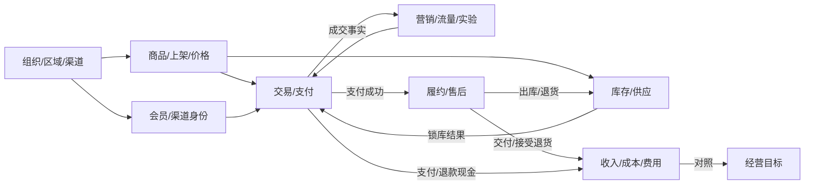

这是业务关系图，生产时按事件时间推进，不能按图上循环反复独立造数。**先定义计划和主数据，再模拟一次完整业务过程，最后聚合报表。** 活动先存在，活动报表在订单结果产生后计算；库存先有开账/供应，再参与订单锁库。

此外保留 **7 张业务生产辅助表**：5 张 `ops` 记录数据版本/采集/生产批次/文件/水位，2 张 `sec` 记录数据库源侧只读身份。它们不计入八大业务域，详见 §3.9。当前默认完整 DDL 共 **63 表、655 字段、225 个外键**；原材料的同名“63 表”含私有 eval 三表，本版剔除它们并加入实验三表，两个 63 的内容不同。

## 3. 每个业务域有哪些表、怎样关联

当前结构版本建议登记为 `compass-retail-1`，与原材料版本分开，发布时同时校验SQL哈希。完整可执行建表文件为 **[business-schema.sql](business-schema.sql)**；完整字段说明为 **[business-data-dictionary.md](business-data-dictionary.md)**。SQL 包含全部字段、类型、可空、主键、唯一约束、CHECK、外键、索引与注释，面向单源空候选业务库。各域下列数量均指 §4 的 **10 万订单 demo 建议版**；“精确”是计划配额，范围是试产估算，均不表示已生成。

ER 展示域内全部业务引用及必要跨域父表，省略重复的 tenant/采集批次边；完整复合外键以 SQL 为准。图中下划线节点名对应 schema.table，外域节点是引用，不重复建表。所有业务键跨域传递 tenant_id，calendar 是共享日历。

### 3.1 组织、区域与渠道

回答“哪个企业、哪个区域、什么渠道、由哪家门店或仓库经营”。这些是全库共享的经营坐标。

企业是隔离单位；同一企业的品牌、部门和区域保留在同一租户。渠道描述在哪里下单，site 描述实际门店/仓库。销售区域沿订单保存，库存区域沿实际地点保存。

| 表 | 一行代表什么 | demo 计划行数 |
|---|---|---|
| `core.tenant` | 一个独立经营企业 | 3（精确） |
| `core.geo_area` | 一个地理节点 | 63（7 大区及各 1 省/市节点×3 租户，建议） |
| `core.org_unit` | 一个经营组织 | 约 37 |
| `core.site` | 一个实体门店或仓库 | 14：10 门店+4 仓（精确） |
| `core.channel` | 一个销售渠道 | 21：7 渠道×3 租户（精确） |
| `core.calendar` | 一个本地自然日 | 1,186（精确） |

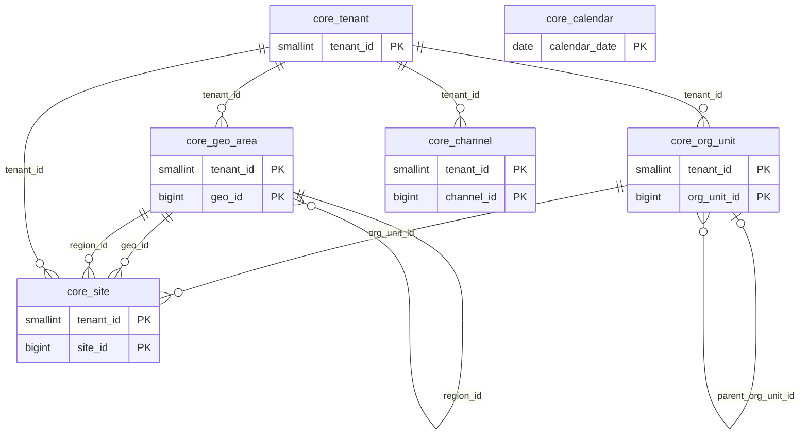

**本域构造顺序：**先造 tenant、地理/组织层级与 calendar，再造 site/channel；父节点先于子节点。地域节点允许先建大区后补自引用关联。

**跨域关系：**企业→地理/组织→门店仓库；下游所有事实带 tenant，订单引用渠道与销售区域，库存引用地点。

### 3.2 商品、经营范围与价格

回答“卖什么商品、有哪些规格、在哪些渠道/地点经营、当时的售价与采购成本是多少”。

一个 SPU 归一个可加总的叶子品类；运动标签多对多。鞋服按尺码/颜色，器材按重量/型号。SKU 是下单与库存的最小商品单位。

| 表 | 一行代表什么 | demo 计划行数 |
|---|---|---|
| `core.brand` | 一个自有品牌 | 7（精确） |
| `core.category` | 一个商品分类节点 | 96：8 一级+24 二级×3 租户 |
| `core.sport` | 一个运动标签 | 24：8 标签×3 租户 |
| `core.spu` | 一款标准商品 | 160（精确） |
| `core.spu_sport` | 一个 SPU 与运动标签的关系 | 240–400 |
| `core.sku` | 一个可售商品规格 | 1,280（精确） |
| `core.channel_listing` | 某渠道商品编码的一个有效版本 | 4,500–12,000 个有效版本 |
| `core.assortment` | 一个地点 SKU 的经营有效区间 | 2,700–5,400 个经营区间 |
| `core.price_period` | 一个 SKU 渠道价格的有效区间 | 约 0.5–4.8 万，按有效 SKU×渠道×价格版本 |
| `core.cost_period` | 一个 SKU 标准采购成本的有效区间 | 1,280–5,120 |

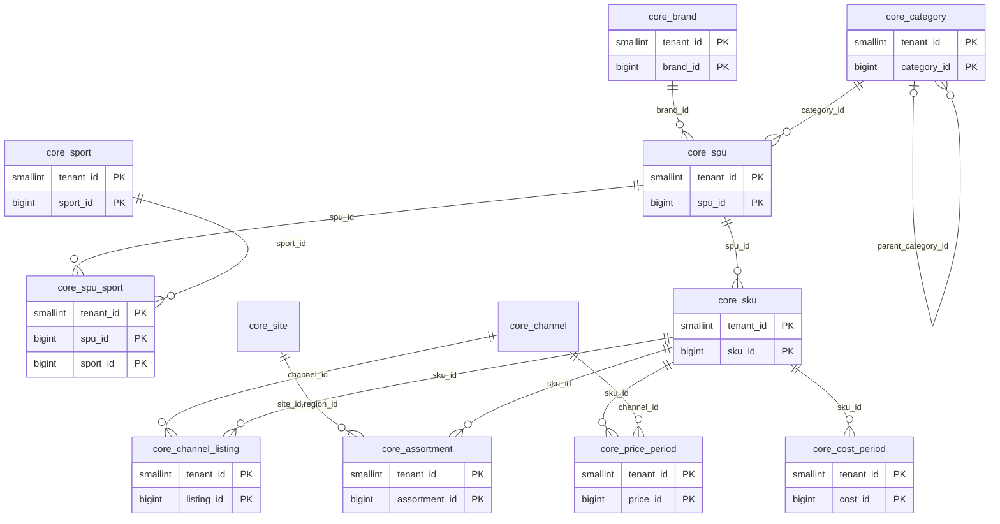

**本域构造顺序：**先品牌/品类/标签→SPU→SKU，再定渠道上架和地点经营区间，最后生成互不重叠的价格/成本有效区间。

**跨域关系：**订单行绑定当时 SKU、价格和优惠；库存批次固定实际采购成本。cost_period 是采购标准，不能覆盖已存在批次成本。

### 3.3 会员与渠道身份

回答“谁买了、在不同渠道如何识别、当时是否已经知道这是同一个会员”。

会员、渠道身份和身份绑定分开；未识别身份保持独立，订单当时未知 customer_id 保持 NULL。绑定发生后不追改历史订单。

| 表 | 一行代表什么 | demo 计划行数 |
|---|---|---|
| `core.customer` | 一个企业会员 | 36,000（精确） |
| `core.customer_identity` | 一个渠道内的购买身份 | 72,000（精确） |
| `core.customer_identity_link` | 一条渠道身份到会员的已验证绑定 | 45,000–60,000 |

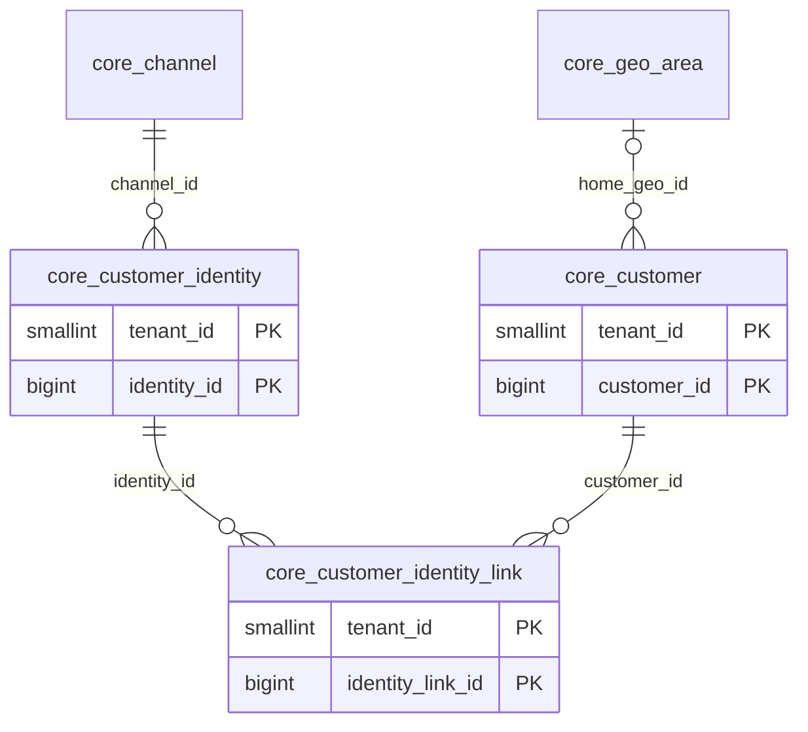

**本域构造顺序：**先会员注册与渠道身份首次出现，再生成有证据和时间的绑定；首购、新老客和留存由订单窗口计算，不直接随机填客户标签。

**跨域关系：**身份→绑定→会员；订单保存当时可知会员快照，自有会话引用渠道身份。实验按预先可识别的会员随机，排除事后身份回填。

### 3.4 交易、支付与退款

回答“下了什么单、每件实付多少、是否付钱、何时取消、退回多少现金”。

订单头→SKU 行→逻辑单件。单件支持部分发货、退货和优惠分摊。payment 已是一笔支付尝试；一单可失败重试或拆分支付。

| 表 | 一行代表什么 | demo 计划行数 |
|---|---|---|
| `core.order_header` | 一个成功创建的订单头 | 100,000（精确，包含取消单） |
| `core.order_line` | 一张订单的一个 SKU 行 | 14.5–16.5 万 |
| `core.order_unit` | 订单行中的一个逻辑计量单件 | 17.5–19.5 万 |
| `core.order_status_event` | 一个订单的一次状态变化 | 40–60 万 |
| `core.order_unit_event` | 一个逻辑单件的一次状态变化 | 70–140 万 |
| `core.discount_allocation` | 一个优惠对一个订单单件的分摊 | 8–16 万 |
| `core.payment` | 一次支付尝试 | 8–12 万次尝试 |
| `core.refund` | 一次现金退款尝试 | 0.8–2 万次尝试 |
| `core.refund_allocation` | 一次退款分配到一个订单单件 | 1–3 万 |

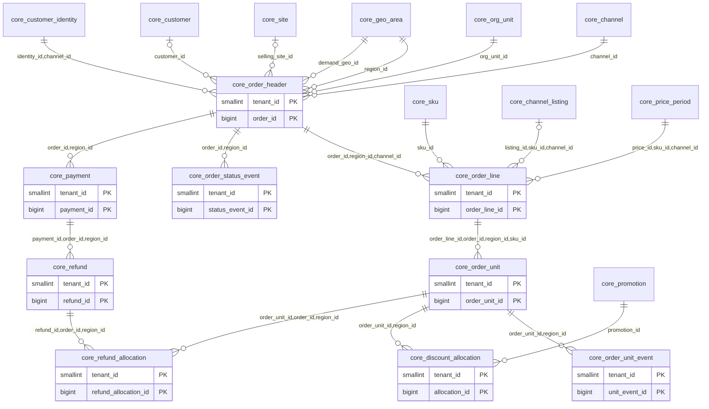

**本域构造顺序：**创建候选订单→规范行/单件→优惠整数分分摊→锁库→支付尝试；超时/失败记录取消并释放库存。退款沿原支付及退货/取消依据产生。

**跨域关系：**向商品/客户取主数据，向库存申请锁库；支付成功后进入履约，退款分摊回原单件。现金与收入分别记账。

### 3.5 履约与售后

回答“从哪里发货、送到没有、哪些单件被退回、检查后可否再次销售”。

一单可多包裹，shipment_item 绑定订单单件与实际 FIFO 库存批次。售后按已发出单件申请并记录收到、接受、回库/判损。

| 表 | 一行代表什么 | demo 计划行数 |
|---|---|---|
| `core.shipment` | 一张订单从一个地点发出的包裹或 POS 交付单 | 8.5–11.5 万 |
| `core.shipment_item` | 一个包裹中的一个订单逻辑单件 | 14.5–18.5 万 |
| `core.shipment_event` | 一张履约单的一次物流状态事件 | 25–45 万 |
| `core.return_header` | 一张售后申请 | 0.8–1.8 万 |
| `core.return_item` | 一次售后对应一个已出库单件 | 1–2.2 万 |
| `core.return_event` | 一个售后单件的一次状态事件 | 4–13 万 |

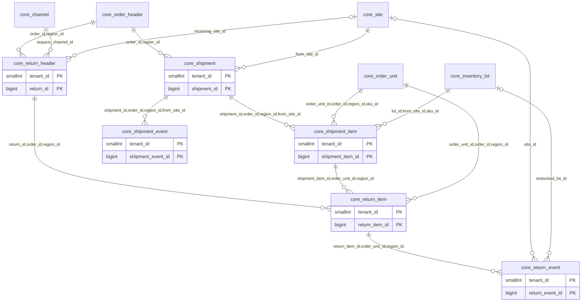

**本域构造顺序：**有成功支付与锁库后生成包裹→发货→交付；交付后的合法时间窗产生退货；接受后分别产生退款、收入冲减、可售回库或报废。

**跨域关系：**包裹连接交易与库存；交付事件驱动收入/成本确认；售后事件驱动退款、库存桶变化和冲回。RTO 单独表示未交付退回。

### 3.6 库存与供应流转

回答“库存在哪、哪些能卖、哪些已预留、在途多少、为何缺货”。

批次是成本与 FIFO 的来源；库存单据描述开账/采购/调拨/处置，流水描述实际桶变化。数量快照与估值分开，便于成本隔离。

| 表 | 一行代表什么 | demo 计划行数 |
|---|---|---|
| `core.inventory_lot` | 一批相同 SKU 成本的某地点库存 | 0.5–3 万 |
| `core.inventory_document` | 一笔采购 调拨 开账或处置业务单据 | 0.5–2 万 |
| `core.inventory_document_line` | 库存业务单据中的一个 SKU | 1.5–5 万 |
| `core.stock_allocation_attempt` | 一次订单锁库事务中一个候选地点 SKU 的尝试 | 14–26 万 |
| `core.inventory_movement` | 一个地点 SKU 批次的一次库存桶变化 | 80–180 万 |
| `core.inventory_snapshot` | 一个本地日末 地点 SKU 的有效库存快照 | 最多 491,400 个日末观察点 |
| `core.inventory_valuation_snapshot` | 一个日末 地点 SKU 和观察截止的库存金额 | 与数量快照同键，最多 491,400 |

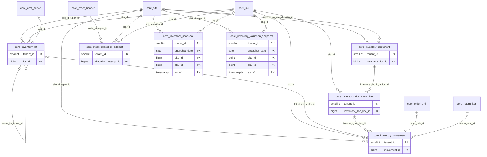

**本域构造顺序：**由历史可知需求计划造开账/供应计划，按统一事件时钟补货、锁库、付款取消、出库、调拨、退货；流水写完后重放出快照。

**跨域关系：**可承诺量=可售实物-reserved；reserved 是占用标记，不能再作为实物加总。在途、待检、损坏各自变化，跨店调拨两端必须闭合。

### 3.7 财务经营与目标

回答“收入、毛利、渠道贡献为何变化，现金与经营结果为何对不上，目标完成多少”。

交付确认收入/成本；接受退货冲收入；只有可售回库冲原成本。退款是现金流，不能直接代替收入冲减。费用按原订单及实际费率产生。

| 表 | 一行代表什么 | demo 计划行数 |
|---|---|---|
| `core.revenue_entry` | 一次单件收入确认或冲减 | 15–21 万 |
| `core.cost_entry` | 一次单件销售成本确认或冲回 | 14.5–20.5 万 |
| `core.order_fee` | 订单对应的一笔经营变动费用 | 18–45 万 |
| `core.target_monthly` | 某月 渠道 大区的一项指标目标 | 10,584 基线+12 修订=10,596 |

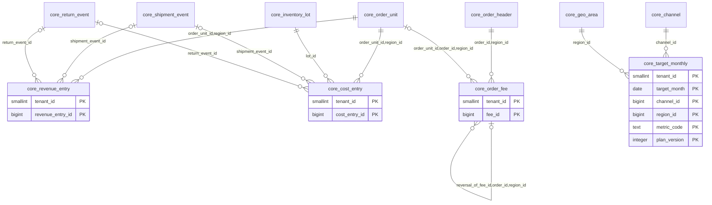

**本域构造顺序：**预先生成月目标；交付/售后事实发生后生成收入、成本及费用，禁止独立随机生成财务总额。修订目标保留版本与预先可知时间。

**跨域关系：**revenue/cost 都追到单件及源事件；target_monthly 只在月×渠道×区域×指标粒度比较，不虚构品类目标分摊。

### 3.8 营销、流量与实验

回答“活动带来什么流量、漏斗哪里掉了、投放是否有效、实验是否能作结论”。

自有 APP/小程序有可观察会话；外部平台只有合理可得的汇总报表。归因有触点才关联，无法观测就标 UNATTRIBUTABLE。

| 表 | 一行代表什么 | demo 计划行数 |
|---|---|---|
| `core.campaign` | 一个营销活动 | 72：主租户 36，辅助租户各 18 |
| `core.promotion` | 一个价格优惠规则 | 72–144 |
| `core.web_session` | 自有线上渠道的一次会话 | 30–45 万 |
| `core.behavior_event` | 一个可观察的会话行为事件 | 200–400 万 |
| `core.campaign_daily` | 一个日 活动 承接渠道 经营区域 | 7,056 基线+实际修订，预计约 8,500 |
| `core.channel_product_daily` | 一个平台 日 渠道 SKU 区域的经营报表版本 | 30–80 万，按来源声明的每日覆盖组合 |
| `core.store_traffic_daily` | 一家门店一天的客流报表版本 | 10,960 基线+实际修订，约 1.2 万 |
| `core.order_attribution` | 某归因模型版本对一张订单的一条触点归因 | 100,000（每单每模型一条） |
| `core.experiment_definition` | 一个预注册的双组会员随机实验 | 2（正常分流、异常分流各 1） |
| `core.experiment_assignment` | 一个实验中一个会员的首次分配，包含未转化者 | 10,000：两实验 6,000/4,000 |
| `core.experiment_exposure` | 一次已分配会员的可追溯实验曝光 | 约 1.5–2.5 万，允许零曝光和多曝光 |

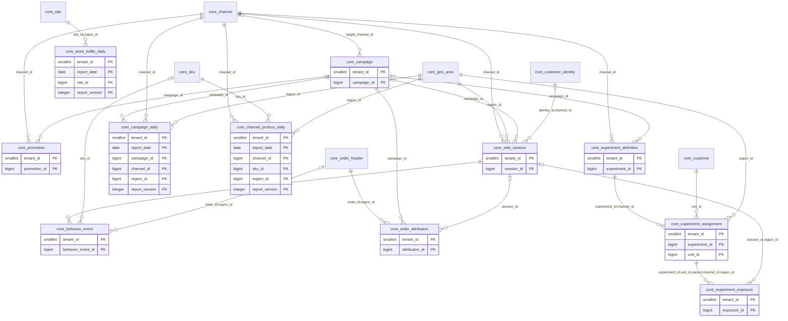

**本域构造顺序：**先活动/优惠/预注册实验→分流/会话/曝光→下单；随后按实际订单/支付/退款形成行为、渠道日报和归因。对照组与未转化会员同样保留。

**跨域关系：**实验定义→分配→曝光；结果从既有订单/退款按预设窗口关联。实验三表不单独再造收入/转化 outcome。活动计划与会话相互作用，报表最后聚合。

**实验约束补充：**首版只做自有渠道、会员级 A/B 两组。`experiment_definition` 在实验开始前可知，`assignment.unit_id` 外键关联会员；曝光的实验/单元/variant/渠道/区域必须同时匹配分配。实验结果以所有分配者为分母，并按主结果 7 天、退款护栏 30 天观察窗关联订单。分流时间落在实验区间、曝光晚于分流、会话渠道与身份匹配等跨表条件另做业务验收。SRM 反例违反预注册比例，仍保留合法行级记录供分析识别。

### 3.9 业务生产辅助表

这些表服务于业务数据生产与源权限验证，和 Agent 的任务、用户、审批无关。

| 表 | 作用 | demo 计划行数 |
|---|---|---|
| `ops.dataset_release` | 一行一个发布版本 | 1 |
| `ops.ingestion_batch` | 一个租户一个源的一次采集批次 | 约 222 万+PIM 变更批次 |
| `ops.generation_run` | 一次生成或恢复运行 | 每次构建各阶段实际记录，首轮约 6–12 |
| `ops.file_manifest` | 一份已提交的数据或配置文件 | 按文件分块，首轮约 100–300 |
| `ops.source_watermark` | 某源在一个已观察时点的完整性水位 | 按日及指定故障观察点，约 3 万 |
| `sec.principal` | 一个真实数据库登录身份 | 源布局下约 6–18 |
| `sec.principal_region` | 登录角色的一条区域授权 | 源侧账号×获权区域，约 10–40 |

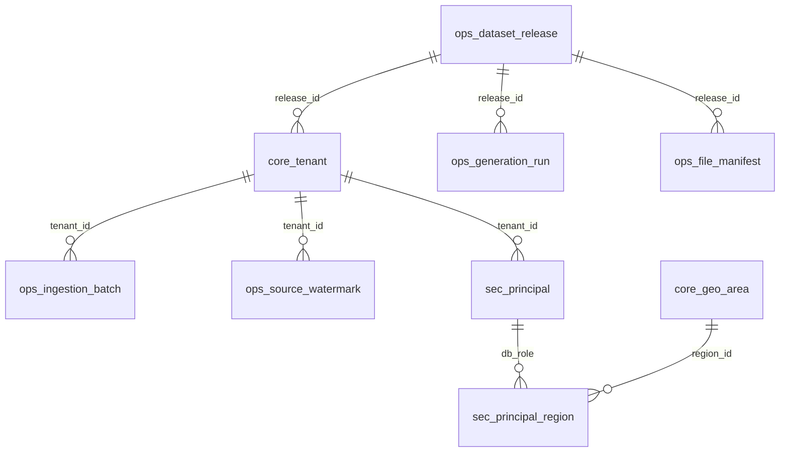

`ops` 写真实生产/装载记录；`sec` 由受控部署身份配置。完整建表 SQL 不自动授予查询权限，RLS/授权必须另行部署并用真实受限连接验证。原始 `02_security.sql` 不能未经适配就套用：它仍引用旧 eval 表且缺新实验表分类。
## 4. 计划生产多少数据，数据分布是什么样

### 4.1 先选一个可读、可查的首批规模

以下是**建议生产配置**，尚未执行。建议固定主随机种子 `20261019`，并将 profile/SQL/算法版本一起纳入内容摘要。订单数指成功创建的订单头，包含后来取消的订单；支付成功、交付、退款行数由业务过程决定。只有标为配额的主数据与订单数量必须精确，事实表估算区间用于发现异常放大，不能为了凑数破坏业务关系。

| 配置 | 用途/覆盖 | 租户订单配额 101 / 102 / 103 | SPU / SKU 总量 | 门店 / 仓 | 会员 / 渠道身份 |
|---|---|---|---|---|---|
| fixture | 先重建规范模型下的边界单，不宣称覆盖全部场景 | 首批约 8–30 单，按边界用例确定 | 仅用例需要的规格 | 至少 2 地点以验证调拨 | 最小身份集合 |
| dev | 日常开发，问数/关联/退款/隔离；不要求分钟监控和统计推断样本充足 | 9,000 / 500 / 500，共 1 万 | 40 / 320 | 4 / 3 | 3,600 / 7,200 |
| **demo（建议先产）** | 12 类场景的数据输入，含定向实验与支付监控切片 | **90,000 / 5,000 / 5,000，共 10 万** | **160 / 1,280** | **10 / 4** | **36,000 / 72,000** |
| extended-1m | 原材料百万规模扩展，后于 demo 验收 | 900,000 / 50,000 / 50,000 | 800 / 6,400 | 32 / 5 | 230,000 / 460,000 |

百万版主数据规模来自原输入；dev/demo 是本次建议缩放。999 还描述过完整企业画像和千万云端数据，它们不自动变成本次生产配额。扩大订单量时同时考虑 SKU、门店和客户池；不能仅改 N 让每店/每 SKU 仍无足够样本。

demo 的企业分配：主租户 120 SPU / 960 SKU / 6 门店 / 2 仓 / 30,000 会员 / 60,000 身份；辅助租户各 20 SPU / 160 SKU / 2 门店 / 1 仓 / 3,000 会员 / 6,000 身份。至少配置 1 家奥莱，奥莱包含在门店数内。不同企业的商品/价格/客户/库存独立生成，部分局部 ID 可故意相同以验证租户复合键。

### 4.2 时间范围与可知性

建议沿用冻结业务窗口：下单为 **2023-01-01 至 2025-12-31**，共 1,096 天；2026-01-01 至 2026-03-31 为 90 天尾窗，只继续履约、退货、退款和采集，不新增订单。参考时钟建议 `2025-12-15 09:00 Asia/Shanghai`。原型中的 2026 年秋季日期不能直接查询这批数据，消费方需显式使用数据参考时间；若决定改成 2026 年窗口，需统一平移节日/活动/场景与预期，不能局部改日期。

每条事实区分业务发生时间和 available_at；查询再固定 reference_time 解释“上月/最近 30 天”。数据库时间用 UTC timestamptz，业务日按 Asia/Shanghai，区间左闭右开。履约/售后/采集的正常最长链路保留原 81 天上界，不能将未结束事件强压到尾窗末日。历史预测不使用尾窗“无新单”制造下降趋势。

### 4.3 组织、渠道、商品和客户分布

**背景订单需求权重**复用原材料的课程设计值；这些参数不代表真实行业统计。先保留定向场景配额，再对剩余订单按权重分配，最终报告同时展示背景分布与全量实际分布。

| 维度 | 建议分布 | 构造方法与限制 |
|---|---|---|
| 企业 | 90% / 5% / 5% | 订单头精确配额；各企业分别执行过程 |
| 销售区域 | 华东29%、华南23%、华北17%、华中11%、东北6%、西南9%、西北5% | 背景需求权重；由订单保存销售区域，跨区履约不改归属 |
| 渠道 | 天猫22%、京东12%、抖音18%、小程序18%、APP12%、POS14%、奥莱4% | 背景需求权重；小程序监控切片会改变全量占比，必须披露 |
| 年份 | 2023/2024/2025 权重 0.85/1.00/1.15 | 与月份/星期/活动权重合成后归一，不承诺净收入同比恰好对应权重 |
| 月份 | 1–12 月：0.85、0.75、0.95、1.05、1.10、1.35、1.00、1.00、1.05、1.10、1.55、1.20 | 6 月、11 月活动较多；露营春秋、水上夏季再乘品类季节权重 |
| 星期 | 周一至周日：0.92、0.91、0.95、0.97、1.05、1.16、1.12 | 日权重按真实日期计算；先按最大余数法给整数订单数 |
| SKU 热度 | 固定种子的对数正态权重，mu=0、sigma=1 | 形成头部与长尾；只从当时已上架商品抽样，不因缺货改抽有货商品 |
| 订单原始行数 | 1/2/3/4 行概率60%/26%/10%/4% | 原始期望1.58行；同SKU同价同优惠合并后统计实际规范行数 |
| 每行数量 | 1/2/3 件概率88%/10%/2% | 期望1.14件；不与单件总数分别抽样 |
| 身份 | 自有会话匿名占比约35%；已识别身份中的绑定另按时点生成 | 匿名会话与未绑定渠道身份区分；会员活跃度用固定长尾权重，最终复购率由订单推导 |

| 品类 | 主租户 SPU / SKU | 背景需求权重 | 建议售价区间（元、不含税） | 已交付单件申请退货概率 |
|---|---:|---:|---:|---:|
| 运动服饰 | 36 / 432 | 27% | 39–599 | 13% |
| 运动鞋履 | 24 / 288 | 26% | 199–1,299 | 15% |
| 户外露营 | 12 / 48 | 10% | 59–2,499 | 6% |
| 包袋配件 | 12 / 48 | 8% | 39–699 | 5% |
| 健身训练 | 12 / 48 | 9% | 29–999 | 5% |
| 骑行装备 | 8 / 48 | 7% | 39–1,299 | 7% |
| 水上运动 | 8 / 32 | 6% | 19–499 | 7% |
| 护具与小件 | 8 / 16 | 7% | 9–399 | 3% |
| **合计** | **120 / 960** | **100%** | — | — |

辅助租户各 20 SPU 按上表品类顺序配置 6/4/2/2/2/1/2/1 款，沿用品类规格模板，恰好各 160 SKU。售价在品类区间内按固定价格带抽样；建议采购标准成本为正常标价的 35%–65%，SKU 固定成本率随版本有限调整，实际批次记录当次成本。优惠从规则计算，建议常规折扣0%–15%、指定清仓15%–35%；可出现少数低毛利/负贡献，但不得用独立随机毛利倒推订单金额。这些成本/折扣区间是新增建议参数，最终随 profile 冻结。

### 4.4 业务过程的分布

| 业务行为 | 建议参数 | 生成结果应怎样解释 |
|---|---|---|
| 支付 | 锁库后每次尝试成功概率94%；失败后25%概率重试，最多4次；2%拆分支付 | 尝试成功率与订单最终支付成功率分开；锁库失败无支付，退款不能超原成功现金 |
| 发货前取消 | 已付订单2% | 记录取消、退款、释放占用；不能仍产生交付收入 |
| 未交付退回 RTO | 发出包裹1% | 不等同交付后退货，不能先计交付收入再无依据冲回 |
| 售后 | 按品类退货概率；申请拒绝3%；接受后12%判损 | 拒绝、可售回库、判损、报废有不同库存和成本处理 |
| 履约窗口 | 最大发货7天、最大交付14天；交付后30天内可申请退货 | 正常延迟按区间内有偏分布抽样，强制事件顺序 |
| 退货后续 | 运输≤10天、验收≤3天、可售回库≤7天、退款≤14天 | 退款和可售回库不要求同一天，各自写真实事件时间 |
| 库存计划 | 门店覆盖21天、仓35天；再订货点10天；采购4–9天、调拨1–3天 | 基于当时可知需求预测；禁止偷看实际未来订单补足全部缺货 |
| 报表版本 | 正常版+少量迟到修订 | 金额来自相应截止内的事实；版本去重后汇总，不把版本相加 |

上述沿用参数来自原配置，仍需试产检视。当前 schema 的 payment.status 只有 SUCCEEDED/FAILED；本版监控只要求尝试成功率，无需先加 error_code/latency_ms。若以后要求错误码归因/耗时分析，先增加明确字段与来源再生产，当前不虚构这些数据。

### 4.5 场景样本必须单独保证

| 数据切片 | 建议生产规模/分布 | 必须保留的业务联系 |
|---|---|---|
| S03 清洗名单 | 2,000 原始行：1,700 唯一合法、100 重复、100 缺关键键、100 格式错误；类别互斥 | 原始行号/文件hash；合法名单中再保留无匹配订单者。源文件不先写入规范客户表 |
| S04 对账 | 同一9月窗口两份快照，至少覆盖退款跨期、迟到、重复Join、口径差异四类 | 差异桥逐项守恒，保留未解释差额；不为对齐而修改源事实 |
| S05/S06 专题 | 预置缺货、促销毛利、退货、数据迟到各一组可见证据/反证；6–10份业务材料 | 业务材料含发生/发布时间，不携带私有“正确答案” |
| S07 预测 | 36月历史；至少3个滚动回测起点，各12周；独立保管未来标签 | 起点分别可选2024-12-31、2025-03-31、2025-06-30；只用当时可知特征，未成熟窗口不评价 |
| S08 正常实验 | 主租户6,000会员，A/B各3,000；2025-09-01至09-15 | 会员在实验前已可识别；结果概率建议8%/10%，不强制得到显著结论；未转化者仍有分配记录 |
| S08 分流异常反例 | 4,000会员，预注册50/50，实际80/20；2025-09-15至10-01 | 不与正常实验重复入组；行级数据合法，样本比例检查应阻断默认实验结论 |
| S09 观察性因果 | 2,000个会员/商品观察单位，处理/对照各1,000，12周前期+8周后期 | 输出干预定义、人群和可观测协变量CSV；提供前趋势不成立反例，私有效应不公开 |
| S10 周期报表 | 固定连续8周，含一周迟到后补齐 | 每期源水位和统计窗明确，不用上一期数据充当本期 |
| S11 支付监控 | 主租户2025-11-10 10:00–11:30，小程序每分钟100次尝试，共9,000；正常/异常/恢复各30分钟，成功率98%/90%/98% | 为此预留9,000真实订单，各一次支付且保障初始库存；全部计入90,000主租户配额，其余81,000按背景权重生产；失败单走取消链，不能悬空造支付记录 |
| S12 留存 | 按首购月×相对月形成队列；每个声明可比较单元建议≥100会员 | 月龄成熟度、退款规则、未知身份明确；不够100标样本不足，不跨组补人数 |

实验与监控采用不同人群/时间切片；实验转化订单从主租户剩余配额中预留，和背景订单去重。若约束导致配额不足，生成器返回 profile 冲突，不静默追加订单。监控切片的9,000次尝试有420次失败、8,580次成功，是定向边界样例；不能将其成功率解释为全库支付基线。低于最小分母的另一个稀疏窗口应明确显示不足。

### 4.6 容量容易被哪些表放大

- **库存快照**：demo 先定义全年经营组合的并集上限2,700对：主租户6店×150 SKU+2仓×640 SKU=2,180；辅助租户各2店×50+1仓×160=260。默认物化2025-10-01至2026-03-31，共182天，两张快照各至多491,400行。零库存保留，未经营组合不生成。更早库存通过流水重放到指定日，不能用缺行代替零。
- **行为**：预计30–45万自有会话、200–400万事件；只在合理自有渠道生成，平台渠道不虚构逐人轨迹。会话量由提交率和真实订单反推，再生成未提交会话。
- **渠道日报**：按来源明确声明的“当日SKU×渠道×区域覆盖集合”生成。所有实际有经营事实的组合必须进入覆盖，另保留明确为零的覆盖组合；缺报单独登记。30–80万是估算，试产根据实际覆盖修正，不能删掉需要的非零记录压体量。
- **采集批次**：按 OMS每5分钟、WMS每15分钟、POS/ERP每小时、CRM每30分钟、WEB每10分钟、ADS每日，三租户1,186天约2,223,750批，再加PIM变更批；空批也是完整性水位的一部分。它同样需要预算，不能只估订单表。

因此10万订单的完整demo预计仍有**约900万–1,600万行**（含辅助表），属于待试产验证的容量区间。上界不作为硬数据质量门禁；实际行数逐表登记并解释超出原因。百万版若按24,800有效组合物化1,186天，数量与估值各约29,412,800行，仅两表即约5,882万行；优先沿用有限物化窗口，完整长期日快照按需求启用。

## 5. 整套数据按什么顺序构造

### 5.1 先后关系

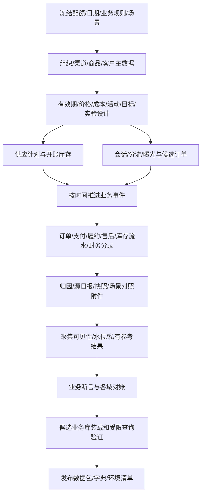

### 5.2 每一步具体产出什么

| 顺序 | 输入 | 做什么 | 输出/依赖 |
|---|---|---|---|
| 1 冻结生产配置 | 本文规模/分布/场景建议 | 明确随机种子、来源方式、每租户订单配额、三个时钟、启用场景 | 一个不可变profile摘要；参数未定不产正式release |
| 2 主数据 | 配置与商品模板 | 造企业/区域/地点/渠道、商品层级/规格、会员/渠道身份；生成合法绑定时点 | 组织/商品/客户主数据；稳定业务ID |
| 3 计划与版本 | 主数据、历史可知需求参数 | 上架/经营区间、价格/成本、活动/优惠、预算目标、实验预注册 | 预先已知的业务计划，不能读取后面的实际结果 |
| 4 供应初态 | 经营组合与预测 | 开账批次、采购/调拨候选；批次单位成本固定 | 起始库存与待到货事件；禁止月初清空重置 |
| 5 需求与流量 | 主数据、活动、权重、实验分配 | 预留定向配额，按日期/渠道/区域抽背景订单、候选购物篮与自有会话 | 规范订单创建候选；原候选行与合并映射保留 |
| 6 业务过程 | 初态、候选、待到货 | 一个租户一条按时间排序的状态流，联动锁库、支付、发货、交付、售后和费用 | 交易、履约、库存、财务域同时落事件；不得分域独立随机造金额 |
| 7 派生与修订 | 已完成的业务事件 | 日报/归因、数量与估值快照、周期快照、指定迟到修订 | 可复算派生数据，注明知识截止与报表版本 |
| 8 来源可见性 | 源事件与采集排程 | 计算各记录available_at与load_batch，生成连续水位；在生成时预分配批次ID，最后核对 | 业务时间≤可见时间；依赖证据未到齐时不能提前可见 |
| 9 验收及装载 | 完整候选包 | 先内存/文件校验，再完整SQL装载、源连接验证和参考SQL对账 | 通过报告后才发布；失败候选不替换活动版本 |

事件队列在同一时刻按“到货/回库 → 取消/超时 → 创建/锁库 → 支付 → 发货 → 交付 → 售后 → 日报”处理，再以稳定实体ID/事件序排序；支付恰好到截止时按超时优先。租户可独立并行，单租户内部不按月割裂库存与资金状态。

**构造顺序与数据库插入顺序不同。** 业务模型存在“单件引用物流、物流引用单件”之类关联；先在候选包完成ID及关联，装载时按依赖分批，必要时在单个候选库事务中延后外键检查。所有外键在提交时通过，不能靠永久禁用约束导入。多库版本不假定跨库事务，另见交付附录。

### 5.3 一笔业务的最小例子

一个会员购买两件同SKU商品，原价各100元，订单优惠20元。规范订单行数量2，两个逻辑单件各实付90元。锁库成功后支付180元；FIFO批次成本各50元。交付两件时收入+180、成本+100；随后退回一件并接受，收入-90，实际退款-90现金。若该件可售回库，成本冲回50；若判损，已发生的成本不按可售回库冲回。

最终现金净流入、净收入和成本的时间分布可能不同，但必须各自对上原事件。样例中的90元退款不能凭随机退款率直接插入，必须有原支付、单件分摊、退货/取消依据；所有金额用整数分计算。

## 6. 哪些是现成的，哪些需要重新构造

### 6.1 现有材料能直接复用到哪一层

| 资产 | 当前实际状态 | 本次复用方式 | 仍需做的工作 |
|---|---|---|---|
| 原63表DDL/模型/字段字典 | 已有完整设计，原件在context | 复用53业务表+7辅助表的结构，私有eval三表移出业务库 | 本版SQL增加实验三表、来源模式字段；安全/校验脚本随模型适配 |
| 原百万profile、业务场景、生产细则 | 已有规则与参数 | 复用价格/时间/库存/状态语义和参考权重 | 按demo/dev新配额重算主数据、源覆盖与场景密度 |
| 77条原SQL断言、30道题 | 已有校验规格，部分在空库/小样执行 | 挑选适用业务断言、独立SQL口径 | 在当前63表真实装载数据上重跑；私有eval相关检查迁到外部工件，补实验/清洗/预测等 |
| 八单金标 | 已有独立简化模型的小样 | 复用金额与事件预期，作为第一批正确性参照 | 重新落进当前规范表，补调拨/在途等缺失链路；不能直接算作已完成全库数据 |
| 随机/整数分参考算法 | 已有代码及14项参考验证 | 复用明确适用的纯算法 | 集成到生成器，测种子稳定性与输入版本依赖 |
| 当前三天demo_daily_sales | 已有3行合成汇总 | 保留现有脚手架链路 | 不能反推出订单、商品、库存或客户明细 |
| Contoso上游 | 原材料登记了项目和固定提交 | 可选复用商品权重/购物篮候选能力 | 尚无本项目fork提交、源码包hash和构建证据；不算已经拿到可导入业务事实 |
| 原型里的图表与数字 | 已有静态演示内容 | 用于理解字段和问题 | 不当作业务数据源，不拟合静态金额 |

**目前没有现成的完整零售事实数据可直接导入。** 本轮新增的是可阅读的设计及完整当前DDL，尚未生成10万或百万经营数据。虚构企业、商品、会员、订单、库存、营销与实验记录均需构造；“复用表结构/规则”与“复用已生产数据”分别记录。

### 6.2 按业务域判断来源

| 业务域 | 现成部分 | 需要生产的部分 |
|---|---|---|
| 组织/渠道 | 企业概念、7区域/7渠道的配置结构 | 虚构组织、门店/仓库、经营时间、跨租户样例 |
| 商品 | 品类/规格模板、价格范围与模型 | 商品目录、SKU/上架/经营区间、价格/成本版本；可选Contoso候选仅供参数来源 |
| 会员 | 身份/绑定模型 | 合成会员、不可逆渠道token、历史绑定、未识别者与复购行为 |
| 交易/履约/库存/财务 | 状态、金额、FIFO、时点与对账规则 | 全部关联事实，必须由同一业务过程驱动 |
| 营销/流量 | 活动/行为/日报/归因模型 | 自有会话、平台合理汇总、活动与实际归因结果 |
| 实验与因果 | 产品分析目标；原模型缺实验分流 | 三张实验表的数据、干预CSV、可观察协变量、异常分流/前趋势反例 |
| 场景附件 | 需求描述和部分参考答案 | 脏名单、固定对账快照、SOP、故障资料、预测窗口/私有标签与留存参考SQL |

所有客户和业务身份使用合成标识，不导入真实个人资料。生成数据来源模式必须如实写入 `ops.dataset_release.source_mode`：纯Python为 PURE_SYNTHETIC，确实复用了固定Contoso源码时才使用 CONTOSO_DERIVED 并记录真实commit。

## 7. 怎么构造，需要哪些工具，计划如何推进

### 7.1 工具选择放在业务规则之后

| 工作 | 建议工具/实现 | 为什么需要 |
|---|---|---|
| 规则与配额 | 版本化JSON/YAML；固定seed与稳定实体ID | 每次生产可复现，参数可阅读和校验 |
| 主数据与事件过程 | 现有Python/uv环境内的业务生成模块 | 直接表达金额、状态和库存规则；无需先建第二套平台 |
| Contoso（可选） | 固定源码的有限适配，输出权重/候选 | 只有确认必须复用后再投入；实际业务过程仍统一由Python负责 |
| 业务文件 | 首批CSV+清单，按表/月份拆分；达到体量需要时增加Parquet | CSV可直接批量入PostgreSQL；不先要求双查询引擎 |
| 业务库 | 当前项目PostgreSQL与迁移机制；本版完整DDL用于空候选库验证 | 用真实约束验证全部业务关联；禁止对现有应用库直接执行新建脚本 |
| 装载 | 客户端流式COPY/批量装载与候选库发布 | 不需要先把文件搬进容器；支持校验后发布与失败重试 |
| 验证 | 独立SQL断言、Python reference算法、真实受限数据库连接 | 验金额/库存/时点/源权限及参考结果，不依赖Agent回答 |

推荐首版采用单Python生产者；Contoso是否必须复用仍待确认。这个选择只影响候选生成和来源记录，不改变八大业务域、金额守恒与生产顺序。若选择Contoso，先拿到真实源码/许可证/构建结果；不能把未实现的fork作为现成工具排期。

### 7.2 生产阶段与退出条件

| 阶段 | 具体工作 | 交付与通过条件 |
|---|---|---|
| P0 冻结首批配置 | 确认demo规模、日期、来源方式、全部启用场景与特殊配额 | 可执行profile、逐表目标/估算、参考时钟；不再隐藏默认值 |
| P1 规范小样 | 先造约8–30单：正常、缺货、失败支付、部分退款、跨期、退货判损、调拨与迟到 | 当前完整DDL能装载；金额/库存/时间与独立预期一致；尚不追求规模 |
| P2 主数据与核心过程 | 完成八域共同依赖及订单→支付→履约→库存→财务链 | dev 1万单；所有主外键与业务守恒通过，重跑同配置哈希一致 |
| P3 场景补充 | 加营销/实验与S03/S04/S06/S07/S09附件、S11分钟密度、S12成熟队列 | 每个声明场景列出有效样本、前提、正负例与独立参考结果 |
| P4 demo试产 | 生产10万单、物化指定库存窗口，装载单源业务库 | 逐表行数/分布报告、资源实测、源侧账号正负例、完整参考SQL对账 |
| P5 稳定交付 | 重复导入/中断/错误文件/同ID异内容/并发发布/回切验证 | 可复现业务包、数据字典、装载说明和验收报告，旧活动数据不受失败候选影响 |
| P6 可选扩展 | 三源物理投影或百万profile | 先完成逐表/列投影DDL及本地约束，跨源参考结果一致，再量产；当前完整SQL只覆盖默认单源布局 |

不预报未经测量的工期与吞吐。先记录P1/P2的行生成速度、装载耗时、字节/行、峰值内存，再估算P4/P6。演示要求的业务数据可以独立交付，平台用户/会话/审批等设计不阻塞这里。

## 8. 如何判断造出来的数据是对的

| 检查 | 可判定结果 |
|---|---|
| 主数据与数量 | 每租户订单头及固定主数据配额准确；逐表行数/重复键/空值/覆盖可解释 |
| 订单金额 | 头=行合计=单件合计，优惠分摊守恒；金额为整数分 |
| 现金 | 每笔退款追到成功支付与业务依据，累计退款不超可退现金，支付尝试与最终支付分开 |
| 收入/成本 | 交付才确认，退货接受才冲收入，可售回库才冲原成本；每条分录定位实际单件事件 |
| 库存 | 不发生负可售/预留；锁库失败有证据；调拨两端/在途闭合；快照=流水重放，估值=剩余可售批次数量×原成本 |
| 时间与身份 | 父证据未可见时子事实不提前可见；历史查询不使用未来身份绑定/未来计划；尾窗无新订单 |
| 营销与实验 | 日报按正确版本聚合、无伪造平台触点；分配包含未转化者、曝光匹配分配，样本比例/观察窗与护栏可验证 |
| 场景样本 | S01–S12各有输入覆盖、有效样本和不足/故障/拒绝的正确预期；不以全库行数替代切片密度 |
| 库与权限 | 源账号只能读取其租户/区域/列；成本不可见不等于0；私有金标/生产控制记录不向业务查询开放 |
| 可复现与发布 | 同配置同逻辑数据hash；坏文件/错版本拒绝，失败候选不发布，旧版可回切 |

DDL能执行只证明结构成立。跨表时序、累计退款、FIFO、现金/收入和报表守恒仍需对实际生成数据执行独立断言。当前SQL的225个外键不能代替这些业务校验。

## 9. 详细附件、决定状态与当前证据

阅读主线到这里才进入工具细节：

- [完整建表SQL](business-schema.sql)：默认单源业务库，63表；不含平台表与私有eval表。每个业务域有 DOMAIN 注释分段，所有外键集中在末尾，支持空库一次执行。
- [完整字段字典](business-data-dictionary.md)：按八域及辅助表逐表说明全部字段/主键/外键/约束，作为SQL派生阅读视图。
- [业务数据包与场景附件契约](data-package-contract.md)：文件与输入输出的细则，场景数量以本文为准。
- [装载、权限与发布细则](data-delivery.md)：保留已确定的业务库布局、AC-ENV业务条款、幂等发布逻辑及文件级任务。
- [原材料评审](../review/design_review.md)：原问题与历史验证证据；不代替当前设计决定。

已确认：998只负责业务数据，默认独立零售库，可选同实例交易/库存/营销多源，岗位平台部分归999。本文新增建议：demo10万的主数据配额、分布参数、定向场景与快照窗口；沿用冻结日期；优先单Python。上述建议仍待确定后生成正式profile，不能将“设计写全”记为数据已经生产。

本轮验证记录将区分当前DDL的结构检查、图表/文档一致性与真正数据生产验收；未通过全量生成和实库装载前不宣称数据可交付。

### 本轮已执行的设计验证

- 在独立内存 PGlite（PostgreSQL 17.5）执行完整 business-schema.sql：成功创建63表、655字段、225外键，无eval表。
- 4个新增结构负例均触发CHECK拒绝：实验分流比例为0、非法组别、曝光可知时间早于发生时间、纯合成来源伪填Contoso提交。
- 该验证使用空库结构及故意不满足行内约束的插入，不证明完整业务数据、源侧RLS、多源投影、FIFO全链路或性能已通过。没有连接现有项目数据库，没有生成正式业务数据。
- 文档检查：63张表在主文表清单、字段字典与SQL中逐一一致；11幅Mermaid图中的ER关系均对应实际外键；55个内部链接/锚点有效，Feature设计路径与格式检查通过。原始材料清单的85个文件哈希保持一致。

## 10. 业务多样性与 AI 辅助生成修订提案

> 后续实施授权：用户已接受本节方向并要求重建，新增约束为同一数据库新 schema、旧版保留。实际目标采用 `retail_v2`，独立装载角色仅能写新 schema；不切换或覆盖旧活动清单。以下“待评审/未实施”描述保留提案时点，实际进度以实施记录为准。当前会话模型可直接编写候选字典，来源标记 `codex_conversation`，不冒充付费 API 调用；自动补充接口独立实现和验证。

### 10.1 需求依据、结论与授权范围

2026-10-22 用户指出商品名称、客户、地址、价格和时间缺少业务多样性，要求系统检查生成器，研究先由 AI 生成必要字典、生成过程中继续调用模型补充素材的方案；本轮只研究与设计。

有效依据为[行业定义](../../999-compass-product-course-landing-app/context/product_definition_industry.md)、[产品 PRD §15](../../999-compass-product-course-landing-app/spec/PRD.md#15-行业经营模型与数据验收)、本次会话新增要求及原 AC-DATA-01–10。原材料按用户指定读取，不修改。当前 `standard` 模板沿用本文；新增 AC-DIV 仅维护本次多样性增量，不重复定义原业务 AC。

**推荐：AI 生成有具体含义的业务素材和条件规则候选，程序负责把它们编译为可复现的经营过程。** 多样性必须体现在名称、属性、分布和跨字段关系四个层面。只增加随机字符串、随机日期或随机金额，无法支持课程分析。

当前应保留整数分金额、状态事件队列、单件退款、FIFO、库存守恒、候选库与受限账号；重点重写 `master.py`、订单候选/购物篮、时间与价格解析、流量生成，以及验收规则。主键可以递增，业务编号可以有规则；禁止再从 `ID % N` 推导品牌、人群、地区等业务属性。

“用户”在 998 中指会员、普通购买者、渠道身份与匿名访客。平台登录用户、岗位账号和会话由 999 负责。本次客户姓名、收件地址均为明确标记的合成内容；无需真实个人资料。

### 10.2 系统检查：问题贯穿哪些链路

检查基线：工作区 Git HEAD `0ea0e049`，包含尚未提交的数据工具代码；仅凭 commit 不足以重现。实际已发布包 `retail-demo-20261022b`，内容摘要 `e0b65e1ddb84f2cf1da2a35a7b74da77d6d8e2f476a5473eba464879bd70ad66`。读取当前源码并在活动库执行只读聚合；本机完整 SQL、结果和逐文件源码摘要保存在 `work/data-seed/generator-diversity-audit.json`。下表保存可审阅的结论，不依赖临时文件长期存在。

| 范围 | 代码根因与实库证据 | 对分析的影响 |
|---|---|---|
| 组织/地理 | `Master.build` 拼接“示例省/市”，共 42 个占位地理节点；所有门店面积均 300㎡，开业日期仅 2 种 | 无法解释真实城市网络、面积效率和不同开业批次 |
| 品牌/商品 | 160 SPU 均以品类加编号命名；品牌与叶子品类按编号取模绑定；每个主租户叶子品类恰好只有一个品牌 | 商品难辨认，品牌与品类分析出现人为混杂 |
| SKU/标签 | 576 个服装 SKU 使用 ALPHA 的 1–4；器材型号为 1/2；所有骑行商品有游泳标签 | 规格筛选与运动类型分析失真 |
| 商品生命周期 | 全部 SPU 同日上市、全年适用、UNISEX、无停售；每品类重量固定 | 无上新、替代、季节与库存老化的有效差异 |
| 客户/身份 | 36,000 会员的入会时刻相同，分群只有 MEMBER、年龄只有 UNKNOWN；72,000 身份首次出现时刻相同 | 入会队列、偏好、获客与身份成熟过程缺失 |
| 地址 | 当前 63 表没有收件人、街道或地址字段；订单只保存需求地理节点 | 无法展示寄送详情，也不能按地址/线路解释履约 |
| 价格/成本 | 8,960 个 SKU×渠道标价区间、1,280 个成本区间均只有一个版本；大类范围内抽价，同款全渠道同价 | 无价格带、渠道价格策略与成本历史变化的丰富样本 |
| 订单/购物篮 | `Simulation.create` 根据 SKU 静态权重独立抽商品；不读取客户偏好、预算或商品互补关系；常规折扣固定 10%，11 月固定 25% | 连带购买、消费层次、促销敏感性缺少生成依据 |
| 时间/支付 | 100,000 单确有 76,432 个时刻、1,096 天、36 个月；但有支付尝试的订单中，79,729 单首付间隔恰好 60 秒，9,000 监控单为 0 秒；91,036 次支付方法均 WALLET | 日月趋势存在，微观支付、不同渠道和客户的时间行为不成立 |
| 履约/费用 | 配送按整天独立抽样；95,479 笔出库物流费全部 600 分，未使用重量和线路 | 大件、远距离、渠道履约成本无法解释 |
| 售后 | `return_request` 将 13,289 个退货单件原因全部写为 SIZE | 质量、描述偏差和不再需要等专题失效；器材也会被机械归为尺码问题 |
| 营销/行为 | 72 活动均自有媒体、小程序、14 天；7,056 条广告日报的曝光=点击×20、花费=点击×120；144,732 条商品日报均为固定漏斗倍数 | 所谓转化差异可能只是造数公式，缺少渠道/活动异质性 |
| 自有会话 | 每笔自有订单回填 9 个会话和同一事件路径；426,141 会话全为 MOBILE | 浏览未买、复访、设备和漏斗流失不能自然形成 |
| 经营目标 | 主租户 1,764 个贡献目标全部 25,000 元；区域、渠道和月份不区分 | 目标差距无法反映经营计划 |
| 库存/财务 | 已有事件驱动、批次与金额守恒；需求预测和经营 SKU 组合仍由静态权重/连续 ID 段产生 | 账能对上，补货/调拨的业务动因仍单薄 |
| 场景/验收 | S05 只查“存在缺货和退货”；S06 主要查材料数量；固定事件大量集中到 SKU 1 | 通过门禁并不能证明专题可解释，还会污染自然商品排名 |
| ops/sec | 批次时间按源采集周期、权限表按固定角色产生 | 这些重复可能合理，不能为了多样性随机扰动 |

检查覆盖八大业务域、场景附件与 ops/sec 的生成路径；实库统计为关键退化点验证，未声称已逐行审查一千多万条记录。现有数据仍可用于联调、守恒与权限测试；正式课程的业务真实性验收应判为未通过。

### 10.3 总体流程：先构造素材，再模拟经营

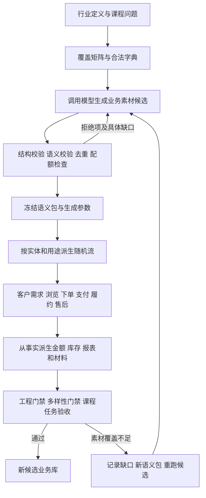

三个文件层次分工明确：

- **业务语义包**：品牌、商品配方、人群原型、地址词料、活动与文字素材；都是审阅过的生成输入。
- **过程参数**：权重、时间分布、价格策略、库存策略、异常计划；每个参数标注课程假设或校准依据。
- **业务事实包**：现有 63 表及本次必要扩展、场景附件与独立验证结果。全部业务结果由同一次过程产生。

现有 `business-data-dictionary.md` 是数据库字段说明；本次新增的语义包是实际取值与生成规则，二者职责不同。默认不引入向量库、Agent 服务或新的任务平台。

### 10.4 AI 要生成什么，如何防止重新落回模板拼字

建议语义包放在拟新增的 `data_seed/catalogs/retail/`，prompt 与 JSON Schema 放在该模块的 `prompts/` 与 `catalog_schema.py`。每个文件职责固定，规模为首轮建议值，先通过小样检验。

| 文件 | 模型负责的内容 | 程序负责的约束与扩展 |
|---|---|---|
| `business.json` | 7 个品牌定位、各租户经营差异、门店名称与经营风格 | 已有租户/渠道键、地区网络、门店容量及营业区间 |
| `products.jsonl` | 160 个具体 SPU 的系列名、商品类型、材质/功能、适用运动、型号与规格配方 | SKU 合法组合、精确配额、单位、重量和价格范围、上下架时间关系 |
| `customers.json` | 12–20 类购买动机与偏好原型、合成姓名词料；人群有重叠与个体差异 | 扩展 36,000 会员、渠道身份、未识别购买者和匿名访问；稳定姓名与地址引用 |
| `geography.json` | 虚构街道、小区、楼栋词料，店名候选 | 省市区层级采用核对过的地理字典；路线矩阵、城市与区域映射由程序维护 |
| `commerce.json` | 活动主题、商品搭配/替代关系、价格档位、季节与人群关系候选 | 概率归一化、有效区间、价格/成本整数分、优惠叠加与库存约束 |
| `language.jsonl` | 搜索表达、退货描述、客服/运营材料句式 | 仅按已发生事实和 reason_code 选用；数值、日期和实体由事实填入并核对 |
| `manifest.json` | 无自由生成内容 | schema/prompt/model/config/内容 hash、父版本、调用与审阅记录 |

模型每次收到具体覆盖槽位，例如“专业跑步品牌、入门公路跑鞋、非竞速、适合日常训练”，并同时看到已接收商品名及需要避免的重复结构。按品牌×叶子品类×价位×用途分批生成 10–20 个候选；验证完整商品记录，避免把一份形容词表随机拼到任何商品上。

示意商品均为本方案人工构造的虚构例子，尚未写入数据库：

| 商品 | 可查询属性与 SKU 示例 | 可形成的问题 |
|---|---|---|
| 山野·岚行轻量软壳夹克 | 软壳、防风、春秋徒步；苔绿/M，石灰/L | 华东春季销量、尺码退货、清仓前库存 |
| 山野·秋羽轻暖羽绒服 | 羽绒、秋冬保暖；墨黑/L，岩白/XL | 北方入冬需求、季末折扣与库存年龄 |
| 逐风·晨跑 R100 缓震跑鞋 | 日常跑步、入门缓震；黑色/EU42，雾蓝/EU41 | 黑色42码缺货、其他尺码调拨 |
| 山野·星栖双人三季帐篷 | 2人、三季、双层；标准款/轻量款，克重不同 | 露营旺季、睡袋连带、不同配送成本 |
| 行野·稳练包胶哑铃 | 单只装；2.5KG/5KG/7.5KG | 重量与运费、入门与进阶购买 |

名称不得暗示不存在的能力，例如名称含羽绒而材质字段无羽绒。客观参数由规格规则验证；无法验证的宣传词不作为分析事实。

### 10.5 品类与规模的明确取舍

发现规格差异：行业定义包含“球拍与球具”“水上与冰雪”，原 §4.3 改成了“包袋配件”“护具与小件”等分类。**建议本次恢复行业定义的八类，把包袋归入露营/徒步、护具归入运动配件，并补齐球具与冰雪商品。** 这是待评审的分类调整；当前分类与数据未改。

先保留 160 SPU / 1,280 SKU / 100,000 订单总规模。以下为可满足总数的候选配额，不要求每个 SPU 有相同 SKU 数：

| 品类 | 主租户 SPU / SKU | 每个辅助租户 SPU / SKU |
|---|---:|---:|
| 运动鞋 | 24 / 288 | 4 / 48 |
| 运动服装 | 36 / 432 | 6 / 72 |
| 露营与徒步装备 | 16 / 64 | 3 / 12 |
| 骑行器材 | 10 / 60 | 1 / 6 |
| 健身器材 | 10 / 40 | 1 / 4 |
| 球拍与球具 | 8 / 24 | 2 / 6 |
| 水上与冰雪器材 | 8 / 24 | 1 / 4 |
| 运动配件与耗材 | 8 / 28 | 2 / 8 |
| 合计 | 120 / 960 | 20 / 160 |

候选规格先满足商品常识，再检查总配额；若配额无法容纳合法规格，报告冲突并调整配方，禁止截断一个尺码系列来凑数。鞋服可为 2 色×4 码、3 色×4 码、2 色×8 码等；器材使用实际容量、重量、人数、包装数量。某些组合不可售应明确记录，不能机械做全笛卡尔积。

主租户三品牌定位不同；辅助租户在实际品种、价位、客户、季节和区域权重上不同。首轮可保留 24 个叶子分类/租户，名称改为真实商品类型；运动标签建议扩到 12 类覆盖滑雪、篮球、羽毛球等。地理从占位节点改为建议约 21 个经核对的城市及所需区县；地理和标签行数随覆盖需要调整，不保留无业务意义的精确旧行数。

### 10.6 有效分析需要怎样的联合生成

所有分布数值首先是**课程仿真假设**，不宣称真实行业规律。模型给出候选与解释，程序按可检查的条件分布实现；人群、地区和品牌保留重叠，避免把一个属性完全决定另一个属性。

| 链路 | 新生成逻辑 | 必须能观察到的业务证据 |
|---|---|---|
| 客户 | 初始存量会员+持续入会；个体运动偏好、购买频次、尺码、价格敏感度和常用渠道分别采样 | 入会时间、合成公开偏好、首购/复购事实；RFM 从截止前交易计算，不预写未来结果 |
| 地理/地址 | 客户有稳定常用地址，可少量更换/异地寄送；订单固化当次收件快照 | 城市/区县、需求区域、发货仓、退货点分别可查；地址变化不重写旧订单 |
| 商品选择 | 权重结合客户偏好、地区季节、在售商品、活动和价格；购买频次由个人倾向及过去经历影响 | 相同人群有相似倾向，也有例外；无法从客户编号直接猜出偏好 |
| 购物篮 | 先选主商品，再抽互补/替代/独立需求；如帐篷配睡袋、跑鞋配袜子 | 连带率、篮子金额、件数及不同渠道差异；不预写固定连带率结果 |
| 商品生命周期 | 经营窗口前存量、新上市、替代款、清仓与停售分开；规格可分批上市 | 上市/停售与上架/经营区间；过季库存仍可存在，停售后无新销售 |
| 价格/成本 | 叶子品类与功能档位决定价格分布；同款规格适度差价；渠道策略与有限时点调价；采购成本按版本形成批次 | 当时的标价、促销、实付、原批次成本均可追溯；同一 SKU 可出现稳定价与有限变价两类 |
| 时间 | 日历季节与门店营业时段约束下，渠道使用不同小时分布；支付/出库/配送/退货分别采样时延 | 工作日/周末、线上夜间、活动高峰、不同线路的延迟；先后关系与尾窗保持成立 |
| 库存 | 地点经营组合依据商圈、容量和品类；补货看当时可得历史需求与已知计划 | 畅销尺码缺货、慢销积压、跨店调拨、补货计划与实际到货，不使用未来真实销量补库存 |
| 履约/费用 | 配送路线、重量/体积档、服务类型、仓容量与活动拥堵共同影响时效和费用 | 远近距离、轻重件的费用差异；物流内部成本进入 order_fee，消费者另收运费须先补金额契约 |
| 售后 | 按商品适用原因、尺码适配、交付体验及少量商品质量事件生成 | SIZE/QUALITY/NOT_NEEDED/DESCRIPTION/OTHER 有合理支持范围；客户描述仅陈述可知事实 |
| 经营目标 | 按预算时点可知历史、区域容量、渠道计划与季节设置目标；各指标独立口径 | 有计划误差和修订，不按未来实际结果反推“完美目标” |
| 数据到达 | 保留源采集周期；加有限延迟、故障窗和修订 | 同批 available_at 相同可合理；业务时间与采集时间分别验收 |

建议用分层权重表达选择：

`商品权重 = 品种基线 × 客户偏好 × 地区季节 × 价格适配 × 活动影响 × 个体扰动`。

先硬过滤租户、日期、渠道和经营范围，再归一化。库存影响可购买性和后续选择；为保留缺货证据，允许客户选择在售但库存不足的商品，随后由现有锁库过程失败或明确重试替代品。不能在候选阶段悄悄删去所有缺货需求。

价格生效区间采用 `[valid_from, valid_to)`。取消 `price_id=(sku-1)*7+channel` 与 `cost_id=sku` 的假设；按业务时刻查唯一版本，订单行固化 price_id，入库批次固化成本版本和金额，旧批次不随新标准成本改价。生命周期、上架、经营、价格四种区间分别保存并校验交集。

旧大类售价范围也需重审。例如纳入自行车、跑步机后，不能继续统一套用骑行 39–1,299 元、健身 29–999 元的上限。新价格字典按具体品种、功能档位与规格定范围；若 demo 只选择车灯、瑜伽垫等小件，应明确实际经营边界。价格以元展示、以整数分存储；模型给出的区间是待校准的合成参数。

一个可审阅的时间/价格例子：岚行软壳在 2023-08-18 上市，初始标价 499 元，2024-03-01 调为 469 元，2025 年秋季替代款上市后进入 399 元清仓，2025-12-01 停止新销售。供应批次按各自有效成本入账，停售后仍保留残余库存和历史售后。具体日期与价格仅示意；进入正式字典时还需满足其品类价格范围、促销区间和版本不重叠约束。

### 10.7 流量、订单与场景怎样同时保持可信

本次必须替换固定漏斗倍数。推荐以**购买机会**为入口：客户/匿名访问、渠道、时间、商品意图 → 浏览路径 → 是否提交订单 → 现有支付与库存流程。自有渠道记录不同长度的实际事件路径；平台渠道只产有来源覆盖的聚合报表，线下保留客流汇总。

为保留 90,000/5,000/5,000 精确订单配额，先给课程专门场景分配额度，再对背景按潜在需求强度分配日期×渠道额度。对每个额度单元依次模拟购买机会，记录所有未提交机会，达到预定提交数后停止；必须设最大尝试数，概率为零或覆盖不足时报告配额冲突。该方法得到**条件于固定订单总量的仿真**，不能据此声称自然市场需求或绝对转化率已被验证。不同格子的漏斗概率、路径与未买数量仍会变化，不再固定为每单 9 会话。

广告先按已批准预算、活动/渠道/人群抽取流量；花费按约定计价机制得到，订单和归因只引用真实触点。预算、转化和订单配额若互相不相容，试产报告冲突，不能事后把曝光/点击乘常数凑平。事件不完整的渠道保持 UNATTRIBUTABLE。

课程案例采用“改变机制参数”的方式：如某 SKU 补货延迟、某系列尺码适配较差、某活动投放更贵。背景噪声和反例同时存在；模型文字解释只能引用观测到的证据，私有原因不能直接写进公开事实。

S11 保留 90 分钟×100 次及 98%/90%/98% 的既有验收切片；将单分钟内时间分散到秒、使用多个合理商品与客户，避免 9,000 单集中 SKU 1。这是有意构造的异常窗口，分析报告必须同时给含该窗口和排除该窗口的基线。实验入组、前趋势反例和金标继续独立保管；不为了保证显著性反复挑 seed。

所有定向案例改用稳定语义键绑定商品、地点与人群，再由编译器解析内部 ID。`SKU 1`、品类数组位置、会员连续编号段不能继续充当案例契约；缺少绑定对象时明确失败。案例绑定与补货、材料、参考 SQL 同步更新，私有答案不进入公开绑定字段。

### 10.8 把模型当作工具：输入、输出、补充与重放

拟新增一个小型 `SemanticGenerator` 调用接口，首轮只实现一个结构化输出模型适配器，采用现有 `.env` 配置入口。模型/接入点/凭据目前尚未配置；本轮未调用付费生成 API，也不预定价格或吞吐。现有工程没有 LLM SDK，模型执行只需进入数据工具的可选依赖组，离线重放不依赖在线模型。

| 工具输入 | 含义 |
|---|---|
| task_kind / request_key | 商品、人群、文字等明确任务；稳定请求键 |
| constraints | 租户、合法品牌/品类/标签、单位、规格、必需覆盖和禁止组合 |
| accepted_digest / examples | 已接受内容摘要、名称去重索引、少量正反例 |
| requested_slots / limit | 缺失槽位与有界数量；避免一次生成整库 |
| facts | 仅文字扩写任务接收已经固化的事实、业务时间及可引用键 |

输出为 JSON Schema 约束的 `candidates[]`，每项有 `slot_key`、业务字段、引用键与可审阅依据。校验分三层：结构/类型 → 业务约束和交叉引用 → 多样性与语义审阅。结构化输出仍可能有语义错误，不能用 JSON 合法替代商品正确；官方文档也明确了这一边界。[OpenAI Structured Outputs](https://developers.openai.com/api/docs/guides/structured-outputs)

模型调用规则：

1. 同一请求的已接受响应直接从缓存读取。缓存键覆盖模型配置、prompt、约束与输入内容 hash；冻结包同时保存响应正文 hash。固定 seed 或低 temperature 都不能代替保存模型输出。
2. 每批建议 10–20 条，首次调用及修复合计最多 3 次；语义包最多 2 轮缺口扩充。设置总请求数、输入/输出 token 上限；实现时依据首轮实测填写成本上限。超限时留下失败状态，禁止自动填回“商品123”。
3. 超时、截断、拒绝、无效引用、重复名和语义矛盾分别记录。失败候选不进入正式词典；修复只提交具体错误与缺失槽位，保持已接受项。
4. 试产过程中可记录 `MissingSemantic(slot, context)`，在阶段边界批量请求补充。例如缺少 30L 徒步背包、南方冬季服装、有效售后措辞。
5. 若补充会改变商品/客户/价格/概率，当前候选运行停在 `NEEDS_EXPANSION`；产生新的字典版本并重新生成候选包，不能中途热改同一次运行的世界。旧活动库保持可用。
6. 仅措辞补充可在事实生成后批量完成；文本只能使用输入事实和声明的截止时间，必须完成数字/日期/实体回查，再作为候选包的一部分冻结。

语义包状态为 `DRAFT → VALIDATED → FROZEN`；单次业务运行绑定一个 FROZEN hash。重放条件为“代码+DDL+profile+语义包+过程参数+seed”完全相同。模型请求日志、潜在偏好、机制真值与 oracle 留在私有工件中；面向 Agent 的目录只提供商品/客户可观察属性和真实业务资料。

模型生成本身也会出现重复风格。去重不能仅比名称：检查商品类型/核心规格/材质/用途的签名、品牌与价位覆盖、稀缺品种槽位；模型复核作为补充，不能让生成模型的自评分成为唯一门禁。

### 10.9 必要的表结构与兼容性调整

优先复用原字段。以下均为提案，当前 DDL 与 `compass-retail-1` 未变：

| 结构 | 建议变化与理由 | 最小边界 |
|---|---|---|
| `core.spu.attributes` | 使用有类型的材质、功能、版型/容量等属性；spu_name/brand/category/sport 使用具体词典值 | 复用已有 JSONB；不为每个属性新建表 |
| `core.sku` | 新增 `spec_attributes jsonb`，支持重量+包装数量、容量+人数等组合；spec_key 由规范化属性确定 | size_system/value 仍保留主要规格，绝不只在名称中藏规格 |
| `core.customer` | 新增 `display_name` 与初始申报属性 `attributes jsonb`，填充现有 age_band/segment_code/joined_at | 合成姓名可重名，ID 才是身份；潜在消费倾向和未来流失标签不公开 |
| `core.geo_area` | 使用经过核对的省市区层级，扩展 `DISTRICT` 枚举与相应父子校验 | 大区属于企业经营映射；直辖市不强造不存在的行政层级 |
| `core.order_delivery_address` | 拟新增 1 表：tenant_id/order_id/region_id、recipient_name、district_geo_id、address_line、address_kind、captured_at/available_at/load_batch_id | `(tenant_id,order_id)` 主键，订单复合 FK 保留 region，geo FK 带 tenant；地址字段可按授权投影 |
| `core.behavior_event` | 新增可空 `search_query`，仅 SEARCH 使用；让搜索表达能对应商品目录 | 不增加全量自由行为日志平台 |
| 价格/成本/上架/经营表 | 增加实际版本和不同区间；键通过映射分配 | 复用现有表与金额字段，不需要新增价格服务 |

地址规则：配送订单固化合成收件人和地址快照；门店即时购买没有快递地址。客户常用地址模板存在语义编译结果中，不额外建立可变地址簿服务。`captured_at=ordered_at`，`available_at≥captured_at`，需求地区与地址城市关联须核查；售后点单独选择。街道与门牌明确为虚构示例，不使用真实住户或可联系号码。

如果这些扩展获采纳，结构预计从 63 表变为 64 表，字段数以迁移结果重新统计；发布 `compass-retail-2`。需同步唯一 DDL、派生字典、复合 FK、源角色列权限、manifest/version 校验和实库迁移。`schema.py` 目前硬编码 63/655，`contracts.py` 固定版本，`access.py` 的列投影与测试也必须同步。旧版按原记录读取，新生成器遇到未支持的旧契约明确拒绝，不静默混装。

采用新候选库重新生成与验证，不就地替换当前表。模型来源记录新增 `semantic_generation` 元数据，业务事实仍属于 PURE_SYNTHETIC；补正文档中“纯 Python”的旧描述，避免隐去 AI 素材来源。

### 10.10 验收：多样性必须对课程问题有用

新增门禁分为硬约束、分布退化检测、课程可用性三类。所有下表数字为**建议验收配置**，须在小样阶段冻结；不伪装成行业统计阈值。老的 53 项数据检查、47 项权限检查仍保留并适配新结构。

| 增量 AC | 建议通过条件 | 如何防止只凑数量 |
|---|---|---|
| AC-DIV-01 具体商品 | 160 SPU 均有可辨商品类型和合法属性；占位名 0；规格/标签硬冲突 0 | 全量人工可读商品册，按叶子品类检查名称与规格的含义；精确唯一与语义去重分别报告 |
| AC-DIV-02 客户/地理 | 主租户覆盖至少 12 个人群原型、24 个非空入会月份；存量会员与新增会员并存；合法城市层级 | 姓名重复允许；人群有交叉与个体波动；不把均匀分布当作多样性 |
| AC-DIV-03 时间 | 活动窗外首付时延至少 20 个取值且单一秒值占比不超过 20%；商品存在分批上市和清仓/停售 | 门店营业、购买前入会/身份可见、上市后销售、事件先后零违规；源批次不套此阈值 |
| AC-DIV-04 价格/成本 | 至少 20% 长期在售 SPU 的某 SKU/渠道有调价，至少 10% 长期在售 SKU 有成本版本变化；同时保留稳定价格样本 | 变化有业务依据、生效区间合法、旧批次成本不变；不靠高频微调凑版本数 |
| AC-DIV-05 履约/售后 | 至少 4 种售后原因，各有适用品类；配送费用体现线路和重量档；收件快照引用合法 | 禁止给不适用商品安排尺码原因；按原因回查原订单和履约，运费金额由规则计算 |
| AC-DIV-06 联合关系 | 预登记至少 6 个关系：偏好×品类、地区×季节、规格×需求、主品×配件、重量×费用、活动×渠道 | 各关系有业务依据、分层分母和反例；同时检查不应存在的 ID 取模关联；不要求任意维度都显著 |
| AC-DIV-07 漏斗/营销 | 无全库固定倍数漏斗；自有渠道有不同路径与未提交会话；平台仅有可观测汇总；至少 3 类活动主题和不同日期/时长 | 从机会、事件与订单独立重算；CTR/CVR/CPC 分布按渠道和样本量检查，小样标不足 |
| AC-DIV-08 场景 | 原 AC-DATA-01–10 保留；每个新增专题有窗口、范围、最小分母、参考 SQL、证据与反例 | 缺货案例明确到命名跑鞋/颜色/尺码/地点；“存在退货记录”不足以证明异常原因可解释 |
| AC-DIV-09 重放/补充 | 冻结输入两次生成逻辑 hash 相同；离线重放零模型调用；缺素材补充产生新版本 | 注入超时/错误引用/重复候选验证预算和停止分支；改变批次顺序不改变已有实体随机属性 |
| AC-DIV-10 可观测边界 | 模型参数、latent persona、真因与金标不可被业务角色查询；事实解释不引用未来数据 | 每个 as-of 任务检查身份、计划、价格和材料的可见时点；真实权限连接验证新字段 |

建议首轮验收题：秋羽羽绒服的区域季节销售；晨跑 R100 黑42缺货与调拨；星栖帐篷与睡袋连带；新旧跑鞋替代；新老会员复购；重件跨区履约成本；不同原因退货成熟度；618 收入增长与渠道贡献变化；新开店与同店增长；数据晚到造成的暂时下跌。至少 10 题分别保留 SQL 和可读结果，记录支持范围；没有充分证据的题应得到“样本不足/不能判断”的正确结果。

相同配置之外，建议用 3 个预先登记 seed 检查背景关系是否因少数样本偶然出现；每个结果都报告，不挑选最漂亮的一次。定向验收场景和自然背景分别统计，不能靠注入样本掩盖全库退化。

方法参考：SDMetrics 区分单列分布、字段关系、父子基数与任务收益；结构成立不能替代统计关系与用途验证。[SDMetrics Quality](https://docs.sdv.dev/sdmetrics/data-metrics/quality) 本项目没有同一真实企业参考库，因此不直接宣称“与真实企业相似度 95%”；首轮以业务约束、预登记仿真假设与课程任务表现验收，也不要求引入 SDV 训练依赖。

### 10.11 文件级实施任务与最小验证

以下为后续计划，全部未执行。优先完成可审阅的语义小样，再决定是否进入整库改造。

| 阶段 | 拟变更位置 | 交付/退出条件 |
|---|---|---|
| R0 业务小样 | `catalogs/retail/` 候选内容与覆盖报告 | 先展示 24 个具体 SPU、8 类客户、6 个城市地址样例、3 条关联业务故事；检查名称/规格/价格/日期/关系，一并评审分类调整 |
| R1 模型工具与冻结 | 新增 `catalog_schema.py`、`semantic.py`、prompts；改 `contracts.py`、CLI | 结构化请求、缓存、修复上限、补充状态、冻结输入 hash；至少一轮真实模型调用的成功/失败记录与成本实测 |
| R2 结构与主数据 | `master.py`、唯一 DDL、派生字典、migrations-retail、`schema.py`、`access.py` | 编译 160/1,280 合法目录、客户/地址/经营时间线；新 schema 装载和新列权限正反例通过 |
| R3 经营过程 | 新增 `demand.py`；修改 `simulation.py`、`inventory.py`、`reports.py`、`storage.py` | 将偏好、购物篮、机会流量、时间、费用、原因与价格版本接入同一事件队列；dev 1 万单全部守恒且无退化点 |
| R4 场景和分析验收 | `scenarios.py`、`validation.py`、新增 `quality.py`、独立参考 SQL/测试 | AC-DIV 与原 AC-DATA 同时通过，3 seed 分布报告、10 个可读业务分析、金标隔离验证 |
| R5 正式候选 | `generator.py`、`importer.py`、`environment.py`、操作/实施记录 | demo 新包与新候选库；两次离线重放；报告时间、空间、模型调用成本；按已有发布约定切换 |

关键类型、模型调用失败/缓存分支、有效价格选择、随机流与生成路径设计见 [CODE_DESIGN.md](CODE_DESIGN.md)。所有代码均为待审设计，不属于已实现能力。

### 10.12 待评审决定与本次边界

| 决定 | 推荐 | 代价/未验证点 |
|---|---|---|
| 修复深度 | 重建语义层与条件过程，保留现有账务/库存/发布底座 | 只改名称成本更低，但不能修复入会、退货、漏斗与价格问题 |
| 分类 | 采用行业定义八类，保留总规模 | 分类配额、标签和课程 SQL 需要同步；本轮未改有效 DDL |
| AI 调用时机 | 构造字典和阶段性缺口补充；文字在事实后生成；冻结后可离线重放 | 不依赖逐订单模型调用；素材校验和版本管理成为必要维护工作 |
| 地址/规格 | 增加最小字段与一张订单地址快照表 | 需升级 schema 和权限投影；避免把地址/多维规格全塞进商品名 |
| 真实程度 | 有业务依据的可控合成世界，显式标注参数假设 | 缺少真实企业分布作校准，不宣称市场预测或真实因果结论 |
| 模型选型 | R0/R1 用同一批 24 商品样本实测一个可用模型；接口保留模型 ID 配置 | 尚无已验证 API 接入和调用预算，无法承诺调用费用与速度 |

本轮完成源码检查、活动库只读聚合和修订设计，未实施 R0–R5、未生产正式字典、未改旧数据库或调用付费模型 API。下一步建议先评审本节与代码设计，尤其检查分类、地址扩展、机会流量与精确订单配额的取舍，然后再进入 R0 业务小样。

### 10.13 已授权实施的落点

以下记录用户随后授权 R0–R5 后的实际实现选择，§10.1–10.12 保留研究与评审时的提案背景。验收结果以[实施记录](../IMPLEMENTATION.md)为准。

- 在原零售数据库中创建 `retail_v2`，将逻辑 core/ops/sec 的 64 张表映射到这一独立 namespace；保留旧表、旧发布清单和旧源码。新装载账号无权写旧表，成功后采用独立的状态目录。
- 规范 DDL 为 64 表、670 字段、228 外键；商品配额保持 160 SPU / 1,280 SKU，dev 按合法规格缩为 40 / 215。行业八大类、14 个运动标签、22 个城市/44 个区县按覆盖需要生成。
- 首轮及规格复核素材由当前会话模型编写，来源明确标记 `codex_conversation`，本轮付费生成 API 调用为 0。结构化 API 工具已经实现，缓存、修复、预算、超时/拒绝/截断等分支通过模拟服务验证；尚无外部服务的真实费用和时延实测。冻结后两个正式重放进程禁止网络请求。
- 首轮字典在商品规格复核后生成新冻结版本，并保留父版本。品种和产品可以显式定义球号、容量、人数、单件重量与包装数量；代码门禁同时核对落库结果。价格、频次、地区季节与活动参数保持课程仿真假设，不能把生成模型自评分当成质量结论。
- 公开运营材料增加两份事实摘录：收入按北京时间业务月和知识截止聚合，商品档案引用实际上市/停售时间。收入材料另由 SQL 核对条数与金额；事故通知在事件之后发布。私有机制参数和期望答案仍保存在业务包外。
- 课程参考分析增加到 14 个结果集，覆盖十个业务专题、兴趣与规格关系、活动渠道和编号退化诊断。六类预登记联合关系分别报告分母、反例和观测限制，排除定向 S11 窗口的背景分母作为补充；不要求任意维度均显著。

## 11. 诊断情节可复现的数据调整

本节沿用当前 `standard` Profile 和主文模板，需求来源为 999 PRD AC-DATA-04–08、S05/S08/S09/S11，以及用户要求根据无法验证的场景说明数据层调整。事实依据见[诊断验收](../test/TEST_PLAN.md)。不改变已发布数据、DDL、PRD 或 Feature Phase；以下情节、数值和结构均为供评审提案。关键伪代码见 [CODE_DESIGN §8](CODE_DESIGN.md#8-诊断情节的数据过程修订)。

### 11.1 共同原则与范围

每个诊断题应有四类输入：**事先冻结的经营事件、由事件驱动的业务事实、同口径对照与反例、独立计算的验收条件**。例如采购延迟须先改变收货事件，再影响可售量和订单；不要先写销量下降，再添加一份解释它的通知。

复用已有 64 表及 `scenarios/bindings.json`、版本化 CSV/Markdown 附件，不搭建通用场景平台。绑定明确问题、商品/地点/人群、事件时间、观察前后窗、知识截止和参考查询；私有参数、配对反事实和期望答案留在构建私有工件。公开材料只能表达当时可知的业务事实，不能直接携带“标准根因”标签。

当前能复现的会计桥接、活动退款成熟、基础规格缺货和支付异常继续保留；优先补齐完整性、供应延迟、同区域门店、实验退款、价格干预与活动观测缺口。

### 11.2 新店增长掩盖老店下降

**事实与生成调整：**在同一华东经营范围内放置至少两家老店和一家新店；老店覆盖两个比较期，新店在第二期经营。旧店的可观测客流或成交结构下降，新店取得新增客流及部分转移客流；客户订单引用实际到访/成交门店，禁止复制旧店订单给新店。另保留未受影响区域作背景对照。

优先在新候选版本重新配置现有六家主租户门店，把新店配置到有老店的区域，维持门店配额；新店名称、地理、经营组合、地址和履约路线必须整体一致。保留成都新店并另加华东店也可实现，但需明确修改配额，不能只修改 `region_id` 伪造地理关系。

示意验收关系：老店收入 100→85，新店由 0→25，区域总收入 100→110。示意单位不限定；正式数据检验固定范围下的方向和可对回差额，不硬编码这三个数字。分母包括未成交客流，经营日不得按“有订单的日子”推断。

**复用/新增：**复用 `site`、`store_traffic_daily`、`order_header`、`revenue_entry`；营业停歇先用版本化 `store-operating-days.csv`，字段为 tenant/site/date、open_minutes、reason、available_at。简版可声明开业至关闭间每日固定营业，只有模拟临时停业才写例外，缺失日期必须按明确覆盖契约解释。

**验收：**同一地区全店正增长、固定同店负增长；两种门店集合和经营日可查；全店变化=同店变化+新店贡献+其他已声明集合变化。若自然波动使关系不成立，该包标记此题未复现。

### 11.3 采购延迟、规格缺货与调拨

**事实与生成调整：**采购计划和实际到货分别采样。例：苏州仓某黑 42 规格计划 9 月 9 日到货，供应商通知延至 9 月 16 日；9 月 10 日起可售不足，形成锁库失败、取消或延期；实际收货后恢复。日期仅为示意，正式窗口须避开未计划的其他事件，并保留足够前后交易。

同时保留同 SPU 其他尺码库存，满足总量与结构矛盾；调拨正例需在另一个地点安排同款同码可用余量。调出数量不得侵占有效预留或事先约定的安全库存；调拨要产生出库、在途、入库和相应批次关系，并考虑到货前已流失的订单。保留全网同码都缺货、无法调拨的负例。

**复用/新增：**`inventory_document.planned_at` 保存原计划；实际收货继续由 `inventory_movement`/`inventory_lot` 表达，不重复添加一个维护不一致的实际到货字段。延迟通知作为绑定原采购单、发布时间和修订预计到货时间的业务附件；若有多次计划修订，使用带版本的计划修订 CSV，原计划不覆盖。`shipment.promised_at` 与 `shipment_event` 分别表达承诺和实际履约。

**验收：**actual_receipt > original_planned；缺货前/中/后同 SKU×地点可售量和订单结果可重建；对照规格/地点没有同类延迟或明确解释差异。不能将“到货后销量恢复”单独当作因果证明。定向样本按需要的时间粒度预留购买机会，报告有效样本不足的格子。

### 11.4 晚到数据与业务期完整度

**事实与生成调整：**保留原订单和日报的 `available_at` 及修订版本；缺报可以是无记录，部分报送应标为暂定，真零值只在覆盖明确且该期已完整时判定。日报从某知识截止下可见的事实生成；补齐后新增版本，历史版本不覆盖。

**必要结构：**新增小型 `ops.asset_period_status`，逻辑键为 `(tenant_id, asset_id, period_start, period_end, observed_at)`；字段包括 `status`（PENDING/PARTIAL/COMPLETE）、`reason_code`、`last_visible_report_version`（可空）、`available_at`。一行是一份资产对一个业务期在一个知识截止的完整度声明。日报版本按明细键不一致时，版本字段为空，完整度仍按声明覆盖判断。

现有 `source_watermark` 继续表达采集源状态；新表表达“指定业务日的这个报表是否可用”。对一个资产/业务期而言，COMPLETE 必须由该期要求的源覆盖、可见批次、业务成熟规则及对账共同支持。源尚未给出结束/覆盖声明时，状态保持 PARTIAL；不得用构建者事后知道未来完整结果来宣布过去完整。

**验收：**9 月 30 日源采集可为 COMPLETE，但 9 月 28 日未修订日报必须仍为 PARTIAL；修订实际可见后才变为 COMPLETE。只按当时可见记录即可得出“待补齐”，不依赖未来版本证明当前状态。正常零值、缺报、部分报送、已补齐四类均留样例。

### 11.5 实验退款护栏

**事实与生成调整：**A/B 订单与普通订单执行相同的支付、取消、履约、售后、验收和退款状态机。分组只改变预登记的业务机制，如优惠/推荐/尺码适配，不能使整组订单免于退款。保留所有分配对象，包括未曝光、未转化、失败支付、拒绝售后和部分退款者。

首版保留正常分流和异常分流两种案例，并给正常分流案例配置一个可观察的退款风险变化或明确的“不确定”结果。样本规模和效应参数在生成前冻结；实际结果与预期不符时报告失败或样本不足，不补造退款、不挑 seed。

**复用/新增：**复用实验三表和既有交易/退款表，无需新增订单结果表；在现有 `decision_rule` 明确主指标、退款护栏、业务容忍度、观察窗及判定规则，数值为待评审的仿真假设。

**验收：**ITT 分母保留全部分配会员；原支付与退款按同一分配窗口关联；成熟度明确；独立计算效应和区间。退款为零只有在真实同一过程模拟后才可解释，测试必须覆盖退款风险恶化会阻止默认采纳的路径。

### 11.6 涨价与客户流失

**事实与生成调整：**将正式 S09 绑定到具体 SKU×渠道的价格变更，明确涨价前后生效时间、公告时间、促销抵消情况和可比对照。干预前确定合格客户集合及前期协变量；之后无订单的客户继续留在队列，禁止用涨价后购买者反向定义处理组。

示例可设一个价格档位由 399→439 元，保留价格稳定的可比商品/范围；这些数字是候选参数。客户对涨价有不同敏感度、替代购买和延迟购买，部分客户不改变行为。流失采用明确的 30/60 日无复购或活跃变化定义，观察窗成熟后判断，购买次数减少不自动等于永久流失。

**复用/新增：**复用 `price_period`、促销、会话和订单；修订现有 intervention definition/cohort/observations 附件以表达价格干预。新增版本化 `price-exposure.csv`，最小字段为 tenant、identity、session、sku、channel、price_id、shown_list_cent、shown_offer_cent、viewed_at、available_at；仅记录实际看见的价格，不等同最终成交价。已识别会员关系按当时映射取得，匿名暴露仍保留且不硬匹配。首版使用已有场景附件机制，后续需要持续 SQL 联查时再落表。

**验收：**调价版本与暴露时点一致；队列在干预前形成；有未购买者和成熟结果窗；检查前趋势、价格外同期变更、跨渠道迁移和替代效应。对照也受替代影响时应报告识别限制。另保留“涨价同时投放变化”的负例，正确结论应为无法识别独立价格效应。现有 OUTREACH 触达附件可保留为独立教学样例，不能继续代替原 S09。

### 11.7 618 渠道回报与流量转化题

**事实与生成调整：**明确覆盖 618 的活动 ID、时间、目标渠道、预算、流量人群、促销及成本版本。投放先产生访问机会，转化订单引用实际触点；保留未转化触点和无法归因订单。活动队列按固定规则保存，首周和成熟回报使用同一订单群及对应花费。

自有渠道复用 `web_session`、`behavior_event`、`order_attribution`。平台不增加伪造的逐人跨平台轨迹；补充 `campaign-attribution-daily.csv`：tenant、campaign、channel、cohort_date、attribution_model/version、report_version、available_at、attributed_paid_cent、attributed_refund_cent、new_buyer_count、new_buyer_definition。定义可为平台内首购，不能混称全企业新客；退款按原获客队列回溯。平台投放实际存在但来源无归因报告时保留 UNKNOWN，不能按渠道同期总销售反推归因。

以当前 `campaign_daily` 的同活动/同队列口径花费与归因结果结合；毛利贡献还需该范围下可追溯的成本与费用，缺失时只提供净回款/投放口径及覆盖边界。平台可比定义不成立时分别展示，不强行排名。

流量题另登记某渠道/商品的前、中、后窗口和可观测变化，如低意图投放占比增加或畅销规格缺货；让路径概率受该机制影响。商品总转化变化先分解流量结构与商品内转化，并核对库存、价格、支付和完整度，保留候选原因被反证推翻的案例。

**验收：**预算/点击/触点/转化/归因覆盖可核对；同一获客队列退款成熟导致的修订可复算；能区分规则归因回报与因果增量。任何排序必须带对应新客定义、分母与未知覆盖。

### 11.8 订单配额、监控样例与可复现性

诊断区域的购买机会、人口、日期与经营计划应先冻结，提交订单与支付结果由过程产生。固定最终订单数再追加访问直到凑够额度，会抵消或扭曲某些价格/流量干预；这项限制无法靠新增词典消除。

**推荐且待评审的取舍：**增加诊断 profile，规模为约 10 万订单、范围事先约定；保持 fixture/demo 的既有精确配额作为工程回归用途。诊断 profile 固定访客/购买机会量与受影响范围，允许成交结果浮动，不在受影响格子回填订单。若仍要求全量严格 10 万，应保留“条件于固定总量”的解释边界，不能同时声称已验证绝对市场需求变化。

当前 S11 的 9,000 单是既有契约的一部分。本提案保留原监控 fixture，并建议从普通诊断 profile 移出这份高密度压力样例；正常经营世界另有与背景规模相容的支付异常和对照。需要每分钟百次的监控课使用独立 fixture。若继续混在同一包，则必须发布明确的全量/排除窗口查询，两种分母独立展示；不把发布后排除某些订单的结果冒充整个企业。

每个事件用稳定语义键、独立随机流和明确作用域；同一个完整配置/代码/seed 必须重放一致。预登记三个 seed 检查方向、范围、反例和失败条件；未达到条件时记录失败，再通过新的配置版本调整机制，不反复挑 seed。跨案例作用域重叠时检查价格、库存、活动、实验的交互是否已声明，未声明交互阻止发布。

### 11.9 AI 的职责与最小实施顺序

AI 可提出供应商延迟通知、门店活动计划、价格公告、客群差异、售后原因、替代解释和反例，并输出受约束的结构化事件候选。候选先验证商品/门店引用、时序、参数范围和情节冲突，再冻结。程序负责库存、订单、金额和事件状态推进；AI 在事实生成后撰写材料时只能引用对应知识截止前已存在的事实。模型推测和私有生成参数不充当公开证据。

| 切片 | 当前文件/数据资产 | 完成条件 |
|---|---|---|
| D1 固定诊断契约 | `scenarios.py`、现有 bindings、profile、公开材料索引 | 每题的范围、比较窗、分母、反证、密度和私有预期明确；无“按结果挑窗口” |
| D2 修时间与共同过程 | `inventory.py`、`simulation.py`、`reports.py`、`storage.py`；完整度表 | 计划/实际分离、实验走正常售后、历史完整度可查；守恒/时序检查继续通过 |
| D3 补场景关系 | `world.py`、`demand.py`、`scenarios.py`；营业日/价格暴露/归因附件 | 同区门店关系、价格处理与未转化者、平台归因范围可解释；资料无未来泄漏 |
| D4 独立诊断验收 | `validation.py`、参考 SQL、现有测试计划 | 本轮失败项得到可核验证据；负例触发正确拒答；同义查询和桥接对回总额 |
| D5 候选发布 | 新版本包及独立候选 schema | 三个 seed 与离线重放通过、旧库指纹不变；用户可用 DBeaver 比较 |

首版只新增一张资产业务期完整度表，其余优先复用现表和版本化场景附件。改 DDL 时同步字典、命名空间映射、装载、权限及结构检查；当前正文只定义拟议逻辑结构，未提前修改物理 DDL。数据包元数据登记新增附件后，读库用户仍需拿到同版本附件路径，不能声称 CSV 已可直接在 DBeaver 查表。

进入实现前须明确诊断 profile 的规模浮动与监控 fixture 分离这两项取舍；本轮不以旧授权自动改变精确配额或 S11 契约。后续候选 schema 可命名 `retail_v3`，现有 `retail_v2` 与旧 schema 保留。最终验收按本节对应原 PRD 条款展开，数据无法支持的因果结论继续保持未解决。

### 11.10 已授权实施与学员交付契约

用户于 2026-10-22 明确授权本节增量实施，并新增单个可直接导入数据库的 SQL 交付要求。以下为授权后落点，§11.1–11.9 保留评审过程：

- 新增 `diagnostic` profile，预登记种子仍为 20261019、20261117、20261213；沿用三租户、160 SPU/1,280 SKU，目标约十万订单。固定逐日访问、媒体点击和价格队列机会，不根据成交结果补齐订单。全包规模门禁 7 万至 14 万，方向与守恒另行验证。
- 工程 `demo` 保留精确配额与 9,000 单监控 fixture；普通诊断包保留自然分钟分母，样本不足时不得给出分钟成功率判断。
- 现有主租户第 5 家门店配置为杭州城西体验店，城市杭州市、区县余杭区、华东地区，2024-01-01 开业，形成老店 1/6 与新店 5 的同区域对照；门店数量不变。
- 依照单文件 SQL 与 DBeaver 联查需求，把原拟 CSV 的营业日、价格曝光、平台归因落表；增加价格研究定义、固定会员队列及采购修订通知，共新增 7 表。唯一物理定义见 [business-schema.sql](business-schema.sql)，当前 71 表/748 字段；派生字典由工具重建。新表同步批次来源、租户/地区权限、外键及版本语义。
- `ops.asset_period_status` 的资产范围是全租户指定报表、指定业务日；原 `source_watermark` 保持源采集含义。日报历史版本按其 source_updated_at 可见事实生成；完整状态需要源覆盖终点与对账时刻，不能由 NULL 绕过约束。
- 价格队列在干预前 13 周登记，2,000 人，周趋势比较 12 周前/8 周后；两组机会流共同延续到干预后第 9 周，覆盖独立的 60 日无复购观察窗，主案例自有渠道 4；另将同一商品在平台渠道 3 的同期调价与投放变化绑定为识别失败反例。
- 单个 SQL 使用普通 PostgreSQL DDL 与分批 INSERT，不含 psql 元命令、外部 CSV 路径、创建数据库、创建角色或密码。目标 `retail_course`，要求预先连接有 CREATE 权限的数据库；已有同名 schema 立即失败，全业务导入在一个事务中执行。
- SQL 增加交付专用 `course_asset` 表，内嵌同版本公开场景文件、参考查询、字典和 manifest。业务关系表为 71 张；交付包另有 1 张公开材料索引表。私有答案、latent 客群和配对反事实继续留在构建目录。
- 2026-10-25 按课程负责人要求，将已验收学员快照提升到 `data/retail/`：压缩 SQL 使用 Git LFS，SHA-256 与导入说明使用普通 Git；`pnpm data:prepare` 生成忽略 Git 的未压缩 SQL。候选包和私有运行记录继续留在 `work/`。必须在空数据库实际导入、核对逐表行数与稳定指纹、拒绝重复导入，并复验诊断查询，才能标记交付完成。
