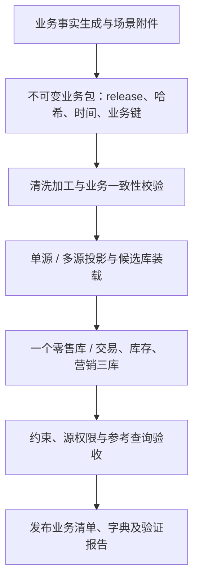

# 业务数据装载、源权限与发布细则

| 项目 | 内容 |
|---|---|
| Feature / Profile | [998](../BRIEF.md) / `standard` |
| 实际模板 | [项目标准技术方案模板](../../_templates/TECH_DESIGN.tmpl.md)，按业务数据生产、加工与装载范围裁剪 |
| 状态 | 业务库环境方向已确认；详细设计待评审，尚未实施；Feature 保持 `draft` |
| 更新日期 | 2026-10-21 |
| 有效来源 | 本次会话确认、998 BRIEF、[999 PRD](../../999-compass-product-course-landing-app/spec/PRD.md) |
| 评审依据 | [数据方案评审](../review/design_review.md)；原始 Contoso 技术包仅作为输入材料 |

> 本文是[业务生产主方案](TECH_DESIGN.md)的技术附录，保留业务侧验收与装载实现细节。先读主文的八大业务域、表结构、规模分布与生产顺序，再查阅本附录。

## 需求依据与验收

按用户最新要求，998 只维护业务库的数据生产方案：合成经营事实与场景素材、清洗加工、业务库结构/源投影、装载、源侧账号及数据质量验证。平台系统结构、配置初始化、身份岗位、查询网关与运行集成统一迁至 [999 数据方案 §5](../../999-compass-product-course-landing-app/design/data-model.md#5-平台初始化与业务源接入)，本需求只保留交付接口。

已确认默认同实例部署独立业务库，业务域逻辑组织，可选交易/库存/营销多源布局，同一套事实按布局派生。业务租户、区域、会员与源侧只读账号属于数据生产和验证范围。Contoso 复用、规模、日期与首批场景尚待收敛。本次边界整理不批准这些未决选择，也不开始生成数据。

当前没有 998 独立 PRD。以下保留原环境验收编号的业务侧部分；AC-ENV-05 的正文整体迁至 999，上述 999 章节记录其余条款的平台部分归属，避免要求丢失或重复维护。

| ID | 业务数据生产验收 |
|---|---|
| AC-ENV-01 | 默认 single-source 在一个 PostgreSQL 实例上使用独立零售业务库；装载与只读账号分离，查询账号写入失败，工具不能装载到未登记目标 |
| AC-ENV-02 | 可选 multi-source 将交易、库存、营销装载到三个数据库，源与账号独立；关闭营销源后交易源参考查询仍可执行 |
| AC-ENV-03 | 两种布局从同一不可变业务包派生，保留租户、业务键、release 和业务/可知时间；同范围/口径/时间的参考查询结果一致 |
| AC-ENV-04 | 源侧样例覆盖租户、区域、数据域与成本/列差异；真实受限连接验证跨租户、跨区域、隐藏成本、写入及越权连接均被拒绝 |
| AC-ENV-06 | 数据样例分别包含未到齐、源不可用、源权限拒绝、真实零值和空集；各类具有独立校验预期，不互相替代 |
| AC-ENV-07 | 仅装载工具登记的业务目标；同 release 同内容重复执行幂等，同 ID 异内容失败；失败不发布，活动业务环境与非目标数据库不受影响 |
| AC-ENV-08 | 各源分别装载校验，全部必需源就绪才原子切换业务环境清单；源内 release/hash 与清单一致；旧版保留且可按清单回切 |
| AC-ENV-09 | 发布前验证跨源业务键、必要维度、金额/数量、粒度和时间一致性；参考查询不得混用两个 release |
| AC-ENV-10 | 保留 pnpm db:seed 三天链路；新业务环境使用显式入口；包中不含真实密码/生产连接，私有金标不随业务可读数据分发 |

业务包字段、场景补充及加工任务见 [业务数据包契约](data-package-contract.md)。999 产品场景只作为业务数据需求来源；产品的会话、审批、报告或投递成功不作为 998 的数据生成结果。

## 1. 最小架构与关键决策

### 1.1 两种布局，共用一套业务事实

| 布局 | 数据库职责 | 用途 |
|---|---|---|
| `single-source`，默认 | 一个零售数据库，保留规范事实与必要授权查询 | 本地开发、数据初始化、普通跨业务分析、权限回归 |
| `multi-source`，选用 | 交易源、库存源、营销源三个零售数据库 | 跨源查询、独立账号、来源迟到/不可用、权限不足的教学验证 |

下文 `retail_data`、`retail_orders`、`retail_inventory`、`retail_marketing` 均为逻辑业务库名。实际库名带环境与 release 标识，由受控部署配置映射；包内自由文本不能用作建库名称。



同实例多库便于管理独立连接与数据库权限，但仍共享服务器资源和实例管理员边界。需要验证资源争抢、独立故障域、不同数据库引擎或独立运维责任时，再将特定源迁到不同实例。当前不增加独立数据库集群、实时 CDC 或通用跨源联邦 SQL 服务。

PostgreSQL 角色在实例范围共享，普通连接只访问指定数据库；跨 schema 查询仍受对象权限约束。因此库名、schema 和角色名本身均不构成完整权限策略。[PostgreSQL 17 Schema 文档](https://www.postgresql.org/docs/17/ddl-schemas.html)

### 1.2 业务域组织与源边界

以[当前完整业务SQL](business-schema.sql)为结构依据，默认业务布局采用 `core/ops/sec`；`eval` 私有预期独立保管，不作为业务可读数据装载。按业务域登记资产集合，通过授权视图暴露交易、库存、营销、财务与客群数据。首版不强制将所有 `core` 表物理搬到新的业务 schema。确需独立迁移责任时再调整 schema。

多源布局按照下表编译源投影，具体字段映射在实施任务 T2 中逐表登记：

| 源 | 权威业务内容 | 跨源所需引用与边界 |
|---|---|---|
| 交易 `retail_orders` | 订单、支付、履约、售后、收入/成本/费用、会员与身份 | 客户身份不复制到营销/库存；成本和会员明细继续单独授权；物流事件提供库存来源引用 |
| 库存 `retail_inventory` | 库存批次、单据、流水、快照、库存估值、锁库证据 | 保留交易事件/单件稳定引用和必要销售区域；库存访问按地点区域，订单相关证据按既有契约分类 |
| 营销 `retail_marketing` | 活动、投放、广告渠道日报、自有行为、归因、门店客流 | 通过订单/身份的受控业务键关联；原始身份映射不随投放数据开放 |
| 公共引用维度 | 租户、SKU/商品、渠道、区域、地点、日历的最小字段 | 每源只复制其查询所需投影；来自同一数据包、只读、同版本，禁止各源另造一套 |

价格、成本、计划和权限等边界资产按具体消费点显式登记，不能根据列名自动推断源归属。源内保留主键、可执行的外键及 CHECK；跨源依赖在数据包发布/装载阶段校验。默认单源SQL中的跨域外键不能直接复制到拆分库并声称仍有效，也不能只删除外键而不补关联校验。

多源训练时，业务查询只连接三个受限源，不提供一个可绕过源权限的完整零售库。用于生成和独立对照的规范数据包由构建/验收身份持有。源投影属于派生数据，其业务真源始终是同一 release 的规范包。

### 1.3 配置维度

`data_profile` 决定规模、日期和场景；`layout` 决定数据库分布；`access_profile` 决定源侧访问测试矩阵。三者分别版本化，避免将“小样”与“单源”、“百万”与“多源”强行绑定。首批只实现上述两种布局与有限源侧账号，不提供任意用户自定义拓扑。

| 配置 | 初始约定 | 缺失/冲突行为 |
|---|---|---|
| `layout` | 默认 `single-source`，可选 `multi-source` | 未知值拒绝 |
| `data_profile`、`release_id` | 从生成包显式选择，记录哈希 | 不以当前日期或默认百万配置静默替代 |
| `source_bindings` | 部署侧登记逻辑源→目标库与凭据引用 | 缺必需源拒绝发布；不输出密码 |
| `access_profile`、`source_access_version` | 源侧只读账号与行列约束配置 | 无有效配置拒绝创建对应查询账号 |
| `business/knowledge/reference_time` | 固定业务时间、可知截止与参考时间，写入包及样例 | 校验与参考查询不得使用截止后的事实 |

## 2. 业务库账号与权限验证

`sec.principal`、`sec.principal_region` 仅配置数据库源侧身份和可见范围。造数工具创建受限账号用于独立验证；不管理产品用户、岗位、工作空间或动态授权。源账号按环境、逻辑源及访问范围命名。

| 源侧测试配置 | 数据范围 | 必需正负例 |
|---|---|---|
| tenant-a-all | 第一业务租户全部区域、指定经营域 | 可读本租户；第二租户同编号记录不可读 |
| tenant-a-east | 第一业务租户华东销售及华东地点库存 | 跨区域拒绝；成本与会员敏感身份默认不可见 |
| tenant-a-marketing | 授权投放、活动、行为及必要销售投影 | 不可读采购成本或完整身份映射 |
| tenant-a-finance | 授权收入、成本、退款及费用 | 成本可见，会员敏感信息不自动可见 |
| tenant-b-east | 第二租户指定区域 | 与第一租户隔离，即使业务编号相同 |
| orders-only | 可读交易源，无营销源连接权 | 交易参考查询成功；营销连接拒绝 |

部署/建库、迁移/装载和只读查询使用不同账号；查询账号不拥有表，无超级用户、BYPASSRLS、建库或建角色能力。显式收敛 CONNECT、schema USAGE、表/列 SELECT、PUBLIC 与未来对象默认授权；search_path 不承担授权功能。[PostgreSQL 17 权限文档](https://www.postgresql.org/docs/17/ddl-priv.html)

租户/区域沿用已审查的 RLS，成本列/表使用专门视图及授权。保留 session_user 作为源侧登录依据，不依赖任意查询可修改的租户变量；禁止通过角色继承或角色切换获得其他范围。装载身份只写候选业务库，查询验证必须使用真实受限登录，不能用现有演示管理员连接替代。

## 3. 生成、加工、导入与交付

### 3.1 先生成一次，再按布局派生

流程为：规范事实生成 → 业务门禁 → 布局投影 → 各源数据包 → 源内校验与跨源校验 → 装载 → 权限/查询验收 → 发布环境清单。

两种布局不改变原订单金额、租户、事件时点或 seed。源投影需要改变物理行粒度时，必须记录映射和可对账规则；金额与订单数不得因复制公共维度或跨源连接而放大。查询结果对等验证使用相同身份、相同口径、同 release、同知识截止。

现有技术包的全表 RLS 脚本不能原样部署到缺少部分 `core` 表的源库。应从同一资产分类生成每个源的显式白名单、授权函数与策略，并将未分类表视为部署失败。业务读身份不访问 `eval`、私有场景参数或生成器文件。

### 3.2 最小环境清单

清单记录 `environment_id`、`layout`、`release_id`、数据包哈希、模型/映射版本、各源逻辑 ID、物理库映射引用、源包哈希、就绪状态和验证结果引用。凭据只存部署引用。初期可使用部署侧受控文件作为活动清单，不新建环境管理服务。

按环境串行执行装载和切换；相同环境已有操作时返回冲突。各源状态为 `pending → loading → validated`，失败标记 `failed`；所有必需源为 `validated` 才能发布。源库内写入实际 release/包哈希，装载器发布前以真实连接核对，避免配置指向错误库。

同 release、layout、映射版本及包哈希已完成时重复导入返回已有结果；同 ID 异哈希直接冲突。未发布的失败候选可按清单重建或重试，不能向活动库盲目追加。工具清理只允许其登记的候选资源，任意非目标数据库不在范围内。

多个数据库分别提交，不假定跨库事务原子性。通过“候选库全部验证完成后一次切换受控活动清单”对外发布；失败候选不出现在活动清单中。工具返回不可变清单与版本；消费者通过交付接口选择具体版本。首版不自动清理已发布旧库，确认消费者释放后才可显式清理；回切使用仍有效且验收通过的旧清单。

### 3.3 数据加工与交付接口

同一份规范事实先按业务域投影，保留稳定 `(tenant_id, business_id)` 与 release。每个投影声明粒度、保留列、源内约束和跨源校验；公共维度复制只允许来自同一版本。参考查询将投放花费与成交分别聚合到相同日期×渠道×区域再关联，防止金额放大；对必要明细关联声明一对一/多对一及未匹配处理。

脏 CSV 等场景输入保留原件、行号和哈希，规范业务事实与清洗结果分别输出，逐项记录去重、丢弃、类型转换与匹配差异。固定财务/经营快照分别保留，不为对齐数字改源；加工参考结果和私有预期独立校验。具体场景字段见数据包契约 §3。

998 对外只交付：业务清单及 release/hash、源结构与数据字典、受限连接的部署引用、可见时间/水位、参考 SQL 与业务验证报告。连接信息不包含明文密码。消费者用这些内容接入；业务数据发布不自动创建任何产品配置。生产和装载可通过独立 SQL/脚本验收，无需启动 Agent。

## 4. 供评审的关键逻辑

以下为设计伪代码，未运行；环境发布归拟新增的 `compass_api.data_seed`，辅助 I/O 由后续实现提供。这里只展开候选业务数据发布的正确性分支。

```text
publish_environment(candidate, expected_active_version):
    取得 environment_id 的独占操作锁
    若当前活动版本不等于 expected_active_version：返回冲突
    若任一必需源缺失、失败或未通过权限及查询验证：拒绝发布
    若源版本、跨源业务键或对账结果不一致：拒绝发布
    写入不可变 candidate manifest，并持久化完成
    原子替换受控活动清单指针，记录新版本
    释放锁；返回新版本；保留旧库及旧清单
```

## 5. 兼容性、风险与验证

| 风险/兼容点 | 处理与验证 |
|---|---|
| 现有 demo 只有单一连接 | 保持原入口；新增零售目标配置与显式环境入口，禁止把旧 DATABASE_URL 默认当导入目标 |
| 原完整模型跨域 FK 与全表安全白名单 | 默认布局先复用；多源投影按映射重新编译与验证，跨源完整性另验，不手工复制多套 DDL |
| 同实例共享角色与 PUBLIC 权限 | 角色使用环境/源前缀；逐库用真实受限连接测试 CONNECT、对象权限、RLS、成本、写入与角色切换 |
| 新增源后仅一部分导入成功 | 候选不发布；保持旧活动清单，重试幂等；两个并发发布只能一个成功 |
| 同 release 的源到达时间不同 | release 一致性与水位完整性分别判断；晚到/补齐切片分别登记水位和参考预期 |
| 多源查询关联放大、数据版本混用 | 独立金标对照、行数与金额对账；故意注入错版本和重复键验证拒绝 |
| 本地权限通过被误认为独立实例隔离 | 明确只验证逻辑数据库边界；资源、管理员和实例故障隔离留到相应部署拓扑验收 |

新零售 schema 迁移沿用现有 Alembic 管理机制，按目标库/布局明确选择迁移集合；受控部署先创建库与账号，再由各目标迁移身份执行，最后装载并验证。默认单源DDL见 business-schema.sql；多源迁移集合与逐表/列投影在对应实施前评审，当前不声称已提供三源建库脚本。原始 context DDL 不直接充当运行时自动迁移脚本。

## 6. 实施任务与未决项

以下均为规划路径，当前没有新增实现文件。测试覆盖按 AC-ENV 组织，优先真实 PostgreSQL 多连接集成测试；SQLite 或单一嵌入会话不能证明数据库 CONNECT 与连接池隔离。

| 任务 | 拟新增/修改位置 | 交付与验收 |
|---|---|---|
| T1 环境与资产映射契约 | `apps/agent-api/src/compass_api/data_seed/contracts.py`、`profiles/`（新增） | 固定两种 layout、数据包/源清单、受控目标引用；AC-ENV-01–03、10 |
| T2 布局编译与约束 | `data_seed/layouts.py`（新增）、`apps/agent-api/migrations/`（按目标新增迁移集合） | 逐表/列源归属、最小维度、源内约束、跨源校验与安全分类；AC-ENV-03、09 |
| T3 源库与测试账号 | `deploy/compose/`、`deploy/README.md`（修改）、`data_seed/access.py`（新增） | 同实例多库、独立账号、源侧访问矩阵与凭据引用；AC-ENV-01、02、04 |
| T4 导入与发布 | `data_seed/importer.py`、`data_seed/environment.py`（新增） | 幂等候选装载、版本检查、环境锁、清单切换与回切；AC-ENV-07、08 |
| T5 命令接入 | `package.json`、`scripts/tasks.mjs`、`scripts/README.md`、API 包命令（修改） | 显式创建/检查/装载入口，沿用根环境加载；保留旧 seed；AC-ENV-10 |
| T6 源侧与多源回归 | `apps/agent-api/tests/integration/test_data_environment.py`（新增） | 实库正负例、等价查询、源故障/迟到、错误版本、重复导入和发布失败；AC-ENV-01–04、06–09 |

建议先完成默认布局和源权限负例，再加入三源布局；两者消费同一固定小样验证结果对等。源包生成的范围依赖后续确定的业务 profile，不能在本次设计中宣称百万生产已就绪。

仍待收敛：Contoso 复用、规模与日期、首批场景数据、逐表投影及多源情况下的规范金标。已确认的环境方向可先做有限验证；完整 Feature 尚不具备无条件实施与验收结项条件。

数据包内容、场景补充与加工的增量任务见 [data-package-contract.md §6](data-package-contract.md#6-可进入生产的门槛与任务)。T1–T6 与这些业务数据任务共同构成实施范围；平台接入任务已迁出。
