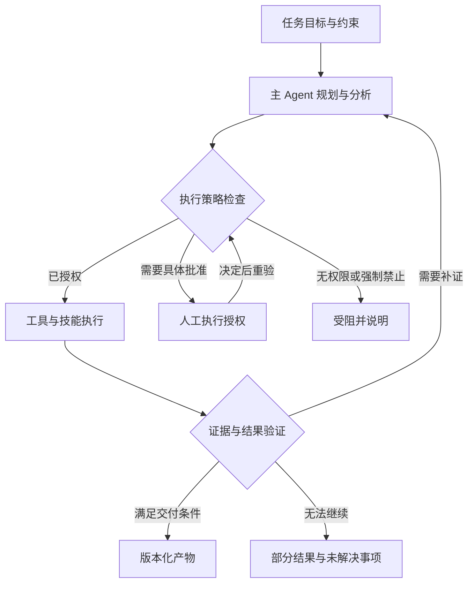

我把这一版整理成了**以主 Agent 的任务执行能力为中心的企业级 DataAgent 功能需求**。

核心定义是：**主 Agent 对“业务问题如何被分析、证据是否支持结论、最终交付什么”负责；工具和技能提供执行能力；统一运行时落实权限、预算、隔离和恢复；管理员持续管理这些能力与质量。**

完整文档共 **27 页、108 项功能需求、12 类典型任务和 12 组验收场景**，每项需求都有编号、级别、功能要求和验收标准，可以用于 PRD、研发拆解和评审。

:chatgpt-content-reference{index="7"}[企业级DataAgent功能需求清单.docx](sandbox:/workspace/scratch/ad41d1830c6b/企业级DataAgent功能需求清单.docx)

下面展开关键定义。这里的条目是**建议的产品需求基线**；上一轮调研中的产品实践用来支持能力方向，不代表每家厂商已经实现全部要求。比如，Snowflake 的官方文档已经把规划、工具调用、代码执行、技能和运行治理列为同一 Agent 平台中的能力。[Snowflake Documentation](https://docs.snowflake.com/en/user-guide/snowflake-cortex/cortex-agents?utm_source=chatgpt.com)

# 一、先明确主 Agent 究竟负责什么

建议在 PRD 中直接采用下面的定义：

> **主 Agent 根据用户目标、业务口径和可用数据，选择适合的分析路径，在既有授权和预算内自主调用工具与技能，根据中间结果调整计划，通过必要的验证与人机协同，交付具有来源、方法、版本和权限的分析产物。**

这意味着，同一个输入框背后需要管理的不只是对话，还有几个独立对象：

| 对象              | 需要保存什么                               | 为什么必须独立                                 |
| ----------------- | ------------------------------------------ | ---------------------------------------------- |
| **会话**          | 用户消息、引用材料、当前讨论上下文         | 一段会话可能产生多个分析任务                   |
| **任务**          | 目标、范围、约束、预期产物、完成标准       | 用来判断这件事到底有没有做完                   |
| **计划与假设**    | 子问题、依赖、方法、候选解释、证据状态     | 分析过程中会被修订，不能只存在于一段临时回复里 |
| **运行与步骤**    | 实际工具调用、结果、错误、费用、检查点     | 支持长任务、恢复、审计和故障定位               |
| **人工决定**      | 决定类型、对象、范围、版本、处理人、有效期 | 澄清、批准、采纳和发布具有不同含义             |
| **Artifact 产物** | 内容、类型、版本、证据、依赖、验证与权限   | 用户需要在对话结束后继续查看、编辑和使用       |
| **发布配置**      | Agent、模型、工具、技能、语义和策略版本    | 用来解释一次分析实际采用了哪套能力             |

## 每次分析都要形成一份“任务契约”

任务契约可以由 Agent 自动生成，不要求用户填写复杂表单。

| 契约字段   | 必须明确的内容                                           |
| ---------- | -------------------------------------------------------- |
| 业务目标   | 用户是在查事实、解释变化、预测未来，还是支持一项业务决定 |
| 分析对象   | 指标、实体、粒度、去重规则、退款处理、单位和币种         |
| 时间与范围 | 时间窗口、时区、地区、渠道、用户群，以及比较基准         |
| 可用数据   | 数据源、附件、业务文档、覆盖范围、实际更新时间           |
| 方法与假设 | 已有分析规范、重要假设、方法前提和不适用条件             |
| 预期交付   | 答案卡、图表、专题报告、可执行分析包、预测结果或监控规则 |
| 资源边界   | 时间、分析深度、计算与模型预算                           |
| 授权边界   | 执行身份、允许动作、接收范围、已有持续授权               |
| 完成标准   | 哪些问题要回答、哪些产物要交付、哪些检查要通过           |

**能从可信上下文确定的内容，Agent 应自动补齐；会实质改变结论或动作的歧义，才向用户澄清。**例如“净收入是否扣退款”值得澄清；已经确定的币种和时区不应每轮询问。

这种业务上下文应来自可维护的指标定义、元数据和可信查询。Databricks Genie 的官方设计也把这些内容作为回答生成的重要输入。[Databricks on AWS](https://docs.databricks.com/aws/en/genie-agents/concepts?utm_source=chatgpt.com)

# 二、12 类典型任务，其流程和交付物有何差异

建议把下列场景作为功能覆盖范围。每一类都应有自己的任务模板、技能组合和验收规则。

| 场景                                                  | 主 Agent 的执行重点                                            | 典型人工介入点                                       | 交付物与验收重点                                                                 |
| ----------------------------------------------------- | -------------------------------------------------------------- | ---------------------------------------------------- | -------------------------------------------------------------------------------- |
| **S01 快速问数**：“上周华东净收入是多少？”            | 解析口径与范围，执行必要查询，校验后直接回答                   | 存在会改变答案的口径歧义                             | **答案卡＋结果表＋查询引用**。数值、单位、时间、数据截止时间完整                 |
| **S02 交互探索**：“按渠道拆开，再看新老客”            | 保留有效分析条件，只修改指定维度；支持下钻与分支               | 无法判断是替换条件还是新增对比                       | **交互分析视图＋筛选状态＋图表**。条件变化可追踪，比较基准一致                   |
| **S03 文件清洗与跨源关联**：“关联这份活动名单和订单”  | 剖析文件、识别主键、处理缺失重复、关联并检查粒度与覆盖         | 删除、填补、身份归并等规则会影响结论，且没有既定规范 | **派生数据集＋转换代码＋质量报告**。解释行数、匹配率与金额变化                   |
| **S04 对账与质量调查**：“财务结果和 Agent 算的不一致” | 固定两份结果，逐项比较公式、过滤、退款、币种、时区与刷新时间   | 两种业务定义冲突；需要修改公共指标或源数据           | **差异桥接表＋对账报告＋修复提案**。已解释项与剩余差异能对回总差额               |
| **S05 异动诊断**：“昨天收入为何下降？”                | 先确认异常与数据完整性，再分解贡献、验证候选解释、关联业务事件 | 缺少活动或故障背景；调查范围显著扩大                 | **诊断报告＋贡献表＋证据图表＋未验证假设**。贡献、关联与因果分别表达             |
| **S06 深度专题**：“研究半年内转化变差的因素”          | 建立问题树，多轮分析；根据新证据修订计划，综合多个分支         | 目标不清、路径成本差异大、研究方向改变               | **专题报告＋可复算分析包＋证据清单**。每个问题都有答案或未完成原因               |
| **S07 预测与情景模拟**：“预测未来 12 周销量”          | 检查历史覆盖，建立基线，按时间回测，再输出预测与情景           | 用途、错误代价、业务约束和情景假设需明确             | **预测数据＋区间图＋回测报告＋方法参数**。回测跨度匹配用途，说明误差和限制       |
| **S08 随机实验评估**：“这个 A/B 实验是否支持上线？”   | 读取设计、检查分流和数据质量，计算效果、区间及护栏指标         | 设计或异常处理不明确；最终上线决定                   | **实验报告＋效应区间＋质量检查**。方法匹配设计，结论符合预设决策标准             |
| **S09 观察性因果评估**：“涨价是否导致流失？”          | 明确干预、结果、人群和时间，选择有识别依据的方法并做诊断       | 需要业务或专家补充干预过程和关键假设                 | **因果分析说明＋估计结果＋诊断与敏感性分析**。识别条件不足时明确原目标未解决     |
| **S10 周期报告**：“每天生成昨日经营日报”              | 首次固定口径、计算和模板；每期检查数据就绪后执行与校验         | 首次定义；重要口径变化；扩大接收范围                 | **报告定义＋每期报告实例＋运行和投递回执**。同版本口径稳定，不能用旧数据冒充本期 |
| **S11 主动监控**：“支付成功率异常时解释原因”          | 受控检测生成异常事件，经去重与冷却后触发调查，跟踪恢复         | 首次阈值、接收范围和升级规则；业务处置授权           | **监控规则＋异常事件＋调查报告＋恢复记录**。验证误报、漏报、去重和检测器健康     |
| **S12 看板与分析应用**：“把留存分析做成团队看板”      | 定义参数、交互、刷新与数据绑定，验证后发布                     | 交互需求不明确；扩大受众；增加写操作                 | **版本化看板或应用＋查询绑定＋验证记录**。筛选、刷新、访问权限及错误状态有效     |

这里有几个直接影响产品实现的区别。

### 1. 问数和诊断需要不同的完成标准

问数的完成标准是：**在正确口径下给出可核验的结果。**

诊断的完成标准还包括：

- 是否确认了异常本身，而不是数据延迟。
- 是否检查了主要候选解释。
- 是否保存了支持证据和反证。
- 是否说明哪些因素已经解释、哪些仍不确定。
- 是否把变化贡献误写成了因果原因。

分析复杂度不能按 SQL 次数判断。一个可信固定流程可能解决复杂问题；多个 SQL 执行成功也可能没有回答用户的问题。

### 2. 不同维度的贡献不能直接相加

按地区、渠道、产品分别分析，可能是在描述同一批变化。

因此异动诊断 Skill 应要求：

- 同一分解内的贡献与未解释项能够对回总变化。
- 不把不同维度的贡献直接求和。
- 对“订单量 × 客单价”等分解说明交互项处理。
- 分别表述“贡献最大”“同时发生”“存在因果证据”。

### 3. 预测和实验需要“方法产物”

预测不能只交一张未来曲线，还要交付基线、回测、误差和区间说明。预测 12 周，就不能只用一步预测的回测表现验收。

实验分析也不能只返回“显著／不显著”。它需要保留实验设计、效应大小、区间、护栏和异常检查。**分析合格与业务结果正向是两件事。**

### 4. 固定报告刷新和重新自主分析应是两种任务

- **固定刷新**：保持指标、计算逻辑和模板，用新数据生成下一期结果。
- **重新分析**：允许 Agent 根据新数据调整假设、方法和分析路径。

两者的成本、稳定性、版本和验收方式不同。Hex 官方也明确区分了运行 Agent 的周期 Tasks 与执行已发布应用的 Scheduled runs。[Hex Technologies](https://learn.hex.tech/docs/explore-data/tasks?utm_source=chatgpt.com)

# 三、主 Agent 的核心能力清单

## 3.1 推理过程应落实为 20 项可观察能力

这里的“推理过程”建议定义为**目标、计划、假设、方法选择、实际动作、证据和修订记录**。验收围绕这些记录能否解释真实分析行为展开，不以展示模型原始内部思维链为目标。

| 编号  | 能力                     | 具体要求                                                 |
| ----- | ------------------------ | -------------------------------------------------------- |
| AG-01 | **任务契约形成**         | 从自然语言提取目标、范围、约束、产物和完成标准           |
| AG-02 | **场景识别与路径选择**   | 选择快速查询、多步调查、固定流程或持续任务               |
| AG-03 | **必要澄清**             | 判断哪些歧义值得打断用户，复用已确认信息                 |
| AG-04 | **业务语义解析**         | 对齐指标、粒度、时间、币种、过滤、连接与去重             |
| AG-05 | **数据发现与可用性判断** | 查找授权数据，检查覆盖、刷新、质量与权限                 |
| AG-06 | **上下文组织与冲突处理** | 区分认证口径、历史偏好、用户材料和未经验证的信息         |
| AG-07 | **计划与依赖管理**       | 拆分子问题，标记前置条件、工具、产物和校验点             |
| AG-08 | **假设与证据管理**       | 保存候选解释、支持证据、反证及未验证状态                 |
| AG-09 | **方法与技能选择**       | 根据目标和数据条件选择适用方法，识别前提不足             |
| AG-10 | **根据结果继续分析**     | 读取实际结果和错误，决定追加验证、修复或调整路径         |
| AG-11 | **计算与结论校验**       | 检查日期、分母、Join、截断、汇总、图表与文字一致性       |
| AG-12 | **动态重规划**           | 新证据或用户纠正后，确定哪些步骤重跑、保留或失效         |
| AG-13 | **探索深度与停止控制**   | 在完成标准、证据增量、时间和预算内推进                   |
| AG-14 | **多轮分析状态**         | 维护指标、过滤、粒度、基准和分支，避免条件漂移           |
| AG-15 | **可检查的过程展示**     | 提供与真实运行对应的计划、方法摘要、动作和修订说明       |
| AG-16 | **子任务委派与汇总**     | 对独立分支设置上下文、权限、预算和输出契约，再统一校验   |
| AG-17 | **受阻与部分完成处理**   | 区分系统失败、证据不足、目标未解决和部分产物完成         |
| AG-18 | **按任务类型交付**       | 生成约定产物，补齐来源、方法、限制和验证结果             |
| AG-19 | **资产复用与记忆候选**   | 复用经过验证的方法；新知识按作用域提出候选               |
| AG-20 | **业务动作提案**         | 把建议形成可审阅的名单、工单或操作草稿，保留独立执行状态 |

**AG-08、AG-10、AG-11、AG-12 是主 Agent 分析能力的重点。**它们共同决定 Agent 能否根据证据推进和修正工作。

例如，在“收入下降调查”中，系统应能记录：

| 假设               | 验证动作                         | 证据状态       | 下一步                               |
| ------------------ | -------------------------------- | -------------- | ------------------------------------ |
| 订单量下降贡献较大 | 对比同口径订单数，按渠道检查     | 有支持证据     | 继续定位订单量变化的人群和渠道       |
| 退款增加是主要因素 | 计算退款变化及其收入影响         | 当前证据不支持 | 降低该方向优先级，保留计算记录       |
| 某次活动影响转化   | 对齐活动时间、覆盖人群与转化变化 | 尚不足以判断   | 补充业务背景，必要时转实验或因果评估 |

这些是**分析活动与证据记录的示例**，不预设真实业务数据会支持某个原因。

## 3.2 工具、Skill、Workflow 和子 Agent 要分别定义

| 对象                  | 定义                                                               | 示例                                       |
| --------------------- | ------------------------------------------------------------------ | ------------------------------------------ |
| **工具 Tool**         | 一次可以执行、返回结构化结果的动作接口                             | 执行 SQL、读取文件、运行 Python、保存图表  |
| **技能 Skill**        | 可复用的分析方法包，包含适用条件、步骤、代码或模板、检查和输出要求 | 留存分析、收入贡献分解、实验评估           |
| **固定流程 Workflow** | 已知依赖和步骤的可重复执行过程                                     | 等待数据到齐，执行日报查询，生成文件，投递 |
| **子 Agent**          | 被委派独立目标、可在限定范围内选择动作的执行者                     | 数据发现、独立调查分支、专门验证           |
| **主 Agent**          | 选择、组合和调整这些能力，对整体任务交付负责                       | 把清洗、查询、诊断和报告组织成一项完整分析 |

**Skill 的关键是把方法和验收封装起来。**建议至少包含：

- 适用场景与不适用条件。
- 必要输入、业务口径与方法前提。
- 所需工具及数据权限。
- 分析步骤、脚本或固定子流程。
- 中间结果检查和异常分支。
- 预期 Artifact 类型。
- 版本、维护者和评测样例。

例如“30 日复购分析 Skill”至少要明确首购定义、复购窗口、退款处理、用户去重和队列成熟条件。最近刚首购的用户尚未拥有完整 30 日观察窗口，不能直接与成熟队列比较。

## 3.3 工具技能体系的 12 项功能

| 编号  | 功能                 | 核心要求                                             |
| ----- | -------------------- | ---------------------------------------------------- |
| TS-01 | 工具契约与能力发现   | 声明输入输出、权限、身份、副作用、错误和资源边界     |
| TS-02 | 数据目录与语义检索   | 搜索数据、字段、指标、关系、取值、可信查询和产物     |
| TS-03 | 受控查询执行         | 查询检查、执行、分页、取样、取消、扫描量限制         |
| TS-04 | 文件与表格处理       | 解析、类型识别、剖析、清洗及处理前后对比             |
| TS-05 | 代码沙箱             | 计算隔离、依赖、超时、状态语义和结果持久化           |
| TS-06 | 业务文档与事件检索   | 检索 SOP、活动、变更与故障，保存时间和来源           |
| TS-07 | 图表与报告生成       | 从真实结果生成产物，保存数据绑定和模板版本           |
| TS-08 | Skill 标准结构       | 统一前提、参数、步骤、依赖、验证和输出声明           |
| TS-09 | Skill 检索与组合     | 按需加载，组合技能与固定子流程                       |
| TS-10 | 领域分析技能包       | 按场景提供对账、漏斗、留存、预测、实验等方法         |
| TS-11 | 结构化结果与证据引用 | 返回覆盖范围、行数、抽样、截断、警告和结果引用       |
| TS-12 | 外部动作与集成       | 通知、分享、调度、工单和写入分别授权，支持预览和回执 |

大结果应通过数据引用、聚合和受控读取传递。Agent 必须知道自己看到的是全集、样本还是部分结果。

# 四、Human-in-the-Loop 要明确到“决定对象”

## 4.1 建议定义五种独立决定

| 决定类型           | 用户或负责人实际决定什么         | 示例                         |
| ------------------ | -------------------------------- | ---------------------------- |
| **业务澄清**       | 问题含义、事实或约束             | “这里的收入扣除退款”         |
| **计划对齐**       | 接受分析范围、方法和重大资源取舍 | “先分析渠道，再看用户群”     |
| **执行授权**       | 允许具体动作在具体范围内执行     | “允许导出这些字段到指定位置” |
| **结果复核或采纳** | 是否认可某个版本的方法或结论     | “这版可以作为本期经营分析”   |
| **发布授权**       | 允许指定版本传播给指定受众       | “把 V3 发给销售管理组”       |

它们可以在一个界面中组合呈现，但要分别记录语义。例如，“这版可以”如果是在回答结果复核请求，不能自动扩展成公开发布。

已有产品对人工接管也提供了具体机制：Hex Notebook Agent 支持对分析单元变更逐项 Confirm 或 Undo。这里借鉴的是**变更对象明确、用户决定可追踪**，不是要求所有 DataAgent 都逐步确认。[Hex Technologies](https://learn.hex.tech/docs/explore-data/notebook-view/notebook-agent?utm_source=chatgpt.com)

## 4.2 默认执行规则

| 条件                               | 系统行为                         |
| ---------------------------------- | -------------------------------- |
| 已授权、范围明确、预算内的常规分析 | 自动执行                         |
| 用户目标或业务口径存在关键缺口     | 请求澄清                         |
| 存在重大方法或成本取舍             | 视用户模式和策略进行计划对齐     |
| 具体外发、写入或额外开支尚未授权   | 准备可审阅的动作后请求批准       |
| 没有数据权限或违反强制策略         | 拒绝相关动作，提供申请或替代路径 |
| 已有范围明确的持续授权             | 在范围内继续，不重复确认         |

## 4.3 HITL 的完整功能要求

文档中的 HI-01 至 HI-10 覆盖：

1. **区分介入类型**，避免不同决定互相替代。
2. **识别既有授权**，让正常分析持续推进。
3. **生成可判断的请求**，说明原因、选项、影响和已完成工作。
4. **绑定具体动作与范围**，包括身份、目标、参数、版本、预算和有效期。
5. **持久化等待状态**，支持跨页面、跨进程、跨时间恢复。
6. **处理拒绝、超时、撤销和权限变化**，超时不自动等于同意。
7. **支持修改与部分批准**，仅执行获准分支。
8. **支持专业复核**，将口径争议和方法争议交给适当责任人。
9. **支持持续授权**，明确周期、数据范围、受众、预算和责任人。
10. **记录决定与执行关联**，防止重复点击或事件重放导致重复动作。

等待某个决定时，只有依赖该决定的步骤需要阻塞；其他仍在授权范围内的独立工作可以继续。

还有一个容易遗漏的边界：**运行中撤权**。系统需要停止派发相关新动作，按能力终止可中断调用；迟到结果在返回用户、继续使用或交付产物前重新检查权限。已经发生的外部动作保留实际回执，不能声称因撤权而自动回滚。

# 五、Artifact 要成为独立的分析资产体系

## 5.1 不同产物承担不同用途

| Artifact 类型            | 必须携带的内容                                   | 主要用途                 |
| ------------------------ | ------------------------------------------------ | ------------------------ |
| **答案卡／指标卡**       | 数值、单位、口径、时间、数据截止时间、来源与校验 | 即时消费和继续追问       |
| **查询结果／派生数据集** | 字段、粒度、行数、过滤、清洗关联记录、覆盖与截断 | 后续计算、复算和导出     |
| **图表**                 | 数据引用、聚合、轴与单位、筛选和配置             | 解读、编辑和报告引用     |
| **专题／诊断报告**       | 问题、方法、事实、证据、假设、限制和建议         | 业务复核与决策沟通       |
| **可执行分析包**         | SQL、Python、Notebook、参数、依赖、顺序和断言    | 人工接管和方法复用       |
| **预测／实验／因果产物** | 方法前提、诊断、回测或效应区间、敏感性和适用范围 | 判断分析是否足以支持决定 |
| **报告模板／监控规则**   | 固定逻辑或自主分析目标、周期、身份、预算和目的地 | 持续运行                 |
| **质量报告／对账表**     | 异常样例、差异、受影响对象、修复提案             | 数据问题定位与修复       |
| **看板／参数化应用**     | 页面、交互、数据绑定、刷新、发布版本和权限       | 团队持续使用             |
| **动作草稿／执行回执**   | 对象、范围、目的地、差异预览、授权和实际结果     | 区分建议、批准和执行     |

## 5.2 每个重要产物版本都应回答六个问题

| 问题       | 对应信息                                         |
| ---------- | ------------------------------------------------ |
| 它是什么   | 产物 ID、类型、名称、版本、所属项目              |
| 谁产生的   | 用户或 Agent、任务、运行、步骤                   |
| 依据什么   | 数据来源、数据截止时间或快照、指标版本、外部材料 |
| 如何计算   | 查询、代码、参数、Skill 版本和依赖               |
| 检查过什么 | 验证结果、证据关联、人工修改、限制               |
| 可以给谁用 | 查看、编辑、重算、导出、分享和发布权限           |

“数据来源：某数据库”不够。重要结论应能追踪到：

**结论 → 指标与范围 → 具体结果 → 对应查询或计算 → 数据版本或查询时间。**

## 5.3 状态要分开保存

| 状态维度   | 示例                                     |
| ---------- | ---------------------------------------- |
| 生成与计算 | 进行中、完成、部分完成、失败、取消       |
| 验证       | 未验证、通过、部分通过、不通过、无法判定 |
| 人工采纳   | 待决定、已采纳、需修改、已否决           |
| 发布       | 草稿、已发布、已撤回、已归档             |
| 数据新鲜度 | 当前有效、已过期、上游变化、待重算       |

因此，一份报告可以同时是“计算完成、验证通过、待采纳、未发布”。单个“完成”状态无法表达这些差异。

## 5.4 编辑、重算、刷新和重分析要有不同语义

| 用户操作                   | 系统应做什么                                       |
| -------------------------- | -------------------------------------------------- |
| 修改颜色、字号、排版       | 产生呈现版本，保留数据绑定，通常无需重查           |
| 修改结论文字               | 记录人工修改，检查受影响的事实与证据关系           |
| 修改 SQL、公式、过滤或聚合 | 重算，并使受影响的图表与结论进入待验证状态         |
| 用相同数据和逻辑复算       | 新建运行记录，保留输入与环境条件                   |
| 用新数据刷新               | 保持固定逻辑，生成新结果和产物版本                 |
| 重新分析                   | 允许改变目标、假设、方法与计划，形成任务修订或分支 |

还需要以下能力：

- AI 基于旧版本完成的修改不能静默覆盖人工编辑。
- 没有历史快照时，明确可复现的范围。
- 动态看板按访问者权限查询；静态报告按内容与受众检查。
- 查看报告、查看底层明细、重算、导出和分享分别授权。
- 已完成产物在任务失败或取消后仍可识别和保留。
- 在线链接撤销与已经导出的文件副本采用不同传播管理方式。

# 六、管理员模块需要覆盖 10 个管理领域

管理员工作台的目标是回答：

> **谁可以让哪个 Agent，在什么数据和工具范围内，以什么成本和质量标准运行；出了问题，如何定位、停止、修正和回滚。**

因此建议将管理权限分给工作区管理员、数据维护者、Agent 维护者、运行维护者和审计员。

下面是完整的 **38 项管理员功能**，按管理领域汇总。

| 管理领域                    | 功能编号与清单                                                                                               | 关键验收边界                                                                          |
| --------------------------- | ------------------------------------------------------------------------------------------------------------ | ------------------------------------------------------------------------------------- |
| **组织、身份与权限**        | AD-01 租户与工作区隔离；02 成员、组与角色；03 企业登录与服务身份；04 执行身份和数据授权；05 人员生命周期同步 | 页面、API、搜索、缓存、下载和日志都不能成为越权入口；账号失效后任务不能改用管理员身份 |
| **数据源与业务语义**        | AD-06 连接与凭证；07 数据范围和元数据同步；08 指标与语义目录；09 可信查询与示例；10 集中质量管理             | 历史结果能追溯旧口径；schema 变化可定位；评测答案不自动进入运行时示例                 |
| **Agent、工具、技能与模型** | AD-11 主 Agent 配置；12 工具策略；13 Skill 与固定流程；14 模型路由与降级；15 代码环境和数据边界              | 草稿不影响生产；安装技能不自动增加权限；模型降级遵守能力和地域约束                    |
| **人机协同策略**            | AD-16 自动执行、审批与拒绝规则；17 批准与恢复；18 领域复核和升级流程                                         | 常规分析不反复审批；批准绑定具体对象；业务复核不授予数据权限                          |
| **运行、恢复与成本**        | AD-19 任务管理；20 配额、并发与队列；21 预算、成本与归属；22 恢复和动作去重                                  | 关闭页面不丢任务；失败恢复不重复副作用；达到硬限额不继续派发                          |
| **观测与审计**              | AD-23 执行追踪；24 敏感载荷、审计与保留；25 运营质量与预警                                                   | 可以从图表定位到计算和来源；运维诊断权限与敏感内容查看权限分开                        |
| **评估、版本与发布**        | AD-26 评测集；27 多层评估；28 组合版本发布与回滚；29 受控实验与改进建议                                      | 发布能看到完整变更和评测；回滚不重放外部动作；改进建议经验证后影响生产                |
| **记忆治理**                | AD-30 作用域与来源；31 写入与共享提升；32 纠错、冲突、到期与删除                                             | 个人偏好不流入其他用户；单次猜测不成为组织事实；撤销后不继续召回                      |
| **产物与传播**              | AD-33 产物管理；34 分享、导出和传播控制；35 模板与资产复用                                                   | 刷新不篡改历史；复用重验权限；公开分享与内部使用分别判断                              |
| **定时与主动分析**          | AD-36 定时任务；37 责任人、授权和投递；38 条件触发与自动调查                                                 | 时区和数据窗口明确；责任人失效可处理；异常去重；分析成功与投递成功分别记录            |

管理员页面可以组织为八个一级入口：

**控制总览、数据与语义、Agent 与能力、运行与调度、质量与发布、安全与审计、记忆与产物、组织设置。**

Hex Context Studio 已把观测、上下文维护、改进建议和评测组织成独立的管理能力，可以作为这部分信息架构的产品参考。[Hex Technologies](https://learn.hex.tech/docs/agent-management/context-studio?utm_source=chatgpt.com)

## 管理员侧尤其需要明确三个规则

**第一，发布的是完整能力组合。**
只给提示词做版本管理不够。任务需要记录实际采用的模型、工具、Skill、语义和配置版本；但记录版本不意味着冻结旧权限，撤权和强制策略仍需按当前规则执行。

**第二，质量评估不能只看工具成功率。**
建议分别检查结果正确性、方法适用性、证据、最终回答、授权行为和运行性能。Snowflake 的官方评估也区分答案正确性、逻辑一致性和工具相关指标，其中部分工具指标仍处于预览状态。[Snowflake Documentation](https://docs.snowflake.com/en/user-guide/snowflake-cortex/cortex-agents-evaluations?utm_source=chatgpt.com)

**第三，记忆、指标和权限分别治理。**
“用户喜欢按周看趋势”可以是个人偏好；“净收入的计算公式”应是语义资产；“可以访问哪些数据”应由权限系统决定。

# 七、统一运行时与简单界面的配套要求

主 Agent 可以自主决定分析步骤，执行边界仍应由运行时落实。工具执行与验证可以采用下面的闭环：

运行时 RT-01 至 RT-08 应覆盖：

- **持久化任务状态**：任务不依赖单次 HTTP 请求或仍存活的聊天进程。
- **执行前策略检查**：主 Agent、子 Agent 和直接 API 调用受到同一套约束。
- **调度、并发和隔离**：长任务不能耗尽其他用户或租户资源。
- **检查点、重试和幂等**：外部操作结果未知时先核实，不能盲目重试。
- **暂停、取消和撤权**：区分“已请求取消”和底层“实际已取消”。
- **全链路预算**：覆盖模型、查询、沙箱和外部服务。
- **真实运行事件**：进度、错误、工具调用和产物状态由实际事件驱动。
- **周期与事件触发**：分别管理分析执行、报告生成和结果投递。

用户界面可以保持简单，但 UX-01 至 UX-08 仍需提供：**上下文引用、任务历史、可展开的执行详情、运行中纠正与取消、产物接管、搜索反馈、协作复核，以及订阅和集成入口。**

业务用户默认看到结论、产物和当前状态；需要检查时再展开口径、方法、查询和证据。

# 八、完整需求清单的范围与验收方式

这次的 108 项需求分为七组：

| 模块                        | 编号范围     |    数量 |
| --------------------------- | ------------ | ------: |
| 用户工作台                  | UX-01～UX-08 |       8 |
| 主 Agent 任务理解与分析执行 | AG-01～AG-20 |      20 |
| 工具与技能体系              | TS-01～TS-12 |      12 |
| Human-in-the-Loop           | HI-01～HI-10 |      10 |
| Artifact 产物体系           | AR-01～AR-12 |      12 |
| 统一运行时                  | RT-01～RT-08 |       8 |
| 管理员控制面                | AD-01～AD-38 |      38 |
| **合计**                    |              | **108** |

级别采用三种含义，避免把场景暂缓和质量要求省略混在一起：

- **基础必备，83 项**：企业级任务共用的生产基线。
- **场景启用时必备，19 项**：一旦启用对应场景，相关控制和验收必须同步交付。
- **增强能力，6 项**：后续提高规模化管理和使用效率。

文档还给出了 12 组验收场景，覆盖：

| 验收方向       | 必须验证的行为                                     |
| -------------- | -------------------------------------------------- |
| 口径与粒度     | 重复明细、退款、时区边界不会导致错误计数           |
| 数据完整性     | 无记录、延迟、截断和权限拒绝得到不同处理           |
| 假设被推翻     | Agent 更新假设与计划，保留反证                     |
| 统计结论边界   | 根据区间与决策标准表达结论，不把未显著直接判成无效 |
| 授权继承与失效 | 范围内不重复询问，范围变化和撤权会重新判断         |
| 崩溃与恢复     | 复用已确认结果，避免重复通知或写入                 |
| 中途修改       | 识别受影响步骤、图表、结论和批准                   |
| 人工编辑       | 保护人工修改，区分样式和计算变更                   |
| 跨租户与旁路   | 搜索、缓存、日志、下载和 API 同样受控              |
| 不可信上下文   | 材料中的指令不会变成新的系统授权                   |
| 成本与取消     | 停止无效循环，不继续派发超预算工作                 |
| 产物交付与发布 | 分别记录生成失败、验证失败和发布状态               |

## 建议的首个版本范围

首个企业版本可以先覆盖 **快速问数、交互探索、指标对账、异动诊断和有边界的专题分析**。配套交付基础工具与代码环境、任务恢复、权限与预算执行、证据、版本化产物，以及最小完整管理员控制面。若文件上传是主要业务入口，同期纳入清洗与跨源关联。

随后启用周期报告、主动监控和参数化看板，并同步补齐持续授权、数据就绪、去重、通知和维护责任。预测、随机实验和观察性因果分析应作为独立场景包验收，分别检查方法前提、诊断和交付标准。
