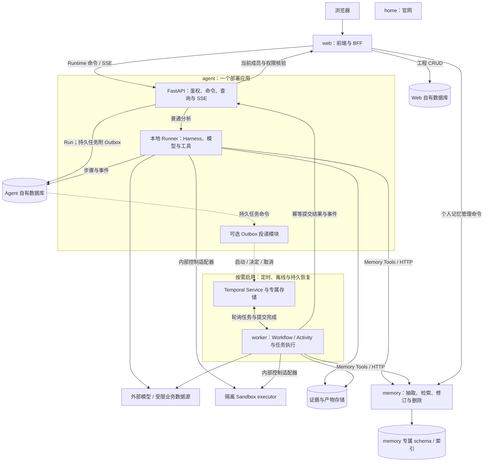

# DataAgent 技术架构与选型

> 2026-10-15 实施登记：产品名 Compass，M0 工程脚手架见 [compass/README.md](../../../README.md)。下文保留完整目标设计及 2026-09-16 的方案背景；实际完成范围与验证见 Compass 工程。

> 2026-10-24 数据设计更新：Profile `standard`，按用户要求将 [Compass DataAgent 系统数据库结构设计](data-model.md)重构为系统专属模型，参考 [998 技术方案](../../998-business-data-seeding-tool/design/TECH_DESIGN.md)的领域组织格式。包含 12 个系统业务域、94 张目标表的完整 ER/字段/约束与逐表 MVP 必要性，M0 为 30 张表；行业业务事实表由外部源方案维护。该附录对齐 PRD 1.6；本文旧“审批”用语按五类决定及具体授权用途解释。当前为待评审设计，完整运行实现仍按阶段推进。

## 1. 决策摘要与范围

2026-10-25 根据用户“控制 app 数量、普通分析在 agent 内执行、定时与后台任务按需交给 worker”的约束，增量维护本方案（Profile `standard`，沿用既有文档结构）。后续脚手架指令已完成 `apps/agent` 名称迁移、独立 memory / worker Python 入口及根工程配置；分析执行、记忆业务与持久编排仍待实施。需求与 AC 继续以 [PRD](../spec/PRD.md) 的 FR-04/07/08、AC-08.2/08.3、AC-RT-01/04/08、AC-TS-05 为准。

采用 **Turborepo + pnpm 管理的多语言 Monorepo，Next.js 承载前端、BFF 与账户/权限/通用配置等工程 CRUD，Python `agent` 承载推理相关 API、任务分派与普通分析执行**。目标自有应用为 `home`、`web`、`agent`、`memory`，定时、离线及要求跨重启恢复的任务增加可选 `worker`。M0 起步只需前三个应用；memory 随 FR-12 / M4 启用，提前启用时同步交付其权限与验收。普通分析使用 agent 管理的协程、受限线程池或子进程；生成代码使用隔离 Sandbox。Python 依赖由 uv workspace 管理，`packages/` 只放有两个及以上应用消费者的共享资产。

2026-10-25 数据归属补充：Web / BFF 直接拥有工程 CRUD 的服务与数据库；Agent 专注 Runtime 推理及其相关状态。每个 app 可使用独立数据库实例，按逻辑库独立迁移；跨 app 使用 API 与逻辑引用。统一执行 [SQL 迁移规范](../../../docs/database-migrations.md)，当前 Web 持久化、完整/增量 SQL 导出入口仍待对应 Feature 实现。

用户同轮追加明确：记忆抽取落盘、查询检索、持久化存储、个人记忆修改作为独立 `memory` 服务，并抽象为 Agent Runtime 工具。memory 拥有记忆 API、存储与迁移，agent / worker 通过工具适配器调用；临时上下文与业务事实仍按原领域归属。契约见 §7.1，验收引用 PRD FR-12、AC-12.1–12.5、AD-30–32。

2026-10-25 文件职责补充：通用上传、原件/派生文件及版本、正文/表格/元信息解析、OCR、主动结构化字段/记忆候选抽取与确认归 `memory`；知识文档随文件生命周期管理。Agent 保留报告/看板业务对象、分析证据和检索编排，按文件 ID/版本调用 Memory。当前 owner 以 [数据库规范](../../../docs/database-migrations.md#1-应用职责与数据库所有权)为准。本文及数据模型中旧的 ArtifactStore 访问和 `file_object` 关联需在后续文件 Feature 中细化为跨服务契约，不可直接转成 Agent 文件表或跨库外键。[995](../../995-web-management-foundation/spec/PRD.md)只实施 Web 基座和完整界面框架，相关业务先空页；本次职责登记不要求实现 Memory、文件存储、解析任务或模型调用。

Dispatcher 保留为 agent 内的投递模块，Sandbox Gateway 保留为内部控制适配器，均不单建 app。持久执行 profile 使用 Temporal + worker；Temporal Service 仍属于外部基础设施。默认普通分析链路不依赖 Temporal、worker 或 Outbox。“后台任务”描述业务交付方式，普通分析的异步 I/O 与 SSE 返回不会自动触发 worker 分派。

Agent 决策权采用 **Autonomous First 的 Hybrid 混合架构**：主 Agent 负责开放分析的任务分解、工具选择与重规划，确定性流程处理权限、预算、验证、人工决定和产物提交。Agent Loop 根据任务组合 Plan and Execute、ReAct 与 Multi-agent；各范式可独立使用或嵌套，委派按实际分工收益启用。此决策由课程负责人于 2026-10-24 明确，属于目标架构，当前 M0 工程基线尚未实现这些执行能力。

选择 Next.js 的依据是统一 Web 全栈工程、会话与页面聚合，并为后续应用扩展建立边界。SSR 是可选渲染能力，不是采用 BFF 的前提。这里的 Turbo 指 **Turborepo（`turbo` CLI）**，与 Next.js 的打包器 Turbopack 职责不同。

这是面向 V5 的待评审技术设计，并非已实现系统。其职责是记录可评审的技术方向，不修改 [PRD](../spec/PRD.md) 的产品范围或 [总纲](../../../../../../course/curriculum/v5/course_outline.md) 的教学顺序。[审查报告](../../../../../../research/shared/dataagent-technology-selection/reports/technology-review.md) 保存证据与被修正观点；[脚手架设计](scaffold-design.md) 保存工程结构与实施门禁。

目标任务：用户提出“华东区 GMV 为什么下降”，系统明确指标口径与权限，查询数据，隔离计算，生成带证据的报告。M0 只读分析与不可变调整草稿；真实写入、自动补偿为 M3 以后候选能力，需另行通过 PRD 与安全验收。

选型约束：核心机制能读懂和修改；学员不耗时重写通用基础设施；同一任务可做故障、隔离与评测实验；10 周课程按阶段增加复杂度。以下未注明官方事实者均为项目设计判断，性能与依赖兼容性须实测。

## 2. 工程边界与 Agent 决策权

| 维度     | 推荐                                                                | 含义                                                                                    |
| -------- | ------------------------------------------------------------------- | --------------------------------------------------------------------------------------- |
| 仓库组织 | Turborepo + pnpm + uv 的 Polyglot Monorepo                          | Next.js、Python、契约、部署与 Eval 同次变更；课程内容仓库另有职责                       |
| 代码架构 | web 工程后台 + agent 推理后台 + 独立 memory + 按需 worker           | 工程 CRUD 由 BFF 实现；Harness、分派与执行控制留在 agent；worker 按实际复用提取执行代码 |
| 运行部署 | home、web、agent；启用记忆时独立 memory；按需 worker；隔离 executor | 本地执行池随 agent 启停；memory 独立管理存储；worker 独立伸缩                           |

app 是构建与部署单位；agent 管理子进程仍属于一个 app。各 app 内部采用模块化结构；Web、Agent、Memory 分别拥有业务与数据，worker 解决后台执行的负载与生命周期问题。模块职责、进程隔离、独立服务分别按实际需求选择。

### 2.1 Agent 决策权与执行范式

固定 Workflow 适合口径、路径稳定的确定性任务；自主主控适合按观察探索、追问与重规划。Compass 的开放经营诊断采用自主主控，权限、预算、人工决定和提交仍由明确的工程契约约束，因此整体选择 Autonomous First 的 Hybrid。状态所有者、可委派范围和返回证据在任务契约中显式规定。

- **Plan and Execute**：多步骤任务先规划，再执行和验证；新增证据可触发带原因的重规划。
- **ReAct**：在依赖工具观察的局部问题上迭代推理、行动和观察，补齐证据或回到上层规划。
- **Multi-agent**：在子任务可以独立取证或需要专业上下文时按需委派；主 Agent 负责口径对齐、证据汇总和冲突校验，共享总预算并限制各子任务预算。

上述模式描述分析控制流。Temporal 承载可恢复执行，Workflow 重放、Activity I/O 与副作用幂等继续遵守本文第 6 节；它与 Agent 决策权分别设计。项目选择薄 Harness 以显式展示和验证这些机制，PydanticAI Direct 负责模型适配。完整 Agent SDK 集成更多循环行为；LangGraph 可以混合确定性与模型决策，并提供持久执行及人工介入。后续替换主控时需评估状态、恢复和版本的归属成本，不据此推断框架的通用优劣。

能力依据（2026-10-24 复核）：[PydanticAI Direct 与 Agent](https://pydantic.dev/docs/ai/core-concepts/direct/)、[LangGraph 概览](https://docs.langchain.com/oss/python/langgraph/overview)、[Temporal Workflow](https://docs.temporal.io/workflows)。组合方式与取舍为项目设计判断。

## 3. 分层技术栈

| 层             | 主选                                                                                         | 项目拥有的职责                                                                                     | 引入阶段                          |
| -------------- | -------------------------------------------------------------------------------------------- | -------------------------------------------------------------------------------------------------- | --------------------------------- |
| Web / BFF      | Next.js App Router、React、TypeScript；Node.js runtime                                       | 页面、账户/权限/通用配置 CRUD、自有数据库、页面聚合、Runtime 命令转发与 SSE；Web 与 BFF 同应用部署 | M0                                |
| 交互与数据展示 | shadcn/ui、Tailwind CSS；TanStack Query / Table；ECharts                                     | 任务、证据、审批草稿；远程状态与本地 UI 状态分开                                                   | M0 起渐增                         |
| Agent 主服务   | FastAPI、Uvicorn、Pydantic、HTTPX；本地执行器                                                | 推理相关 API、普通分析、Run 命令与事件、并发限制与取消；阻塞调用移出事件循环                       | M0                                |
| 契约           | Pydantic → OpenAPI / JSON Schema → openapi-typescript / openapi-fetch                        | DTO、RunEvent、错误、schema_version；边界运行时校验                                                | M0                                |
| Agent 核心     | 普通 Python、dataclass、typing.Protocol；自有薄 Harness                                      | AnalysisState、Plan / Act / Verify、预算、停止条件、能力选择                                       | M0 简版，M2 完整                  |
| 模型执行       | 自有 LLM Runtime + PydanticAI Direct Adapter；原生 SDK / Fake Adapter                        | Logical Call / Attempt、能力、路由、deadline、使用量与流式提交                                     | M0 直连，M1 治理                  |
| 持久后台执行   | 可选 worker + Temporal；投递模块内置 agent                                                   | 定时、离线、长等待任务的可恢复步骤、超时、版本与取消                                               | M2 能力启用时                     |
| 应用数据       | PostgreSQL；Python app 使用 SQLAlchemy / psycopg / Alembic；Web 迁移工具随首个持久化需求选定 | Web 管工程实体，Agent 管推理状态，Memory 管记忆；各逻辑库独立迁移、账号与完整/增量 SQL             | 随所属 Feature                    |
| 查询与分析     | SQLGlot + 自有 Query Gateway；Sandbox 内 DuckDB、pandas、PyArrow                             | 表列函数白名单、只读执行、资源限制、证据验证                                                       | M0 安全子集，M3 扩展              |
| 知识与证据     | PostgreSQL + pgvector；关系 ACL 与版本约束                                                   | agent 管理 Knowledge 索引与 Evidence                                                               | M3                                |
| 记忆服务       | 独立 memory app；PostgreSQL + 按需 pgvector                                                  | 提取候选、确认落盘、检索、个人修改、删除传播与使用记录；Runtime 工具接入                           | M4，按 FR-12 启用                 |
| 文件与产物     | 自有 ArtifactStore；本地目录 → S3 API；SeaweedFS 本地候选                                    | 内容哈希、元数据、授权引用、保留与回收                                                             | M0 起，分布式前接 S3              |
| 认证           | OIDC；Next.js 服务端身份集成；Keycloak 教学完整环境                                          | Web 管会话；API 验委托身份与业务授权；集成库待锁版验证                                             | M0 演示身份；共享环境启用 OIDC    |
| 遥测           | OpenTelemetry、结构化日志；Collector + 可替换后端                                            | trace_id、run_id、延迟、错误和成本；日志脱敏                                                       | M0 标识，后续完善                 |
| 测试 / 评测    | pytest、Hypothesis、Vitest、Playwright；自有 Eval Contract / Runner                          | 确定性测试、故障不变量、Outcome / Trajectory / System                                              | 各阶段；M5 完整                   |
| 工程与部署     | Turborepo、pnpm workspace、uv workspace、Ruff、Pyright、Docker Compose                       | 跨语言任务图、锁依赖、独立构建、迁移、质量门禁                                                     | Compose 起步；Kubernetes 后期参考 |

可替换意味着变化被限制在明确边界，仍需契约测试与迁移。PydanticAI Direct 提供低层模型请求，本项目负责上层行为；其消息对象留在适配器内。[官方 Direct 文档](https://pydantic.dev/docs/ai/core-concepts/direct/)

Redis 仅在跨副本限流、可重建缓存或通知吞吐需要时加入。Kafka、独立向量集群、Service Mesh、Celery 不列入默认主线。身份集成、目标模型能力和全部锁定版本尚待脚手架 CI 验证，不在这里虚构兼容版本组合。

## 4. 系统结构与控制权

### 4.1 完整分层视图

系统总览采用八个逻辑层，图中的横向分层表示职责，不是一层一个进程。它覆盖 M0–M5 的目标范围；标为“后续 / 按需”的能力不表示 M0 已交付。数据层单独展开，安全治理、可观测与评测作为跨层能力。

| 逻辑层         | 主要内容                                                                             | 应用 / 部署归属                                                                                     |
| -------------- | ------------------------------------------------------------------------------------ | --------------------------------------------------------------------------------------------------- |
| 应用体验       | 经营分析工作台、报告与证据、租户管理、平台运营；后续可新增管理端或业务 app           | 当前为 apps/web 内的不同角色视图；未来独立 app 按需创建                                             |
| 接入与 BFF     | TLS、同域路由、登录会话、页面聚合、命令转发、SSE                                     | Nginx / Ingress 是边缘入口；Next.js BFF 与 UI 同属 apps/web                                         |
| 领域服务       | 工程 CRUD、Run / Timeline、数据源与指标定义、报告与产物、运行决定                    | web 拥有账户、租户、权限与通用配置；agent 拥有推理相关状态与执行；业务实现待交付                    |
| 分派与持久调度 | 本地运行领取；按需 Outbox 投递、Temporal、等待与重试                                 | 分派与 Outbox relay 内置 agent；持久 profile 的 Temporal 独立运行，Workflow / Activity 在 worker 内 |
| Agent Runtime  | Harness、预算、Context、Knowledge、Memory 工具客户端、能力选择与 Action 策略         | 默认在 agent 内；worker 复用执行包；记忆存储、提取与检索由独立 memory 服务负责                      |
| 能力接入与隔离 | LLM Runtime、Query Gateway、Tool / Skill / MCP Adapter、Sandbox 控制适配器与执行器   | 控制逻辑为内部模块；agent 与 worker 可调用同一受限执行接口；生成代码进入隔离执行器                  |
| 数据与存储     | Web / Agent / Memory 各自的逻辑数据库、pgvector 索引、S3 证据产物、Temporal 专属存储 | 各自有明确所有者与账号；pgvector 可为平台 PostgreSQL 扩展，不表示独立数据库集群                     |
| 部署基础设施   | Node / Python 容器、Compose、Secret、网络隔离、资源配额、备份与恢复；后期 Kubernetes | 按应用构建镜像，按角色配置凭据与资源；Kubernetes 非入门必需                                         |

模型 Provider、只读零售业务数据源、OIDC 身份服务、后续 MCP / 企业工具属于外部依赖。平台库不承担任意模型 SQL；知识与记忆由授权记录和版本控制，向量索引不替代业务权限；Sandbox 中 DuckDB / pandas 使用授权快照，其本地文件不是权威业务库。

跨层安全包括身份委托、RBAC / 资源授权、租户隔离、执行策略、审计、脱敏、限额和密钥管理。跨层观测包括 OpenTelemetry Trace / Metrics / Logs、Run / Step / Attempt 标识、模型成本与告警。评测包括固定 Case / Trial / Grader、结果 / 过程 / 系统质量、故障恢复实验和发布门禁；这些职责不必各自部署一套新服务。

工程工具放在图的独立底栏：Turborepo 编排任务，pnpm / uv 管依赖，CI 验证与构建镜像，apps 是应用入口，packages 是实际共享资产。工具不进入线上业务请求链。生成总图为该逻辑视图的传播表达，下面的时序关系和各节边界规定工程语义。

### 4.2 运行依赖与命令链



虚线表示可选持久任务投递。LLM Runtime、Query Gateway、Context 和 Sandbox 控制适配器先在 agent 内；worker 加入后复用已提取的包，不互相导入 app。memory 为独立能力服务，按 §7.1 通过工具与管理 API 接入。home 独立展示产品信息。Sandbox executor 单独隔离，无需新增自有 gateway app。普通分析链路在 Temporal 不可用时仍能运行；已受理的 durable Run 等待依赖恢复，不能回退为本地重复执行。

| 控制点               | 所有者                          | 不能越过的边界                                                                         |
| -------------------- | ------------------------------- | -------------------------------------------------------------------------------------- |
| 下一步分析与重规划   | Harness 策略                    | 受预算、权限、Verifier 与停止条件限制                                                  |
| 本地执行生命周期     | agent 内 Runner                 | 有界并发、请求外运行、取消与排空；进程故障明确标记中断                                 |
| 持久恢复、等待与调度 | 可选 Temporal Workflow          | 仅管理持久任务；不代替业务授权、不直接做网络或数据库 I/O                               |
| 数据与工具授权       | 项目 Policy / Query / Action 层 | 模型提议不构成授权；执行时重查当前权限                                                 |
| 人工决定与高风险授权 | 有相应权限的处理人 / 业务负责人 | 决定绑定具体对象版本、身份、范围、参数、受众、预算及有效期；澄清/计划/采纳不产生执行权 |
| 质量与发布           | Eval Contract + 人工责任人      | 安全硬门槛不能被平均分抵消                                                             |

## 5. Next.js 前端与 BFF 的边界

**`apps/web` 是独立部署的 Next.js 全栈应用，UI、BFF 与工程 CRUD 一起发布；Python `agent` 承载推理相关 API 与普通分析执行。** BFF 直接处理账户、租户、权限及通用配置，并访问自有数据库；Harness、工具执行、运行决定与执行预算由 agent 管理。[Next.js BFF 文档](https://nextjs.org/docs/app/guides/backend-for-frontend)

```text
浏览器 → 同域入口 → apps/web（Next.js，Node runtime）
  页面 / 登录          → App Router + 服务端会话
  /api/工程资源/*      → Web 服务层 → Web 自有数据库
  /api/memory/*        → Memory 管理 API
  /api/runs/*         → Route Handlers → apps/agent /v1/runs/*（目标目录）
  /api/runs/*/events  → SSE 透传 → Agent API 持久事件

Server Component → server-only Web 服务层 / 所属应用 API client
Client Component → 同域 Route Handler → Web 服务层 / 所属应用 API
```

服务端组件直接调用 Web 服务层或所属 app 的 API client，避免再通过 HTTP 绕回自己的 Route Handler。工作台中的聊天、图表、筛选使用 Client Components；首屏数据与页面布局可按需要使用 Server Components，不要求全部 SSR。Route Handlers 是公开可请求的端点，必须逐请求鉴权，不能因代码在服务端就默认可信。

| 职责 | Next.js Web / BFF                                                       | Python Agent API / Worker                                                |
| ---- | ----------------------------------------------------------------------- | ------------------------------------------------------------------------ |
| 身份 | OIDC 集成、会话、账户映射、租户/成员/角色/权限管理与核验 API、CSRF 防护 | 验证委托身份，向 Web 核验当前权限并检查自有资源约束                      |
| 交互 | 页面 DTO 聚合、输入初检、命令转发、事件透传                             | 参数与业务约束终检、Run / Action 状态、幂等与持久事件                    |
| 执行 | 快速提交并返回任务 ID；展示与订阅                                       | Harness、模型调用、持久调度、Query 与 Sandbox 调用                       |
| 数据 | 直接读写自有工程实体、会话与通用配置；不访问其他 app 业务表             | Agent 管理推理事务、运行决定、成本及产物；Worker 通过 owner API 提交状态 |

认证采用 Authorization Code + PKCE、state / nonce 校验；浏览器持 Secure / HttpOnly / SameSite Cookie 的不透明 session_id，Provider token 放服务端受保护会话存储。共享环境用共享会话存储，不能靠 Node 进程内 Map。Web 工程数据与会话可用独立实例，或同 PostgreSQL 实例中的独立 database / schema 与账号；Web 自行迁移，Agent 的 Alembic 只管理自有逻辑库。各库 SQL 交付和 SDD 验收遵守全项目数据库规范。

BFF 向 API 传短期委托访问令牌，验证链包含 issuer、audience、有效期与 subject；API 通过 Web 的授权核验契约确认当前成员与权限，再检查自有资源与状态。用户指定的 tenant_id 或 HTTP 头只用于选择租户，不构成可信凭据。OIDC Provider 如需 token exchange / API audience 支持，须在身份集成时验收。模型密钥不进入 Web；BFF 的服务凭据与公开客户端代码通过 `server-only` 和导出边界隔离。

变更命令校验 Origin 与 CSRF，登录退出后会话失效；HttpOnly 不能替代 CSRF 防护。身份适配库、Session 存储与刷新策略在脚手架阶段验证后锁定，不自研完整认证协议。

SSE 路径是 API → BFF → 浏览器。BFF 透传 event ID、心跳与 Last-Event-ID，不汇总完毕再返回；每层代理关闭缓冲，并设置连接 / 空闲超时和背压上限。浏览器断开只终止订阅，取消 Run 必须另发授权命令。多副本从持久记录恢复，不依赖某个 Node 进程内存。页面与事件中的租户数据显式 `no-store`，不能进入公共 Next.js / CDN 缓存。[自托管与 Streaming](https://nextjs.org/docs/app/guides/self-hosting)

Next.js 使用 Node 容器部署；分析由 agent 本地 Runner 或持久 profile 的 worker 执行，生命周期独立于 Route Handler、Server Action 与浏览器连接。Serverless 只有在平台连接时限、SSE 和请求生命周期通过测试后才作为可选部署。静态 export 不能承担动态 BFF。管理与治理继续使用 web 内角色视图；未来独立管理端需有明确用户或发布边界。

## 6. 一次任务如何可靠运行

### 6.1 API、执行与 UI 三条链

**默认普通分析：**API 验证身份、权限、预算与容量，在短事务中保存 `execution_mode=local` 的 Run、启动命令与初始事件，返回 `202 + run_id`。agent 生命周期管理的 Runner 领取已提交的 queued Run，通过协程与受限执行池运行 Harness；HTTP 和 SSE 连接关闭不取消任务。数据库中的 queued Run 是待执行事实，内存通知仅作唤醒，通知丢失可通过扫描补领；无需 Outbox。进程崩溃后，已领取但未完成的本地 Run 标记 `interrupted`，保留已提交结果并由用户明确重发；尚未领取的 queued Run 可继续领取。

**执行位置在受理时固定：**普通交互分析默认 local；定时触发、显式离线分析、要求跨重启恢复或长时间人工等待的任务使用 durable。资源预测超出本地限制时，在开始前确定后台方式；local Run 运行中超限则停止并保留结果，不自动换执行器重跑；遇到此前未识别的长时间人工等待，保存可解释的受阻状态，由用户明确发起关联的新 durable Run，并验证已提交结果的可复用范围。持久 profile 未启用时明确拒绝新增此类任务；已受理任务遇临时故障保持 queued / 重试状态。M2 的 AC-08.2/08.3、AC-RT-04/08 由持久路径验收，本地中断语义不满足这些恢复验收。

**持久后台分析（M2 按需启用）：**

1. 浏览器向 BFF 的 `POST /api/runs` 提交客户端幂等键，BFF 委托身份转发到 agent 的 `POST /v1/runs`。API 验证身份、租户、权限与任务参数，在一次短事务中写 `execution_mode=durable` 的 Run、初始事件、启动 Outbox；按租户与幂等键做唯一约束，同时保存请求哈希。相同键不同请求返回冲突。
2. API 返回 `202 + run_id`；agent 内 Outbox relay 至少一次投递到 Temporal，收到确认后标记投递完成。失败退避重试；发送成功但确认丢失可重复发送，Workflow ID 由租户和 Run 确定，接收方去重。显式拒绝重复启动，禁用已完成 ID 被无意重用；只有显式 fork 才创建新 Run。relay 只投递命令，不驱动分析步骤；其失败不阻断本地分析。
3. Workflow 驱动可恢复步骤。模型调用、查询、计算、结果提交分别在 Activity 边界；纯策略可以作为 Python 核心函数执行。非确定性 I/O 不能混入 Workflow。[Temporal 确定性约束](https://docs.temporal.io/develop/python/workflows/basics)
4. Activity 用稳定 step_id / logical_call_id / action_id 识别业务动作；attempt_id 标识尝试。以唯一约束幂等写结果、版本和 RunEvent，避免重放重复入账。模型调用结果尚未持久化便宕机时可能再次调用，要承认额外费用及结果差异，记录未知尝试而非宣称 exactly-once。
5. UI 查询持久快照并订阅后续事件。断开浏览器只释放连接；取消须显式命令。界面显示排队、运行、待审批、取消中、终态等产品状态。
6. 审批与取消同样先持久化业务命令 + Outbox。Workflow 收到消息按 command_id 去重，晚到审批检查状态、版本、过期时间。取消请求不等于已取消；外部副作用结果未知时进入待核对状态。

定时能力随持久 profile 启用，利用 Temporal 调度到期执行。每期按 `schedule_id + planned_fire_time` 去重，调用 agent 的幂等受理接口，在 agent 单库事务中创建唯一 Run 与 Outbox，再经 relay 投递分析命令。分析调度规则由 agent 管理，平台当前权限由 Web 提供；API 的多个副本不能各自重复启动定时器。报告生成与对外投递分别记录，投递失败只重试该阶段（AC-RT-08）。

审批数据库记录是业务权威；Temporal 只消费已批准、可验证的命令。Action 执行前再检查实时权限与参数哈希。外部系统支持时传稳定幂等键；不支持时先查回执或人工核对，不靠重试假装 exactly-once。

### 6.2 状态唯一所有者

| 对象                                   | 权威位置                                                 | 其他位置的角色                                            |
| -------------------------------------- | -------------------------------------------------------- | --------------------------------------------------------- |
| Run 执行位置与本地状态                 | Agent PostgreSQL 的 execution_mode 与 Run / Step / Event | 本地 Runner 只领取 local；重启不修改 durable Run          |
| 持久 Workflow 调度、等待、完成历史     | 启用持久 profile 后的 Temporal                           | 项目库保存运行映射与展示状态                              |
| 账户、租户、成员、角色、权限与通用配置 | Web / BFF 自有数据库                                     | Agent / Memory 通过 API 核验，运行快照仅解释历史          |
| 运行决定、Action、执行成本账本         | Agent API 自有数据库                                     | Workflow 保存必要 ID / 已确认决策，通过 API 提交结果      |
| Web 登录会话                           | Web 管理的会话 schema / 专用存储                         | BFF 可撤销会话；API 仍独立校验委托令牌                    |
| UI Run 快照、Timeline 业务事件         | Agent PostgreSQL 读模型                                  | Temporal 进度经幂等 Activity 投影；允许可解释延迟         |
| 分析状态                               | 已提交步骤记录 + 状态 / Artifact 引用                    | Workflow 历史引用已提交版本，不另起竞争状态机             |
| 大结果与证据                           | ArtifactStore                                            | 数据库记录租户、哈希、权限、版本、状态与位置              |
| 记忆内容、版本、使用与删除状态         | memory 管理的专属 schema                                 | agent / worker 只保存 ID 与版本引用；索引与缓存是派生数据 |
| 指标事实 / 经营数据                    | 版本化指标定义 / 业务数据源                              | Memory 仅引用，执行时重新确认                             |

后台对账发现 Outbox 超时、终态投影缺失、孤立产物；不能让数据库扫描器同时驱动 Temporal 管理中的业务步骤。Artifact 先上传不可变对象，再提交元数据；失败留下孤儿对象由保留期后的回收任务清理。

### 6.3 Workflow 与 Harness 的真实边界

采用 `decide(state, observation) -> Decision` / `reduce(state, committed_result) -> state` 一类显式策略函数。InProcessRunner 与 Temporal 编排层复用状态和策略，执行方式各自实现；不声称一个任意 async while loop 可以自动套进 Temporal。

Workflow 的代码也运行在 Worker 进程，Temporal Service 保存历史并派发任务。Activity 按可恢复副作用边界拆分；大型 payload 留 S3。长历史采用 Continue-As-New 等生命周期策略，发布使用兼容 Worker 版本与重放测试。切换执行引擎必须迁移或排空在途任务，成本不能隐藏在 Protocol 后面。

重试预算只由一处决策：LLM Runtime 管可观测的模型调用尝试；Temporal Activity 明确超时与重试类别；SDK 重试关闭或纳入共同预算。传递 deadline、取消信号、并发额度，未知结果先核对。数据库 Session 用短事务，不跨模型调用和等待；并发任务各建 Session。[SQLAlchemy 并发说明](https://docs.sqlalchemy.org/en/20/orm/extensions/asyncio.html#using-asyncsession-with-concurrent-tasks)

### 6.4 SSE 契约

持久 `RunEvent`：`schema_version, event_id, run_id, step_id?, sequence, event_type, occurred_at, payload`；服务端绑定可信租户，不以客户端事件字段授权。

快照带 `last_sequence`，订阅只补发其后的已提交事件；同一 Run 的 sequence 在锁定该 Run 记录的事务中分配，使序号与提交顺序一致。客户端按 ID 去重、按 sequence 合并；网络只保证可重连，业务采用至少一次交付。游标超出保留期返回重取快照指示。Token delta 为临时显示通道，不推进持久业务游标；最终文本提交后替换临时内容。

多 API 副本从共享事件记录补发；数据库通知或 Redis 只作唤醒，通知丢失不影响正确性。代理关闭流缓冲，设置心跳、连接超时、慢消费者上限；鉴权在连接建立与会话过期 / 撤权时复核。Timeline 展示工具、证据、步骤状态和决策摘要，不记录或暴露模型隐藏思维链。

### 6.5 agent 内部执行器与评审代码设计

本节为待实现设计；当前 [main.py](../../../apps/agent/src/compass_agent/main.py) 只有健康检查与演示查询，尚无任务 Runner。默认一个 Uvicorn 进程管理整个服务内的执行器，应用 lifespan 负责启动、停止接单、有限等待与资源回收；开发 reload 同样可能中断本地任务。[FastAPI lifespan](https://fastapi.tiangolo.com/advanced/events/)

| 工作类型                   | 执行方式                 | 必须保持的约束                                                            |
| -------------------------- | ------------------------ | ------------------------------------------------------------------------- |
| 模型 / HTTP 等原生异步 I/O | 受监管的 asyncio 任务    | 保持任务引用、记录异常；与请求生命周期分离；租户与全局并发、deadline 有界 |
| 同步数据库驱动 / 阻塞 SDK  | 有界线程池               | 每次调用独立 Session；设置底层超时；不能在事件循环中直接调用阻塞函数      |
| 受信任的 CPU 密集计算      | 有界进程池或可终止子进程 | 使用可序列化输入与结果引用；不传活跃连接 / Session；限制待执行队列        |
| 模型生成代码               | 隔离 Sandbox executor    | 独立文件、网络与资源权限；普通子进程继承主服务权限，不能替代沙箱          |

Python 官方提供线程 / 进程 executor 与事件循环适配；CPU 密集操作可交给进程池。取消 Future 不保证已经运行的调用停止，超时也需要结合底层调用期限与进程回收。[asyncio executor](https://docs.python.org/3.13/library/asyncio-eventloop.html#executing-code-in-thread-or-process-pools)、[Future.cancel](https://docs.python.org/3.13/library/concurrent.futures.html#concurrent.futures.Future.cancel)

以下为评审伪代码，展示受理与执行权的关键分支；`store` 表示数据库事务操作，不代表已存在接口。Run 的 `execution_mode` 与状态约束同步在 [数据模型模块 D](data-model.md#domain-d)。

```python
ExecutionMode = Literal["local", "durable"]

def submit(command, principal, capabilities) -> Run:
    authorize(principal, command)
    with store.transaction():
        # 唯一约束覆盖租户、调用者与幂等键；并发撞键后重读同一记录。
        old = store.get_command_for_update(principal, command.key)
        if old is not None:
            if old.request_hash != command.request_hash:
                raise Conflict("同键请求内容不同")
            return store.get_run(old.run_id)
        mode = "durable" if (
            command.scheduled or command.offline
            or command.requires_recovery or command.long_human_wait
            or command.exceeds_local_limits
        ) else "local"
        if mode == "durable" and not capabilities.durable_enabled:
            raise CapabilityUnavailable("后台持久执行未启用")
        store.check_and_reserve_admission(principal, mode)
        run = store.create_queued_run_and_command(command, principal, mode)
        store.append_event(run.id, "queued")
        if mode == "durable":
            store.append_outbox(run.id, command.id)
    return run  # 事务提交后返回 202；本地扫描器或 relay 将发现已提交记录。

def claim_local() -> Run | None:
    with store.transaction():
        # 只从 execution_mode=local 且 state=queued 的行中领取。
        # 行锁 + SKIP LOCKED；同事务检查并发额度、改 running、追加事件。
        return store.claim_local_if_capacity()

def commit_local_result(run_id, result):
    with store.transaction():
        run = store.lock_run(run_id)
        if run.execution_mode != "local" or run.state != "running":
            store.record_late_attempt_result(run_id, result)
            return  # 不发布正常完成事件，不覆盖取消 / 中断 / 终态。
        recheck_current_authorization_and_budget(run, result)
        store.commit_result_and_event(run, result)
```

外围连接、DTO 与池封装省略；关键实现契约如下：

- `check_and_reserve_admission` 使用租户 / 执行模式的事务级锁，统计 Run 表中 queued / 活跃任务，超过上限明确拒绝；同事务插入 Run 即占用接单容量，无需新增容量表。领取与终态迁移分别占用、释放执行槽位。线程数有界仍需限制待执行数量，不能无限排队。
- 本地 supervisor 持有唯一执行所有权，启动时先获取平台库会话级独占锁，再核对并回收上一代子进程，随后只把旧 local 的活跃 Run 标记中断；待执行 local 可继续，durable 完全由其持久执行器处理。数据库锁连接丢失即停止领取并停止本地执行。首版禁用多 Uvicorn worker；多副本本地执行须另行引入 owner/lease/fencing 并验收，不能直接加副本。
- 取消先持久化 `cancelling`，再通知 supervisor 停派后续步骤。协程协作取消；线程依赖调用超时与协作停止，需硬终止的计算使用可回收子进程或 Sandbox。确认停止后才写 `cancelled`；迟到结果只保留尝试证据，不发布为成功。失败、超时、停机路径均释放容量并保存已提交结果。
- 池只接受受信任函数，子进程使用受控启动方式，各建数据库会话并限制资源；生成代码始终走 Sandbox。授权信息传稳定 ID 与快照引用，工具调用及结果发布前重新检查当前权限。
- 持久 relay 与本地执行使用分开的并发额度。relay 通过短事务领取 Outbox、网络调用在事务外进行、确认后登记投递；领取超时可重试，`event_key / command_id` 去重。合并部署保留跨数据库与 Temporal 的投递一致性要求。

需要在实现阶段补充的验证：无 Temporal 时完成普通分析与 SSE 重连；阻塞 / CPU 任务不堵塞健康检查；接单与执行限流；提交后通知丢失仍可启动；本地重启只中断 local；取消后的迟到结果不能回写成功；Outbox 重投不重复启动；定时多次触发只产生一期 Run；worker 崩溃可恢复；生成代码无主服务凭据。它们对应 FR-04/07/08、AC-08.2/08.3、AC-RT-01/04/08、AC-TS-05；本轮文档检查不代表这些运行测试已通过。

## 7. 数据与 Sandbox 边界

平台初始化与业务源接入统一在 [data-model.md §5](data-model.md#5-平台初始化与业务源接入)维护，包含从 998 迁入的配置/模拟包、岗位映射、Query Gateway、动态撤权、缓存/导出及产品贯通任务；998 只生产和装载业务数据。平台实现暂缓，迁移不改变当前工程实施阶段。

系统业务域、完整字段/约束与 ER、108 项功能映射、M0–M5 切片及文件级任务统一维护于 [data-model.md](data-model.md)。M0 以不可变配置快照保存固定目录/策略/能力，后续动态配置按域落表。PRD §18 明确 Conversation 一对多 Task；原型 `taskId` 路由经兼容映射定位会话。ArtifactVersion 统一报告与看板，HumanDecision 覆盖五类决定；这些模型取代把所有记录附在单一任务 JSON 或动作审批上的实现假设。

Web、Agent、Memory 各自拥有数据库 / schema、迁移历史与账号，允许独立实例；零售分析源使用独立数据库与账号；启用 Temporal 后为其提供专属存储。本地可以共用 PostgreSQL 实例；共享生产环境按安全和运维需求隔离实例。迁移账号、应用账号与查询只读账号分开。RLS 是纵深防线，owner / BYPASSRLS 等角色会绕过策略。[PostgreSQL RLS](https://www.postgresql.org/docs/current/ddl-rowsecurity.html)

Query Gateway 先确认指标与权限，再做 AST 校验、允许的表列函数检查、只读事务、statement timeout、扫描 / 结果额度和审计。`SELECT` 前缀不足以判断安全；拒绝多语句、系统目录与不受控函数、COPY / 文件 / 外网扩展。模型 SQL 不进入平台库；不能靠一个可由 SQL 修改的 `tenant_id` 会话变量隔离任意查询。优先使用数据库受限角色、授权视图或服务端参数化模板。

Sandbox 仅接收授权数据快照和最小任务参数，无平台库连接、模型密钥或容器控制口。agent / worker 内的 Sandbox 控制适配器负责创建、限额、取消、回收、产物校验；执行器无默认外网，文件只读输入 / 单独输出目录，非 root、最小 capability、CPU / RAM / PID / wall time / 输出字节上限。报告与生成 HTML 视为不可信内容，下载或安全渲染，不能直接以应用同源脚本执行。

本地 Docker 只用于受控 Fixture 实验；云端候选 gVisor 或受管 Sandbox 需额外验证兼容性、网络隔离与资源限制。macOS 本地容器体验不代表已验证 Linux 云端隔离。[gVisor 官方说明](https://gvisor.dev/docs/)

pgvector 负责候选召回，关系数据控制 ACL、时效与删除。先做结构化过滤与精确检索，近似索引由数据量和 Recall / 延迟评测触发。外部 embedding 与 reranker 通过适配器接入，记录模型版本、维度、切片策略及数据出境配置，重建索引不覆盖权威文档版本。向量相近不授予权限。[pgvector 过滤](https://github.com/pgvector/pgvector#filtering)

### 7.1 独立 memory 服务与 Runtime 工具

本节原有记忆工具契约继续作为目标设计；文件上传、解析/OCR、主动抽取与知识文档现归同一 Memory app，职责见 §1 与数据库规范。文件接口、处理状态和权限传播留到对应 Feature 细化，现有工具表不表示文件能力已设计完毕或已交付。

memory 的闭环为 **授权输入 → 抽取候选 → 标准化与去重 → 用户确认 → 持久化 → 检索与使用 → 修订 / 失效 / 删除**。服务同时提供个人记忆管理 API 与 Runtime 工具；web 的“我的记忆”通过 BFF 直接调用 memory 管理 API，交互会话与后台 worker 共用同一份记忆。首版使用 HTTP + 版本化 JSON Schema，工具注册到现有 Capability Registry；有外部客户端需求时再增加 MCP 适配，不增加单独工具网关 app。

| 工具 / API 能力                   | 输入要点                                                  | 结果与写入语义                                                                       |
| --------------------------------- | --------------------------------------------------------- | ------------------------------------------------------------------------------------ |
| `memory.extract`                  | 获权来源引用、候选类型、作用域、operation_key             | 返回并保存候选及来源；候选不进入正式召回；模型提议不自动激活                         |
| `memory.search`                   | query、类型 / scope 过滤、top_k、任务上下文               | 返回当前获权且有效的 memory_id、version、内容、来源与相关度；限制可返回条数          |
| `memory.get` / `memory.list`      | memory_id 或分页过滤                                      | 提供原文、版本、来源、失效时间与使用记录，支撑个人管理页面                           |
| `memory.update`                   | memory_id、expected_revision、拟修改内容、operation_key   | 生成不可变候选版本；已认证用户明确提交的修改走确认提交，Runtime 推断的修改先等待确认 |
| `memory.confirm`                  | candidate_version_id、expected_revision、可信决定引用     | 检查内容 hash、Owner、作用域与决定有效性后原子切换 active_version；重复提交幂等      |
| `memory.delete` / `memory.retire` | memory_id、expected_revision、operation_key、可信用户意图 | 立即从召回排除，返回删除 / 失效回执；索引、缓存与下游清理完成前明确 pending          |
| `memory.record_use`               | memory_id、version、run_id、purpose                       | Runtime 在实际采用后幂等记录使用，支持“在哪里用过”与撤回追踪                         |

`tenant_id`、当前成员、委托范围和操作权限由服务端认证上下文注入，模型工具参数不能覆盖。memory 自行校验身份和记忆作用域；平台成员与共享许可通过 Web 的授权核验接口检查，来源资源通过相应 owner API 核验；失败时关闭相关访问。Web 授权核验只返回自有身份与策略结果，不回调 memory；来源核验与对象本地状态检查分开，避免递归依赖。个人记忆默认仅 Owner 可见；团队 / 租户共享沿用 PRD 的额外授权与来源规则。

用户从管理页明确提交的编辑 / 删除可形成可信操作记录；工具返回或模型生成的“用户同意”不能充当凭证。Runtime 请求的确认引用由 agent 记录；管理页直接操作由 memory 校验 BFF 委托身份与明确用户意图后记录。确认均绑定具体 memory_version、内容 hash、作用域和动作；memory 在提交时核验。内容修改后旧确认失效；`expected_revision` 冲突返回 409，保留已生效版本。工具读取的内容属于数据，不具备修改系统指令、权限或授权的效力。

**数据所有权：**[数据模型 K 域](data-model.md#domain-k) 的 `memory_record / memory_version / memory_use` 归 memory 的 schema、迁移与账号所有。本地可共用 PostgreSQL 实例；agent / worker 无权直接读写这些表。跨服务的成员、Run、Evidence、Artifact、决定与共享授权使用带租户的逻辑引用及 API 验证，不建立跨服务数据库外键或跨服务事务；memory 内部记录与版本仍保持复合 FK。平台的删除治理记录跟踪 memory 返回的回执，记忆索引与缓存由 memory 清理。

候选抽取与 embedding 可通过 memory 内模型适配器处理，使用预分配的预算与 deadline 并记录费用；不另建模型网关或 memory-worker app。批量、定时提取可由已有 worker 调用相同工具。后台抽取的候选落库有幂等键，服务故障后重试不重复生成正式记忆；未持久化的模型调用可能重复计费，按 Attempt 记录。

检索先限定 tenant / Owner / scope / 状态 / 有效期，再在获权范围内排序；返回与采用前核对 active_version、当前授权及删除状态。pgvector 可作为派生索引，首版也可使用关键词与结构化查询。删除先使权威记录不可召回，再清理索引、缓存与下游引用；保留不含已删除正文的审计和回执，不能仅删除向量后报告完成。

代表性提交逻辑（评审伪代码，权限适配与数据访问接口待实现）：

```python
def confirm_memory(ctx, candidate_id, expected_revision, decision_id):
    candidate = memory_store.read_candidate(ctx.tenant_id, candidate_id)
    grant = policy.verify_current_decision(ctx, decision_id, candidate)
    # grant 绑定调用者、动作、作用域、候选 ID/hash 与期限；只读核验不提交跨库事务。
    with memory_store.transaction():
        record = memory_store.lock_record(ctx.tenant_id, candidate.record_id)
        if record.active_version_id == candidate.id and record.confirmation_ref == decision_id:
            return record  # 相同确认重试返回原结果；权限仍已核验。
        if record.status in {"deleted", "retired"}:
            raise Conflict("记忆已失效")
        if record.revision != expected_revision:
            raise Conflict("记忆已被修改")
        grant.require_matches(candidate.id, candidate.content_hash, record.scope)
        grant.require_not_expired()
        memory_store.activate_and_increment_revision(record, candidate, decision_id)
    return record
```

跨服务核验与提交之间不能宣称全局事务：确认凭证短时、限对象且可审计；撤权使后续读取 / 使用立即重新核验，已落库内容不会凭旧决定扩大当前可见范围。source 引用删除或失权同样阻止继续召回与使用。

验收补充：个人记忆跨用户 / 租户拒绝；注入材料只能产生待确认候选；重复提取 / 确认幂等；并发编辑冲突；删除后主库 / 索引 / 缓存均不再召回；agent 与 worker 读取同一版本。memory 不可用时，非必要个性化可明确以当前输入继续；依赖该记忆的步骤暂停，写操作报告失败或待核实，禁止在 agent 私存第二份长期记忆后返回成功。对应 AC-12.1–12.5、AD-30–32，均待实现验证。

## 8. 部署方案

| 环境                | 拓扑                                                                                                 | 使用与限制                                                                                         |
| ------------------- | ---------------------------------------------------------------------------------------------------- | -------------------------------------------------------------------------------------------------- |
| 默认普通分析        | home、web、agent + PostgreSQL；按实际工具启用隔离 executor；本地 Artifact                            | 单个 agent 服务管理本地执行池；默认单 Uvicorn 进程；重启标记已开始的本地任务 interrupted，显式重发 |
| 记忆能力            | 默认环境 + memory；可共用 PostgreSQL 实例，独立 schema / 账号                                        | memory 自有迁移和版本；HTTP 工具接入；故障时按是否依赖记忆明确降级或暂停                           |
| M2 持久任务 profile | 默认环境 + worker + Temporal 及持久存储；按需共享 ArtifactStore                                      | 支持定时、离线、长等待与恢复；Outbox relay 内置 agent；故障恢复依赖持久卷，单机故障仍不可用        |
| 后期云端参考        | web / agent 副本、独立 memory、按负载配置 worker、隔离 executor；托管或独立部署的 PG / S3 / Temporal | agent 本地执行多副本须先完成执行权与租约改造；按需伸缩，Dispatcher 不另建 app                      |

M0 默认 app profile 不启动 memory / worker / Temporal；普通分析的启动、健康检查与测试不要求它们在线。当前已有可选 `memory` / `worker` profiles 用于运行脚手架；`durable`、`identity`、`observability` 仍待实现，durable 将包含跨执行节点可达的 ArtifactStore。Temporal Service 是外部服务及存储，Python SDK、线程或子进程池无法提供等价持久历史。[Temporal Service](https://docs.temporal.io/temporal-service)

home、web、agent、memory、worker 均有启动与构建入口；memory / worker 业务按需启用，三个后端使用 Python 3.13 + uv 构建基线。子进程池、relay 与 Sandbox 控制适配器不增加独立镜像、网络协议或部署配置。Sandbox executor 仍使用独立固定镜像与受限权限。实施状态见 [脚手架设计](scaffold-design.md#8-部署收敛实施任务)。

Web 可采用 Next.js `output: standalone` 构建；Monorepo 内要正确设置 tracing root，检查共享包被包含，并按镜像布局复制 public 与 `.next/static`。多副本使用同一构建，明确部署版本、会话与缓存一致性策略；租户页面默认不共享缓存。CDN 只缓存适合公开缓存的静态资产。[Next.js output](https://nextjs.org/docs/app/api-reference/config/next-config-js/output)

伸缩依据：Web 看渲染、聚合延迟与 SSE 连接数；API 看请求延迟、错误和 SSE 连接容量；Worker 看 task queue 等待、并发与资源耗用；Sandbox 看可用槽位与作业配额。限流同时约束全局、租户、模型和执行器，不能仅靠多加 Worker。

上线前需定义业务 SLO、备份恢复目标并演练。数据库迁移由单独受控 Job 执行，采用先扩展后收缩以支持滚动升级；API 存活不等于依赖可写，分别设置 liveness / readiness。Worker 优雅排空，恢复策略与 Task 超时匹配；密钥由环境 Secret 管理注入并可轮换；同源入口、内部网络与 Sandbox 网络分别限制。数据库与对象存储备份、恢复、保留期和删除传播一起验收。

## 9. 演进触发条件与教学边界

| 变化                                       | 触发问题                                       | 证据 / 验收                                                |
| ------------------------------------------ | ---------------------------------------------- | ---------------------------------------------------------- |
| 启用 worker + Temporal                     | 定时、离线任务或明确要求跨重启、长等待与接管   | 杀进程仍可恢复；重复提交不重复副作用；普通分析仍可本地执行 |
| LLM Runtime 模块 → 独立服务                | 多应用共享路由 / 预算，凭据或发布边界需要独立  | 跨服务延迟可接受，预算与 Attempt 归集不丢失                |
| Query Gateway 模块 → 独立服务              | 数据源凭据隔离、查询负载与 API 资源争抢        | 越权拒绝、压力下 API 延迟不退化                            |
| 内置 relay / Sandbox 控制适配器 → 独立服务 | 已观测到独立容量、权限或故障隔离需求           | 拆分收益覆盖部署与协议成本；默认保持内置                   |
| 新增 apps/admin 或其他业务 app             | 现有 web 角色视图无法满足独立用户或发布边界    | 先证明必要性；不为模块名称创建 app                         |
| Compose → Kubernetes                       | 多机容量、调度隔离、滚动升级与平台团队具备条件 | 故障转移和运维成本有证据，非以“企业级”命名触发             |
| 结构化 / 精确召回 → HNSW 或独立检索        | 数据量、召回质量、延迟约束改变                 | 过滤后 Recall、ACL、删除有效性均达标                       |

M0 预制基础 UI、Fixture、登录骨架和环境；M1 学模型执行契约；M2 学 Harness 与持久执行；M3 学 Context / Tool / Action；M4 学 Memory；M5 学 EvalOps。安全基础、事件标识和证据记录从 M0 存在，不等到专章才开始。

学员实现领域机制与验证实验，讲师预制外围接入。每个阶段提交 ADR、可运行改动和证据；最终学员可以提出“继续保持模块化单体”，只要质量、风险与规模证据成立。

## 10. 独立 home 官网 App

2026-10-20 按用户授权新增 `apps/home`（Next.js / React / TypeScript / shadcn/ui），承载六页产品与课程介绍，独立端口 3001。需求见 [PRD 第 21 节](../spec/PRD.md#21-home-官网首版)，本切片模块、状态、素材分发与运行方案见 [home-app-design.md](home-app-design.md)。默认 Next.js 服务端运行；私有预览可静态导出。工作台与后端保持原有运行边界。
