# Compass DataAgent 系统数据库结构设计

> Feature：[999](../BRIEF.md) · Profile：`standard` · 状态：`review` · 更新：2026-10-25。
>
> **范围：Compass 系统自身的数据模型。** 本文只定义身份权限、分析协作、Agent 执行、证据产物与系统治理。外部行业数据库由各数据源维护；本文不包含电商订单、商品、库存、会员、营销、财务等业务事实表，也不包含它们的生成方案。
>
> 需求与 AC 唯一源：[PRD 1.6](../spec/PRD.md) §§7、10、16、18–19。组织格式借鉴 [998 技术方案](../../998-business-data-seeding-tool/design/TECH_DESIGN.md) 的“业务域拆解 → 总关系图 → 分域 ER 与表说明”，沿用[项目标准设计模板](../../_templates/TECH_DESIGN.tmpl.md)的取舍、任务和验证要求。2026-10-24 用户要求将本文件重构为纯 DataAgent 系统结构，并逐模块说明设计理由与 MVP 必要性。
>
> **交付性质：待评审的目标结构，尚未生成迁移或实现。** 本文中的 M0 是 PRD 的产品 MVP；当前仓库仍为 M0 工程脚手架。代码核对基线为 `0ea0e049` 加当前工作区，已有平台数据库代码仅有 [DemoSale](../../../apps/agent/src/compass_agent/database.py) 与 [0001 迁移](../../../apps/agent/migrations/versions/0001_demo_fixture.py) 的链路验证表；该演示表不属于本设计。

## 1. 系统业务域分析与拆解

### 1.1 DataAgent 系统需要记录什么

Compass 的核心业务链是：**已认证用户提出问题 → 固定分析目标与范围 → 选择数据和方法 → 运行与验证 → 形成可追溯产物 → 人工决定与后续复用**。系统数据库保存这条链上的身份、契约、配置版本、过程和结果引用。

同一个经营问题可能产生多次对话、多个目标版本、多次运行和多份报告；运行结束之后还可能发生人工编辑、复核、分享、定期刷新、记忆修订和发布回滚。这些对象的生命周期不同，必须明确谁拥有状态、谁引用版本、谁有权改变它。

M0 验收以 PRD §10 为准：完成会话/任务、受限分析、证据和产物的核心闭环，包含明确标记的审批模拟、固定指标与私有 Seed Eval。动态配置中心、真实外部动作、持久调度、长期记忆和完整评测平台分别按 M1–M5 启用。本文完整描述目标结构，同时逐表标出首次建表阶段。

### 1.2 业务域清单与边界

| 模块                                    | 领域责任                                                          | 目标表数 | M0 建表数 |
| --------------------------------------- | ----------------------------------------------------------------- | -------: | --------: |
| [A 身份、租户与访问控制](#domain-a)     | 谁在什么工作空间内，可以读取什么、执行什么？                      |       12 |         5 |
| [B 数据源、目录与指标语义](#domain-b)   | Agent 可以查询哪些数据，字段与指标表达什么，当前数据是否可用？    |        9 |         0 |
| [C 会话、消息与分析任务](#domain-c)     | 用户在讨论什么，本次究竟要解决哪个问题，修订后如何继续？          |        6 |         6 |
| [D 计划、执行与恢复](#domain-d)         | 准备如何分析，实际做过什么，失败后从哪里继续？                    |       10 |         6 |
| [E 文件、查询与可验证证据](#domain-e)   | 这个结果从哪里来，执行了什么，结论是否经过验证？                  |        5 |         4 |
| [F 分析产物、结论与传播](#domain-f)     | 怎样把一次回答沉淀为可编辑、可追溯、可再次访问的工作成果？        |        9 |         7 |
| [G 人工决定、协作与受控动作](#domain-g) | 何时需要人决定，批准的是哪一版，实际动作是否已经发生？            |        8 |         0 |
| [H 周期任务、监控与投递](#domain-h)     | 如何让同一个分析持续运行，每一期是否生成、是否送达？              |        8 |         0 |
| [I 能力、配置快照与初始化](#domain-i)   | 本次 Agent 使用哪一套方法、模型和策略，这些配置如何受控进入系统？ |        9 |         1 |
| [J 预算、审计与运行治理](#domain-j)     | 谁做过什么，消耗了多少资源，系统故障怎样被发现与处理？            |       10 |         1 |
| [K 受治理记忆](#domain-k)               | 哪些经验可以复用，属于谁，什么时候失效或删除？                    |        3 |         0 |
| [L 评测、发布与回滚](#domain-l)         | 变更是否改善效果，什么组合可以上线，如何安全回退？                |        5 |         0 |

**目标结构共 94 张系统表，其中 M0 首次建表 30 张。** 后续首次建表：M1 6 张、M2 24 张、M3 25 张、M4 3 张、M5 6 张。这些数量描述设计切片，不代表已经实现；后续表逐域出现，不提前生成空模块或一次性建库。

### 1.3 业务域总关系图

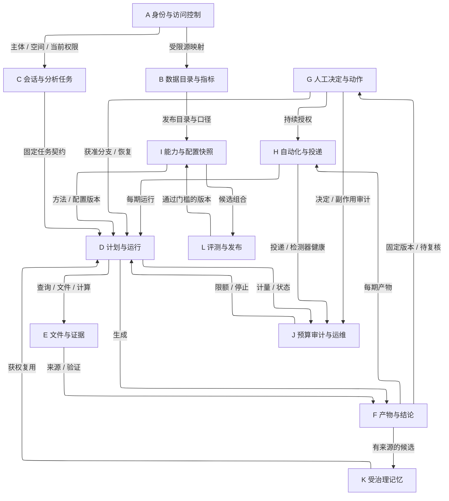

这是领域协作图，箭头说明数据或控制关系，不表示数据库级联删除。2026-10-25 按用户补充的数据所有权，A 域由 Web / BFF 拥有，推理相关领域由 Agent 拥有，K 域由 Memory 拥有；Worker 的执行位置不改变数据所有者。跨 app 的身份、来源、授权与使用关系通过 API 验证，不使用跨服务事务。迁移与 SDD 交付遵守 [全项目数据库规范](../../../docs/database-migrations.md)。

### 1.4 存储与状态归属

**2026-10-25 职责修订说明：** 用户将通用文件上传/存储/版本、解析/OCR、主动抽取及知识文档管理归入 Memory。当前 app owner 以 [数据库规范](../../../docs/database-migrations.md#1-应用职责与数据库所有权)和[技术架构的职责补充](TECH_DESIGN.md#1-决策摘要与范围)为准；下表的旧 79/3 张分配以及后文 `file_object` 的同库 FK 画法保留为待调整的目标模型记录，不能作为当前迁移输入。后续文件 Feature 需重分文件实体并将跨 owner 关系改为逻辑 ID/版本与 API 验证，本轮不扩展文件处理表或重建完整模型。[995](../../995-web-management-foundation/spec/PRD.md)仅实现 Web 自有工程实体与页面框架，不以本文件 94 张目标表或 M0 表清单作为本期建库范围。

| 存储                              | 权威内容                                                                                  | 边界                                                                                        |
| --------------------------------- | ----------------------------------------------------------------------------------------- | ------------------------------------------------------------------------------------------- |
| Web 自有数据库 / schema           | A 域 12 张身份与权限表、Web 会话；通用工程配置按实际 Feature 加入                         | BFF 直接实现 CRUD 并独立迁移；IdP 管认证协议与密码，Web 保存主体映射                        |
| Agent 自有数据库 / schema         | B–J、L 域中本文定义的 79 张推理相关表：语义目录、会话任务、运行、证据产物、运行配置与治理 | Agent 独立迁移；I 域定义 Runtime 配置，J 域定义运行治理，通用工程配置和平台管理 CRUD 归 Web |
| Memory 自有数据库 / schema        | K 域 3 张记忆表                                                                           | Memory 独立迁移，通过契约验证身份与来源                                                     |
| 外部数据源                        | 行业业务事实及源侧权限                                                                    | 平台只用获权账号查询；无跨库 FK，无事实写入                                                 |
| 文件 / 对象存储                   | 上传、结果集、代码、报告正文                                                              | `file_object` 保存定位与完整性；大结果不放进消息或 JSON 大列                                |
| 调度器、缓存、搜索/向量、观测后端 | 调度历史、可重建缓存/索引、原始遥测                                                       | 不作为任务目标、授权、产物版本的第二份权威来源                                              |
| 私有评测存储                      | 用例输入、金标、试验 Trace                                                                | 与生产检索、Agent 上下文及普通文件访问隔离                                                  |

上述归属覆盖现有 94 张逻辑目标表，M0 的 30 张表拆为 Web 5 张与 Agent 25 张。数量不表示已交付；新增通用配置等工程实体由对应 Feature 更新设计和统计，不直接塞入 Agent 的 Runtime 配置表。每个 app 可独立数据库实例；共享实例仍隔离 schema、账号和版本表。

## 2. 分模块的数据库结构设计

### 2.0 阅读约定与全局约束

**完整性约定。** 每个模块的 Mermaid ER 包含本域全部目标表、全部字段和每条显式外键；外域父表只展示键并标注“外域引用”。同 owner / 逻辑库内引用沿实际外键绘制；Web、Agent、Memory 之间的引用以点线及 REF 标注，不生成数据库外键，不重复建表。每域的表清单补充一行代表什么、首次建表阶段、唯一键/CHECK/索引、MVP 必要性。固定配置中的版本键、计划 DAG 边和快照依赖属于有 schema 的 JSON 引用，校验规则在正文说明，不能当作不存在的 SQL 外键。

**字段和约束约定：**

- A 域表归 Web，B–J/L 的推理业务表归 Agent，K 域归 Memory，各自在自有数据库 / schema 迁移。图中使用短表名。`tenant`、`principal` 是 Web 内全局表，主键 `id uuid`；其他表主键统一为 `(tenant_id, id)`。Web 内可外键引用 tenant；Agent / Memory 的租户、成员、空间均为 API 验证的逻辑引用。UUID 由服务端生成。
- 除指向全局表外，图中任意 `x_id FK → table` 都代表复合外键 `(tenant_id, x_id) → table(tenant_id, id)`。`tenant.active_config_snapshot_id` 通过 Agent API 验证快照所属租户、版本、hash 与可用性，在 Web 保存逻辑引用，不建立跨库 FK。同空间对象引用进一步使用 `(tenant_id, workspace_id, x_id)`，目标增加 `UNIQUE(tenant_id,workspace_id,id)`；空间不能由客户端单独指定。包含可空空间的授权/记忆对象按作用域规则事务校验。
- 所有字段默认 `NOT NULL`；图中标注 `NULL` 的字段允许空值。`created_at` 默认数据库 `now()`；可变表的 `revision` 默认 `1`、更新时 CAS 递增，`updated_at` 默认 `now()` 且写入时更新。其他列没有隐式默认值，创建者必须提供经校验的值；表清单列出的默认值优先。
- `text` 为 UTF-8 文本；`int` 为 32 位整数；`bigint` 为 64 位整数；`numeric` 在迁移中使用 `numeric(20,6)`，金额必须同时有单位/币种；时间统一 `timestamptz`，业务时区单列保存。所有 `version/attempt_no/sequence` 正整数，`revision≥1`，结束时间不得早于开始时间。
- 下表 `U(...)` 为 UNIQUE、`I(...)` 为索引、`C(...)` 为 CHECK；租户表的 U/I 均自动前缀 `tenant_id`。可空字段参与业务唯一键时采用明确的部分唯一索引或 `NULLS NOT DISTINCT` 语义，禁止依赖 NULL 默认不相等。FK 子列建匹配的 B-tree 索引；高频检索只添加清单中的访问路径索引，不默认建所有 JSON 的 GIN。
- 每条 FK 默认为 `ON DELETE RESTRICT`；不以级联删除清除历史。`deleted_at/archived_at/revoked_at` 分别表示软删除、归档、撤权。受控物理清理由删除任务按保留规则处理。
- 不可变对象的内容列只允许 INSERT；状态投影、观测、撤回时间允许受控更新。事件、决定、审计、账本追加保存。所有内容 hash 统一对规范化内容计算 SHA-256，带 schema 版本；存储路径不作为内容身份。
- M0 数据目录、指标、查询、能力和模型/Sandbox 配置以 Agent 的 `config_snapshot.manifest` 为运行版本权威；其中 identity_policy 只保存 Web 已发布策略的版本/hash 与解释快照，当前授权权威仍在 Web。`tenant.active_config_snapshot_id` 保存已验证的运行快照引用。先在 Agent 发布不可变快照，再由 Web 核验后在本库事务中切换引用并提高 policy_epoch；失败可重试，旧引用继续有效，不假定两库原子提交。新 Run 固定配置，运行前及敏感操作前向 Web 核验当前成员与权限。M1/M3 管理表启用后，草稿/编辑版本由对应表负责，运行仍引用已发布快照；禁止双向同步或修改历史快照。旧快照的 key/version/hash 在迁移时原样保留。
- 表中阶段为首次启用建议，与现有里程碑一致；某场景提前启用时，其依赖表、权限和验证须同步交付。图展示目标全量字段；引用尚未启用域的可空列及 FK 随目标域迁移加入，首版不创建悬空 FK。例如决定请求的 `memory_version_id` 和资源授权的 `memory_record_id` 随 M4 加入，作为指向 memory 服务的逻辑引用。

**有 schema 的 JSON 内容，不能作为任意数据袋：**

| 字段组                                              | 必需内容 / 校验                                                                                                                                                                        |
| --------------------------------------------------- | -------------------------------------------------------------------------------------------------------------------------------------------------------------------------------------- |
| `task_version.contract`                             | goal、metrics_and_grain、time_range、data_scope、method、deliverable、resources、authorization、acceptance 九类；补齐来源写 source_refs；任务输入只能申请权限                          |
| `plan_version.plan_json`                            | nodes(key,goal,method,input_refs,output_contract,verification)、edges(from,to)、reused/invalidated 节点及原因；端点存在、无环                                                          |
| `config_snapshot.manifest`                          | schema_version、identity_policy、source_bindings、catalog、metrics、queries、capabilities、model_routes、sandbox、code_revision；所有版本引用以 kind/key/version/hash 定位；不含凭据值 |
| `query_execution.clocks` / `run.source_snapshot`    | analysis_as_of、business_cutoff、source_watermarks；数据发布/快照 ID、schema/hash、快照能力声明；缺历史快照只能标明按当前数据复算                                                      |
| 查询 `envelope`                                     | schema_version、status、row_count、columns、inline_result 或 result_file、truncated、sampled、warnings、coverage、freshness、quality、error；失败没有成功数据分支                      |
| `run.authorization_snapshot`                        | 已认证主体/空间、policy_epoch、配置 hash、获准动作/源/行/列范围与检查时点；运行时始终读取当前权限，不由旧快照授予权限                                                                  |
| `artifact_version.computation_spec/data_refs`       | 方法/代码/参数/环境 hash、证据 ID、数据版本、源范围、结果对象；修改呈现可复用，修改计算须创建新结果                                                                                    |
| `authorization_grant.scope/budget/audience`         | 目标版本、动作、数据范围、执行身份、目的地/受众、周期/次数、金额/单位、有效期；空值不表示无限授权                                                                                      |
| 配置 `dependency_refs` / `seed_binding.target_kind` | 固定类型白名单及实际存在的目标/版本；事务内验证租户和引用，禁止用户提供任意表名或 SQL                                                                                                  |

<a id="domain-a"></a>

### 2.1 模块 A：身份、租户与访问控制

**本域回答：**谁在什么工作空间内，可以读取什么、执行什么？

**为什么这样设计：**身份、成员资格与工作空间分开，才能表达一个身份加入多个组织、退出其中一个组织后仍保留其他身份。授权结果始终由服务端计算。M0 用固定策略快照完成端到端隔离；多人编辑角色、组和共享授权在 M3 落表。

**边界：**本域 12 张表及其 CRUD 归 Web / BFF，Agent / Memory 通过授权核验 API 使用。此处保存平台身份。登录密码、MFA、Web Session 由既有 IdP / Web 认证集成管理，不复制到领域表。岗位是预置能力组合，产品经理与研发工程师也使用相同成员/角色模型，不为每种岗位建表。

**完整 ER 与字段类型：**

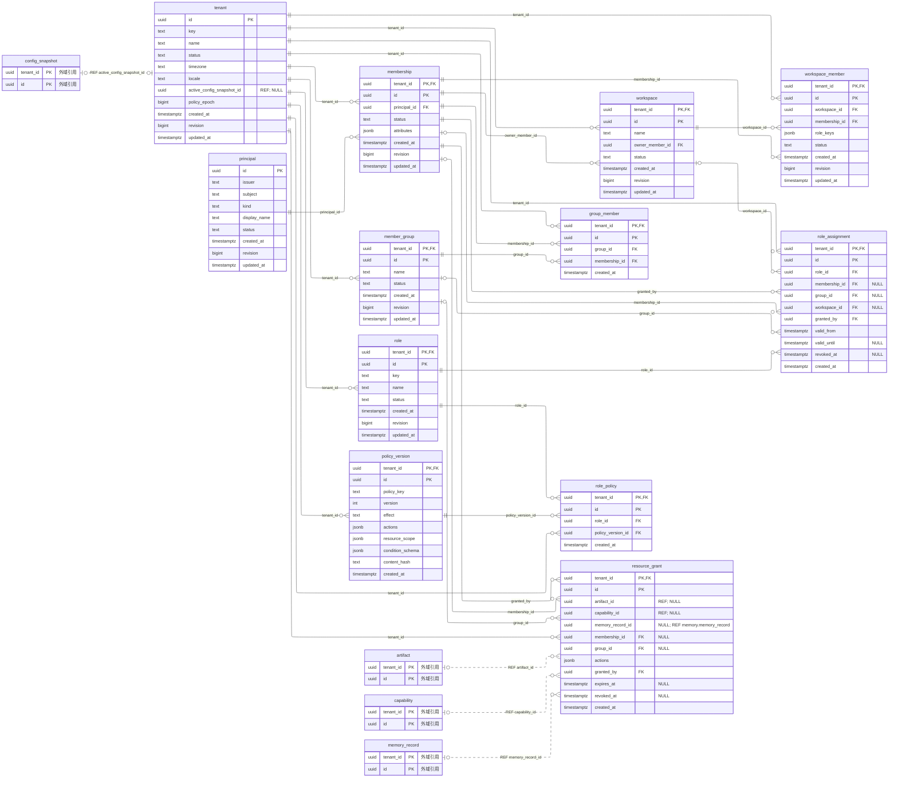

**表结构、约束与 MVP 必要性：**

| 表                 | 一行代表什么                   | 首次建表 | 关键约束与索引（继承 §2.0）                                                                                                 | MVP 必要性 / 延后理由                                                        |
| ------------------ | ------------------------------ | -------- | --------------------------------------------------------------------------------------------------------------------------- | ---------------------------------------------------------------------------- |
| `tenant`           | 一个平台组织                   | M0       | U(key)；status∈provisioning/active/suspended；active 时快照非空且属于本租户；policy_epoch≥1，权限变更与配置切版同事务递增。 | 隔离与撤权的根对象；保存当前生效配置，旧 Run 的快照不能覆盖当前权限。        |
| `principal`        | 一个认证主体                   | M0       | U(issuer,subject)；kind∈human/service；status∈active/disabled。                                                             | 把外部身份映射为稳定系统 ID，避免信任前端传入的姓名/角色。                   |
| `membership`       | 一个主体在一个租户中的成员资格 | M0       | U(principal_id)；status∈active/disabled；attributes 只保存受控组织属性；停用递增 tenant.policy_epoch。                      | 用户跨组织加入/退出的最小授权单元。                                          |
| `workspace`        | 一个租户内的协作空间           | M0       | U(name)；owner 必须为当前有效成员；status∈active/archived。                                                                 | 确定任务、会话与产物的协作边界。                                             |
| `workspace_member` | 一名成员在一个空间中的访问资格 | M0       | U(workspace_id,membership_id)；role_keys 是固定策略快照中的角色键；status∈active/disabled。                                 | 空间列表与直接 URL/API 使用同一准入判断；role_keys 不允许用户自行写入。      |
| `member_group`     | 一个租户内的授权组             | M3       | U(name)；status∈active/disabled。                                                                                           | M0 用直接成员绑定即可；需要批量组织授权时启用。                              |
| `group_member`     | 一项组成员关系                 | M3       | U(group_id,membership_id)。                                                                                                 | 随组管理启用，避免把大规模成员数组写入角色。                                 |
| `role`             | 一个可维护的能力组合           | M3       | U(key)；key 与 M0 role_keys 对齐；status∈draft/active/retired。                                                             | M0 角色来自配置快照；出现管理界面和发布流程时才建动态角色目录。              |
| `policy_version`   | 一份不可变授权策略版本         | M3       | U(policy_key,version)；version≥1；effect∈allow/deny；拒绝优先；限定行/列/资源语法。                                         | M0 固定策略足够；策略编辑后需要保留旧版以解释历史授权。                      |
| `role_policy`      | 角色采用的一个策略版本         | M3       | U(role_id,policy_version_id)；角色变更递增授权版本。                                                                        | 复用已验证策略并支持角色组合，随动态角色启用。                               |
| `role_assignment`  | 向主体授予的一项角色           | M3       | C(membership_id、group_id 恰一非空)；valid_until>valid_from；未撤销同主体/角色/空间唯一，NULL 空间按租户范围处理。          | M0 不建通用授权管理；多人维护、有效期与组授权启用时需要。                    |
| `resource_grant`   | 对一个具体资源的一项共享许可   | M3       | 目标三列恰一非空；被授主体两列恰一非空；actions 必须是授予者当前可授范围子集。memory_record_id 随 M4 增列。                 | M0 限于 Owner/固定空间策略；精细分享启用时才加入，历史共享不能覆盖当前拒绝。 |

<a id="domain-b"></a>

### 2.2 模块 B：数据源、目录与指标语义

**本域回答：**Agent 可以查询哪些数据，字段与指标表达什么，当前数据是否可用？

**为什么这样设计：**外部数据源只以连接引用、元数据和版本进入平台。M0 将固定目录、指标、可信查询放在 config_snapshot 中；M3 开启动态接入后，以下表成为目录编辑的权威来源，并发布同结构快照供运行固定。

**边界：**本域不保存行业事实，也不生成业务库。凭据只保存 credential_ref；源租户键是连接适配器的受控映射值。模型不能选择任意 DSN 或提升账号。

**完整 ER 与字段类型：**

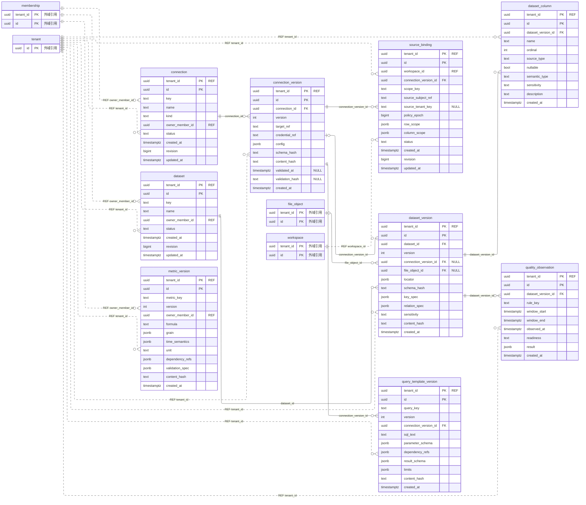

**表结构、约束与 MVP 必要性：**

| 表                       | 一行代表什么               | 首次建表 | 关键约束与索引（继承 §2.0）                                                                                                | MVP 必要性 / 延后理由                                            |
| ------------------------ | -------------------------- | -------- | -------------------------------------------------------------------------------------------------------------------------- | ---------------------------------------------------------------- |
| `connection`             | 一个逻辑数据源             | M3       | U(key)；kind∈postgres/file/api/document；status∈active/disabled。                                                          | M0 连接数量固定，保存在快照即可；需要独立维护生命周期时落表。    |
| `connection_version`     | 一份不可变连接配置         | M3       | U(connection_id,version)；验证 hash 绑定目标/凭据版本/schema；更新测试观测不改配置内容。                                   | 避免轮换连接后无法解释旧查询；M0 用同结构固定清单。              |
| `source_binding`         | 一种受控的空间到源权限映射 | M3       | U(workspace_id,connection_version_id,scope_key)；status∈active/revoked；当前授权必须落在该绑定范围内。                     | 动态接入时选择最小权限源账号；M0 固定映射随快照部署。            |
| `dataset`                | 一个逻辑数据集             | M3       | U(key)；status∈active/retired。                                                                                            | 隔离稳定资产名与物理源变化；M0 固定目录按 key 定位。             |
| `dataset_version`        | 一个数据集的元数据版本     | M3       | U(dataset_id,version)；连接/文件恰一非空；relation_spec 的目标 key/version、列与基数在发布时全部解析验证。                 | 源 schema 漂移不能静默改变旧分析语义；M0 已由快照固定同样内容。  |
| `dataset_column`         | 数据集某版本的一列         | M3       | U(dataset_version_id,name)；U(dataset_version_id,ordinal)；ordinal≥1。                                                     | 动态列检索与列级脱敏需要；M0 直接查询快照中的列目录。            |
| `metric_version`         | 一个指标口径的版本         | M3       | U(metric_key,version)；依赖只能指向已验证数据集/指标版本，禁止循环；币种/去重/空值规则在结构化口径内。                     | 统一不同分析的口径；M0 用固定指标定义，M3 才引入编辑和版本发布。 |
| `query_template_version` | 一份只读参数化查询模板     | M3       | U(query_key,version)；只读语法、允许列/函数和参数范围验证通过才可发布。                                                    | M0 白名单模板存在快照中；动态维护后需要可追踪修订。              |
| `quality_observation`    | 对一个数据集版本的质量观测 | M3       | U(dataset_version_id,rule_key,window_start,window_end,observed_at)；readiness∈ready/delayed/unavailable/denied；窗口有序。 | M0 查询结果已携带水位/质量；独立质量巡检与历史管理出现后再建表。 |

<a id="domain-c"></a>

### 2.3 模块 C：会话、消息与分析任务

**本域回答：**用户在讨论什么，本次究竟要解决哪个问题，修订后如何继续？

**为什么这样设计：**Conversation 承载交流，Task 承载目标，TaskVersion 固定九类分析契约。一次会话可以产生多个任务；继续聊天、重分析和修改目标都有明确归属。

**边界：**会话删除为软删除，不级联删除任务、独立产物与审计。搜索索引、主题排序和未读标记由这些表派生，不另建第二份消息真源。

**完整 ER 与字段类型：**

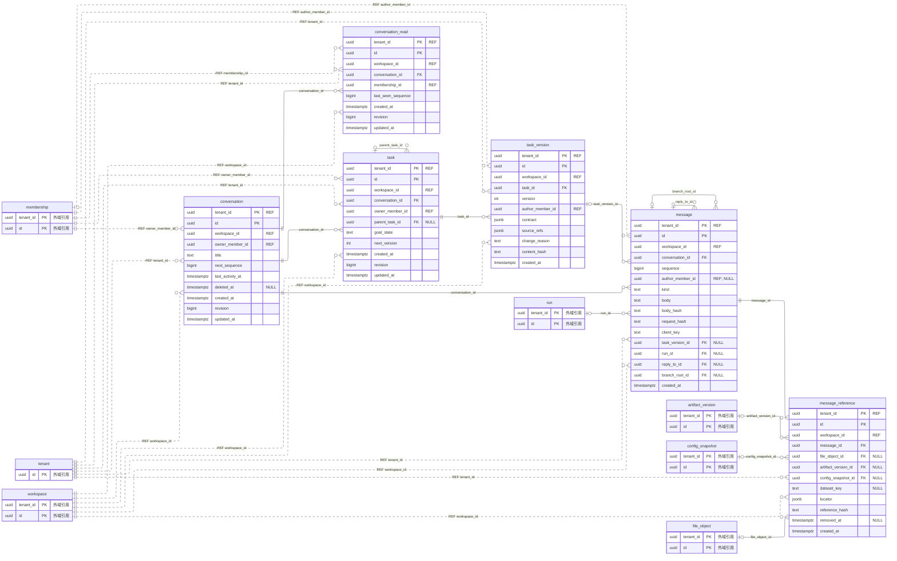

**表结构、约束与 MVP 必要性：**

| 表                  | 一行代表什么             | 首次建表 | 关键约束与索引（继承 §2.0）                                                                                                                                                            | MVP 必要性 / 延后理由                                          |
| ------------------- | ------------------------ | -------- | -------------------------------------------------------------------------------------------------------------------------------------------------------------------------------------- | -------------------------------------------------------------- |
| `conversation`      | 一段持续讨论             | M0       | title 长度1–120；next_sequence 默认1；I(workspace_id,owner_member_id,last_activity_at)，仅未删除记录。                                                                                 | 刷新、历史、改名和撤销删除必须有稳定会话 ID。                  |
| `conversation_read` | 一名成员的会话已读游标   | M0       | U(conversation_id,membership_id)；游标≥0且单调递增，不超过实际读到的已提交序号。                                                                                                       | 支持个人未读状态，多人查看不能共用一个全局已读位。             |
| `message`           | 一条已提交消息           | M0       | U(conversation_id,sequence)；U(conversation_id,client_key)；kind∈user/assistant/system/tool_summary；user 必须有 author；request_hash 覆盖正文与引用，同 client_key 异请求 hash 冲突。 | 完整消息与任务/运行关联支撑历史恢复；临时 token 不落持久消息。 |
| `message_reference` | 消息引用的一项输入或产物 | M0       | file、artifact、config+dataset 三类恰一成立；dataset_key 必须存在于指定快照；U(message_id,reference_hash)，hash 覆盖目标与 locator。                                                   | 移除某个引用后，新任务上下文可明确排除它，并保留旧任务依据。   |
| `task`              | 一个持续追踪的分析目标   | M0       | goal_state∈draft/active/blocked/partial/completed/cancelled；父任务同空间且无环；next_version 默认1。                                                                                  | 目标完成与工具执行成功分别记录；任务可跨多次运行。             |
| `task_version`      | 任务契约的一次不可变修订 | M0       | U(task_id,version)；contract schema 固定九类必需键，授权与资源只能收窄父级；引用逐项验证。                                                                                             | 时间/范围/方法变化不会覆盖旧分析，用户能比较版本。             |

<a id="domain-d"></a>

### 2.4 模块 D：计划、执行与恢复

**本域回答：**准备如何分析，实际做过什么，失败后从哪里继续？

**为什么这样设计：**计划是执行意图，Run/Step/Attempt 分别是一次运行、逻辑操作与物理尝试；RunEvent 提供已提交时间线。Run 创建时固定 execution_mode：local 由 agent 内 Runner 执行，重启后明确中断；durable 由按需 worker / Temporal 承担持久恢复。

**边界：**计划 DAG 的节点/边在不可变 plan_json 内完整保存并校验；M0 不需要为每条边单独建表。Temporal 历史、链路追踪与模型 token 流由相应基础设施承载。

**完整 ER 与字段类型：**

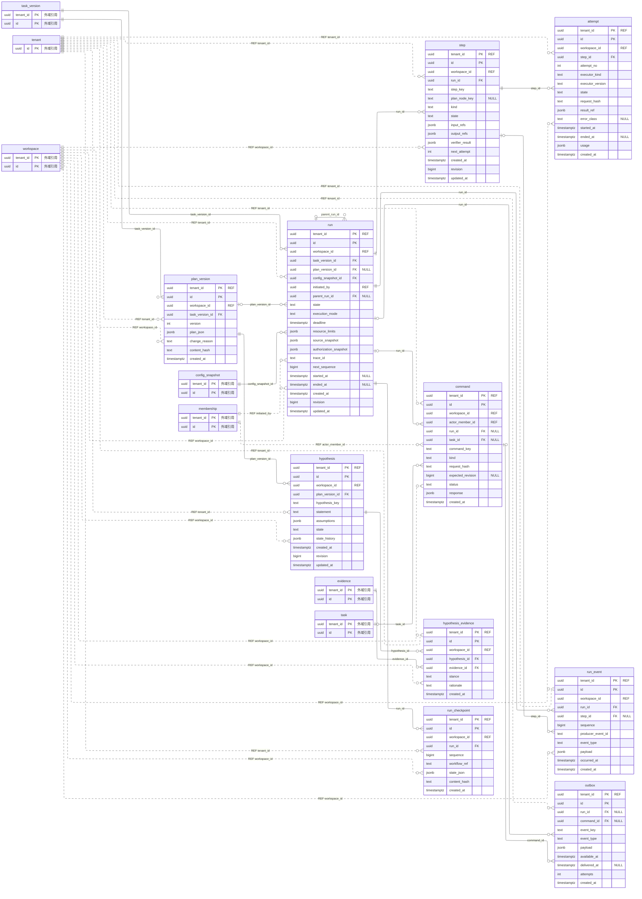

**表结构、约束与 MVP 必要性：**

| 表                    | 一行代表什么               | 首次建表 | 关键约束与索引（继承 §2.0）                                                                                                                                                                                                                               | MVP 必要性 / 延后理由                                                               |
| --------------------- | -------------------------- | -------- | --------------------------------------------------------------------------------------------------------------------------------------------------------------------------------------------------------------------------------------------------------- | ----------------------------------------------------------------------------------- |
| `plan_version`        | 任务版本的一份分析计划     | M0       | U(task_version_id,version)；plan_json 节点 key 唯一、边端点存在且无环，记录输入/方法/输出/验证/复用失效；快速问数可不建计划。                                                                                                                             | 多步分析与重规划要保留可检查计划，不能靠当前 UI 状态恢复。                          |
| `run`                 | 基于固定任务契约的一次运行 | M0       | execution_mode∈local/durable，默认 local、创建后不可变；local 只由本地 Runner 领取，durable 随 M2 启用； 计划须属于同 task_version；state 见§3.2；source_snapshot 固定源发布/快照与时间；授权快照用于解释，执行仍重验；I(workspace_id,state,created_at)。 | 固定一次分析的输入、配置、权限依据与结果状态。                                      |
| `step`                | 运行内一个逻辑操作         | M0       | U(run_id,step_key)；plan_node_key 必须存在于该 Run 计划；state∈pending/waiting/running/succeeded/failed/skipped/invalidated/cancelled。                                                                                                                   | 按逻辑步骤展示和重用结果；重试不能伪造成另一项分析目标。                            |
| `attempt`             | 逻辑操作的一次物理尝试     | M0       | U(step_id,attempt_no)；attempt_no≥1；state∈running/succeeded/failed/unknown/cancelled；ended_at≥started_at。                                                                                                                                              | 超时、重试与真实调用成本均可定位；未知结果不能冒充失败后随意重做。                  |
| `run_event`           | 一次已提交的运行状态事件   | M0       | U(run_id,sequence)；U(run_id,producer_event_id)；同 Run 行锁内分配 sequence；payload 为脱敏摘要。                                                                                                                                                         | SSE 重连与历史时间线可以补发；日志丢失不影响业务事实。                              |
| `command`             | 一条已受理的用户操作       | M0       | U(actor_member_id,command_key)；run/task 恰一非空；kind∈start/cancel/pause/resume/reanalyze；status∈accepted/applied/rejected；同键异 hash 冲突。                                                                                                         | 双击、网络重试不会重复创建运行或吞掉取消请求。                                      |
| `hypothesis`          | 计划下的一条候选解释       | M2       | U(plan_version_id,hypothesis_key)；state∈unverified/limited/supported/refuted/inconclusive；状态历史追加保存。                                                                                                                                            | M0 快速问数无需独立假设管理；启用诊断/自主专题时与该场景同时交付。                  |
| `hypothesis_evidence` | 证据对候选解释的一次判断   | M2       | U(hypothesis_id,evidence_id,stance)；stance∈support/refute/inconclusive；保留反证。                                                                                                                                                                       | 随假设分析启用，不以工具 success 代替判断。                                         |
| `run_checkpoint`      | 可恢复的业务执行边界       | M2       | U(run_id,sequence)；只引用已提交的步骤/产物；workflow_ref 对应调度器恢复点。                                                                                                                                                                              | M0 中断后显式新运行；M2 长任务需要可恢复业务状态。                                  |
| `outbox`              | 事务提交后待派发的事件     | M2       | U(event_key)；attempts≥0；I(available_at) WHERE delivered_at IS NULL；消费者按 event_key 幂等。                                                                                                                                                           | 仅 durable 路径使用，agent 内 relay 投递；local 由 queued Run 扫描领取，M0 无此表。 |

<a id="domain-e"></a>

### 2.5 模块 E：文件、查询与可验证证据

**本域回答：**这个结果从哪里来，执行了什么，结论是否经过验证？

**为什么这样设计：**大文件与结果正文存对象存储，数据库保存归属、哈希、权限和版本定位。查询记录描述实际执行，Evidence 描述可引用的事实，ValidationRecord 描述对指定输入的检验；三者不能合成一个 success 位。

**边界：**外部数据的原始行留在源库或获权结果对象。平台仅保存分析过程必需的结果引用、质量摘要和证据。ResultEnvelope 作为查询/证据中的有版本 JSON，不另建空壳表。

**完整 ER 与字段类型：**

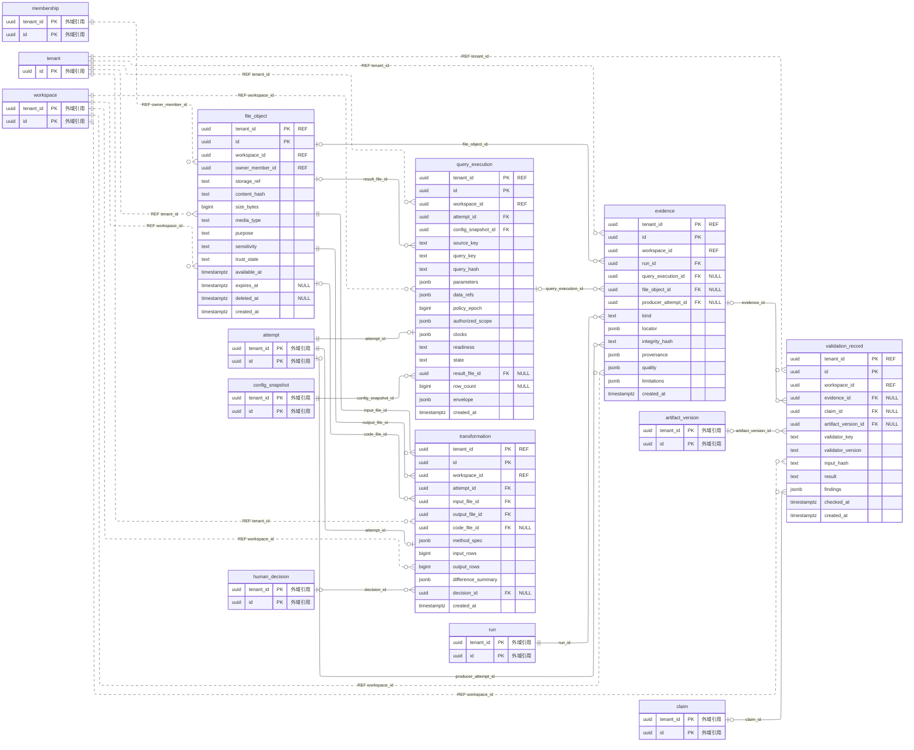

**表结构、约束与 MVP 必要性：**

| 表                  | 一行代表什么               | 首次建表 | 关键约束与索引（继承 §2.0）                                                                                                                                                                                  | MVP 必要性 / 延后理由                                              |
| ------------------- | -------------------------- | -------- | ------------------------------------------------------------------------------------------------------------------------------------------------------------------------------------------------------------ | ------------------------------------------------------------------ |
| `file_object`       | 一个不可变文件或结果对象   | M0       | U(storage_ref)；size_bytes≥0；purpose∈upload/result/artifact/code；trust_state∈quarantined/verified/rejected；同 hash 不跨租户暴露存在性。                                                                   | 上传、查询大结果与报告需要同一对象引用；数据库无需装入全部结果行。 |
| `query_execution`   | 一次真实查询尝试           | M0       | U(attempt_id)；state∈running/succeeded/failed/denied/cancelled/unknown；readiness∈ready/delayed/unavailable/denied；row_count≥0；成功必须有结果对象或完整的小结果 envelope；源/查询/数据版本键在快照中解析。 | 区分真实零值、空集、权限拒绝、截断和查询失败，形成可追溯依据。     |
| `transformation`    | 一次文件剖析或受控转换     | M3       | U(attempt_id)；输入输出对象不能相同；行数非负；高影响转换要求有效决定且匹配参数 hash。                                                                                                                       | M0 支持引用文件；启用清洗/跨源关联场景后保存前后差异，保留原件。   |
| `evidence`          | 一份可引用的事实或材料片段 | M0       | 查询/文件恰一非空；kind∈query_result/document/computation；查询证据仅接受成功结果；文件必须 verified；provenance 包含版本/时钟/权限范围。                                                                    | 从结论回溯到查询和材料，避免把失败或无来源文字当事实。             |
| `validation_record` | 对一个固定对象的一次验证   | M0       | 目标三列恰一非空；result∈pass/partial/fail/inconclusive；I(目标,input_hash,checked_at)；输入变化不沿用旧结论。                                                                                               | 验证结果与被验证版本绑定，计算或文案修改后能明确失效。             |

<a id="domain-f"></a>

### 2.6 模块 F：分析产物、结论与传播

**本域回答：**怎样把一次回答沉淀为可编辑、可追溯、可再次访问的工作成果？

**为什么这样设计：**Artifact 是稳定资产，ArtifactVersion 是不可变内容。答案、图表、报告、预置看板和动作草稿共享版本机制；Claim 与 Evidence 多对多，五维状态由事件记录并投影。

**边界：**M0 预置看板使用同一模型，任意拖拽 Builder 不在范围。在线发布、外发投递和下载导出各有记录，下载成功不代表外部接收方已采纳。

**完整 ER 与字段类型：**

```mermaid
---
config:
  layout: elk
---
erDiagram
    direction LR
    artifact {
        uuid tenant_id PK "REF"
        uuid id PK
        uuid workspace_id "REF"
        uuid owner_member_id "REF"
        uuid task_id FK "NULL"
        text kind
        text title
        uuid head_version_id FK "NULL"
        timestamptz archived_at "NULL"
        timestamptz created_at
        bigint revision
        timestamptz updated_at
    }
    artifact_version {
        uuid tenant_id PK "REF"
        uuid id PK
        uuid workspace_id "REF"
        uuid artifact_id FK
        int version
        uuid run_id FK "NULL"
        uuid author_member_id "REF"
        uuid edit_base_version_id FK "NULL"
        uuid computation_base_version_id FK "NULL"
        uuid config_snapshot_id FK
        uuid content_file_id FK
        text content_hash
        text edit_kind
        jsonb computation_spec
        jsonb data_refs
        jsonb limitations
        timestamptz created_at
    }
    artifact_state_event {
        uuid tenant_id PK "REF"
        uuid id PK
        uuid workspace_id "REF"
        uuid artifact_version_id FK
        bigint sequence
        text dimension
        text from_state "NULL"
        text to_state
        uuid actor_member_id "REF; NULL"
        text reason
        jsonb source_ref
        timestamptz created_at
    }
    claim {
        uuid tenant_id PK "REF"
        uuid id PK
        uuid workspace_id "REF"
        uuid artifact_version_id FK
        text claim_key
        text text
        text kind
        text judgment_strength
        jsonb limitations
        timestamptz created_at
    }
    claim_evidence {
        uuid tenant_id PK "REF"
        uuid id PK
        uuid workspace_id "REF"
        uuid claim_id FK
        uuid evidence_id FK
        text usage
        text support_strength
        jsonb locator
        jsonb limitations
        timestamptz created_at
    }
    feedback {
        uuid tenant_id PK "REF"
        uuid id PK
        uuid workspace_id "REF"
        uuid actor_member_id "REF"
        uuid message_id FK "NULL"
        uuid artifact_version_id FK "NULL"
        uuid claim_id FK "NULL"
        text category
        text comment
        timestamptz created_at
    }
    export_record {
        uuid tenant_id PK "REF"
        uuid id PK
        uuid workspace_id "REF"
        uuid artifact_version_id FK
        uuid actor_member_id "REF"
        text format
        uuid output_file_id FK "NULL"
        bigint policy_epoch
        text recipient_description
        text state
        timestamptz completed_at "NULL"
        timestamptz created_at
    }
    artifact_dependency {
        uuid tenant_id PK "REF"
        uuid id PK
        uuid workspace_id "REF"
        uuid artifact_version_id FK
        uuid upstream_artifact_version_id FK "NULL"
        uuid config_snapshot_id FK "NULL"
        uuid evidence_id FK "NULL"
        text dependency_key "NULL"
        text impact
        timestamptz created_at
    }
    publication {
        uuid tenant_id PK "REF"
        uuid id PK
        uuid workspace_id "REF"
        uuid artifact_version_id FK
        uuid grant_id FK
        uuid published_by "REF"
        jsonb audience
        text token_hash
        timestamptz expires_at "NULL"
        timestamptz revoked_at "NULL"
        timestamptz created_at
    }
    authorization_grant {
        uuid tenant_id PK "外域引用"
        uuid id PK "外域引用"
    }
    config_snapshot {
        uuid tenant_id PK "外域引用"
        uuid id PK "外域引用"
    }
    evidence {
        uuid tenant_id PK "外域引用"
        uuid id PK "外域引用"
    }
    file_object {
        uuid tenant_id PK "外域引用"
        uuid id PK "外域引用"
    }
    membership {
        uuid tenant_id PK "外域引用"
        uuid id PK "外域引用"
    }
    message {
        uuid tenant_id PK "外域引用"
        uuid id PK "外域引用"
    }
    run {
        uuid tenant_id PK "外域引用"
        uuid id PK "外域引用"
    }
    task {
        uuid tenant_id PK "外域引用"
        uuid id PK "外域引用"
    }
    tenant {
        uuid id PK "外域引用"
    }
    workspace {
        uuid tenant_id PK "外域引用"
        uuid id PK "外域引用"
    }
    tenant ||..o{ artifact : "REF tenant_id"
    workspace ||..o{ artifact : "REF workspace_id"
    membership ||..o{ artifact : "REF owner_member_id"
    task |o--o{ artifact : "task_id"
    artifact_version |o--o| artifact : "head_version_id"
    tenant ||..o{ artifact_version : "REF tenant_id"
    workspace ||..o{ artifact_version : "REF workspace_id"
    artifact ||--o{ artifact_version : "artifact_id"
    run |o--o{ artifact_version : "run_id"
    membership ||..o{ artifact_version : "REF author_member_id"
    artifact_version |o--o{ artifact_version : "edit_base_version_id"
    artifact_version |o--o{ artifact_version : "computation_base_version_id"
    config_snapshot ||--o{ artifact_version : "config_snapshot_id"
    file_object ||--o{ artifact_version : "content_file_id"
    tenant ||..o{ artifact_state_event : "REF tenant_id"
    workspace ||..o{ artifact_state_event : "REF workspace_id"
    artifact_version ||--o{ artifact_state_event : "artifact_version_id"
    membership |o..o{ artifact_state_event : "REF actor_member_id"
    tenant ||..o{ claim : "REF tenant_id"
    workspace ||..o{ claim : "REF workspace_id"
    artifact_version ||--o{ claim : "artifact_version_id"
    tenant ||..o{ claim_evidence : "REF tenant_id"
    workspace ||..o{ claim_evidence : "REF workspace_id"
    claim ||--o{ claim_evidence : "claim_id"
    evidence ||--o{ claim_evidence : "evidence_id"
    tenant ||..o{ feedback : "REF tenant_id"
    workspace ||..o{ feedback : "REF workspace_id"
    membership ||..o{ feedback : "REF actor_member_id"
    message |o--o{ feedback : "message_id"
    artifact_version |o--o{ feedback : "artifact_version_id"
    claim |o--o{ feedback : "claim_id"
    tenant ||..o{ export_record : "REF tenant_id"
    workspace ||..o{ export_record : "REF workspace_id"
    artifact_version ||--o{ export_record : "artifact_version_id"
    membership ||..o{ export_record : "REF actor_member_id"
    file_object |o--o{ export_record : "output_file_id"
    tenant ||..o{ artifact_dependency : "REF tenant_id"
    workspace ||..o{ artifact_dependency : "REF workspace_id"
    artifact_version ||--o{ artifact_dependency : "artifact_version_id"
    artifact_version |o--o{ artifact_dependency : "upstream_artifact_version_id"
    config_snapshot |o--o{ artifact_dependency : "config_snapshot_id"
    evidence |o--o{ artifact_dependency : "evidence_id"
    tenant ||..o{ publication : "REF tenant_id"
    workspace ||..o{ publication : "REF workspace_id"
    artifact_version ||--o{ publication : "artifact_version_id"
    authorization_grant ||--o{ publication : "grant_id"
    membership ||..o{ publication : "REF published_by"
```

**表结构、约束与 MVP 必要性：**

| 表                     | 一行代表什么                 | 首次建表 | 关键约束与索引（继承 §2.0）                                                                                                                                          | MVP 必要性 / 延后理由                                                                         |
| ---------------------- | ---------------------------- | -------- | -------------------------------------------------------------------------------------------------------------------------------------------------------------------- | --------------------------------------------------------------------------------------------- |
| `artifact`             | 一个可独立访问的分析资产     | M0       | kind∈answer/dataset/chart/report/analysis_package/method/quality_table/board/action_draft/monitor_draft；head 必须属于当前 artifact；首次版本与 head 同事务提交。    | 产物可以脱离聊天访问，会话删除后仍能按自身权限打开。                                          |
| `artifact_version`     | 资产的一份不可变内容         | M0       | U(artifact_id,version)；edit/computation base 属于同资产或明确授权的复用源；edit_kind∈generated/presentation/narrative/computation；head 以 expected_head 比较更新。 | 保留人工与 AI 编辑的版本冲突，改颜色可复用计算，改数值必须重验。                              |
| `artifact_state_event` | 产物某一状态维度的一次变化   | M0       | U(artifact_version_id,sequence)；dimension∈generation/validation/adoption/publication/freshness；状态集合见 PRD §18.2；追加写。                                      | 五维独立解释完成、验证、采纳、发布、新鲜度，防止一个状态覆盖全部。                            |
| `claim`                | 产物版本中的一条结论         | M0       | U(artifact_version_id,claim_key)；kind∈fact/interpretation/prediction/recommendation；强度与限制按结论类型校验。                                                     | 数字事实和推断分别表达；反馈与验证可以定位具体结论。                                          |
| `claim_evidence`       | 结论对一条证据的引用         | M0       | U(claim_id,evidence_id,usage)；usage∈support/refute/context；引用时校验证据范围与当前权限。                                                                          | 一条结论可用多条证据，一条证据可支持或反驳多个结论。                                          |
| `feedback`             | 对一个确定对象的用户反馈     | M0       | 目标三列恰一非空；category∈correct/incorrect/missing/unsafe/other；只允许反馈可见对象。                                                                              | 记录具体错误与改进依据，避免泛化为整段会话评分。                                              |
| `export_record`        | 对一个固定版本的一次导出     | M0       | state∈requested/succeeded/failed/denied；成功需有已验证 output_file；导出前和签发下载前均重验当前权限。                                                              | M0 下载属于用户路径，必须记录导出版本与许可依据。                                             |
| `artifact_dependency`  | 产物版本对一个上游版本的依赖 | M3       | 上游三列恰一非空；config 依赖要求 key 可解析；impact∈presentation/computation/meaning/access；资产依赖禁环。                                                         | M0 从 data_refs/Claim-Evidence 解析本次依赖即可；跨资产影响预览和批量刷新启用时建索引关系表。 |
| `publication`          | 向指定受众发布的固定版本     | M2       | U(token_hash)；grant 必须为 publish 用途且对象/受众匹配；不保存明文访问令牌；访问时重新授权。                                                                        | M0 产物在固定空间内访问；启用发布流程后，需独立表达受众、期限与撤回。                         |

<a id="domain-g"></a>

### 2.7 模块 G：人工决定、协作与受控动作

**本域回答：**何时需要人决定，批准的是哪一版，实际动作是否已经发生？

**为什么这样设计：**澄清、计划对齐、执行授权、结果采纳、发布授权分别记录用途；决定与授权分开。执行提案、物理执行和外部回执再分开，才能处理重复点击、部分批准和结果未知。

**边界：**M0 审批为明确模拟，保存在演示隔离环境的消息/事件，动作建议用 action_draft 产物。以下正式表随 M2 的真实决定/等待启用；外部写入还必须通过对应集成门槛。

**完整 ER 与字段类型：**

```mermaid
---
config:
  layout: elk
---
erDiagram
    direction LR
    human_decision_request {
        uuid tenant_id PK "REF"
        uuid id PK
        uuid workspace_id "REF"
        uuid run_id FK "NULL"
        text kind
        uuid task_version_id FK "NULL"
        uuid plan_version_id FK "NULL"
        uuid artifact_version_id FK "NULL"
        uuid action_proposal_id FK "NULL"
        uuid automation_version_id FK "NULL"
        uuid memory_version_id "NULL; REF memory.memory_version"
        text binding_digest
        jsonb requested_scope
        jsonb options
        timestamptz expires_at
        text state
        timestamptz created_at
        bigint revision
        timestamptz updated_at
    }
    human_decision {
        uuid tenant_id PK "REF"
        uuid id PK
        uuid workspace_id "REF"
        uuid request_id FK
        uuid actor_member_id "REF"
        text command_key
        text choice
        jsonb approved_subset
        text reason
        text binding_digest
        bigint policy_epoch
        timestamptz decided_at
        timestamptz created_at
    }
    authorization_grant {
        uuid tenant_id PK "REF"
        uuid id PK
        uuid workspace_id "REF"
        uuid decision_id FK
        uuid execution_member_id "REF"
        text purpose
        text binding_digest
        jsonb scope
        jsonb audience
        jsonb budget
        text mode
        timestamptz valid_from
        timestamptz expires_at
        timestamptz revoked_at "NULL"
        text consumed_operation_key "NULL"
        timestamptz created_at
    }
    work_item {
        uuid tenant_id PK "REF"
        uuid id PK
        uuid workspace_id "REF"
        uuid request_id FK
        uuid assignee_member_id "REF; NULL"
        timestamptz due_at "NULL"
        text state
        uuid assigned_by "REF"
        timestamptz created_at
        bigint revision
        timestamptz updated_at
    }
    work_item_comment {
        uuid tenant_id PK "REF"
        uuid id PK
        uuid workspace_id "REF"
        uuid work_item_id FK
        uuid author_member_id "REF"
        text body
        text body_hash
        timestamptz created_at
    }
    action_proposal {
        uuid tenant_id PK "REF"
        uuid id PK
        uuid workspace_id "REF"
        uuid artifact_version_id FK
        uuid run_id FK
        text action_kind
        text destination_ref
        jsonb payload
        text payload_hash
        text risk_level
        timestamptz expires_at
        timestamptz created_at
    }
    action_execution {
        uuid tenant_id PK "REF"
        uuid id PK
        uuid workspace_id "REF"
        uuid proposal_id FK
        uuid grant_id FK
        uuid execution_member_id "REF"
        text operation_key
        text payload_hash
        text state
        timestamptz submitted_at "NULL"
        timestamptz completed_at "NULL"
        timestamptz created_at
        bigint revision
        timestamptz updated_at
    }
    receipt {
        uuid tenant_id PK "REF"
        uuid id PK
        uuid workspace_id "REF"
        uuid action_execution_id FK "NULL"
        uuid delivery_id FK "NULL"
        text external_ref "NULL"
        text observed_state
        text response_hash
        uuid response_file_id FK "NULL"
        timestamptz observed_at
        timestamptz created_at
    }
    artifact_version {
        uuid tenant_id PK "外域引用"
        uuid id PK "外域引用"
    }
    automation_version {
        uuid tenant_id PK "外域引用"
        uuid id PK "外域引用"
    }
    delivery {
        uuid tenant_id PK "外域引用"
        uuid id PK "外域引用"
    }
    file_object {
        uuid tenant_id PK "外域引用"
        uuid id PK "外域引用"
    }
    membership {
        uuid tenant_id PK "外域引用"
        uuid id PK "外域引用"
    }
    memory_version {
        uuid tenant_id PK "外域引用"
        uuid id PK "外域引用"
    }
    plan_version {
        uuid tenant_id PK "外域引用"
        uuid id PK "外域引用"
    }
    run {
        uuid tenant_id PK "外域引用"
        uuid id PK "外域引用"
    }
    task_version {
        uuid tenant_id PK "外域引用"
        uuid id PK "外域引用"
    }
    tenant {
        uuid id PK "外域引用"
    }
    workspace {
        uuid tenant_id PK "外域引用"
        uuid id PK "外域引用"
    }
    tenant ||..o{ human_decision_request : "REF tenant_id"
    workspace ||..o{ human_decision_request : "REF workspace_id"
    run |o--o{ human_decision_request : "run_id"
    task_version |o--o{ human_decision_request : "task_version_id"
    plan_version |o--o{ human_decision_request : "plan_version_id"
    artifact_version |o--o{ human_decision_request : "artifact_version_id"
    action_proposal |o--o{ human_decision_request : "action_proposal_id"
    automation_version |o--o{ human_decision_request : "automation_version_id"
    memory_version |o..o{ human_decision_request : "REF memory_version_id"
    tenant ||..o{ human_decision : "REF tenant_id"
    workspace ||..o{ human_decision : "REF workspace_id"
    human_decision_request ||--o{ human_decision : "request_id"
    membership ||..o{ human_decision : "REF actor_member_id"
    tenant ||..o{ authorization_grant : "REF tenant_id"
    workspace ||..o{ authorization_grant : "REF workspace_id"
    human_decision ||--o{ authorization_grant : "decision_id"
    membership ||..o{ authorization_grant : "REF execution_member_id"
    tenant ||..o{ work_item : "REF tenant_id"
    workspace ||..o{ work_item : "REF workspace_id"
    human_decision_request ||--o{ work_item : "request_id"
    membership |o..o{ work_item : "REF assignee_member_id"
    membership ||..o{ work_item : "REF assigned_by"
    tenant ||..o{ work_item_comment : "REF tenant_id"
    workspace ||..o{ work_item_comment : "REF workspace_id"
    work_item ||--o{ work_item_comment : "work_item_id"
    membership ||..o{ work_item_comment : "REF author_member_id"
    tenant ||..o{ action_proposal : "REF tenant_id"
    workspace ||..o{ action_proposal : "REF workspace_id"
    artifact_version ||--o{ action_proposal : "artifact_version_id"
    run ||--o{ action_proposal : "run_id"
    tenant ||..o{ action_execution : "REF tenant_id"
    workspace ||..o{ action_execution : "REF workspace_id"
    action_proposal ||--o{ action_execution : "proposal_id"
    authorization_grant ||--o{ action_execution : "grant_id"
    membership ||..o{ action_execution : "REF execution_member_id"
    tenant ||..o{ receipt : "REF tenant_id"
    workspace ||..o{ receipt : "REF workspace_id"
    action_execution |o--o{ receipt : "action_execution_id"
    delivery |o--o{ receipt : "delivery_id"
    file_object |o--o{ receipt : "response_file_id"
```

**表结构、约束与 MVP 必要性：**

| 表                       | 一行代表什么               | 首次建表 | 关键约束与索引（继承 §2.0）                                                                                                                    | MVP 必要性 / 延后理由                                        |
| ------------------------ | -------------------------- | -------- | ---------------------------------------------------------------------------------------------------------------------------------------------- | ------------------------------------------------------------ |
| `human_decision_request` | 一次针对固定对象的决定请求 | M2       | 六类目标恰一非空；kind∈clarify/plan/execute/adopt/publish；kind 与目标类型白名单对应；state 见 PRD §18.2；memory 目标随 M4 加列。              | 真实等待/授权启用时不可缺；M0 模拟不能产生正式授权。         |
| `human_decision`         | 某人对请求的一次不可变决定 | M2       | U(actor_member_id,command_key)；choice∈approve/partial/reject/return/revoke；子范围必须属于请求与当前可授范围；同键异内容冲突。                | 保留谁在何时对哪一版作了什么决定；重复回调不重复批准。       |
| `authorization_grant`    | 一次或持续使用的具体授权   | M2       | purpose∈execute/publish；mode∈once/continuous；U(decision_id,purpose,binding_digest)；一次消费 CAS，持续授权按 occurrence 限额；当前拒绝优先。 | 把“采纳结果”与“可外发/可执行”分开；M0 无真实授权表。         |
| `work_item`              | 一次待办或专业复核分派     | M2       | state∈unassigned/open/in_progress/completed/cancelled/overdue；分派不授予额外数据权；超时不自动批准。                                          | 协作复核启用后需要独立责任人与截止时间；M0 无待办系统。      |
| `work_item_comment`      | 针对指定待办的评论         | M2       | 评论保持请求绑定版本；改对象必须创建新请求/待办。                                                                                              | 保存复核依据，评论本身没有批准效力。                         |
| `action_proposal`        | 一份待授权的不可变动作提案 | M2       | U(artifact_version_id,payload_hash)；来源必须是获权 action_draft；参数/目的地变化产生新提案。                                                  | M0 仅草稿产物；真实执行启用后需要固定提案作为授权对象。      |
| `action_execution`       | 一个提案版本的一次逻辑执行 | M2       | U(operation_key)；state∈ready/submitting/succeeded/failed/unknown/cancelled；同键异 payload 冲突；unknown 先对账。                             | 保证重复恢复仍对应同一外部操作；已发生副作用不能随撤权删去。 |
| `receipt`                | 对外部执行结果的一次观察   | M2       | action/delivery 恰一非空；observed_state∈accepted/applied/failed/not_found/unknown；观察追加保存；外部 accepted 不等于最终 applied。           | 记录真实结果、核实未知状态；数据库提交本身无法证明外部生效。 |

<a id="domain-h"></a>

### 2.8 模块 H：周期任务、监控与投递

**本域回答：**如何让同一个分析持续运行，每一期是否生成、是否送达？

**为什么这样设计：**自动化定义、版本、每期实例和投递分层。生成失败与发送失败独立恢复；监控观察、异常事件和检测器故障分别保存。

**边界：**M0 只保存 monitor_draft 产物。启用调度、持续授权与故障恢复后进入 M2；监控规则随相应场景启用，不能由普通分析草稿自动激活。

**完整 ER 与字段类型：**

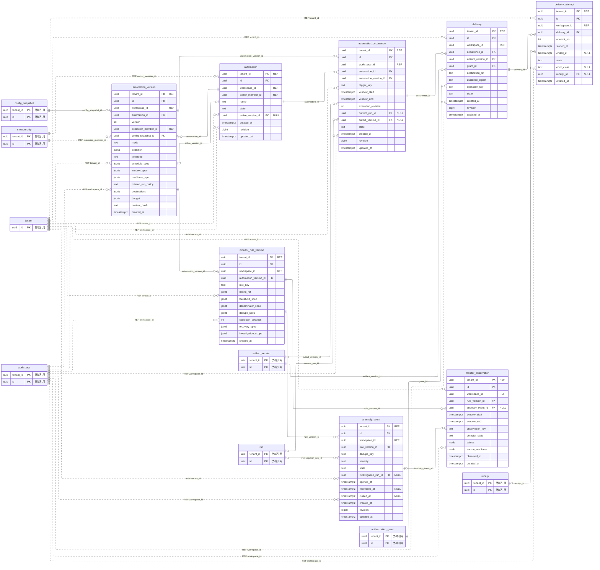

**表结构、约束与 MVP 必要性：**

| 表                      | 一行代表什么                 | 首次建表 | 关键约束与索引（继承 §2.0）                                                                                                                                                      | MVP 必要性 / 延后理由                                       |
| ----------------------- | ---------------------------- | -------- | -------------------------------------------------------------------------------------------------------------------------------------------------------------------------------- | ----------------------------------------------------------- |
| `automation`            | 一个持续执行的自动化任务     | M2       | state∈draft/active/paused/retired；active_version 必须属于当前任务；Owner 失效暂停。                                                                                             | M0 无后台周期执行；开启后需要稳定身份与启停状态。           |
| `automation_version`    | 自动化配置的一次不可变修订   | M2       | U(automation_id,version)；mode∈refresh/reanalyze/monitor；definition 固定模板/产物/目标版本；激活前查询用途匹配的持续 grant，无 grant 不激活。                                   | 明确方法、周期、窗口、身份和受众，配置变化不改历史期次。    |
| `automation_occurrence` | 一个计划窗口或触发事件       | M2       | U(automation_id,trigger_key)；配置切版不改变 trigger_key；同一期显式重分析提高 execution_revision，历史 Run 由事件追溯；state∈waiting/running/succeeded/partial/failed/skipped。 | 防止重复调度生成同一期；迟到数据不能用上期报告充数。        |
| `delivery`              | 某一期产物向一个目的地的投递 | M2       | U(occurrence_id,artifact_version_id,destination_ref,audience_digest)；U(operation_key)；state∈pending/awaiting_authorization/submitting/delivered/failed/unknown/cancelled。     | 发送失败只重试投递，避免重复分析或重复外发。                |
| `delivery_attempt`      | 一次投递调用                 | M2       | U(delivery_id,attempt_no)；重试重用 delivery.operation_key；state∈submitting/succeeded/failed/unknown；receipt 必须属于该 delivery。                                             | 保留超时与重试历史，真实送达由回执观察证明。                |
| `monitor_rule_version`  | 一个监控规则的固定版本       | M2       | U(automation_version_id,rule_key)；cooldown_seconds≥0；指标/窗口/分母必须可解析；调查不能超出持续授权。                                                                          | 监控场景开启后保证规则与自动调查范围可追溯。                |
| `anomaly_event`         | 一个经去重合并的异常过程     | M2       | 活跃事件 U(rule_version_id,dedupe_key)；state∈pending/investigating/action_required/observing/recovered/closed；恢复与人工关闭分别记时。                                         | 同异常冷却期合并观察，不反复创建告警与调查。                |
| `monitor_observation`   | 规则对某个窗口的一次检测     | M2       | U(rule_version_id,observation_key)；detector_state∈ok/delayed/failed/denied；只有有效观测可触发异常/恢复，失败不能生成正常结论。                                                 | 同时保留正常/异常与无法检测的事实，避免把检测器故障当恢复。 |

<a id="domain-i"></a>

### 2.9 模块 I：能力、配置快照与初始化

**本域回答：**本次 Agent 使用哪一套方法、模型和策略，这些配置如何受控进入系统？

**为什么这样设计：**固定配置与动态编辑采用同一发布快照契约。config_snapshot 保存运行可消费的不可变组合；后续编辑表保存草稿和版本，发布时编译为快照。一次运行只固定一份快照，同时实时服从当前权限。

**边界：**M0 配置来自代码评审过的清单；快照登记是可复现运行所需的最小表。M1/M3 才增加模型/插件编辑与包导入管理；M5 增加正式发布评测。凭据值、私有金标和真实批准均不进入快照。

**完整 ER 与字段类型：**

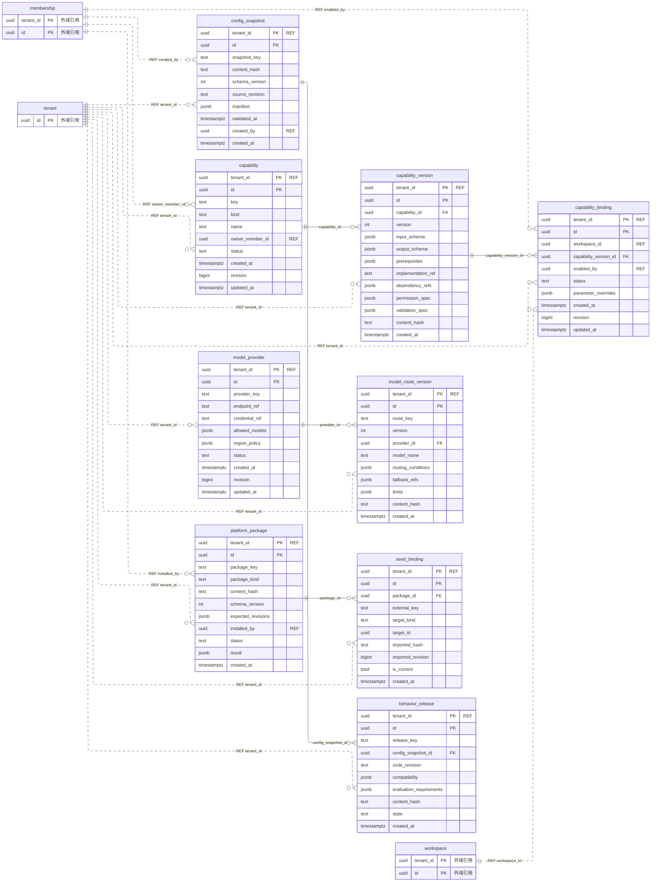

**表结构、约束与 MVP 必要性：**

| 表                    | 一行代表什么               | 首次建表 | 关键约束与索引（继承 §2.0）                                                                                                                                          | MVP 必要性 / 延后理由                                                        |
| --------------------- | -------------------------- | -------- | -------------------------------------------------------------------------------------------------------------------------------------------------------------------- | ---------------------------------------------------------------------------- |
| `config_snapshot`     | 一份已验证的运行配置快照   | M0       | U(snapshot_key)；U(content_hash)；manifest 覆盖身份策略、受限源映射、目录/指标/查询、能力/模型/Sandbox 版本；引用含 key/version/hash，发布时逐项解析；不可更新内容。 | 固定本次分析的全部配置来源；M0 用一张表替代尚无编辑需求的目录/能力配置中心。 |
| `capability`          | 一种可发现的分析能力       | M3       | U(key)；kind∈skill/prompt/agent/template/dataset/tool/workflow；status∈draft/active/retired。                                                                        | M0 固定清单足够；插件维护和动态发现出现后需要生命周期。                      |
| `capability_version`  | 能力的一份不可变契约       | M3       | U(capability_id,version)；不同 kind 采用独立 schema；依赖目标版本必须存在且无环；dataset kind 只引用目录。                                                           | 避免安装新版后旧任务的方法来源丢失；安装不授予数据权。                       |
| `capability_binding`  | 一个空间启用的一项能力版本 | M3       | U(workspace_id,capability_version_id)；status∈enabled/disabled；参数覆盖不能扩大权限与资源上限。                                                                     | 区分注册和实际启用；M0 按固定快照启用。                                      |
| `model_provider`      | 一个模型服务接入           | M1       | U(provider_key)；status∈active/disabled；仅保存凭据引用；数据地域限制由 Gateway 校验。                                                                               | M0 单一已配置模型；M1 多模型治理需要可管理的接入对象。                       |
| `model_route_version` | 一份模型路由版本           | M1       | U(route_key,version)；备用模型引用解析为固定版本，必须满足原任务的数据地域/能力要求。                                                                                | 记录为何选择或降级到该模型，支持成本与质量归因。                             |
| `platform_package`    | 一次平台配置包安装         | M3       | U(package_key)；package_kind 固定 platform_config；status∈installed/rejected；同 key 同 hash 幂等、异 hash 冲突；安装失败独立记录审计。                              | M0 使用受控启动配置；批量导入、多环境迁移出现后需要幂等安装记录。            |
| `seed_binding`        | 受管配置条目的安装版本     | M3       | U(package_id,external_key)；当前 U(external_key) WHERE is_current；target_kind 仅允许固定配置类型，服务事务校验真实表/租户/版本；禁止按名称接管人工记录。            | 保护人工编辑并支持跨包版本升级；仅配置导入器使用，禁止承载运行对象和授权。   |
| `behavior_release`    | 一份经评测的行为发布候选   | M5       | U(release_key)；state∈candidate/validated/rejected/retired；评测对象须含代码与配置组合 hash。                                                                        | M0 Run 已固定快照；正式评测、灰度和回滚出现后才增加发布生命周期。            |

<a id="domain-j"></a>

### 2.10 模块 J：预算、审计与运行治理

**本域回答：**谁做过什么，消耗了多少资源，系统故障怎样被发现与处理？

**为什么这样设计：**成本账本保存计量与结算事实，运行日志保留执行摘要，审计记录身份和权限操作。系统 Incident 负责基础设施/检测器故障，业务异常由 H 域处理。

**边界：**M0 记录最小审计并按 Run 固定硬限额。M1 才启用并发预算预留；长任务、运营处置与保留策略逐阶段加入。原始遥测留在观测后端，敏感载荷不复制进普通日志。

**完整 ER 与字段类型：**

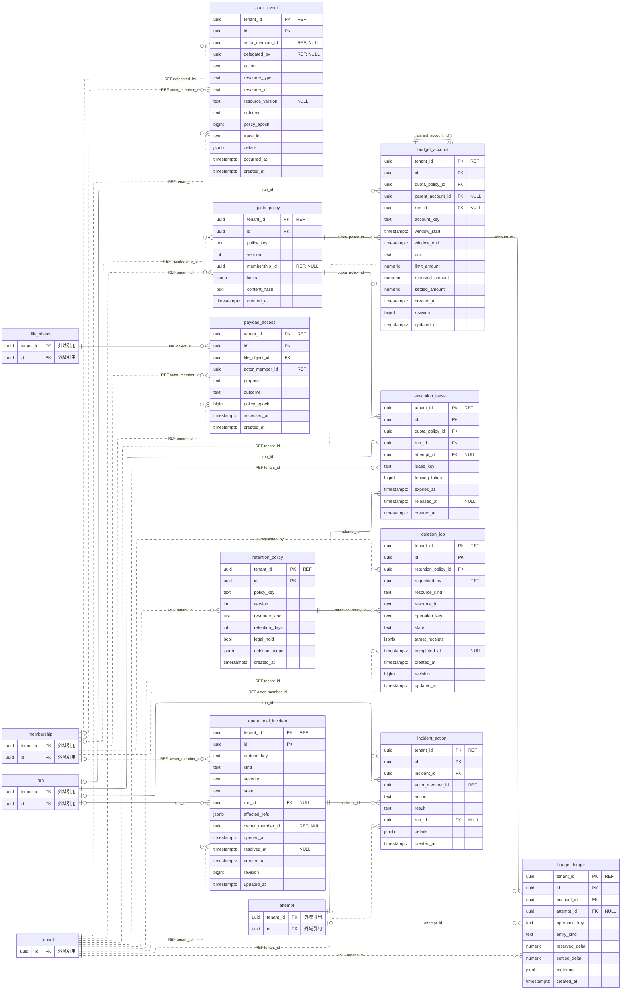

**表结构、约束与 MVP 必要性：**

| 表                     | 一行代表什么                     | 首次建表 | 关键约束与索引（继承 §2.0）                                                                                                                       | MVP 必要性 / 延后理由                                                   |
| ---------------------- | -------------------------------- | -------- | ------------------------------------------------------------------------------------------------------------------------------------------------- | ----------------------------------------------------------------------- |
| `audit_event`          | 一次安全或重要业务操作的审计事实 | M0       | 追加写；I(actor_member_id,occurred_at)、I(resource_type,resource_id,occurred_at)；details 为脱敏摘要；资源定位允许保留已删除对象，因此无级联 FK。 | 解释拒绝、导出、配置和停止操作；系统记录不能只靠浏览器。                |
| `quota_policy`         | 一个主体范围的限额版本           | M1       | U(policy_key,version)；NULL membership 为租户策略；limits 明确并发/调用/金额/窗口及单位。                                                         | 多用户并发与成本治理开启后使用；M0 仅固定 Run 限额。                    |
| `budget_account`       | 一个预算窗口内的可用与预留余额   | M1       | U(account_key,window_start,window_end,unit)；金额非负；父账号同单位且无环；以稳定顺序同时锁定任务和租户账号。                                     | 并发调用不能各自认为预算充足；余额为账本的事务投影。                    |
| `budget_ledger`        | 一条不可变预算变动               | M1       | U(account_id,operation_key,entry_kind)；entry_kind∈reserve/settle/release/adjust；未知成本维持预留，冲正追加记录。                                | 重试、预留和实际费用分开，防止重复扣款或重复释放。                      |
| `execution_lease`      | 一个在执行的并发配额占位         | M1       | U(lease_key)；fencing_token 单调递增；同限额行锁内计数和领取；执行器拒绝旧 token。                                                                | 配额依赖共享占位，不能只靠单进程计数；M0 单进程用固定上限。             |
| `payload_access`       | 对一份敏感载荷的访问记录         | M2       | I(file_object_id,accessed_at)；访问需载荷专项权限；只保存目的和结果。                                                                             | 运维追踪权限不自动开放输入/结果内容，专项载荷查看启用时需要。           |
| `retention_policy`     | 一类资源的保留政策版本           | M3       | U(policy_key,version)；retention_days>0；范围包括主存储、缓存、索引、对象与备份生命周期。                                                         | M0 受控环境使用配置中的保留规则；可管理的数据生命周期启用后落表。       |
| `deletion_job`         | 一项受控删除请求及回执           | M3       | U(operation_key)；state∈requested/running/partial/completed/blocked；所有受控目标回执齐全后完成；资源可已删除，定位不设 FK。                      | 删除必须覆盖派生索引/缓存并能核验；离线副本记录责任边界。               |
| `operational_incident` | 一个需处置的系统故障             | M2       | 活跃 U(dedupe_key)；state∈open/acknowledged/mitigating/resolved/closed；kind∈runtime/source/detector/delivery/security。                          | M0 通过日志排障；多人运行维护与检测器健康告警启用后需要归属和处置记录。 |
| `incident_action`      | 故障的一次处置记录               | M2       | 追加写；重试/取消必须调用领域命令接口，不能绕过授权直接改 Run 状态。                                                                              | 保留故障如何恢复与真实处置结果。                                        |

<a id="domain-k"></a>

### 2.11 模块 K：受治理记忆

**本域回答：**哪些经验可以复用，属于谁，什么时候失效或删除？

**为什么这样设计：**记忆候选、已确认版本与召回使用分开。记忆保存偏好与经过治理的经验；指标定义、事实证据和权限仍由各自领域负责。

**边界：**M0 用用户当前输入与固定模板；M4 引入独立 `apps/memory`，提前启用时同时交付 FR-12 验收。本域三张表、迁移、抽取与检索全部归 memory 服务；agent / worker 通过 Memory Tools / HTTP 使用，禁止直连本域表。向量索引为派生检索结构，删除、权限与版本以关系记录为准。跨服务引用在图中用 REF 标注、点线表示；调用时核验当前租户、Owner、来源与授权。

**完整 ER 与字段类型：**

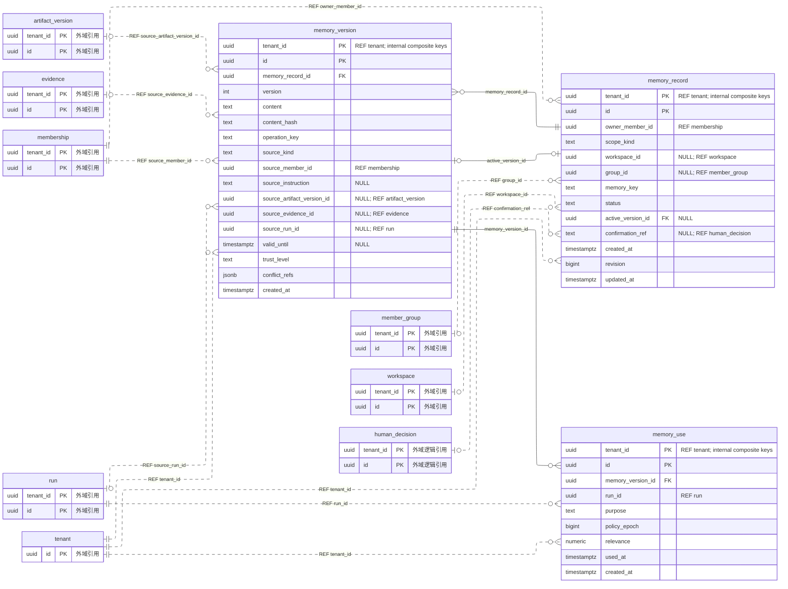

**表结构、约束与 MVP 必要性：**

| 表               | 一行代表什么             | 首次建表 | 关键约束与索引（继承 §2.0）                                                                                                                                                                                                                                     | MVP 必要性 / 延后理由                                        |
| ---------------- | ------------------------ | -------- | --------------------------------------------------------------------------------------------------------------------------------------------------------------------------------------------------------------------------------------------------------------- | ------------------------------------------------------------ |
| `memory_record`  | 一个有作用域的记忆主题   | M4       | scope_kind∈personal/workspace/group/tenant；对应 workspace/group 按类型恰当非空；同 Owner/作用域/key 唯一；status∈candidate/active/conflicted/retired/deleted；active_version_id 必须属于当前 record；激活需可信 confirmation_ref，CAS 更新 revision。          | M0 无长期记忆；启用时用明确范围防止个人偏好跨人/跨组织复用。 |
| `memory_version` | 记忆的一次不可变修订     | M4       | U(memory_record_id,version)、U(source_member_id,operation_key)；source_kind∈extracted/user_edit；extracted 需 source_run 与证据/产物，user_edit 需已认证用户的明确 source_instruction；相同操作键异 hash 冲突；共享提升须有匹配决定；仅 active_version 可召回。 | 保留来源与纠错历史；模型猜测不能直接成为组织事实。           |
| `memory_use`     | 一次运行对记忆版本的使用 | M4       | U(memory_version_id,run_id,purpose)；实际采用前验证 active_version、有效期/作用域/当前权限；Run 为跨服务逻辑引用。                                                                                                                                              | 评估记忆是否有帮助并支持撤回影响分析。                       |

个人管理页直接编辑不要求先创建分析 Run；source_member_id、source_instruction 记录用户明确输入，source_run_id 可空。抽取产生候选版本，确认后 CAS 切换 active_version；待确认修改保留原有效版本。record 的作用域固定，提升共享作用域创建新的获权候选。删除先标记 deleted 并排除召回，再按 FR-12 清理正文、索引与缓存，保留不含正文的必要回执；内容不可变约定不阻止获权删除清理。

memory 与 agent 没有跨库原子事务：授权 / 来源 API 核验失败则拒绝对应使用；确认凭证绑定版本 / hash 并有期限，每次读取与使用仍重验当前权限。memory 内部 record/version/use 的复合外键继续存在；跨服务记录不存在或已撤销时返回不可用引用，不伪造关联。工具契约、故障语义与确认伪代码唯一维护在 [技术架构 §7.1](TECH_DESIGN.md#71-独立-memory-服务与-runtime-工具)。

<a id="domain-l"></a>

### 2.12 模块 L：评测、发布与回滚

**本域回答：**变更是否改善效果，什么组合可以上线，如何安全回退？

**为什么这样设计：**评测数据版本、用例、试验运行、逐项结果和部署动作各有独立身份。评测绑定完整 BehaviorRelease；硬安全门槛独立于平均分。

**边界：**M0 用私有文件 Seed Eval，不建评测平台。M5 才落下列表；私有预期答案存评测专用对象空间，生产检索/Agent 账号无权读取。

**完整 ER 与字段类型：**

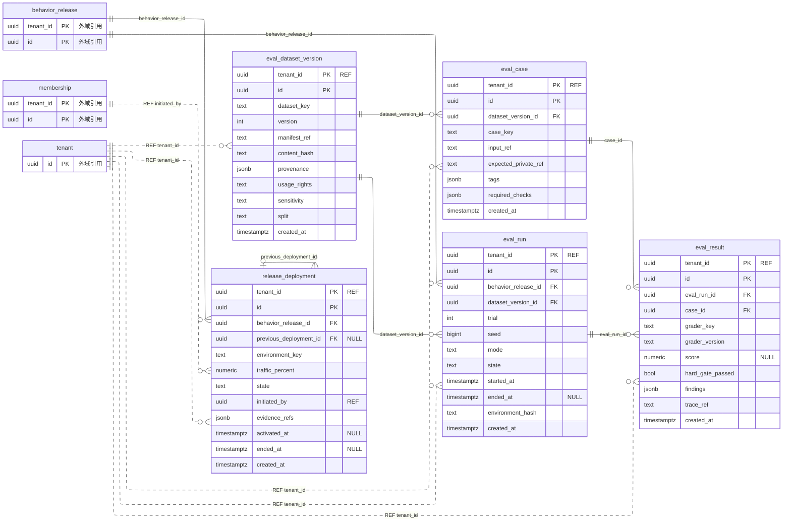

**表结构、约束与 MVP 必要性：**

| 表                     | 一行代表什么             | 首次建表 | 关键约束与索引（继承 §2.0）                                                                                                            | MVP 必要性 / 延后理由                                        |
| ---------------------- | ------------------------ | -------- | -------------------------------------------------------------------------------------------------------------------------------------- | ------------------------------------------------------------ |
| `eval_dataset_version` | 一份评测集基线           | M5       | U(dataset_key,version)；split∈development/regression/holdout；manifest_ref 属于私有评测存储。                                          | M0 文件评测足够；团队维护样本与多版本回归后需要平台目录。    |
| `eval_case`            | 评测集中的一条用例       | M5       | U(dataset_version_id,case_key)；输入/答案分别鉴权；case 不出现在生产目录。                                                             | 固定正负例与硬门槛，避免测试答案混入生产上下文。             |
| `eval_run`             | 对发布候选的一轮试验     | M5       | U(behavior_release_id,dataset_version_id,trial,mode,seed)；mode∈regression/replay/ablation；state∈running/completed/failed/cancelled。 | 重复试验和消融有独立身份，避免只记录一次漂亮均分。           |
| `eval_result`          | 一个用例的一项评分结果   | M5       | U(eval_run_id,case_id,grader_key,grader_version)；case 属于该 run 的数据集版本；硬门槛失败不能被均分抵消。                             | 能回看具体失败用例与 Trace，解释发布决定。                   |
| `release_deployment`   | 一次发布、灰度或回滚操作 | M5       | traffic_percent 在0–100；state∈candidate/canary/active/rolled_back/disabled；环境变更串行，流量总和≤100；发布必须通过所需 eval gate。  | 记录完整组合与灰度结果；回滚不恢复已撤权策略，也不重放动作。 |

## 3. MVP 取舍、跨域约束与需求覆盖

### 3.1 M0 需要哪些表，为什么已经足够

| M0 模块                  | 表清单                                                                                                         | 为什么首版需要                                                    |
| ------------------------ | -------------------------------------------------------------------------------------------------------------- | ----------------------------------------------------------------- |
| A 身份、租户与访问控制   | `tenant`、`principal`、`membership`、`workspace`、`workspace_member`                                           | 谁在什么工作空间内，可以读取什么、执行什么？                      |
| C 会话、消息与分析任务   | `conversation`、`conversation_read`、`message`、`message_reference`、`task`、`task_version`                    | 用户在讨论什么，本次究竟要解决哪个问题，修订后如何继续？          |
| D 计划、执行与恢复       | `plan_version`、`run`、`step`、`attempt`、`run_event`、`command`                                               | 准备如何分析，实际做过什么，失败后从哪里继续？                    |
| E 文件、查询与可验证证据 | `file_object`、`query_execution`、`evidence`、`validation_record`                                              | 这个结果从哪里来，执行了什么，结论是否经过验证？                  |
| F 分析产物、结论与传播   | `artifact`、`artifact_version`、`artifact_state_event`、`claim`、`claim_evidence`、`feedback`、`export_record` | 怎样把一次回答沉淀为可编辑、可追溯、可再次访问的工作成果？        |
| I 能力、配置快照与初始化 | `config_snapshot`                                                                                              | 本次 Agent 使用哪一套方法、模型和策略，这些配置如何受控进入系统？ |
| J 预算、审计与运行治理   | `audit_event`                                                                                                  | 谁做过什么，消耗了多少资源，系统故障怎样被发现与处理？            |

M0 表清单是目标结构中的依赖闭包：不会因为一个可空外键而提前创建整个后续域。M0 的固定配置使同一条分析链可以读取目录、校验指标、执行已授权查询并追溯方法，无须同时实现这些配置的 CRUD、审批和发布平台。动态配置的触发条件是“已有真实多人编辑与独立发布需求”；此时把清单按原 key/version/hash 导入对应表，运行消费契约保持一致。

M3 启用动态授权时，将 `workspace_member.role_keys` 一次性解析为 RoleAssignment；切换后该字段仅作旧数据兼容，不再参与当前权限计算。角色/策略发布生成新的生效快照，授撤权立即提高 policy_epoch；旧 Run 的策略内容只用于解释历史，不能绕过新的拒绝。

三个需要明确保留的 MVP 简化：

1. **人工决定模拟**：真实澄清通过消息和任务修订完成；审批演示只写隔离环境的模拟消息/事件，不创建授权、不恢复真实外部命令。动作与监控建议分别保存为 `action_draft`、`monitor_draft` 产物。
2. **本地与持久执行分开**：local 的命令、步骤和结果持久化，重启后已开始任务标记 interrupted，尚未领取的 queued 任务可继续。durable 的 Checkpoint/Outbox/Temporal 保证随 M2 profile 引入；两种执行位置创建后不自动切换。
3. **文件化 Seed Eval 与固定配置**：评测仍须执行并保留证据，私有答案隔离；M0 不建评测管理、配置导入后台和记忆平台。

这三项简化不会免除当前租户/空间隔离、只读查询、结果完整性、版本冲突和导出鉴权。其他场景启用时，需同时交付对应表、权限、验证器与负例，不通过删除验收来缩小范围。

### 3.2 状态与事务边界

| 聚合 / 权威记录                  | 状态与不变量                                                                                                                                                                | 原子提交边界                                                                                                                    |
| -------------------------------- | --------------------------------------------------------------------------------------------------------------------------------------------------------------------------- | ------------------------------------------------------------------------------------------------------------------------------- |
| Conversation / Message           | 会话序号唯一且与提交顺序一致；已读只前进；软删除不删除产物                                                                                                                  | 向 Web 核验当前权限；Agent 事务锁 conversation，追加 message/reference 与核验版本，更新活动时间                                 |
| Task / TaskVersion / PlanVersion | 目标状态独立于 Run 成败；契约与计划不可变；计划 DAG 无环                                                                                                                    | 分配版本、保存契约/计划及修订原因；Run 固定版本                                                                                 |
| Run / Step / Attempt / Event     | Run：queued/running/waiting_input/waiting_decision/retrying/paused/blocked/cancelling/cancelled/partial/completed/failed/expired/interrupted；Step/Attempt 使用各自状态集合 | 每次迁移在 Run 锁内更新状态、分配 sequence、追加事件；终态不能被迟到事件回退；中断是工程恢复状态                                |
| Artifact / Version / StateEvent  | 五维状态独立；内容不可变；人工编辑以 expected_head 防覆盖                                                                                                                   | 同事务新增内容版本/Claim/依赖/初始状态并 CAS 更新 head；外部文件先写后引用                                                      |
| Decision / Grant                 | 五类用途独立；部分批准是原请求与当前可授范围的子集；过期无效                                                                                                                | 先向 Web 核验当前可授范围；Agent 事务锁请求及对象版本/头，追加运行决定、限定 grant 与恢复命令；M2 同事务写 Outbox               |
| Action / Delivery / Receipt      | ready→submitting→真实结果；unknown 先核实；重试保持 operation_key                                                                                                           | 数据库内领取派发并记 submitting，提交后调用外部；回执另一个事务记录                                                             |
| BudgetAccount / Ledger           | 父/子预算同时满足；预留与实付分开；未知费用未核实前不释放                                                                                                                   | 固定顺序锁租户与任务账号，更新余额和账本；结算幂等                                                                              |
| Memory / Version / Use           | memory 服务拥有 active_version 与确认引用；候选不召回，修改 CAS，删除立即失效                                                                                               | memory 单库事务提交；跨服务授权 / 来源通过 API 核验，不依赖平台库事务或 FK                                                      |
| Automation / Occurrence          | 同一期一个实例；改配置不重发同一期；生成与投递独立                                                                                                                          | 以稳定 trigger_key 插入/读取实例，显式重跑追加 revision 与 Run 关联事件                                                         |
| Monitor / Anomaly                | 同规则同去重键只存在一个活跃事件；检测失败不等于恢复                                                                                                                        | 规则/去重键事务锁 + 部分唯一索引；追加观察、更新事件及派发请求                                                                  |
| Configuration / Authorization    | 运行配置固定；当前停用、撤权、强制拒绝实时生效                                                                                                                              | Web 本库更新权限与 policy_epoch；Agent / Memory 通过 API 复核，新请求、缓存命中、展示、导出与敏感派发按契约重验，不跨库锁权限行 |

跨 app 授权核验与业务写入不共享事务。核验结果绑定主体、租户、对象/动作、policy_epoch、核验时点与期限；服务记录实际使用的结果。撤权与在途操作的生效窗口、超时拒绝、缓存失效及高风险派发前复核在对应 Feature 验收，不能声称一次前置核验保证整个执行期间权限不变。

`head_version_id` 与同 owner 内版本父引用形成的环采用“先建稳定父行 → 插入首版 → 设置 head”的同一事务；运行结束前外部不可见半成品。迁移先建表，再补循环外键，禁止为简化迁移移除引用完整性。

同一聚合的会话、任务、计划、Run、Step、Attempt 与消息关联必须属于同一空间；关联一致性用复合 FK 或锁内校验保证。跨空间资产复用采用获权引用，写入新空间前重新校验来源权限；不能为绕过复合键复制未授权内容。`reply_to` 属于当前会话，`step_id` 属于当前 Run，`delivery_attempt.receipt_id` 属于当前投递，`eval_result.case_id` 属于试验数据集，均需显式验证。

### 3.3 108 项功能映射

下表沿用 PRD §16 的稳定编号；范围为闭区间，合计 108 项。映射登记完整产品的数据责任，不表示 M0 实现了所有管理入口。

| PRD 功能 ID | 负责模块与记录                                    | 首版 / 后续边界                               |
| ----------- | ------------------------------------------------- | --------------------------------------------- |
| UX-01–04    | C 会话/引用/契约；D Run/Command/Event             | M0；持久恢复 M2                               |
| UX-05–06    | F 产物版本/反馈/导出；E 验证                      | M0                                            |
| UX-07       | G WorkItem/Comment/Decision                       | M2 专业复核                                   |
| UX-08       | H Automation/Delivery                             | M0 草稿产物；M2 正式启用                      |
| AG-01–07    | C TaskVersion；D PlanVersion；B/I 目录与快照      | M0 固定目录与计划                             |
| AG-08–12    | D Hypothesis/计划；E Evidence/Validation；F Claim | M0 基础验证；诊断/专题启用时加入假设，建议 M2 |
| AG-13–18    | D Run/Step/Attempt；J 限额；F 交付                | M0 单任务；M1 共享预算；M2 委派/恢复          |
| AG-19       | K MemoryVersion/Use                               | M4                                            |
| AG-20       | F action_draft；G Proposal/Execution/Receipt      | M0 草稿；M2/M3 经授权的具体集成               |
| TS-01–03    | I 能力快照；B 目录/模板；E QueryExecution         | M0 白名单；M3 动态接入                        |
| TS-04–07    | E File/Transformation/Evidence；F ArtifactVersion | M0 文件/结果引用；清洗/多源场景启用时补转换   |
| TS-08–10    | I CapabilityVersion/依赖/快照                     | M0 固定方法包；M3 编辑与发布                  |
| TS-11–12    | E ResultEnvelope；G/H 动作/投递/回执              | M0 结果完整性；M2 外部交互                    |
| HI-01–04    | G Request/Decision/Grant                          | M0 明确模拟；M2 正式决定                      |
| HI-05–08    | G WorkItem；D Checkpoint/TaskVersion              | M2                                            |
| HI-09–10    | G Grant/Execution；H Automation/Delivery          | M2                                            |
| AR-01–03    | F Artifact/Version/StateEvent/Claim；E Evidence   | M0                                            |
| AR-04–09    | F 版本/依赖；E Validation；D 新 Run               | M0 单资产冲突与失效；M3 跨资产影响管理        |
| AR-10–12    | F Publication/Export；A ResourceGrant；I 模板     | M0 下载；M2 发布；M3 精细共享/复用            |
| RT-01–02    | D Run/Event/Command；A/I 授权                     | M0                                            |
| RT-03–04    | J Quota/Lease/Ledger；D Checkpoint/Outbox         | M1 配额；M2 持久调度                          |
| RT-05–08    | D Command；J Ledger；H Occurrence/Delivery        | M0 停止；M1 预算；M2 周期与投递               |
| AD-01–05    | A 身份/空间/角色/策略                             | M0 固定角色与拒绝基线；M3 动态管理            |
| AD-06–10    | B 数据目录/指标/质量；I Snapshot                  | M0 固定配置；M3 动态维护                      |
| AD-11–15    | I Capability/Provider/Route/Snapshot              | M0 固定配置；M1 路由；M3 能力管理             |
| AD-16–18    | G Request/Grant/WorkItem；A 策略                  | M2                                            |
| AD-19–22    | D Run/Command；J 预算；G Receipt                  | M1 成本；M2 恢复与外部核实                    |
| AD-23–25    | D Event；J Audit/PayloadAccess/Incident/Retention | M0 最小审计；M2 运维；M3 保留管理             |
| AD-26–29    | L Eval/Deployment；I BehaviorRelease              | M0 私有 Seed Eval；M5 管理平台                |
| AD-30–32    | K Memory/Version/Use；J DeletionJob               | M4                                            |
| AD-33–35    | F 产物/发布/导出；I 模板                          | M0 产物；M2/M3 共享与复用                     |
| AD-36–38    | H 周期/监控/投递                                  | M0 草稿；M2 正式自动化                        |

原型 S01–S12 的系统数据映射：S01/S02 使用 C–F 的问数/探索链路；S03 加入 E 转换；S04 使用 E 验证与 F 差异产物；S05/S06 加入 D 假设/计划与 G 决定；S07/S08/S09 的预测/实验/因果方法以 I 的方法包、E 的验证和 F 的方法产物表达，不创建行业专用系统表；S10/S11 由 H 处理周期/监控；S12 使用 F 的参数化应用产物与 G 的发布授权。对应场景的分析方法、数据充分性与验收仍以 PRD 为准。

### 3.4 旧逻辑对象如何落到当前结构

| 旧文档概念                                          | 当前结构 / 取舍                                                                                                                            |
| --------------------------------------------------- | ------------------------------------------------------------------------------------------------------------------------------------------ |
| User、TenantMembership、Group                       | principal、membership、member_group/group_member；与源侧身份隔离                                                                           |
| Metric、QueryTemplate、MonitorRule 的稳定主表       | 以 metric_key/query_key/rule_key + version 表达稳定身份；MVP 不增加没有独立生命周期的空主表                                                |
| PlanNode、PlanEdge                                  | plan_version.plan_json 内的完整 DAG，发布时校验；节点独立调度需求出现后再拆表                                                              |
| ResultEnvelope、Dependency、Transformation 输入列表 | 查询/证据的版本化 envelope；artifact_dependency 与类型化版本引用；一次 transformation 记录主输入/输出，其余输入在 method_spec 中固定并鉴权 |
| ReportVersion、Board、Action 草稿                   | artifact + artifact_version，kind 区分；正式 ActionProposal 在执行启用时从获权草稿转换                                                     |
| SandboxProfileVersion、配置类策略                   | config_snapshot 中的版本化 manifest；模型路由 M1、动态能力 M3 分别落表，Sandbox 的镜像/依赖/网络/资源策略随快照发布                        |
| BehaviorRelease、运行环境清单                       | M0 用 config_snapshot + Run.source_snapshot 固定配置与源；M5 behavior_release 加入评测/发布生命周期                                        |
| ConfigEntry、PlatformPackageManifest、DemoEnvelope  | §5 的输入契约，非重复业务表；platform_package/seed_binding 仅管理配置安装                                                                  |
| 旧 ApprovalRequest/Decision                         | human_decision_request/decision，旧 ID 通过迁移映射保留为 execute 类决定                                                                   |

## 4. 供评审的关键逻辑

以下是拟新增 API 模块的设计伪代码，尚未运行；外围 ORM/序列化省略，权限、版本、事务、失败与幂等分支均为必须实现的语义。正式模型将沿用现有 Python / SQLAlchemy / Alembic，不生成生产实现文件。

### 4.1 消息提交与任务修订

```text
append_message(actor, conversation_id, client_key, payload):
    先验证输入 schema，计算 request_hash
    通过 Web 核验当前成员、空间与动作权限，取得有期限的授权版本结果
    开启 Agent 短事务；锁 conversation，检查核验绑定与有效期、conversation.deleted_at
    查询 (tenant, conversation, client_key)：
        已存在且内容/引用 hash 一致：返回原消息
        已存在但 hash 不同：返回冲突
    验证 reply_to 属于当前会话，所有引用存在且当前获权
    分配 next_sequence，写 message/reference，更新活动时间
    若修订任务：锁 task，追加 task_version；标记受影响步骤/产物待重算
    提交；已读游标独立按 max(old, actually_seen_sequence) 更新
```

### 4.2 产物编辑与验证失效

```text
save_artifact_version(actor, artifact_id, expected_head, edit):
    先存不可变对象并验证 hash；失败则终止
    通过 Web 核验当前 edit 权限与授权版本
    开启 Agent 短事务；锁 artifact，检查核验绑定、有效期和资源本地状态
    若 head != expected_head：返回冲突及获权差异
    presentation：只允许呈现字段，固定 computation_base，复用已验证的计算/证据
    narrative：重新生成受影响 Claim，相关状态回到未验证
    computation：产生新计算引用；新验证通过前不得发布，依赖产物待重算
    同事务追加 version、Claim/Evidence 引用、初始状态事件，CAS 更新 head，写 audit
    提交；对象已写但事务失败的孤儿由保留任务回收，禁止覆盖旧对象
```

### 4.3 人工决定与真实派发

```text
submit_decision(actor, request_id, expected_revision, choice, command_key):
    通过 Web 核验当前处理权限和可授范围，绑定请求、动作与版本
    开启 Agent 短事务；锁请求及固定目标/当前头，检查核验有效期
    校验处理权限、对象可见性、请求期限和 binding_digest
    同 command_key 同请求 hash 返回原决定，异 hash 冲突
    请求已终态、过期、目标绑定变化或已撤权：拒绝，记录原因
    部分批准必须在 requested_scope ∩ actor 当前可授范围之内
    追加 human_decision，CAS 更新请求状态
    clarify/plan/adopt 只更新相应用途的判断；不得创建 execute/publish grant
    execute/publish 创建匹配用途、身份、对象版本、范围、受众、预算及期限的 grant
    若需恢复分支：同事务写幂等命令和 Outbox；提交

dispatch_external(operation_key):
    派发前通过 Web 复核当前权限；失败或过期即停止
    Agent 短事务锁执行记录与运行 grant，检查核验绑定、期限、目标版本与预算
    已确认完成：返回原回执；submitting/unknown：进入核实流程，不再提交
    有效且未提交：CAS 领取派发、原子消费一次授权/本期额度、写 submitting；提交
    外部调用携带稳定 operation_key；网络调用不持有数据库事务
    明确结果：追加 receipt，结算预算并更新状态
    超时/进程崩溃：保留 unknown 与预算预留，查询外部状态恢复
    核实未发生且允许重试：重用原键；无法核实：保持待人工处理
    展示结果前重新授权；撤权不删除已经发生的外部结果
```

外部系统没有幂等键和状态查询能力时，数据库事务无法保证外部 exactly-once；结果未知必须人工核实。已提交的在途动作只能尽力取消，记录真实后果。

## 5. 平台初始化与业务源接入

本节保留稳定标题与原有链接。这里只定义通用平台配置、源元数据接入和 Query Gateway；行业事实、行业岗位样例、数据生成与业务包结构均由外部源方案维护。

### 5.1 初始化对象与顺序

M0 使用受控部署流程：Web 创建 provisioning 租户、主体映射、成员、空间与固定角色键 → Agent 验证运行配置与受限连接并保存不可变 config_snapshot → Web 通过 API 核验快照后在本库事务设置 active_config_snapshot_id、提高 policy_epoch 并置 active → 用受限查询验证 Evidence/Artifact 链路。各步骤使用稳定操作键和明确回执，失败保留已完成状态并按清单继续或停用，不承诺跨库回滚。provisioning 租户拒绝普通运行；引导身份由部署操作者显式指定，配置包不得自授权限。源不可达或权限不匹配时不启用相应查询，产品贯通失败暂停租户并保留审计。

平台记录分三类：配置 `C`、真实运行 `R`、隔离演示 `D`。配置可初始化；真实批准、已执行动作、真实费用、已送达回执只来自实际运行；演示数据只在专用演示环境，不能进入执行授权或生产恢复队列。

### 5.2 配置包与演示包契约

| 输入对象                | 必需字段                                                                                                                                                | 校验和失败行为                                                                                    |
| ----------------------- | ------------------------------------------------------------------------------------------------------------------------------------------------------- | ------------------------------------------------------------------------------------------------- |
| PlatformPackageManifest | schema_version、package_kind、package_id、revision、content_hash、files、required_database_versions（按 app/database-key）、可选 source_environment_ref | platform_config/demo_fixture 使用独立入口；hash 排除自身；文件不得越界；源引用只保存受控版本/哈希 |
| ConfigEntry             | kind、external_key、revision、payload_hash、dependencies、required_schema_version、payload                                                              | 固定类型白名单；按依赖拓扑解析；缺依赖/循环/运行记录整包拒绝                                      |
| SeedBinding             | package_id、external_key、target_kind/id、imported_hash/revision、安装时间与当前标记                                                                    | 对应 I 域表；同名人工对象不能被接管；人工修改返回冲突                                             |
| DemoEnvelope            | demo_environment_id、origin=demo_fixture、simulated_at、fixture_version、records                                                                        | 默认禁用、专用目标与身份；没有生产凭据/真实目的地，模拟批准不能变成正式 grant                     |

M0 的固定清单装载只需要校验快照并幂等登记，不需要通用包管理表。M3 开启可维护配置包时启用 platform_package/seed_binding。新内容使用新 package_id，稳定 external_key 用于跨包升级；expected_revision 防止覆盖人工修改。同包同 hash 返回已有结果，同包异 hash 返回冲突。

### 5.3 受控配置导入

```text
import_platform_config(actor, manifest, expected_revisions):
    验证 package_kind、schema、全部文件 hash、路径与固定类型白名单
    解析目标依赖和源环境版本；缺失/循环/夹带运行或授权记录则拒绝
    验证 actor 配置导入权限与可授范围；执行事务前受限连接测试
    按目标 owner 拆分导入；工程配置交 Web，Runtime 配置交 Agent，各自独立版本与回执
    以下在单个 owner 内执行短事务；锁 package_key、受影响配置 head，并记录授权核验版本
    相同 package_key 同 hash：返回已有安装；异 hash：冲突
    每项检查 binding 与 expected_revision：
        已受管且内容一致：复用 ID
        已受管但人工修改：整包回滚并返回差异
        同名但未受管：冲突，不接管
        显式升级：追加不可变版本，更新受管绑定的当前标记
        新条目：按依赖创建并登记 binding
    核对测试时的源/凭据/配置 hash 与当前一致
    保存安装记录、快照与审计后提交；不产生批准、运行成功或投递成功
```

跨 owner 导入按清单依次执行，部分成功时保留已完成回执；运行激活引用仅在所有依赖可用后由 Web 提交，恢复与重试不覆盖历史快照。外部测试与数据库提交无法组成跨系统事务；第一次实际使用仍验证连接与权限。外部失败不发布半套有效配置。配置快照从固定清单迁到动态表时，切换写入权威一次完成，禁止长期双写。

### 5.4 Query Gateway 与当前权限

平台成员、角色与源侧账号保持受控映射。连接池按逻辑源、真实登录身份、凭据版本隔离；禁止管理员连接回退。源发布标识、schema/hash 和快照能力由适配器报告，平台只登记引用，不复制行业主数据。

```text
prepare_query(authenticated_context, run, source_key, query_key, parameters):
    由服务端认证上下文向 Web 核验当前成员、空间与 policy_epoch
    验证 Run 属于当前获权空间；读取其固定 config_snapshot 与 source_snapshot
    source/query 不在快照或当前授权范围：返回 denied
    计算 requested_scope ∩ 当前行/列/动作许可；不满足任务范围时拒绝或显式修订任务
    选择覆盖该子范围的受限源映射；不存在/已撤销则拒绝
    校验目标源发布/schema/hash、三个时钟与水位
    只执行已验证的只读模板；参数范围、超时、扫描量/行数与取消同时受控
    保存 query_execution 与真实 ResultEnvelope
    结果返回前重验当前授权；成功且完整性可解释时才创建 Evidence
```

`ready/delayed/unavailable/denied` 是源可用性；零行和零值是成功查询的实际结果。缺必需源时保留缺口，不能把失败填零。多源关联只把当前获权、版本/时点可兼容的必要结果交给 Sandbox，并记录输入、粒度、基数和差异；M0 不建设通用联邦 SQL 引擎。

缓存键至少绑定主体、空间、当前 policy_epoch、授权范围、快照/源版本、查询参数和时间边界；命中仍鉴权。消息引用、搜索片段、产物查看/导出/发布均应用当前权限。撤权提高授权版本并停用映射、回收受影响连接；旧运行仍固定原输入配置，权限始终按当前规则裁剪。没有源历史快照时，复算必须明确使用当前数据。

### 5.5 保留的接入验收与任务归属

保留 **AC-ENV-05**：Query Gateway 根据已认证身份及当前工作空间绑定受限源连接；修改模型输入中的租户/角色不能升级权限，无权限或无映射时拒绝，不回退到管理员。对应 PRD AC-AD-04、AC-RT-02、AC-TS-03。

原接入验收的系统侧责任继续由 999 承担：AC-ENV-01 的平台/源账号隔离；AC-ENV-06 的源不可用与部分交付；AC-ENV-08 的运行固定版本与当前撤权；AC-ENV-09 的授权 Sandbox 关联；AC-ENV-10 的私有金标隔离。原 T7、PK-05 的目录→查询→证据→产物贯通归 DM-08；原 PK-03 的配置导入归 DM-06。外部数据工具的生产验收不依赖平台这些功能完成。

## 6. 实施任务与设计验收

本次仅维护设计文档。2026-10-25 的路径调整与实施顺序见 [脚手架任务](scaffold-design.md#8-部署收敛实施任务)；下表明确 Web 工程数据、Agent 推理数据与 Memory 记忆的实施归属。以下为拟新增路径和实施建议，保持 Feature Phase=`draft`、设计状态=`review`、平台实施暂缓；不创建空模块、不生成数据库迁移、不修改 PRD 的需求或里程碑。

| 任务                   | 模块与拟新增代码落点                                                                             | 依赖 / 可判定验收                                                                                         |
| ---------------------- | ------------------------------------------------------------------------------------------------ | --------------------------------------------------------------------------------------------------------- |
| DM-01 身份与固定配置   | Web 服务端 identity / authorization 与自有迁移；Agent 的 `configuration/snapshots.py` 与自有迁移 | A/I 的 M0 子集；Web 授权 API、跨库逻辑引用、停用/撤权、分步配置激活；分别交付完整/增量 SQL                |
| DM-02 会话与任务       | `conversations/models.py`、`service.py`、`tasks/models.py`                                       | DM-01；同会话多任务、并发序号、幂等消息、个人未读、删除撤销且产物保留；AC-CHAT-01–12                      |
| DM-03 证据与产物       | `evidence/models.py`、`artifacts/models.py`、`service.py`                                        | DM-02/04；Claim→Evidence→真实查询；五维状态、呈现/计算编辑区分、版本冲突、下载鉴权；AC-AR-01–12           |
| DM-04 计划与运行治理   | `runtime/models.py`、`commands.py`、`budget.py`                                                  | M0 D/J 子集与 DM-01/02；事件重放、取消确认、进程中断；M1 成本/并发预留，M2 Checkpoint/Outbox；AC-RT-01–08 |
| DM-05 人工决定与自动化 | `decisions/`、`automations/`、`actions/`                                                         | M2，依赖 DM-03/04；五类决定不扩权、部分批准/过期、一期唯一、未知回执核实、仅重试投递、监控健康            |
| DM-06 配置导入         | Web 工程配置导入；Agent 的 Runtime `platform_seed/`；跨 app 执行清单                             | M0 受控快照装载；M3 正式包管理；依赖/白名单、人工修改冲突、幂等/回滚、模拟授权隔离；§5.2–5.3              |
| DM-07 后续管理域       | agent 的 `catalog/`、`capabilities/`、`evaluations/`；独立 `apps/memory` 及其迁移                | 按 M1–M5 启用；旧 key/hash 兼容，记忆作用域/删除回执、私有答案隔离、组合发布回滚                          |
| DM-08 数据源到产品贯通 | `query_gateway/`、`source_bindings.py`、`tests/integration/test_source_integration.py`           | M0 固定源，M3 动态源；源可用性、真实受限账号、缓存/展示/导出撤权、真实查询到产物；AC-ENV-05               |

迁移按阶段切片：由 web / agent / memory 各自创建本服务阶段表，再增加服务内 FK 和必要索引，最后装载受控配置；环形 head 引用后加。后续新增列先允许空并验证已有记录，再按真实不变量收紧。已有 `demo_daily_sales` 仅保留工程演示职责，不自动迁成系统业务数据；原型 localStorage 的模拟批准和状态不得导入为真实运行事实。

正式实施需补齐原型无法证明的集成测试：复合 FK 与多租户/多空间越权、并发序号/幂等冲突、人工编辑并发、撤权与派发竞争、失败查询不生成事实证据、模拟决定不能授权、未知发送结果恢复、预算双预留、同周期重复触发、监控失败不恢复、私有金标与生产检索隔离。每个迁移阶段按本域依赖验证，不以 UI 可点击代替运行证据。

## 7. 设计检查与变更记录

### 7.1 2026-10-24 系统专属模型重构

本轮已完成以下设计检查：

- 12 个领域、94 张目标系统表、1,084 个字段与 341 条显式外键引用逐项核对；每个字段的类型、可空性和每条关系均与模块 ER 一致。M0 的 30 张表形成依赖闭包；跨后续阶段的两处记忆引用均为可空列，已明确随 M4 加入。
- 使用项目现有 Mermaid 12.2.0 与 Chromium 实际解析、渲染 1 张领域总关系图和 12 张 ER 图，全部通过；逐图 SVG 节点数与关系边数符合定义，341 条 ER 外键边完整呈现。图内指定 ELK 布局，以保留并列引用和自引用关系。
- PRD 的 108 个功能编号展开后无遗漏、无重复；S01–S12 的系统模型归属已登记，行业事实结构留在外部方案。
- 本轮 6 个文档/清单文件的 84 个内部链接及锚点有效；manifest YAML 可解析，33 个路径引用（24 个不同目标）均存在，领域/表数与文档一致。
- Feature 999 的 `validate-feature.mjs --artifact design` 路径检查、`git diff --check`、所选文件的格式检查及包含未跟踪文档的逐文件空白检查通过。

这些检查证明设计文档的结构、索引、引用、映射和图可渲染，不构成数据库迁移、事务并发、权限或业务集成测试通过的证据。

本次未实施数据库迁移、平台包导入或新增运行功能。实际 IdP 接入、各外部连接的快照能力和凭据轮换仍在相应实施前验证；这些部署输入不改变本文的通用系统表结构。

### 7.2 已有历史验证记录

下列为 2026-10-21 旧稿的设计检查证据，仅对当时文件与输入有效，旧章节位置不作为本版结构索引；保留用于追溯：

2026-10-21 边界拆分后复核：998 当前 design 中已无平台配置/模拟包类型、ConfigEntry/SeedBinding/DemoEnvelope、查询准备/平台导入伪代码及平台实施任务；相应定义与验收在本文 §5、§6 均可定位。13 个变更文件的 135 个内部链接及锚点、manifest 的 17 个登记路径检查通过；108 个功能与 12 个场景映射完整。两个 Feature 设计路径校验、git diff --check 与文档空白检查通过；原技术包 85 个文件哈希一致。历史评审只增加范围迁移说明，正文保持不变；home、原型与工程实施状态保持不变。本轮仅整理设计，无代码或数据库变更。

2026-10-21 边界拆分前的静态检查（历史记录）：映射展开后覆盖 PRD 全部 108 个功能编号，无缺失/重复；998 场景表覆盖 S01–S12；本次涉及的 9 份 Markdown 的 101 个内部文件链接有效，manifest YAML 可解析且 16 个登记路径存在。两个 Feature 的 `validate-feature.mjs --artifact design` 检查通过，`git diff --check` 通过，并单独检查尚未纳入 Git 跟踪的文档空白格式。原技术包 manifest 的 85 个文件哈希全部一致。

这些结果只证明设计索引、覆盖登记和输入完整性；本次未执行数据库迁移、生成业务数据、导入平台配置或运行新增集成测试。Feature Phase、M0 脚手架实施状态及 home 官网记录保持原状态。

### 7.3 2026-10-25 应用收敛与独立记忆服务

按用户要求更新执行与数据所有权：agent 内本地执行 / 内置投递、按需 worker、独立 memory。Run 增加 execution_mode；K 域三表转为 memory 独占 schema，跨服务关系改为逻辑引用，补充有效版本、可信确认与个人直接修改来源。目标仍为 94 表、M0 30 表；历史字段 / FK 数及渲染证据只描述 2026-10-24 基线。新契约需在实施时验证队列、取消、恢复、记忆隔离、并发修改与删除传播；本轮不创建迁移或运行服务。

本轮文档检查：12 个变更文档的 126 个内部链接与锚点有效；manifest 可解析，35 个已登记路径均存在；14 张 Mermaid 图实际解析与渲染通过，ER 节点及关系数量与源码一致；94 张目标表、M0 30 张表及 108 项功能映射保持完整。Feature 设计路径检查与包含未跟踪文档的逐文件 diff 空白检查通过。上述结果仅证明设计结构与引用一致，运行能力仍待实施与业务验收。

### 7.4 2026-10-25 Web 工程数据与跨应用迁移规范

按用户明确的职责边界，A 域 12 张表归 Web / BFF，K 域 3 张表归 Memory，其余现有目标表承载推理业务并归 Agent；通用工程配置随 Web Feature 补充。M0 30 张目标表按 Web 5 / Agent 25 拆分，未新增或删除逻辑目标表。ER 的跨 app 关系改为 REF，执行伪代码改为授权 API 核验与 owner 本地事务，配置初始化采用分步发布与激活。迁移和完整/增量 SQL 按 [全项目规范](../../../docs/database-migrations.md)交付；本轮未生成迁移或实施数据库。此前 FK 数和渲染记录仅对应其注明的历史基线。
