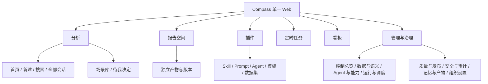
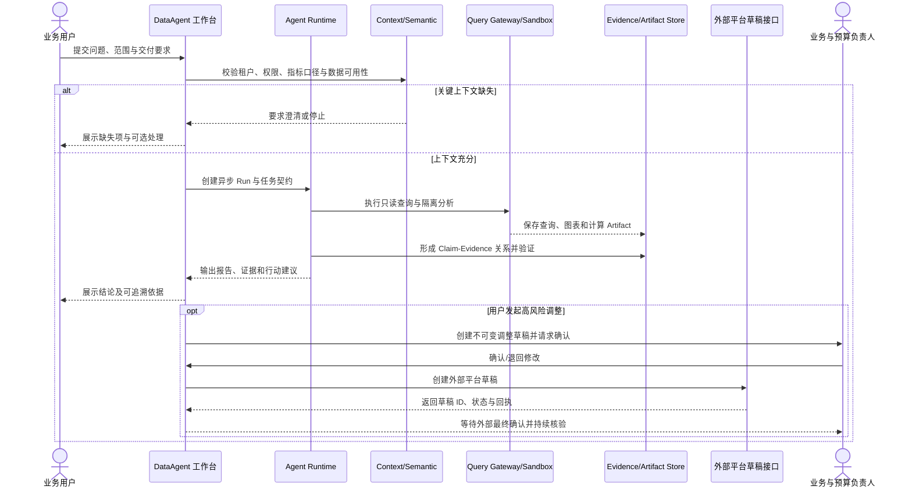
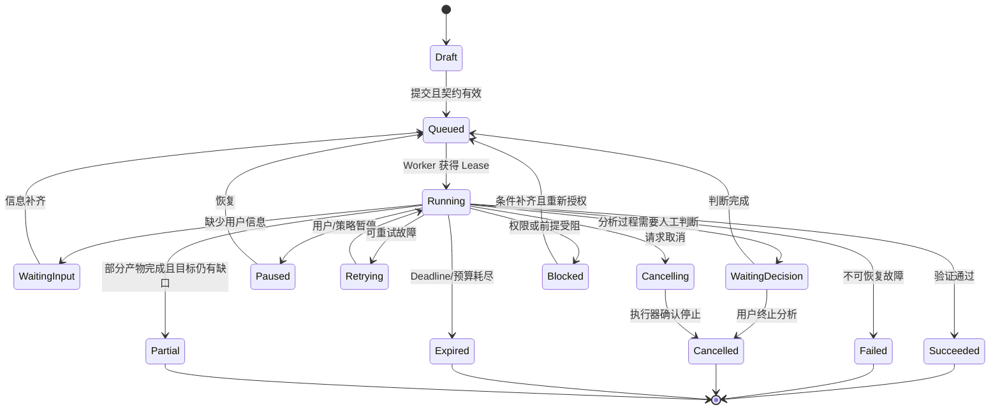
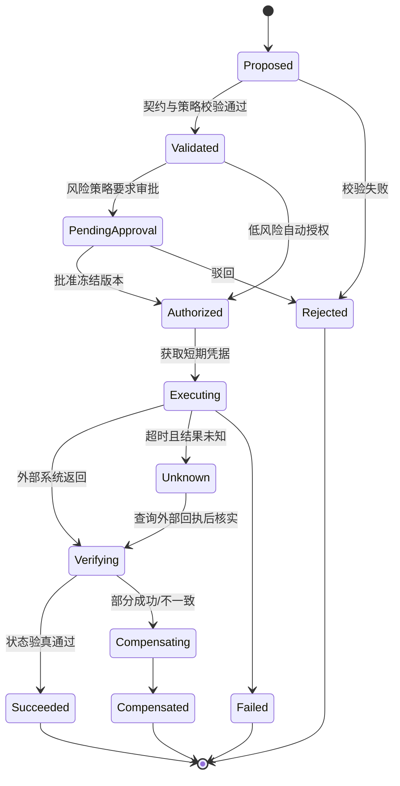
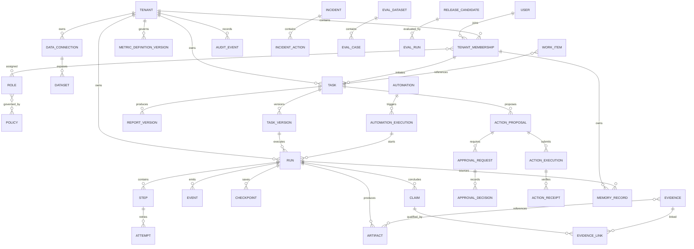

# Compass 产品需求文档（PRD）

> 返回：[产品定义](product-definition.md)
>
> 上游基线：[V5 正式课大纲](../../../../../../course/curriculum/v5/course_outline.md)
>
> 体验规格：[UI/UX 设计规范](../design/ui-ux-design-spec.md) · [HTML 原型](../design/prototype/index.html)

## 0. 文档控制

| 项 | 值 |
|---|---|
| 产品 | Compass：企业级多租户全渠道运动户外经营 DataAgent |
| 产品阶段 | 产品与体验基线 |
| PRD 状态 | `review` |
| 目标发布 | 教学基线 M0，持续演进至 M5 |
| 决策原则 | 证据优先、风险适配自动化、端到端多租户、可恢复、可评测 |
| 产品定义 | [product-definition.md](product-definition.md) |
| Feature / Profile | [999：Compass 产品立项与课程 Landing Page App](../BRIEF.md) / `standard` |
| 实际模板 | [Compass 标准 PRD 模板](../../_templates/PRD.tmpl.md)，本文件增量维护并保留既有 ID |
| 当前交付 | 完整产品规格、设计体系与可运行 HTML 原型；生产工程保持 M0 脚手架 |
| 验收唯一源 | 本 PRD；FR-01–16、原有 AC 保持 ID，新增源材料 ID 与 AC 见第 16–20 节 |

文中 `[推断]` 或 `[设计提案]` 表示尚未经过业务试点验证的产品决策。状态 `review` 表示交付可评审规格，尚无人类批准。

### 0.1 输入、优先级与兼容

1. 用户于 2026-10-20 明确：最终只有一个 Web 系统；支持多岗位、多角色与灵活功能授权；普通用户以 ChatGPT 式 AI Native 交互工作，部门管理与管理控制台共用系统；本次自主完成 PRD 与全部功能雏形。
2. [行业设定](../context/product_definition_industry.md) 规定主例为行野运动集团、中国市场、SPU/SKU、全渠道、多岗位和可对账的统一合成数据。品牌与规模是课程设定。
3. [系统需求](../context/product_definition_system2.md) 提供 12 类任务与 UX/AG/TS/HI/AR/RT/AD 共 108 项功能边界。
4. 既有产品定义、FR-01–16、AC 与 NFR 的有效要求保留；本次对自动执行、管理权限、任务场景、产物生命周期和前端信息架构做定点修订。
5. 用户后续确认双层侧栏：左侧窄图标栏；二级展开占位、收起隐藏、悬停浮层。业务一级入口固定为分析、报告空间、插件、定时任务、看板，另保留管理与治理。分析二级承载完整会话列表、搜索与排序，点击独立会话可恢复历史并续聊。本条覆盖上一轮平铺侧栏的界面约定。
6. 用户进一步确认：分析场景的中间区域保持完整对话，分析摘要、工具记录、输出、行内产物、消息操作、人工授权和底部输入共同组成工作区。案例说明与演示控制集中到右侧临时“演示面板”。会话搜索改为侧栏标题区图标打开的 Alfred 式弹窗；会话列表采用单行标题、状态标记与悬停/聚焦操作。

原文引用的 DOCX 未在 Feature 中提供；仅核验上述 Markdown。UX、HI、AR、RT 中部分编号的逐项标题由本文按原文段落规范化。原文“83 项基础、19 项场景必备、6 项增强”没有逐项对应表，本文使用自己的可核验级别定义，不宣称恢复原 DOCX 的逐项分级，也不据此删减功能。

### 0.2 本次变更与既有 AC 兼容

| 旧约定 | 本次有效规则 | 影响 ID |
|---|---|---|
| 三个固定角色空间、全部能力配置仅平台可用 | 同一应用的岗位模板与能力权限可组合；租户能力维护与平台 Provider 权限分离 | FR-01/02/10/11/16 |
| 任务提交前固定逐项确认 | 可信上下文自动补齐；仅实质歧义、重要取舍、新增授权请求决定 | AC-03.2/03.3、HI-01–10 |
| 异常必须人工确认后调查 | 已批准的监控规则可自动触发授权内调查；写入与扩大范围单独判断 | AC-03.7、AD-38 |
| M0 预置看板限制 | M0 生产切片限制保留；完整产品与本轮原型覆盖 S12 参数化应用与发布 | FR-15、S12 |
| 单一运行完成状态 | Run 结果区分受阻、部分完成、失败与取消；产物另外保留五维状态 | RT-01/05、AR-03 |
| 文字平铺侧栏与场景级任务入口 | 窄图标一级栏、可固定/浮动二级栏；按 taskId 打开完整会话，报告/插件/看板独立空间 | FR-02/03/05/15/17、AC-NAV、AC-CHAT |
| 场景说明与演示动作占据会话正文 | 中间保留正式对话交互；案例信息、自动播放与手动状态进入临时右侧演示面板 | FR-03/04/07、AC-CHAT-10–12、AC-DEMO |
| 侧栏常驻搜索框、双行会话条目 | 标题区图标打开全文搜索弹窗；单行会话附运行/待授权/未读状态，并支持改名、软删除与撤销 | UX-02、AC-SEARCH、AC-CHAT-07–09 |

既有技术架构、工程脚手架和历史验证记录不因本次文档更新自动视为实现完成。技术设计需同步新的任务对象、权限能力、五类决定和产物五维状态。

## 1. 需求概述

### 1.1 背景

零售经营问题往往需要跨订单、商品、库存、会员、广告和售后系统完成多步骤分析。传统 BI 擅长固定报表，通用对话助手擅长生成文本，但二者都难以单独完成“理解口径—规划分析—查询计算—核验证据—建议行动—审批执行—效果跟踪”的完整闭环。

DataAgent 要把这一闭环建设为企业可采用的产品，也要作为课程中 LLM Runtime、Agent Runtime、Context、Tool/Skill、Memory 和 EvalOps 的统一实践对象。

### 1.2 产品目标

| 编号 | 目标 | 衡量方式 |
|---|---|---|
| G-01 | 缩短复杂经营问题从提出到可信结论的时间 | 相比人工基线中位时长降低 ≥ 50% `[推断]` |
| G-02 | 让关键经营结论可核验、可追溯 | 关键 Claim 有效证据覆盖率 ≥ 95% |
| G-03 | 让 Agent 能安全连接真实业务系统 | 跨租户泄漏与未审批高风险执行均为 0 |
| G-04 | 让长任务可运营、可恢复、可解释 | 关键 Run 均有 Timeline；故障注入恢复成功率 ≥ 99% `[课程目标]` |
| G-05 | 让产品能力可以在课程中渐进演进 | M0–M5 每阶段都有业务可见增量与独立验收证据 |
| G-06 | 让每次 Agent 版本变更可比较、可回归 | 候选版本均产生版本元组、Eval 报告和门禁结果 |

### 1.3 范围

#### In Scope

- B2B Web SaaS，支持企业租户、组织成员、角色与策略；
- 自然语言经营问题、任务澄清、分析计划与异步 Run；
- 订单、商品、库存、会员、广告、售后数据查询；
- 指标语义、维度、血缘、新鲜度、数据质量与权限治理；
- 只读 SQL Query Gateway 与隔离 Python Sandbox；
- 证据包、Claim-Evidence、报告、图表与 Artifact；
- 行动提案、风险分级、具体执行授权、幂等交接、回执与效果跟踪；原型均为模拟；
- 周期报告与异常监测；
- 多模型路由、预算、配额、Trace、Replay、Eval 与发布门禁；
- 受治理的用户偏好和历史任务引用记忆；
- 正常、故障、演进三类演示链路。

#### Out of Scope

- 替代数据仓库、BI、主数据、广告平台或工单系统；
- 模型直连生产数据库或长期持有生产凭据；
- 无审批执行高风险资金、价格、预算、库存写入；
- 法定财务、税务或审计报告的自动签发；
- 通用无行业边界的 Agent Builder；
- 原生移动客户端；复杂配置只要求桌面端；
- 跨租户训练或默认使用客户数据训练模型。

### 1.4 用户角色与场景

| 角色 | 代表场景 | 期望 |
|---|---|---|
| 经营负责人 | 查看异常、批准策略、跟踪行动效果 | 一屏理解发生了什么、证据是否充分、下一步做什么 |
| 业务分析师 | 发起诊断、审查计划、下钻 SQL/Artifact | 控制分析边界并复用 Agent 的执行力 |
| 运营/商品/广告经理 | 获取建议、发起工单、调整策略 | 建议能进入真实协作与执行系统 |
| 审批人 | 审核预算或业务写入 | 看清变更差异、证据、影响和回滚方式 |
| 租户管理员 | 配置成员、权限、数据接入、指标口径与租户额度 | 策略可配置、越权可阻断、成本可管理 |
| 数据治理人员 | 维护指标、口径、血缘与质量 | Agent 只使用已批准且当前有效的语义 |
| 运维/审计人员 | 诊断失败、回放 Run、审查发布 | 过程可解释、事件可追责、问题可复现 |
| 平台管理员 | 运营多个租户、Runtime、Provider 和接入服务 | 跨租户看健康与容量，但不能越权读取租户业务内容 |

### 1.5 设计前提

- 默认使用桌面 Web，目标视口 1440×900；支持 375、768、1024、1440 px 响应式断点。
- 数据查询与真实动作由确定性服务执行，模型只生成提议或受约束参数。
- 原型使用行野运动集团及两个隔离租户的合成演示数据；规模设定、预测、实验结果与界面操作均服务原型评审。
- 生产架构允许从模块化单体演进到分布式服务，PRD 定义的领域契约不随部署形态改变。

## 2. 产品信息架构

同一应用共享认证、租户、工作区和审计。一级窄图标栏组织五个业务入口：**分析、报告空间、插件、定时任务、看板**；获权用户另见“管理与治理”。八个管理领域收在该入口的二级导航。场景库与待我决定位于分析二级，设计指南位于导航底部。

### 2.1 一级、二级与页面路由

| 页面 ID | 一级 / 二级位置与路由 | 目标与主要对象 | 关联 |
|---|---|---|---|
| P-00 | 全局身份与租户/岗位选择 | 当前主体、授权范围与体验身份 | FR-01、AD-01–05 |
| P-01 | 分析首页 `#analysis` | 居中输入框、上下文与聚合经营看板案例 | FR-02、UX-01 |
| P-02 | 分析二级“全部会话” → `#chat/<taskId>` | 独立会话的完整历史、计划、步骤、决定、产物及续聊 | FR-03、UX-02–04 |
| P-03 | 看板 `#boards` | 独立的团队看板、筛选、查询绑定、刷新与发布版本 | FR-15、S12 |
| P-04 | 报告空间 `#reports` 与会话内产物 | 答案、图表、表格、代码、报告、证据与五维状态 | FR-05、AR-01–12 |
| P-05 | 分析二级“待我决定” `#review` | 五类决定、证据、对象版本与处理动作 | HI-01–10 |
| P-06 | 管理与治理 → 记忆与产物 `#memory` | 来源、作用域、纠错、失效与保留 | AD-30–35 |
| P-07 | 管理与治理 → 组织设置 `#organization` | 成员、角色、模块/动作/数据范围授权 | AD-01–05 |
| P-08 | 管理与治理 → 数据与语义 `#data` / 数据源标签 | 连接、凭据引用、元数据、刷新与质量 | AD-06/07/10 |
| P-09 | 管理与治理 → 数据与语义 `#data` / 指标标签 | 指标、公式、血缘、版本与可信查询 | AD-08/09 |
| P-10 | 管理与治理 → Agent 与能力 `#capabilities` | 能力配置、工具策略、模型、沙箱与发布候选 | AD-11–15 |
| P-11 | 管理与治理 → 控制总览 `#admin-overview` / 运行与调度 `#runs` | 运行健康、排队、配额、预算、恢复与运营配置 | AD-19–25 |
| P-12 | 管理与治理 → 质量与发布 `#quality` | 评测集、组合版本、门禁、发布与回滚 | AD-26–29 |
| P-13 | 分析二级“待我决定”与通知 | 处理人、决定版本、时效与协作 | HI-03–10 |
| P-14 | 定时任务 `#automations` | 固定报告、重新分析、监控定义与每期结果 | AD-36–38、S10/11 |
| P-15 | 管理与治理 → 安全与审计 `#security` | 策略、审计、传播控制与敏感载荷 | AD-16–18/24/34 |
| P-16 | 管理与治理 → 运行与调度 `#runs` / 运行详情 | 异常、停止、恢复、事件与处置回执 | FR-08/14/16 |
| P-17 | 报告空间 `#reports` | 脱离会话的产物检索、版本、复算、刷新与传播 | AR-01–12 |
| P-18 | 分析二级“场景库” `#scenarios` | 十二类场景模板；选择后创建/打开独立会话 | S01–12 |
| P-19 | 管理与治理二级 | 八个原管理入口，按权限显示 | AD-01–38 |
| P-20 | 导航底部 `#design` | 设计体系、组件与原型边界 | UI-01–08 |
| P-21 | 插件 `#plugins` | Skill、Prompt、Agent、模板、数据集的发现、详情与复用 | FR-17、TS-08–10、AD-35 |

### 2.2 导航状态与默认行为

- 一级图标栏始终保持窄形态；图标具备可访问名称，悬停和键盘聚焦显示标题。当前一级与当前二级均有选中状态。
- 桌面默认固定展开二级栏，二级栏占据布局空间。收起后二级栏隐藏并释放空间；主内容保留一级栏占位。
- 二级收起时，悬停一级图标临时显示对应二级浮层，主内容宽度保持稳定。指针可从一级移入二级操作，移开后浮层关闭；“固定展开”将浮层转换为占位栏。
- 键盘聚焦可预览二级，方向键进入列表，Escape 关闭浮层并返回触发图标；触屏通过点击完成相同操作，不依赖悬停。
- 点击“分析”进入默认首页，输入框居中，下方聚合授权内经营看板案例与继续工作入口。进入任何会话后仍可通过分析首页或新建按钮返回。
- 导航切换只切换视图，不重建已有会话、不丢弃消息或运行状态。无权模块同时从固定栏、浮层、搜索和直接路由访问中受控。

### 2.3 会话列表与完整性

分析二级顶部保留“新建分析”；搜索使用标题区图标，紧邻折叠按钮左侧。点击图标或按 Cmd/Ctrl+K 打开 Alfred 式搜索弹窗，焦点进入搜索框。搜索覆盖授权内会话标题及完整消息记录，结果显示标题与匹配片段；↑/↓选择、Enter 打开独立会话、Escape 关闭并恢复触发焦点。无匹配时提供清除搜索；无权和已软删除会话不进入结果。

会话列表覆盖当前用户授权范围内全部有效会话，默认按更新时间倒序，可切换按主题分组。每条会话保持单行标题，超长截断并提供完整标题；右侧用加载标记表示运行中，用高亮“待授权”标记表示待执行授权，用蓝点表示未读更新。状态具有可访问文字，打开会话后清除对应未读状态。hover 或键盘 focus 显示改名和删除，触屏提供可点击的等价入口。

改名只更新会话标题，不改变 taskId、消息或产物关系；空标题不保存。删除采用软删除，从列表和搜索隐藏，提供撤销；取消删除不变更记录。删除当前会话后回到分析首页，直接访问已删除会话不继续显示历史内容。通过侧栏撤销后恢复原 taskId 和历史，仍检查当前权限。报告空间中的独立产物继续保留，审计与运行取消各自遵循原契约；删除会话不自动取消运行。

每个新会话使用独立 `taskId`，路由为 `#chat/<taskId>`。S01–S12 是方法模板编号；同一模板可产生多个独立会话。会话持有自身问题、消息时间线、任务契约、运行/步骤、决定、产物及版本引用。新建会话不继承上一会话的完成态、授权、人工修改或产物。点击历史会话展示完整用户/Agent 往来与过程事件，可在原上下文继续提问；新消息只追加到选中会话。刷新、前进/后退和页面切换后仍按 `taskId` 恢复。

原型可以在空工作区提供三个明确标注的合成会话示例。旧浏览器状态迁移为独立会话后保留消息与结果，迁移不新增授权。权限收缩后隐藏越权会话内容，原历史范围保留，不能通过改写区域标签使旧内容重新可见。

### 2.4 兼容路由与权限过渡

`#home` → `#analysis`；`#assets` → `#reports`；`#tasks` → 分析会话列表；`#scenario/S01` 至 `S12` 作为兼容场景入口解析到对应模板或独立会话，不再把场景编号当唯一会话 ID。已有管理路由、`#review`、`#scenarios`、`#design` 保留，只改变导航层级。旧深链接不得显示空白页或覆盖其他会话。

本轮原型的报告空间、插件与看板暂共同消费既有 `assets` 模块授权；其编辑、导出、发布及数据范围继续单独检查。产品规划保留三个空间的独立模块授权，后续技术实现拆分能力键并迁移旧授权。在该迁移完成前，不宣称三者已可独立授权。管理与治理保留各领域能力与独立写动作控制。

### 2.5 正式会话工作区与临时演示工具

正式会话按时间顺序呈现用户输入与 Agent 消息。每条 Agent 消息可包含可展开的“分析过程”（thinking）、输出正文、行内产物卡、引用与消息操作。分析过程完整呈现已记录的目标、方法摘要、工具输入/输出引用、状态、证据与修订，支持逐项展开；展示范围限于可检查的分析摘要和执行记录，模型私密原始思维链不纳入产品数据。工具成功、失败、取消和未执行必须可区分。

图表、表格、代码、证据和报告以行内产物卡连接独立对象与版本，展开后仍可返回对应消息。消息复制、反馈等动作有可观察结果；重试和续聊保留既有历史及人工修改。底部输入持续服务当前 taskId，等待授权时仍可补充信息，受控执行必须等授权卡产生有效决定。授权卡在中间对话中显示动作、对象版本、数据/受众范围、预算、有效期和确认/拒绝动作，按 HI 契约校验并记录，不依赖演示按钮。

原型专用的右侧“演示面板”容纳六个重点任务的完整静态演示；普通会话另在折叠区保留 S01–S12 的旧流程和边界状态控件。该面板属于本轮评审辅助工具，退出条件是迁入正式产品；生产界面与功能范围不包含此面板。>1180 px 使用右侧常驻面板；≤1180 px 使用默认收起的右侧抽屉，由会话右上按钮打开，遮罩、Escape 或关闭按钮关闭，焦点进入抽屉并在关闭后返回。收起面板后完整对话、产物和人工决定仍可独立工作。自动演示只推进本地合成事件，暂停保留已生成过程；手动切换只影响选定的本地演示会话。自动模拟人工授权须在面板内明确提示，并在记录中保留模拟标记，不授予真实权限或触发外部动作。生产工作流中的授权始终由获权用户或已登记的持续授权策略处理。

## 3. 关键业务流程

### 3.1 经营分析主流程

### 3.2 Run 状态机

### 3.3 Action 状态机

下图为完整产品的受控动作契约。M0 只模拟/交接外部草稿；真实写入与补偿需要后续能力启用和具体授权。界面区分草稿提交、外部最终生效与结果未知，补偿能力不得被解释为所有外部操作都可回滚。

## 4. 功能需求总览

| 编号 | 功能域 | 优先级 | 目标里程碑 | 说明 |
|---|---|---|---|---|
| FR-01 | 多租户身份与权限 | P0 | M0→M5 | Tenant/Principal/Role/Policy 与端到端授权 |
| FR-02 | AI Native 分析首页 | P0 | M0 | 意图输入、推荐问题、模板、待处理队列与最近上下文 |
| FR-03 | 会话历史与分析工作台 | P0 | M0 | 完整会话、Task Contract、指派、状态、Review、跟进与深度分析 |
| FR-04 | 自主分析与可控执行 | P0 | M0→M2 | 计划、查询、Sandbox、验证、预算、停止 |
| FR-05 | 报告、证据与 Artifact | P0 | M0→M3 | 可核验 Claim-Evidence 与可分享报告 |
| FR-06 | 调整草稿与受控行动 | P1 | M0→M3 | M0 外部草稿交接；M3 后按证据评估受控执行 |
| FR-07 | 周期任务与效果跟踪 | P1 | M2 | 周报、异常监测、后续行动效果 |
| FR-08 | Run、Trace 与故障恢复 | P0 | M1→M2 | Timeline、Checkpoint、Resume、Replay、Fork |
| FR-09 | 数据与经营语义治理 | P0 | M0→M3 | Connector、Metric、Lineage、Quality、Query Gateway |
| FR-10 | 能力、工具与凭据治理 | P0 | M3 | 租户能力维护者与平台管理员按作用域治理 Tool/Skill/Workflow/MCP |
| FR-11 | 模型路由、预算与配额 | P0 | M1 | 平台提供模型与区域约束，获权租户维护者配置允许模型内的路由和上限 |
| FR-12 | 受治理 Memory | P1 | M4 | 写入、召回、查看、修正、删除与防污染 |
| FR-13 | EvalOps 与受控发布 | P0 | M5 | Dataset、Fixture、Grader、Gate、Canary、Rollback |
| FR-14 | 审计、安全与运营控制 | P0 | M1→M5 | 审计、告警、Kill Switch、保留与导出 |
| FR-15 | 看板与持续监控 | P1 | M0→M3 | M0 团队预置看板和分析转监控草稿；通用 Builder 需使用证据后再立项 |
| FR-16 | 平台运营与监控 | P0 | M1→M5 | 多租户健康、Runtime/依赖、容量成本、告警与处置 |
| FR-17 | 分析插件空间 | P1 | 原型→后续实现 | Skill、Prompt、Agent、模板、数据集的发现与复用；治理仍由能力控制台负责 |

## 5. 功能详述

### FR-01 多租户登录、身份与权限

**用户故事**：作为租户管理员，我希望成员只访问被授权的数据、工具和操作，以便在共享平台上安全使用 Agent。

**业务规则**：

- Tenant Context 只能由认证与授权层建立，不能由 Prompt、模型输出或普通前端字段覆盖。
- 支持企业 SSO/OIDC/SAML、MFA、Session 生命周期和多组织工作空间选择；本地账号仅用于演示或受控应急 `[推断]`。
- 同一 Principal 可加入多个 Tenant 并拥有不同角色；登录后先选择/恢复上次授权工作空间，不自动合并跨租户数据。
- 所有领域对象必须包含 `tenant_id`；用户级对象还必须包含 `principal_id`/`owner_id`。
- 支持可组合 RBAC 模板与能力权限；岗位、角色、用户允许项取并集，再与租户/工作区边界及数据范围相交；显式拒绝和强制策略优先。支持区域、品牌、渠道、门店、指标、行、列、工具、环境和风险等级约束。
- 租户切换必须重新获取 Session/授权上下文并清空前一租户的本地缓存、筛选与未提交草稿。

**交互说明**：全局顶栏展示当前租户与环境；切换租户前显示确认，切换完成后用非颜色提示显示新上下文。

**验收标准**：

- [ ] AC-01.1 用户无法通过修改请求体中的 `tenant_id` 读取其他租户对象。
- [ ] AC-01.2 无权访问的数据源、字段、工具和导航项默认不展示，直接访问仍由服务端拒绝。
- [ ] AC-01.3 任意 Run、Artifact、Memory、Action、Trace 均可追溯到 Tenant 与 Principal。
- [ ] AC-01.4 角色/策略变更在下一次动作派发与结果返回授权检查时生效；界面权限缓存传播目标 ≤ 30 秒 `[设计提案]`，不能用缓存窗口继续执行已撤销权限；活跃 Run 重新授权或安全停止。
- [ ] AC-01.5 自动化负向测试覆盖缓存、队列、对象存储、向量索引、日志和导出边界。
- [ ] AC-01.6 登录、MFA、Session 过期、租户选择、角色切换、退出和紧急撤权均有可测试流程与审计。
- [ ] AC-01.7 租户管理员可创建角色、组合资源/动作/数据范围权限，并在发布前预览受影响用户与能力。

### FR-02 AI Native 分析首页

**用户故事**：作为普通业务用户，我希望登录后第一屏就能描述经营问题，并获得与我的角色、租户和最近工作相关的推荐问题，以便不需要先理解系统菜单就能开始分析。

**业务规则**：推荐问题由角色、当前租户、授权数据域、异常信号、周期任务和最近上下文生成；不能推荐用户无权访问的数据或动作。首页下半区聚合当前授权范围的经营看板案例、待处理对象与继续工作入口；问题输入保持首要视觉层级。

**交互说明**：分析首页采用居中大尺寸问题输入框，支持引用指标、看板、报告、数据源和文件；其下聚合可点击经营看板案例。完整会话列表、新建和搜索置于分析二级栏；场景库、待我决定作为该栏的次级入口。

**验收标准**：

- [ ] AC-02.1 页面首屏在 1440×900 中完整展示问候、输入框、作用域、推荐问题和主要提交动作。
- [ ] AC-02.2 用户可从自然语言、推荐问题、模板、异常卡、看板组件或历史报告创建 Task Contract 草稿。
- [ ] AC-02.3 推荐问题只引用当前用户有权访问的指标、数据源与动作，并说明推荐来源。
- [ ] AC-02.4 首页聚合经营看板案例与继续工作入口；待 Review、待确认、待审批、待补充信息和跟进对象由分析二级“待我决定”与通知可达，按紧急度/影响排序。
- [ ] AC-02.5 用户可继续最近任务、固定常用问题、隐藏不相关推荐并反馈推荐质量。
- [ ] AC-02.6 导航由有效能力授权决定；向同一分析师增加租户级 Skill 管理权限后显示对应入口，撤销后隐藏且直接访问被拒绝；平台级 Provider 配置仍需独立权限。

### FR-03 会话历史与分析工作台

**用户故事**：作为业务分析师，我希望统一管理我发起、被指派、等待我 Review 和由周期任务触发的分析，并在需要时进入深度工作台，以便长期任务不会散落在聊天记录中。

**业务规则**：Task Contract 至少包含目标、范围、指标、时间、约束、交付物、完成条件、预算与授权上下文；关键项缺失必须澄清。

**交互说明**：分析二级提供全部授权会话、顶部新建、标题区搜索图标与弹窗、更新时间排序或主题分组。单行会话显示运行、待授权和未读状态，支持改名、软删除与撤销。详情使用独立 taskId，在中间展示完整用户/Agent 历史、可展开分析摘要与工具记录、行内产物、消息操作、人工授权和底部输入。任务的 Owner、SLA、团队与定时来源仍作为筛选和详情属性；Task Contract、计划与方法说明在对话中按需展开。案例介绍和状态演示只进入临时右侧面板，正式授权按 HI 规则处理。

**验收标准**：

- [ ] AC-03.1 用户可输入问题、选择时间/区域/渠道、附加文件或引用已有报告。
- [ ] AC-03.2 只对影响结果的歧义或关键缺项请求澄清，可信上下文中的币种/时区自动补齐；无权限请求进入受阻并提供申请或缩小范围入口。
- [ ] AC-03.3 提交时提供可展开、可编辑的 Task Contract 与成本/时长区间；授权范围明确的常规查询直接运行，重大方法/成本取舍依策略请求计划对齐。
- [ ] AC-03.4 提交后创建全局唯一 Run ID、固定任务版本并返回异步状态。
- [ ] AC-03.5 用户可以取消、暂停或在允许的节点修改范围；修改后生成新任务版本并保留差异。
- [ ] AC-03.6 任务可指派 Owner/Reviewer、设置优先级、SLA、标签、依赖、周期触发器和通知渠道。
- [ ] AC-03.7 已发布监控规则可在持续授权内自动创建调查，异常去重并记录触发来源；扩大数据/费用范围或执行外部动作时单独检查授权。

### FR-04 自主分析与可控执行

**用户故事**：作为分析师，我希望 Agent 自主规划并执行多步骤分析，但在预算、权限和停止条件内运行，以便获得效率而不失去控制。

**业务规则**：

- 整体采用 Autonomous First 的 Hybrid 混合架构：Autonomous Harness 主导开放分析的规划、工具选择与重规划；确定性流程承载授权检查、执行约束、人工决定与产物提交。Agent Loop 按任务组合 Plan and Execute、ReAct 与 Multi-agent；委派任务受共享任务契约、证据口径与预算约束。
- 计划包含步骤目标、工具、输入、验证方法、预算和完成状态；Replan 必须记录原因。
- SQL 必须经 Query Gateway 解析、授权、只读校验、限制扫描与结果脱敏；Python 仅在隔离 Sandbox 内运行。
- 达到答案充分、信息不足、预算耗尽、Deadline、策略阻断或用户取消任一条件时停止。

**交互说明**：工作台展示计划、当前步骤、预算使用、证据数量与停止原因；用户可展开技术细节但默认看到业务语言。

**验收标准**：

- [ ] AC-04.1 计划按场景包含口径、实际计算、校验与对应交付；S01 可直接回答，S05/S06 必须展示分析分支和验证节点，禁止为快速问数制造无意义步骤。
- [ ] AC-04.2 每个 Step 都有输入、输出、Attempt、状态、耗时、成本和验证结果。
- [ ] AC-04.3 危险 SQL、越权字段、超出扫描预算的查询在执行前被阻断。
- [ ] AC-04.4 Sandbox 无默认生产凭据，网络、文件、CPU、内存和执行时长受策略限制。
- [ ] AC-04.5 重试、降级和 Replan 不得突破总预算、自主性预算与 Deadline。
- [ ] AC-04.6 无充分证据时系统输出“未证实/需要更多信息”，不得伪造确定结论。

### FR-05 报告、证据与 Artifact

**用户故事**：作为经营负责人，我希望每个关键结论都能下钻到口径、数据和计算过程，以便判断是否采纳。

**业务规则**：报告区分观测结果、解释假设和建议；只有会影响决策的关键判断需要显式关联数据依据。数据核对通过只证明来源、范围和计算可复现，不自动证明因果。除非存在实验、准实验或明确识别策略，不得使用“导致、主因、已证实因果”等措辞，也不得生成无法解释的统一可信度分数。

**交互说明**：报告采用“结论正文 + 证据侧栏/抽屉”；证据卡显示来源、覆盖范围、计算、状态和 Artifact 链接；技术用户可查看 SQL、参数和 Python 产物。

**验收标准**：

- [ ] AC-05.1 诊断报告包含摘要、变化、贡献排序、候选解释、证据、限制和下一步；其他产物遵循 S01–S12 的完成标准，相关变化不自动写成因果。
- [ ] AC-05.2 关键判断分别显示数据检查状态 `已核对/有缺口/已过期/相互矛盾` 与判断强度 `结果支持/支持有限/暂无支持/无法判断`。
- [ ] AC-05.3 Evidence 可追溯到数据源、查询/代码、版本、时间、新鲜度、质量和生成它的 Step。
- [ ] AC-05.4 大型表格、图表、SQL 结果和日志存入 Artifact Store，通过引用加载。
- [ ] AC-05.5 导出/分享遵循当前租户权限与脱敏策略，并记录审计事件。
- [ ] AC-05.6 报告可生成行动提案，但不能直接触发高风险副作用。

### FR-06 调整草稿与受控行动

**用户故事**：作为业务负责人，我希望在提交调整草稿前看清对象、变更差异、依据、限制和有效期，并由外部系统中有权限的人最终发布。

**业务规则**：

- M0 只创建广告预算调整草稿并交接到外部广告平台；DataAgent 不直接使预算生效。
- 草稿包含参数、目标、数据依据、估算假设、有效期和固定版本；修改后原确认立即失效。
- DataAgent 只承诺草稿提交的幂等与回执。外部系统是否发布通过回调或查询确认，不能把接口成功写成业务生效。
- 短期表现低于观察阈值时创建复核任务并提醒负责人，不自动依据 ROAS 改动预算。

**交互说明**：调整草稿详情强调变更前后、估算假设、数据依据和限制；“提交草稿”与“退回修改”不只用颜色区分，提交前要求二次确认。

**验收标准**：

- [ ] AC-06.1 提交草稿前不产生真实预算变更。
- [ ] AC-06.2 草稿被修改后原确认失效，必须重新确认新版本。
- [ ] AC-06.3 详情展示对象、差异、估算假设、数据依据、有效期和外部发布责任人。
- [ ] AC-06.4 提交草稿前检查版本、权限、连接状态和业务前置条件。
- [ ] AC-06.5 重复请求只产生一个外部草稿；结果通过外部对象状态而非接口“成功”字段验真。
- [ ] AC-06.6 退回、过期、提交失败和外部未发布均有明确状态、原因与审计记录。

### FR-07 周期任务与效果跟踪

**用户故事**：作为经营负责人，我希望定期收到经营报告和异常提醒，并看到上次行动是否有效，以便形成持续改进闭环。

**业务规则**：周期任务每次运行均生成独立 Run，检查当期权限并使用报告定义绑定的语义版本；语义版本不再适用时暂停并请求修订定义。持续授权必须仍有效，不得复制上一期实时结论冒充本期结果。

**验收标准**：

- [ ] AC-07.1 支持按日/周/月与租户时区配置报告或异常监测。
- [ ] AC-07.2 每次执行保存触发器、数据快照版本、权限、策略和输出。
- [ ] AC-07.3 失败、延迟、数据未就绪和预算不足通过指定渠道通知所有者。
- [ ] AC-07.4 行动可设置基线、目标指标、观察窗口和归因限制，并展示效果状态。

### FR-08 Run、Trace 与故障恢复

**用户故事**：作为运维人员，我希望查看一次 Run 的状态、事件和失败原因，并能按规则恢复或回放，以便处理长任务和生产故障。

**业务规则**：Run/Step/Attempt/Event/Checkpoint 采用统一执行模型；Retry、Resume、Replay、Fork 语义必须区分；副作用边界后不得通过普通重试重复提交。

**交互说明**：Run 列表支持状态、租户、任务类型、版本和时间筛选；详情为业务摘要、Timeline、资源、Context/Tool/Model Trace 和事件原文多层渐进展示。

**验收标准**：

- [ ] AC-08.1 Run Timeline 记录状态变化、计划调整、模型调用、工具、审批、Checkpoint 和 Artifact。
- [ ] AC-08.2 崩溃后从最近一致 Checkpoint 恢复，不重做已提交 Action。
- [ ] AC-08.3 Lease/Heartbeat 防止两个 Worker 同时拥有同一执行权；失联后可接管。
- [ ] AC-08.4 用户能看到失败发生在哪一步、是否可恢复、已消耗资源和推荐处理方式。
- [ ] AC-08.5 Replay 使用固定 Fixture 和版本；Fork 生成新 Run 并保留父子关系。

### FR-09 数据与经营语义治理

**用户故事**：作为数据治理人员，我希望统一管理指标定义、数据权限、血缘、质量和新鲜度，以便 Agent 在查询前理解业务并只使用可信数据。

**业务规则**：同一时间和范围内只能有一个默认有效指标版本；权限先于相关性；数据库元数据不能替代业务语义。

**验收标准**：

- [ ] AC-09.1 Data Connector 显示所有者、环境、凭据引用、同步状态、数据域和健康度。
- [ ] AC-09.2 Metric 定义包含名称、别名、公式、粒度、维度、时间/币种、版本、Owner 和状态。
- [ ] AC-09.3 用户可从指标查看数据血缘、质量规则、新鲜度 SLA 和访问策略。
- [ ] AC-09.4 指标发布需评审；冲突或过期版本不得静默进入 Context。
- [ ] AC-09.5 Query Gateway 强制只读、参数化、行列授权、扫描/时长限制、脱敏和审计。

### FR-10 能力、工具与凭据治理

**用户故事**：作为平台管理员，我希望注册和治理 Tool、Skill、Workflow、SubAgent 与 MCP 能力，以便只向 Agent 暴露当前任务所需且被授权的最小能力集。

**业务规则**：模型可见描述、Runtime 执行契约和治理策略分层；生产凭据由 Credential Broker 按请求签发，不进入 Prompt 或长期存储。

**验收标准**：

- [ ] AC-10.1 Capability Registry 记录类型、版本、Owner、权限、风险、SLO、环境和生命周期。
- [ ] AC-10.2 每个 Tool 有输入/输出 Schema、标准错误、幂等语义、超时和验证器。
- [ ] AC-10.3 系统按租户、角色、任务阶段和风险动态编译最小工具集。
- [ ] AC-10.4 MCP 接入执行认证、租户隔离、限流、版本锁定与 Tool Trace，而非只依赖协议 Schema。
- [ ] AC-10.5 Skill 变更必须运行对应 Eval，退化时阻断发布。

### FR-11 模型路由、预算与配额

**用户故事**：作为管理员，我希望按任务能力、成本、区域和租户策略选择模型，并限制用量，以便稳定运营。

**业务规则**：上层使用逻辑模型/任务配置，不写死物理模型名；一次 Logical Call 可包含多个 Attempt，但共享 Deadline、预算和输出契约。

**验收标准**：

- [ ] AC-11.1 Model Registry 记录 Structured Output、Tool Calling、Reasoning、Streaming 等能力与限制。
- [ ] AC-11.2 路由决策展示选型理由、候选、策略版本和降级路径。
- [ ] AC-11.3 Retry/Fallback 遵循错误分类、Deadline、预算和数据区域策略。
- [ ] AC-11.4 成本按租户、用户、Run、Step、任务类型和模型归集。
- [ ] AC-11.5 配额接近阈值时预警；超限后安全停止、降级或请求授权，不静默透支。

### FR-12 受治理 Memory

**用户故事**：作为业务用户，我希望 DataAgent 记住经我确认的报告偏好和历史任务引用，同时允许我查看、修正和删除，以便获得连续体验而不污染事实。

**业务规则**：禁止保存实时经营值、权威指标、原始敏感数据、凭据、模型推测与历史授权；向量索引只负责候选召回，最终使用必须回到权威记录并重新授权。

**验收标准**：

- [ ] AC-12.1 记忆写入经提取、标准化、证据、策略、用户确认、幂等与提交管线。
- [ ] AC-12.2 Recall 按租户、用户、类型、状态、权限、时效和任务 Step 过滤，再按价值排序。
- [ ] AC-12.3 用户可查看“记住了什么、为何记住、在哪里用过”，并可修正、失效或删除。
- [ ] AC-12.4 删除传播到主库、索引、缓存和下游，验证任务确认不再召回。
- [ ] AC-12.5 恶意文档、工具结果和未经确认的模型输出不能写入长期记忆。

### FR-13 EvalOps 与受控发布

**用户故事**：作为产品与平台负责人，我希望用可复现评测比较 Baseline 与 Candidate，并通过门禁、灰度和回滚控制发布，以便持续提升而不破坏安全与既有能力。

**业务规则**：代码、模型、Prompt、Context、Tool、Skill、Memory 与 Policy 组成完整版本元组；跨租户泄漏、未审批执行等硬门槛不可被平均分抵消。

**验收标准**：

- [ ] AC-13.1 Dataset 覆盖正常、长尾、数据缺失、工具故障、越权、审批拒绝和恢复场景。
- [ ] AC-13.2 Fixture 固定数据、时间、权限、依赖与版本，可复现 Baseline/Candidate 对比。
- [ ] AC-13.3 使用 Code、Environment、Trace 与校准后的 LLM Grader，支持 Multi-Trial。
- [ ] AC-13.4 Scorecard 同时展示质量、安全、成本、时延、稳定性和可恢复性。
- [ ] AC-13.5 Regression Gate 对硬门槛和关键能力执行阻断；结果关联失败 Trace。
- [ ] AC-13.6 支持 Shadow、租户级 Canary、Kill Switch 和完整行为版本回滚。

### FR-14 审计、安全与运营控制

**用户故事**：作为审计与运维人员，我希望关键配置、访问、审批、执行和发布都有不可抵赖记录及快速止损能力，以便满足企业治理要求。

**业务规则**：审计日志与普通应用日志分离；敏感字段脱敏；普通用户不可修改或删除审计事件。

**验收标准**：

- [ ] AC-14.1 记录登录、租户切换、授权拒绝、数据查询、导出、策略变更、审批、执行、记忆和发布事件。
- [ ] AC-14.2 每条事件包含时间、租户、主体、动作、资源、结果、关联 Run/Trace、来源与策略版本。
- [ ] AC-14.3 支持按权限检索与导出；导出本身产生审计事件。
- [ ] AC-14.4 Kill Switch 可按租户、能力、模型、Action 类型或版本关闭，且不破坏进行中状态的一致性。
- [ ] AC-14.5 告警能区分业务失败、依赖故障、安全事件、成本异常与质量退化。

### FR-15 看板与持续监控

**用户故事**：作为经营负责人，我希望查看团队预置看板，并把一次有价值的分析保存为持续监控，以便以后不必重复发起同一问题。

**业务规则**：M0 看板只能引用已授权、已版本化的指标或报告；从分析生成的监控先作为草稿，只允许修改名称、范围、频率和接收人。通用拖拽画布、任意组件生成和复杂发布权限不在 M0 范围。

**交互说明**：提供经营总览、营销效率和库存风险等团队模板；用户可从报告选择“持续关注”，检查范围、频率与接收人后保存监控草稿。

**验收标准**：

- [ ] AC-15.1 用户可查看团队看板并从任一指标带上下文发起分析。
- [ ] AC-15.2 用户可把完成的分析保存为监控草稿，设置名称、范围、频率和接收人。
- [ ] AC-15.3 草稿展示所用指标、筛选、数据时间和质量状态，发布前重新校验权限。
- [ ] AC-15.4 权限或指标版本变化后安全停止刷新并说明影响，不沿用历史授权。
- [ ] AC-15.5 M0 保留预置模板；完整产品 S12 支持参数化应用的编辑、查询绑定、验证与发布。通用任意拖拽 Builder 需另行需求依据，不影响 S12 验收。

### FR-16 平台运营与监控

**用户故事**：作为平台管理员或运维人员，我希望从跨租户运营视角查看 Runtime、模型、Sandbox、数据连接器、MCP、成本和安全健康，以便发现问题并在不读取租户业务内容的前提下处置。

**业务规则**：平台运营权限与租户业务权限分离；默认只展示元数据和聚合指标，任何 Break-glass 访问都需要理由、审批、时限和审计。

**验收标准**：

- [ ] AC-16.1 提供租户健康、Run 成功率/排队/恢复、Worker/Sandbox 容量、Provider、Connector、MCP 和成本看板。
- [ ] AC-16.2 告警可关联 Trace、租户、依赖、版本和 Run，但敏感业务输入/输出默认脱敏。
- [ ] AC-16.3 支持按租户/能力/模型/版本限流、隔离、暂停、接管和 Kill Switch，并展示影响范围。
- [ ] AC-16.4 平台运营数据支持 SLO、趋势、容量预测、成本分摊和异常归因。
- [ ] AC-16.5 所有处置动作有审批策略、操作回执和审计记录。

### FR-17 分析插件空间

**用户故事**：作为业务分析师，我希望在独立插件空间找到可复用的 Skill、Prompt、Agent、模板和数据集，并将它们用于当前或新分析，以减少重复配置。

**业务规则与交互**：`#plugins` 按五种类型筛选和搜索；详情说明用途、输入、方法前提、Owner/版本、依赖与权限范围。选择复用时保留所选对象引用并进入分析；受限内容和不可用依赖明确提示。生产能力配置、工具安装策略、模型路由、评测与发布继续由 `#capabilities` / `#quality` 管理。产品内“插件”指可复用分析资产，本轮不引入外部插件商店或收费分发。

**验收标准**：

- [ ] AC-17.1 五种类型均有可发现的示例与详情，搜索/分类结果对应选定条件，空态可恢复。
- [ ] AC-17.2 从插件发起分析保留插件 ID/版本/输入引用，并创建独立会话或追加到用户明确选中的会话。
- [ ] AC-17.3 复用插件不增加当前用户的数据、工具、导出或发布权限；受限项给出可执行处理路径。
- [ ] AC-17.4 报告空间、插件、看板在本轮共用 `assets` 的权限限制可检查；后续独立授权实现前不宣称三模块可分别配置。

## 6. 角色与权限矩阵

权限判定使用主体、租户/工作区、资源、动作、数据范围、环境及当前策略。功能可见性只表达当前授权的结果；服务端必须对 API、搜索、缓存、下载、日志和晚到结果再校验。原型用本地角色和权限编辑器模拟此规则，无法证明生产安全隔离。

### 6.1 岗位模板与可组合能力

| 岗位模板 | 默认范围与业务能力 | 可委派管理责任 | 默认排除 |
|---|---|---|---|
| CEO / 集团负责人 `executive` | 本企业经营汇总、分析、资产、复核与获权发布 | 经营目标、业务复核 | 凭据、平台配置、明细 PII |
| BA / 分析师 `analyst` | 授权数据内分析、代码/产物、看板、周期任务 | 获权语义或资产维护 | 自行扩权、未经批准外发 |
| 部门 / 区域经理 `manager` | 本部门/区域/渠道的分析与资产 | 团队成员范围、预算、复核与调度 | 超出部门数据、组织级强制策略 |
| 租户管理员 `admin` | 组织治理、授权分配、租户元数据 | 可向数据/Agent/运行维护者委派配置 | 默认业务明细、平台 Provider、跨租户 |
| 平台运行维护者 `operator` | 跨租户运行元数据、容量、依赖与恢复 | Provider、平台能力、版本及运行策略 | 默认租户业务输入、报告、SQL 结果 |
| 审计员 `auditor` | 获权范围的审计、策略与变更记录 | 审计导出；敏感内容需专门授权 | 更改角色、批准自身变更、运维写操作 |

岗位模板可以组合；例如 BA 兼部门负责人获得两个模板允许项，再受华东区域范围限制。租户管理员身份本身不授予读取业务产物；如需兼任业务用户，另授 `analyze`/`assets` 与相应数据范围。

| 能力组 | 独立动作 | 对应功能 |
|---|---|---|
| `analyze` | create/view/continue/cancel；代码执行额外受工具授权 | UX、AG、TS |
| `assets`（本轮聚合授权） | 报告空间/插件/看板共同入口授权；view/edit/recompute/export/share/publish 与数据范围分开检查；三个模块的独立授权留待后续迁移 | AR、S12、FR-17 |
| `automations` | create/test/enable/pause/transfer；指定执行身份 | S10/11、AD-36–38 |
| `review` | clarify/align/authorize/adopt/publish，按决定类型 | HI-01–10 |
| `admin-overview` | 租户或平台运行摘要读取 | AD-25 |
| `data` | connection/metadata/metric/query/quality 分别读写发布 | AD-06–10 |
| `capabilities` | agent/tool/skill/workflow/model/sandbox 分别读写发布 | AD-11–15 |
| `runs` | read/pause/cancel/resume/quota/budget，敏感载荷额外授权 | AD-19–23 |
| `quality` | dataset/evaluate/release/rollback，职责分离 | AD-26–29 |
| `security` | policy/audit/export/retention，配置与审计分权 | AD-16–18/24/34 |
| `memory` | 本人记录；团队提升/删除需额外权限 | AD-30–32 |
| `organization` | member/group/role/service-identity/lifecycle | AD-01–05 |

### 6.2 授权规则

- `BR-P01` 默认拒绝；允许项不能突破租户边界、平台强制策略、显式拒绝和当前行列范围。
- `BR-P02` 导航、按钮与数据范围分别计算。模块可见不自动授予所有操作；有权读报告不自动有权读底层明细、导出或发布。
- `BR-P03` 动态看板使用访问者身份查询；静态报告的内容范围与接收人授权须在分享前复核。发布权限不拓宽数据权。
- `BR-P04` 租户、角色和策略变更采用新授权上下文；派发前及返回结果前重新检查。强制撤权停止新动作，可取消调用尽力终止，迟到结果隔离。
- `BR-P05` 周期任务使用明确的用户/服务身份。Owner 离职或授权失效时暂停或经批准迁移，不能自动改用管理员身份。
- `BR-P06` 子 Agent 权限/数据/预算最多等于委派契约；工具安装、记忆召回、用户文件都不能扩大授权。
- `BR-P07` 模拟“切换岗位”用于原型体验，生产系统只允许切换已被授予的上下文。策略发布前展示用户与模块变化，撤销后即时清除原型缓存与不再允许的视图。
- `BR-P08` 平台 Break-glass 访问需具体对象、原因、批准、时限与审计；普通运维回放使用脱敏信息或 Fixture。

## 7. 数据需求

### 7.1 核心实体

### 7.2 关键字段

| 实体 | 必需字段（除通用 ID/时间戳） |
|---|---|
| Tenant | name, status, region, timezone, currency, policy_version |
| User | identity_ref, display_name, status |
| TenantMembership | tenant_id, user_id, role_ids, attributes, status |
| Role/Policy | tenant_id, name, version, bindings, status |
| Task/TaskVersion | tenant_id, owner_membership_id, objective, scope, metric_refs, state, version |
| WorkItem | tenant_id, object_type, object_id, assignee_id, due_at, state |
| Run | tenant_id, task_version_id, state, deadline, autonomy_budget, behavior_version |
| Step | run_id, type, objective, state, input_refs, output_refs, verifier_result |
| Attempt | step_id, executor_type, provider, started_at, ended_at, error_class, cost |
| MetricDefinition | tenant_id, name, aliases, formula, grain, dimensions, time_semantics, currency, version, owner, status |
| Evidence | tenant_id, source_ref, query_or_method_ref, freshness, quality, authorization_snapshot, integrity_hash |
| Claim | run_id, text, claim_type, data_check_state, judgment_strength, limitations |
| EvidenceLink | claim_id, evidence_id, usage, support_strength, limitations, version |
| ReportVersion | task_id, run_id, version, status, published_at |
| ActionProposal | tenant_id, run_id, type, target, immutable_payload, risk_level, expires_at, idempotency_key, version |
| ApprovalRequest/Decision | proposal_id, approver_id, state, decision, reason, decided_at, policy_snapshot |
| ActionExecution/Receipt | proposal_id, external_ref, state, observed_state, verified_at, compensation_state |
| Automation/Execution | tenant_id, owner_id, trigger, scope, state, last_run_id |
| AuditEvent | tenant_id, actor_id, action, resource, result, policy_version, trace_id |
| Incident/IncidentAction | scope, severity, state, impact, actor_id, action, result |
| MemoryRecord | tenant_id, owner_id, type, canonical_value, source_ref, evidence_ref, status, version, valid_until |
| BehaviorVersion | code, model, prompt, context_policy, tool, skill, memory_policy, routing_policy |

### 7.3 数据分级与保留 `[推断]`

| 级别 | 示例 | 默认控制 |
|---|---|---|
| Public | 产品帮助、公开指标说明 | 可公开读取 |
| Internal | 非敏感配置、合成 Demo 数据 | 租户内最小权限 |
| Confidential | 经营数据、报告、Artifact | 加密、细粒度授权、下载审计 |
| Restricted | PII、凭据、审批与安全事件 | 强隔离、字段脱敏、短期访问、严格保留 |

保留期按租户政策配置；Trace 与 Artifact 不得无限期默认保留。删除必须覆盖受控主存储、缓存、索引、备份生命周期和受控下游副本，并生成可验证回执。已导出的离线副本通过传播记录和责任人管理，不承诺远程撤回。

## 8. 非功能性需求

### 8.1 安全与隐私

| 编号 | 要求 |
|---|---|
| NFR-S-01 | 所有网络通信和持久化敏感数据加密；密钥与业务数据职责分离。 |
| NFR-S-02 | 生产凭据通过 Broker 短期签发，不进入 Prompt、日志、Artifact 或 Memory。 |
| NFR-S-03 | Query、Sandbox、Action、MCP、Memory、Telemetry 均执行服务端租户隔离。 |
| NFR-S-04 | 外部内容作为不可信数据处理；指令与数据分离，防止 Prompt Injection。 |
| NFR-S-05 | 权限拒绝默认安全失败；错误消息不得泄露对象存在性或跨租户信息。 |
| NFR-S-06 | 所有高风险操作满足职责分离、重新授权、审批版本冻结和审计。 |

### 8.2 可靠性与可恢复性

| 编号 | 要求 |
|---|---|
| NFR-R-01 | Run 状态转换持久化且幂等；重复事件不破坏状态。 |
| NFR-R-02 | Worker 崩溃、模型/工具超时、队列重复投递后可安全恢复或终止。 |
| NFR-R-03 | 已提交副作用不因 Retry/Resume 重复执行。 |
| NFR-R-04 | 关键数据写入使用完整性校验并能关联 Trace。 |
| NFR-R-05 | M5 教学环境关键 Run 月可用性目标 99.5% `[推断]`，恢复点/时间目标在技术设计中定义。 |

### 8.3 性能与容量 `[推断]`

| 场景 | 目标 |
|---|---|
| 页面首个可交互内容 | p75 ≤ 2.5s（标准企业网络、缓存后） |
| 常用列表筛选/分页 | p95 ≤ 1s（不含外部数据查询） |
| 创建 Run 并返回 ID | p95 ≤ 2s |
| Run 状态更新可见延迟 | p95 ≤ 3s |
| 审批提交响应 | p95 ≤ 2s；外部执行异步 |
| 单租户并发 Run | M0 5；M5 由配额配置，演示目标 ≥ 50 |
| Artifact 大对象 | 列表只取元数据，正文按需流式/分页加载 |

### 8.4 可扩展性与兼容性

- Provider Adapter、Tool Contract、Data Connector 和 Grader 采用版本化契约；
- 上层业务不依赖具体模型名、框架或队列实现；
- Schema 变更提供向后兼容窗口、迁移与回滚方案；
- 多租户公平同时考虑 Share、Rate、Priority、Age、Cost 与 Concurrency，而非只用 FIFO；
- 原型支持最近两个主版本的 Chrome、Edge、Safari 与 Firefox `[推断]`。

### 8.5 可访问性与国际化

- 目标达到 WCAG 2.2 AA：正常文本对比度 ≥ 4.5:1、键盘可操作、可见焦点、语义结构、错误可被辅助技术播报；
- 触控目标最小 44×44 px；不只用颜色表达状态；尊重 `prefers-reduced-motion`；
- 中文为首期语言，架构支持文案外置；时间、时区、数字、币种和自然周/财务周按租户设置格式化。

### 8.6 可观测性与审计

- 每个用户请求、Run、Step、模型调用、Tool、Query、Action 与 Eval 通过 Trace/Correlation ID 关联；
- 指标至少包含吞吐、成功率、排队、时延、Retry、成本、Token、Sandbox 资源、审批等待与安全拒绝；
- 日志默认脱敏，Trace 访问遵循最小权限；审计事件不可由普通租户成员修改；
- 用户界面提供业务解释，工程控制台提供结构化详情，避免只向业务用户暴露底层日志。

## 9. 通知与错误体验

| 类型 | UI 表达 | 后续动作 |
|---|---|---|
| 可恢复故障 | 当前步骤标记“正在重试”，显示原因与下一次策略 | 自动重试或允许接管 |
| 需补充信息 | Run 状态“等待输入”，突出缺失项 | 用户补充后从 Checkpoint 恢复 |
| 需确认 | 状态“等待确认”，显示责任人和过期时间 | 通知责任人，允许退回修改 |
| 权限阻断 | 明确说明无权访问的能力类别，不泄露数据 | 申请权限或调整范围 |
| 数据质量问题 | 指标/证据标记“不可靠”，不显示伪正常值 | 查看质量规则、换数据或停止 |
| 预算/Deadline | 展示已用与上限、已完成步骤和可保留产物 | 申请扩容、降级或结束 |
| 不可恢复失败 | 失败步骤、错误分类、影响与推荐动作 | 重建 Run、Fork 或联系运维 |

所有需要人工介入的异步状态变更进入“待处理”；周期报告失败、安全事件和发布门禁支持配置企业 IM、邮件或 Webhook，具体集成在技术设计阶段确定。

## 10. 发布与里程碑验收

| 里程碑 | 必须通过的产品验收 |
|---|---|
| M0 | AC-02/03/04/05 核心链路；一个审批模拟；核心指标定义；Seed Eval；模块化单体可演示 |
| M1 | FR-11、模型 Trace、成本归集、故障与降级演示；无业务代码直调模型 SDK |
| M2 | FR-06/07/08；异步长任务、Checkpoint/Resume、审批、幂等与故障接管 |
| M3 | FR-09/10；动态 Context/Tool、Semantic、Query Gateway、Action Runtime、多租户负向测试 |
| M4 | FR-12；形成、召回、修正、删除、跨租户隔离、污染防护及效果对照 |
| M5 | FR-13/14；多层 Eval、Replay/Ablation、Regression Gate、Canary、Kill Switch、Rollback |

每个里程碑必须提交业务演示、架构图/ADR、测试与 Eval 证据、已知限制和下一阶段迁移计划；“页面可点击”或“单次成功”不构成验收。

## 11. V5 课程要求可追溯矩阵

| V5 课程要求 | 产品/PRD 落点 | 原型证据 |
|---|---|---|
| 多数据源经营查询 | FR-03、FR-04、FR-09 | 分析工作台、数据与指标 |
| AI Native 意图入口与推荐问题 | FR-02 | AI 分析首页 |
| 任务管理、Review、确认与跟进 | FR-03、FR-07 | 分析会话历史、任务卡、分析二级“待我决定” |
| 智能看板与定制看板 | FR-15 | 固定团队看板、从分析结果保存持续监控；M0 不承诺通用编辑器 |
| 多租户登录、组织与 RBAC | FR-01 | 登录/工作空间选择、权限控制台 |
| 数据源、业务系统与接入治理 | FR-09、FR-10 | 数据源与接入 |
| 平台运营和监控看板 | FR-08、FR-14、FR-16 | 运营监控 |
| 指标口径与多步骤计划 | FR-03、FR-04、FR-09 | 任务契约、计划、指标详情 |
| SQL 与 Python Sandbox | FR-04、NFR-S | 分析步骤与 Artifact |
| 异常诊断与证据链 | FR-05 | 报告与证据 |
| 补货、营销、人群、预算建议 | FR-05、FR-06 | 报告建议、审批提案 |
| 人工确认与外部行动 | FR-06 | 调整草稿、外部平台最终确认与状态回执 |
| 周期报告、异常监测、效果跟踪 | FR-07 | 经营总览 |
| 租户级数据源、指标、预算、权限与获权能力维护；平台级 Provider 与跨租户策略 | FR-01、FR-09–11 | 数据、能力、组织与运行控制台 |
| LLM Runtime 与多模型路由 | FR-11 | 运行详情、平台能力配置 |
| Workflow + Autonomous Harness | FR-04 | 分析计划、Run Timeline |
| Run/Step/Attempt/Event/Checkpoint | FR-08 | Run 与 Trace |
| Scheduler/Queue/Worker/Sandbox/故障接管 | FR-08、NFR-R | Run 资源与恢复详情 |
| Context Contract/Assembler/Trace/Security | FR-03/04/09/14 | 任务口径、Evidence、Trace |
| Tool/Skill/MCP/Action 治理 | FR-06、FR-10 | 调整草稿、平台能力配置 |
| Memory 写入/召回/修正/删除 | FR-12 | 我的记忆 |
| Outcome/Trajectory/System Eval | FR-13 | Eval 与发布 |
| Regression Gate/Canary/Rollback | FR-13/14 | Eval 与发布 |
| 正常、故障、演进三条最终演示 | M0–M5 验收 | 跨角色工作区、事件处置与受控发布联合展示 |

以上保留既有课程映射；本轮新增输入的完整映射见第 16–20 节。技术设计继续把验收项映射到 API、Schema、测试与 Eval Case，原型入口不等于生产验收通过。

## 12. 开放问题

| 编号 | 问题 | 影响范围 | 状态/建议 |
|---|---|---|---|
| OQ-01 | 行业与渠道 | 数据模型、指标、Demo | 已据来源收敛：行野运动、中国、多品牌、多渠道；详见第 15 节 |
| OQ-02 | 首个真实写入场景选择工单还是广告预算？ | 外部集成、责任与风险 | M0 只生成广告平台草稿；真实写入在客户验证和技术门禁通过后决定 |
| OQ-03 | 行列级权限采用何种实现组合？ | Query Gateway、数据库、安全测试 | 技术设计决定；PRD 只规定结果不变量 |
| OQ-04 | PII 是否进入教学数据集？ | 数据 | 已收敛：完全合成会员标识，不引入真实个人信息 |
| OQ-05 | 企业 SLO、RTO/RPO 和保留期具体数值？ | NFR、成本、部署 | Pilot 前与客户确认 |
| OQ-06 | 业务接受 Run 的责任人与反馈方式？ | 北极星指标、运营流程 | 试点设计时明确每租户 Owner |
| OQ-07 | 课程演进分支、部署和数据 Fixture 如何发放？ | Learner Kit、教学运维 | 后续技术设计与课程实践设计共同决定 |

## 13. PRD 质量自检

- [x] 目标、范围和角色与产品定义及 V5 课程基线一致。
- [x] 保留既有课程子系统映射，并新增用户两份材料的完整功能清单。
- [x] M0 核心流程跨工作台、运行时、数据依据、人工确认和外部草稿回执端到端描述；真实写入明确留到后续里程碑。
- [x] 每个功能域包含用户故事、业务规则、交互说明和可测试验收标准。
- [x] 推断性数值和实现假设已标注 `[推断]`。
- [x] Run、Action 与数据实体模型和正文一致。
- [x] 开放问题集中登记，未用隐含假设替代决策。

## 14. 变更记录

| 日期 | 版本 | 变更 | 作者 |
|---|---|---|---|
| 2026-08-12 | 1.0 | 基于产品定义和 V3 课程要求形成首版企业级 PRD | Codex |
| 2026-08-12 | 1.1 | 增加 AI Native 首页、任务中心、智能看板、多租户登录/RBAC、接入管理和平台运营监控 | Codex |
| 2026-08-26 | 1.2 | 迁移至 V5 课程基线，补充待办、自动化、审计安全和事件处置原型表面 | Codex |
| 2026-09-01 | 1.3 | 经三轮对抗评审收敛一级导航，拆分课程承载与产品表面，纠正证据语义、Action 边界、角色权限、状态机与核心实体 | Codex |

| 2026-10-20 | 1.4 | Feature 999：一个 Web、细粒度能力授权、行野运动经营模型、108 项功能、12 类任务、完整状态与可判定 AC | Codex |
| 2026-10-20 | 1.5 | 按用户后续要求调整双层导航、五个业务入口、完整会话与独立 taskId，新增插件空间及导航/会话验收 | Codex |
| 2026-10-20 | 1.6 | 恢复以完整对话为中心的场景工作区；隔离临时演示面板，补充搜索弹窗、会话状态与可恢复管理验收 | Codex |

## 15. 行业经营模型与数据验收

### 15.1 企业、渠道与数据域

| 项目 | 有效定义 | 约束 / 验收关联 |
|---|---|---|
| 企业 | 虚构行野运动集团；中国 7 大区、约 80 城市、240 门店、8 配送中心、36 个月 | 完整生成目标；原型为子集；另设两家隔离租户 |
| 商品 | 三个品牌、8 一级品类、约 60 二级品类、8,000 SPU/60,000 SKU | 主品类单值用于汇总；运动标签多值但不重复计销售 |
| 商品规格 | 鞋服颜色/尺码/版型，装备容量/型号/重量/尺寸 | SPU 高库存与某 SKU 缺货可同时成立 |
| 渠道 | 天猫、京东、抖音，自有 App/商城、小程序，标准店、奥莱 | 京东按品牌自营旗舰店；经销/批发/加盟另行扩展 |
| 经营维度 | 营销来源、下单渠道、需求区域、销售归属、履约地点、退货地点 | 六者独立；异地退货不改原订单归属 |
| 主数据 | 租户、品牌、品类、运动标签、SPU/SKU、区域/城市/门店/仓库、渠道、会员、日历 | 各来源商品编码映射稳定企业 SKU；所有记录有租户归属 |
| 订单/POS | 订单头/行、折扣分摊、支付、取消、成本历史 | 行级粒度清楚，金额可对账；成本按业务时点取版本 |
| 仓储履约 | 预留、出入库、发货、交付、补货、调拨、库存流水/快照 | 未支付释放预留，可再售退货入库；零库存仍保留 |
| 售后 | 申请、验收、原因、部分退货、退款 | 引用原订单行与原支付；业务时间和入库时间分离 |
| 会员/行为 | 会员、等级、偏好、购买；自有渠道会话、访问、浏览、加购、下单 | 跨渠道身份只在有依据时关联；匿名访问单独保留 |
| 营销/计划 | 活动、曝光、点击、花费、渠道费、预算和目标 | 平台多为日汇总；自有渠道可算细粒度漏斗；目标粒度单独保存 |

行野运动的业务参数为可控仿真参数，不代表行业统计事实。全球化、多币种欧洲经营单元、经销批发和加盟属于后续扩展，不加入本期默认口径。

### 15.2 指标语义与方法限制

以下为统一合成数据的拟议口径，须通过指标管理的发布流程成为各租户权威定义。所有数值必须携带单位、筛选、时间语义、截止时间、版本和可观测范围。

| 指标 | 拟议默认口径 | 必须展示的边界 |
|---|---|---|
| 支付 GMV | 按支付成功时间累计订单商品实付，订单级优惠分摊至行；取消未支付不计 | 退款单独展示；含税/运费另列，不与净销售额混称 |
| 净销售额 | 以交付确认的商品净收入，扣除当前确认的对应退货 | 业务发生口径与原订单群回溯口径分别选择；跨期退款解释 |
| 毛利 | 净销售额减对应净销售成本，退货按原成本版本冲回 | 排除投放与渠道费；成本版本与业务时间对齐 |
| 渠道贡献 | 毛利减约定渠道费、投放费与履约变动成本 | 费用覆盖、分摊规则和延迟必须可查 |
| 转化率 | 同一可观测漏斗与窗口内的成功支付单位数 / 合格访问单位数 | 人/会话粒度、去重、跨日窗口、渠道覆盖明确；禁止用平台日汇总拼接用户级漏斗 |
| 退款率 | 选定订单群的退款金额 / 原支付金额；数量口径作为独立指标 | 窗口成熟度与部分退款；近期订单不可直接比较成熟队列 |
| 同店增长 | 在两期均满足开店与经营日条件的门店集合同口径比较 | 新店贡献与老店增长分开；停业天数处理可追踪 |
| 可售库存 | 指定 SKU/地点可用库存减有效预留，按库存口径展示 | 全局 SPU 总库存不替代地点尺码库存；过期快照不可假装实时 |
| 30 日复购 | 按发布的首购、用户去重、退款与复购定义计算成熟队列 | 观察不足 30 日者单列，不作为完整队列分母 |

`BR-D01` 同一分解的贡献与剩余项必须对回总变化；区域、渠道、商品三种重叠分解独立呈现，不跨维度求和。乘法分解明确交互项分配方法。

`BR-D02` 观测差异、归因规则、相关关系和因果估计分别表述。随机实验保留设计与分流检查；观察性因果缺少识别条件时声明目标未解决；不得用“未显著”直接推导“没有效果”。

`BR-D03` 预测保留基线、时间回测、误差和区间；12 周用途必须检查相匹配的回测跨度，不能用单步误差替代。置信区间、预测区间和情景假设分别标注。

`BR-D04` 数据到达延迟、无记录、权限拒绝、结果截断和真实零值分别表达。数据未到齐时可选择等待或缩小到完整窗口；每次选择写入任务修订。

### 15.3 数据与情节验收

| AC ID | Given / When | Then / 验证方式 |
|---|---|---|
| AC-DATA-01 | 给定含折扣、部分退款和跨期退货的订单集，生成汇总 | 订单头与行分摊一致；退款可追溯原支付/行；参考查询逐项对账 |
| AC-DATA-02 | 给定入库、预留、销售、可再售退货、调拨、报损 | 期末库存 = 期初 + 入库 + 可再售退货 + 调拨入 − 销售出库 − 调拨出 − 报损；预留另查；不平衡生成质量事件 |
| AC-DATA-03 | 上海下单、苏州仓发货、杭州门店退货 | 需求、销售、履约与退货各维度可分别查询，原销售归属不被重写 |
| AC-DATA-04 | SPU 总库存充足但黑色 42 码缺货 | S05 显示 SKU/地点证据和补货记录，不能用 SPU 汇总否定缺货 |
| AC-DATA-05 | 大促带来销售上升、折扣/投放/退款变化 | 贡献桥接能对回总额，标识成熟度和不可归因部分，不把全部因素当成已识别因果 |
| AC-DATA-06 | 新店增长掩盖老店下降 | S02/S05 允许切换全区域与同店集合，保留两个不同分母与门店集 |
| AC-DATA-07 | 渠道报表晚到，后续补齐或退款成熟 | 数据截止时间可见；历史报告不被覆盖，新版本记录差异及原因 |
| AC-DATA-08 | 某事件作为评测答案 | 事件配置包含时间/范围、参数变化、业务可查证据、参考 SQL 和限制；未在数据留证的原因不可被要求“猜中” |
| AC-DATA-09 | 公开数据集来自不同实体 | 不以随机 ID 拼接成同一企业漏斗；外部参考与课程生成数据分别登记来源 |
| AC-DATA-10 | 原型显示规模或运营数字 | 明确为合成示例；不宣称已生成千万级订单、性能压测或真实执行 |

规模目标：演示 10 万订单、20–30 万订单行、100–300 万行为事件；课程云端 1,000 万订单、2,000–3,000 万行、1–3 亿事件；压力版 1 亿订单、2–3 亿行。库存按真实经营 SKU/地点生成，分批与列式存储；这些是待验证容量输入，HTML 原型不生成该规模数据。

## 16. 完整功能规格：108 项

本节每行是一项需求与其稳定 AC。**基础**表示通用生产基线；**场景**表示启用相应场景时必须同时实现；**增强**表示完整产品纳入规划、可独立排期的效率能力。级别为本 PRD 设计提案，全部条目都属于本次原型功能雏形范围。每行“触发/输入”构成 Given/When，“预期行为与输出”及 AC 构成 Then；原型用本地模拟检验可理解性，生产通过独立集成、故障与权限测试验收。

### 16.1 用户工作台 UX-01–08（8 项）

| ID / 级别 | 触发/输入 | 预期行为与输出 | AC ID 与可判定结果 | 页面 / FR |
|---|---|---|---|---|
| UX-01 基础 | 输入问题，引用文件/指标/报告 | 组成会话上下文，显示范围、引用来源与当前身份 | AC-UX-01：删除引用后新任务不继续使用该引用；无权引用不显示内容；空问题不能提交 | `#analysis` / 02/03 |
| UX-02 基础 | 打开任务历史、搜索或继续任务 | 按本人/团队、场景、状态、时间查找，恢复会话与任务版本 | AC-UX-02：从历史打开指定任务可还原范围、步骤、产物及决定；刷新后仍可定位 | `#analysis`（会话列表） / 03/08 |
| UX-03 基础 | 展开“分析过程” | 由真实事件展示计划、方法摘要、工具、修订和验证 | AC-UX-03：每条执行记录关联步骤和结果；没有实际执行的工具不显示成功 | `#scenario/S06` / 04/08 |
| UX-04 基础 | 运行中纠正、暂停、取消 | 保存修订差异、停止请求与受影响节点，保留已完成产物 | AC-UX-04：修改时间窗口使依赖结果待重算；取消先显示请求中，确认停止后终态 | `#scenario/S06` / 03/08 |
| UX-05 基础 | 选择产物编辑/复算/下载 | 打开独立产物，按权限接管并保留版本 | AC-UX-05：人工编辑被保存，新 AI 修改基于旧版时触发冲突；导出受当前权限检查 | `#reports` / 05 |
| UX-06 基础 | 搜索业务资产、反馈结果 | 权限内检索并可反馈具体结论/证据/错误类别 | AC-UX-06：无结果与无访问权限分开；反馈绑定对象版本而非整段会话泛评 | `#reports` / 02/05/13 |
| UX-07 基础 | 指派专业复核与协作 | 选择获权人员、对象、截止时间，记录评论和采纳状态 | AC-UX-07：复核人可评价指定版本；复核通过不增加数据或发布权 | `#review` / 03/06 |
| UX-08 场景 | 订阅、集成和持续关注 | 创建带周期、身份、范围、预算与目的地的草稿 | AC-UX-08：明确授权前不能外发；分析成功与投递成功分别显示 | `#automations` / 07 |

### 16.2 主 Agent AG-01–20（20 项）

| ID / 级别 | 触发/输入 | 预期行为与输出 | AC ID 与可判定结果 | 页面 / FR |
|---|---|---|---|---|
| AG-01 基础 | 用户提出经营目标 | 生成目标、指标/粒度、时间范围、数据、方法、交付、资源、授权、完成标准九类契约 | AC-AG-01：缺项与自动补齐来源可查看；任务有版本和验收条件 | `#analysis` / 03 |
| AG-02 基础 | 契约确定 | 在 S01–S12 中选择快速、探索、固定或自主路径并说明方法摘要 | AC-AG-02：快速问数不强制专题报告；周期刷新保持固定逻辑 | `#scenarios` / 04 |
| AG-03 基础 | 发现实质歧义 | 只询问影响结果/动作的缺口，复用已确认口径 | AC-AG-03：已明确的 CNY/上海时区不重复问；净收入口径冲突进入澄清 | `#scenario/S01` / 03 |
| AG-04 基础 | 解析业务术语 | 对齐指标版本、粒度、连接、去重、退款、时间和币种 | AC-AG-04：重复订单行及跨期退款样例结果与参考 SQL 一致 | `#data` / 09 |
| AG-05 基础 | 查找可用数据 | 先授权，再检查覆盖、刷新、质量与查询可用性 | AC-AG-05：无记录、晚到、截断、拒绝分别进入对应反馈，不生成相同零值 | `#scenario/S05` / 09 |
| AG-06 基础 | 汇入指标、材料、偏好 | 区分认证定义、事实、用户材料、历史偏好和未验证信息 | AC-AG-06：材料中的越权指令被视为内容；冲突显式标记且不静默替换指标 | `#scenario/S06` / 04/09/12 |
| AG-07 基础 | 需多步分析 | 建立子问题、依赖、方法、工具、产物与校验点 | AC-AG-07：依赖未完成步骤不执行；独立分支可并行，结果有归属 | `#scenario/S06` / 04 |
| AG-08 基础 | 形成候选解释 | 保存支持证据、反证、未验证状态与后续检查 | AC-AG-08：反证出现后降低/否定假设并保留原记录，不仅追加支持证据 | `#scenario/S05` / 04/05 |
| AG-09 基础 | 选择方法或 Skill | 校验适用条件、输入粒度、覆盖和方法前提 | AC-AG-09：未成熟留存队列不按成熟队列计算；缺识别条件不输出确定因果 | `#capabilities` / 04/10 |
| AG-10 基础 | 工具返回结果或错误 | 读取实际结果，追加验证、修复或改路，记录原因 | AC-AG-10：截断结果触发聚合/受控续读；超时按分类处理，不把错误当证据 | `#scenario/S05` / 04 |
| AG-11 基础 | 计算完成、拟输出 | 检查日期、分母、Join、重复、金额、汇总、图文一致 | AC-AG-11：人为注入 Join 膨胀或图表总额差异时验证失败且阻止标记通过 | `#scenario/S04` / 04/05 |
| AG-12 基础 | 新证据或用户纠正 | 新计划版本标明重跑、保留、失效与待授权部分 | AC-AG-12：变更筛选使其依赖图表/结论/批准失效；未受影响分支可复用 | `#scenario/S06` / 03/04 |
| AG-13 基础 | 结果趋稳或资源临界 | 按完成标准、证据增量、预算、时间与循环限制停止 | AC-AG-13：连续无新增证据或硬预算耗尽不继续派发；给出未完成原因 | `#scenario/S06` / 04/11 |
| AG-14 基础 | 多轮追问和分支 | 继承有效过滤/基准，明确替换与新增对比 | AC-AG-14：“再按渠道”保留时间与区域；分支不篡改原分析版本 | `#scenario/S02` / 03 |
| AG-15 基础 | 用户检查过程 | 展示目标、方法摘要、动作、证据与修订的可检查记录 | AC-AG-15：过程可定位实际步骤与产物，不输出模型原始内部思维链 | `#scenario/S06` / 04/08 |
| AG-16 场景 | 独立调查可委派 | 为子 Agent 指定目标、上下文、权限、预算与输出契约，再统一验证 | AC-AG-16：子任务不能越过父级范围；失败分支在汇总中标明，不能虚称全完成 | `#scenario/S06` / 04/10 |
| AG-17 基础 | 目标受阻或部分完成 | 区分系统失败、证据不足、目标未解决和已完成产物 | AC-AG-17：数据可用但识别不足显示“目标未解决”，已生成表格仍可打开 | `#scenario/S09` / 04/08 |
| AG-18 基础 | 满足交付条件 | 按 S01–S12 交付适配类型并补来源、方法、限制和验证 | AC-AG-18：预测场景缺回测报告不能标为交付完整；答案卡显示截止时间 | `#reports` / 05 |
| AG-19 增强 | 发现可复用分析或偏好 | 引用已验证资产，提出有来源和作用域的记忆候选 | AC-AG-19：单次猜测不写组织事实；复用仍重验当前数据与权限 | `#memory` / 12 |
| AG-20 场景 | 业务建议需后续动作 | 形成名单、工单或操作草稿，保留独立执行状态 | AC-AG-20：生成建议不等于批准；回执与真实外部状态分开记录 | `#review` / 06 |

### 16.3 工具与技能 TS-01–12（12 项）

| ID / 级别 | 触发/输入 | 预期行为与输出 | AC ID 与可判定结果 | 页面 / FR |
|---|---|---|---|---|
| TS-01 基础 | 注册/发现工具 | 声明输入输出、身份、权限、副作用、错误、超时、幂等与资源限制 | AC-TS-01：缺契约工具不可发布；任务只能发现授权能力 | `#capabilities` / 10 |
| TS-02 基础 | 搜索目录与语义 | 搜索表、字段、指标、关系、取值、可信查询和产物 | AC-TS-02：按范围过滤后再排序，无权列名与样本不进入结果 | `#data` / 09 |
| TS-03 基础 | 执行查询 | 检查只读/参数、分页、抽样、取消、扫描量和行列权限 | AC-TS-03：DDL/越权列被拒绝；超限结果注明截断并可受控续读 | `#scenario/S01` / 04/09 |
| TS-04 场景 | 上传表格与跨源关联 | 剖析类型、缺失、重复、主键，预览清洗与关联差异 | AC-TS-04：用户可检查前后行数、匹配率与金额；不默默删除/合并身份 | `#scenario/S03` / 04 |
| TS-05 基础 | 执行 Python/分析代码 | 隔离依赖、网络、文件、超时与资源；保存输出和环境 | AC-TS-05：越目录/未授权网络失败；超时保留可恢复状态与结果引用 | `#capabilities` / 04 |
| TS-06 基础 | 查询 SOP/活动/变更/故障 | 返回有时间、来源、范围与信任标识的业务材料 | AC-TS-06：过期 SOP 与当期变更分别显示；文档内容不能授予权限 | `#scenario/S06` / 09/10 |
| TS-07 基础 | 从结果生成图表/报告 | 绑定真实结果引用、聚合、单位与模板版本 | AC-TS-07：图表与结果表总额一致；无结果时显示空/失败，禁止补造数据点 | `#reports` / 05 |
| TS-08 基础 | 创建 Skill | 统一前提、参数、步骤、依赖、验证、产物、Owner、版本、评测样例 | AC-TS-08：缺方法前提或检查项时不能发布；安装不自动扩权 | `#capabilities` / 10 |
| TS-09 基础 | 按任务加载技能 | 检索适配 Skill，组合工具与固定子流程，记录版本 | AC-TS-09：不适配粒度/权限的 Skill 不执行；运行可追溯实际组合 | `#capabilities` / 10 |
| TS-10 场景 | 启用分析场景 | 提供对账、漏斗、留存、预测、实验与因果方法包 | AC-TS-10：每个启用场景拥有对应前提检查、负例与交付清单 | `#scenarios` / 04/10 |
| TS-11 基础 | 工具返回大结果 | 返回范围、行数、取样/截断、警告和结果引用 | AC-TS-11：Agent 能区分全集与样本；大表不全文塞入上下文 | `#scenario/S03` / 05/09 |
| TS-12 场景 | 通知/分享/调度/工单/写入 | 分别授权，执行前预览，执行后关联回执与观察状态 | AC-TS-12：未授权目的地不能投递；结果未知先核实再决定重试 | `#review` / 06/07 |

### 16.4 人工决定 HI-01–10（10 项）

| ID / 级别 | 触发/输入 | 预期行为与输出 | AC ID 与可判定结果 | 页面 / FR |
|---|---|---|---|---|
| HI-01 基础 | 请求人工介入 | 标明业务澄清、计划对齐、执行授权、结果复核或发布授权 | AC-HI-01：“采纳 V3”不自动触发分享、外发或数据扩权 | `#review` / 03/06 |
| HI-02 基础 | 执行前授权判断 | 识别当前有效的一次/持续授权，范围内自动继续 | AC-HI-02：同周期内授权范围未变不重复询问，超范围分支单独等待 | `#review` / 01/06 |
| HI-03 基础 | 生成决定请求 | 提供具体对象、原因、可选项、影响及已完成工作 | AC-HI-03：请求可在一个视图读到差异、证据、预算、期限与拒绝路径 | `#review` / 06 |
| HI-04 基础 | 批准具体动作 | 绑定执行身份、目的地、参数、数据范围、版本、预算、有效期 | AC-HI-04：批准后修改任一绑定关键字段，旧批准不能执行新版本 | `#review` / 06 |
| HI-05 基础 | 等待人工 | 持久化请求/恢复点，只阻塞相关依赖分支 | AC-HI-05：关闭页面再打开仍在等待，独立获权分支可完成 | `#analysis`（会话列表） / 03/08 |
| HI-06 基础 | 拒绝/超时/撤销/撤权 | 终止或受阻相关动作，解释后果与恢复方式 | AC-HI-06：超时保持未授权；晚到批准重新检查权限和版本 | `#review` / 01/06 |
| HI-07 场景 | 修改或部分批准 | 将批准范围拆分，修订目标产生新版本 | AC-HI-07：只执行获准渠道/预算分支，未准部分保持等待/拒绝 | `#review` / 06 |
| HI-08 场景 | 指标或方法争议 | 路由到数据 Owner、领域专家或适当复核人 | AC-HI-08：专业复核可确认方法但不能获得其无权读取的数据 | `#review` / 03/09 |
| HI-09 场景 | 配置持续授权 | 绑定周期、数据、动作、受众、限额、负责人和到期 | AC-HI-09：到期、责任人失效或扩大接收人导致暂停并重授权 | `#automations` / 07 |
| HI-10 基础 | 决定被提交或重放 | 决定关联实际执行，用一次有效决定约束一次动作版本 | AC-HI-10：双击、重复回调或恢复不重复外发/写入；结果未知先查回执 | `#review` / 06/08 |

### 16.5 分析产物 AR-01–12（12 项）

编号标题根据来源第五节产物章节规范化，保留源范围 AR-01–12；具体语义以本表为维护源。

| ID / 级别 | 触发/输入 | 预期行为与输出 | AC ID 与可判定结果 | 页面 / FR |
|---|---|---|---|---|
| AR-01 基础 | 生成分析结果 | 创建答案、数据集、图表、报告、分析包、方法产物、规则、质量表、应用、草稿/回执 | AC-AR-01：产物可脱离聊天在资产中心打开，类型与场景对应 | `#reports` / 05/15 |
| AR-02 基础 | 保存重要版本 | 保存 ID/类型/版本、作者/任务/运行、来源/快照、方法/代码、验证/限制、权限 | AC-AR-02：从结论可追到指标范围、结果、查询和数据版本/时间 | `#reports` / 05 |
| AR-03 基础 | 状态变化 | 计算、验证、采纳、发布、新鲜度五维独立记录 | AC-AR-03：允许“计算完成、验证通过、待采纳、草稿、当前有效”，无单一完成状态覆盖 | `#reports` / 05 |
| AR-04 基础 | 编辑颜色/布局 | 建立呈现版本，保留计算和数据绑定 | AC-AR-04：修改颜色不触发查询，历史呈现版本可查看 | `#reports` / 05/15 |
| AR-05 基础 | 修改结论文字 | 标记人工编辑，检查对应证据与事实一致性 | AC-AR-05：修改数值或判断后相关结论回到待验证，原证据未被篡改 | `#reports` / 05 |
| AR-06 基础 | 修改 SQL/公式/过滤/聚合 | 创建计算修订，重算并失效依赖图表与结论 | AC-AR-06：新结果校验前依赖产物显示待验证，不能沿用旧“已通过” | `#reports` / 05/09 |
| AR-07 基础 | 复算/刷新/重分析 | 复算保持输入逻辑；刷新更新数据；重分析允许改目标/方法并生成任务分支 | AC-AR-07：三种操作产生不同运行记录与差异，原版本始终可定位 | `#reports` / 03/05/07 |
| AR-08 基础 | AI 基于旧版返回编辑 | 乐观版本检查，显示冲突与人工修改差异，供合并或另存 | AC-AR-08：人工 V3 不被基于 V2 的 AI 输出覆盖 | `#reports` / 05 |
| AR-09 基础 | 请求复现或依赖过期 | 记录快照、环境、参数、Skill 与外部材料，传播失效 | AC-AR-09：无历史快照时明确“仅能以当前数据重算”；上游变更标待重算 | `#reports` / 05/08 |
| AR-10 基础 | 访问/导出/共享 | 查看、底层数据、编辑、重算、导出、分享、发布分别检查 | AC-AR-10：能看静态报告者仍可能不能看明细；动态应用按访问者权限查询 | `#reports` / 01/05 |
| AR-11 基础 | 任务失败/取消 | 保存已完成且有权访问的产物，标明未完成目标与验证限制 | AC-AR-11：取消长任务后已生成表格仍可打开，不标为最终完整报告 | `#reports` / 05/08 |
| AR-12 场景 | 发布/撤回/归档/复用 | 固定发布版本、受众与权限，撤销在线链接，复用重新授权 | AC-AR-12：撤回后链接失效；已下载副本标记无法远程追回，传播日志仍保留 | `#reports` / 05/15 |

### 16.6 统一运行时 RT-01–08（8 项）

| ID / 级别 | 触发/输入 | 预期行为与输出 | AC ID 与可判定结果 | 页面 / FR |
|---|---|---|---|---|
| RT-01 基础 | 提交、断网、关页 | 任务/运行/步骤/决定与状态持久化，重连按事件序恢复 | AC-RT-01：关闭 HTTP/浏览器不丢任务，重开显示最近状态与已完成产物 | `#analysis`（会话列表） / 03/08 |
| RT-02 基础 | 主/子 Agent 或 API 派发 | 执行前统一检查身份、权限、策略、限额和版本 | AC-RT-02：直接 API 与工具调用得到同一拒绝结果，Prompt 无法绕过 | `#security` / 01/04 |
| RT-03 基础 | 多租户任务争用 | 队列、并发、公平性与沙箱隔离，长任务不占尽资源 | AC-RT-03：单租户限额耗尽进入排队，不阻断其他租户获准任务 | `#runs` / 08/11 |
| RT-04 基础 | 超时、崩溃、重复事件 | 从一致检查点恢复；重试按错误分类；副作用未知先核实 | AC-RT-04：恢复不重复已确认通知/写入；重复消息不重复推进状态 | `#runs` / 06/08 |
| RT-05 基础 | 暂停、取消、撤权 | 区分请求与实际停止；停止新动作，尽力中断，隔离晚到结果 | AC-RT-05：撤权后返回结果不展示；已发生外部动作保留实际回执 | `#scenario/S06` / 01/08 |
| RT-06 基础 | 预算接近/达到上限 | 汇总模型、查询、沙箱、外部服务费用并控制派发 | AC-RT-06：达到硬限额不新建调用；已发生/待结算成本与预计成本分别显示 | `#runs` / 11 |
| RT-07 基础 | 事件流更新 | 用真实事件驱动进度、错误、工具与产物，断线可补齐 | AC-RT-07：未知总工作量不用伪百分比；乱序/重放不造成重复成功状态 | `#runs` / 08 |
| RT-08 场景 | 定时或事件触发 | 分别管理分析执行、报告生成和投递，保存触发及去重键 | AC-RT-08：报告生成成功但投递失败可只重试投递，不能重复分析或通知 | `#automations` / 07 |

### 16.7 管理员控制面 AD-01–38（38 项）

管理页面的八个入口合并十个领域：组织/身份、数据/语义、Agent/工具/模型、人工协同、运行/成本、观测/审计、评估/发布、记忆、产物/传播、定时/主动分析。入口名与数据范围由授权决定，管理动作始终带变更预览、结果和审计。

| ID / 级别 | 触发/输入 | 预期行为与输出 | AC ID 与可判定结果 | 页面 / FR |
|---|---|---|---|---|
| AD-01 基础 | 创建/切换租户或工作区 | 独立数据、任务、资产、搜索、缓存、导出与日志范围 | AC-AD-01：跨租户 ID 直接访问/搜索/下载均拒绝，界面无残留 | organization / 01 |
| AD-02 基础 | 管理成员、组、角色 | 可组合能力、操作和数据范围，预览受影响用户，版本化发布 | AC-AD-02：给分析师单独授语义维护后仅相应入口/动作改变；撤销立即失效 | organization / 01 |
| AD-03 基础 | 企业登录/服务身份 | SSO、会话、MFA、服务主体及密钥引用生命周期 | AC-AD-03：身份停用后新请求拒绝；日志不含凭据明文 | organization / 01 |
| AD-04 基础 | 配置执行身份/数据权 | 明确用户委托与服务执行、行列策略及工具范围 | AC-AD-04：任务不能从无权用户回退为管理员身份；动态看板按访问者过滤 | organization / 01 |
| AD-05 基础 | 入职、转岗、离职同步 | 更新成员组、撤销会话与授权，标记受影响自动化 | AC-AD-05：离职 Owner 的周期任务暂停/待迁移，历史审计保留 | organization / 01 |
| AD-06 基础 | 新建/轮换数据连接 | 测试连接、保存安全凭据引用、Owner、环境、权限、健康 | AC-AD-06：测试失败不发布；轮换不在界面/日志暴露密钥，显示最后验证时间 | data / 09 |
| AD-07 基础 | 同步元数据/范围 | 选择目录/表/字段，跟踪 schema 与影响资产 | AC-AD-07：字段删除定位依赖指标、查询和任务，不能继续静默执行旧结构 | data / 09 |
| AD-08 基础 | 维护指标与语义 | 公式、粒度、时间、退款、币种、Owner、血缘、版本与发布 | AC-AD-08：旧报告仍引用旧口径，新运行只用有效版本；冲突阻断默认发布 | data / 09 |
| AD-09 基础 | 维护可信查询/示例 | 审核示例范围、版本与用途，控制进入上下文 | AC-AD-09：评测答案不能自动成为运行示例；停用示例不再召回 | data / 09/13 |
| AD-10 基础 | 质量检查/数据晚到 | 集中展示规则、新鲜度、异常、影响、Owner 与修复记录 | AC-AD-10：未到齐数据使关联任务等待/标部分，补齐后可受控重跑 | data / 09 |
| AD-11 基础 | 调整主 Agent 配置 | 目标、模式、默认深度、停止条件与允许能力，草稿隔离 | AC-AD-11：未发布草稿不影响生产；运行记录实际配置版本 | capabilities / 10 |
| AD-12 基础 | 调整工具策略 | 按身份/风险限定发现、使用、副作用、超时、幂等与禁用 | AC-AD-12：停用工具后新派发拒绝；安装成功不增加用户权限 | capabilities / 10 |
| AD-13 基础 | 维护 Skill/Workflow | 编辑前提、步骤、依赖、参数、检查、输出和样例，验证后发布 | AC-AD-13：缺方法或评测不发布；可追溯运行使用的具体版本 | capabilities / 10 |
| AD-14 基础 | 配置模型路由/降级 | 依能力、成本、地域、隐私与任务类型匹配模型 | AC-AD-14：降级模型不满足结构输出/地域时终止或改路，不能突破约束 | capabilities / 11 |
| AD-15 基础 | 配置沙箱环境 | 依赖锁、CPU/内存/时长、文件/网络边界与环境版本 | AC-AD-15：未经允许的网络与路径被拒绝；重算能定位环境版本 | capabilities / 04 |
| AD-16 基础 | 制定 HITL 策略 | 配置自动执行、需要决定、强制拒绝与持续授权 | AC-AD-16：常规范围内分析自动继续，外发/写入缺授权等待，禁止项不可审批绕过 | security / 06 |
| AD-17 基础 | 查看批准/恢复队列 | 版本、处理人、期限、授权校验和幂等恢复 | AC-AD-17：过期/变更/撤权批准不执行；批准后从对应等待点恢复 | review / 06/08 |
| AD-18 场景 | 配置专家复核/升级 | 按指标、方法、风险分配复核责任及 SLA | AC-AD-18：无复核人显示待指派；到期升级不自动采纳 | review / 03 |
| AD-19 基础 | 运行管理 | 按租户/场景/Owner/版本筛选并暂停、取消、恢复或重建 | AC-AD-19：动作先显示影响与权限，返回回执；关闭用户页面不丢运行 | runs / 08 |
| AD-20 基础 | 设置配额、并发、队列 | 用户/租户/任务类型限额、优先级与公平调度 | AC-AD-20：超过并发排队；硬限制不靠前端隐藏实现，其他租户可继续 | runs / 11 |
| AD-21 基础 | 预算与成本分析 | 按租户/用户/任务/模型/工具归集、阈值预警和上限 | AC-AD-21：模型重试与沙箱成本计入同一任务；达到硬限额停止新增派发 | runs / 11 |
| AD-22 基础 | 恢复/重试外部动作 | 检查点、幂等键、重复事件与结果未知核实 | AC-AD-22：注入超时与重复回调后外部草稿仅一个；实际回执可查看 | runs / 08 |
| AD-23 基础 | 检查执行追踪 | 从图表/结论关联 Run、步骤、查询、代码、模型、技能与来源 | AC-AD-23：技术追踪权限不自动暴露敏感输入；所有关联可定位同一版本 | runs / 08 |
| AD-24 基础 | 管理敏感载荷、审计、保留 | 脱敏、访问分权、保留政策、审计导出与删除回执 | AC-AD-24：审计员无法修改历史事件；导出也记录审计，敏感内容专门授权 | security / 14 |
| AD-25 基础 | 运营质量与预警 | 结果质量、方法、证据、安全、延迟、成本和检测器健康 | AC-AD-25：工具成功但结论错误计为质量失败；预警可定位受影响任务/版本 | admin-overview / 16 |
| AD-26 基础 | 管理评测集 | 来源、许可/敏感度、租户、标注、时间、版本、正负例与隔离 | AC-AD-26：可定位样本基线，答案不进入生产上下文；修订生成新版本 | quality / 13 |
| AD-27 基础 | 执行多层评估 | 检查结果、方法、证据、答案、授权和运行性能，支持重复试验 | AC-AD-27：安全硬门槛失败不能被平均分抵消，失败样例能回看 Trace | quality / 13 |
| AD-28 基础 | 发布/灰度/回滚 | 发布 Agent、模型、工具、Skill、语义、策略与环境的完整组合 | AC-AD-28：显示变更与评测；回滚保留当前强制权限，不重放外部动作 | quality / 13 |
| AD-29 增强 | 受控实验与改进建议 | 从失败/反馈提出候选，离线比较与受控灰度 | AC-AD-29：改进建议未经验证不改变生产，实验流量/成本范围可撤销 | quality / 13 |
| AD-30 基础 | 查看/使用记忆 | 个人、团队、租户作用域与来源、Owner、到期和使用记录 | AC-AD-30：个人偏好不跨用户召回；指标事实和权限继续由独立系统维护 | memory / 12 |
| AD-31 场景 | 记忆写入与共享提升 | 候选提取、确认、去重；提升团队/组织须审批与来源验证 | AC-AD-31：单次模型猜测不成为组织事实；提升不能复制未授权内容 | memory / 12 |
| AD-32 基础 | 纠错、冲突、到期、删除 | 版本化修订、失效传播与召回排除，展示处理回执 | AC-AD-32：删除后主库/索引/缓存不再召回；冲突记录进入复核 | memory / 12 |
| AD-33 基础 | 管理分析产物 | 类型、版本、五维状态、Owner、依赖、保留与归档 | AC-AD-33：刷新生成新版本，历史报告不被覆盖；失效依赖可定位 | reports / 05 |
| AD-34 基础 | 分享、导出、传播 | 目的地/受众、脱敏、期限、在线撤回与副本边界 | AC-AD-34：内部使用许可不等于公开分享；撤回链接不宣称删除离线副本 | security / 05 |
| AD-35 增强 | 模板与资产复用 | 认证模板、参数、方法前提、作用域与维护者 | AC-AD-35：跨工作区复用重新校验数据和权限，失效模板不能继续默认推荐 | plugins / 05/15 |
| AD-36 场景 | 创建定时任务 | 固定刷新/重新分析分开，配置时区、窗口、数据就绪和漏跑策略 | AC-AD-36：同模板固定刷新不改变方法；迟到数据不被上一期内容替代 | automations / 07 |
| AD-37 场景 | 责任人、持续授权与投递 | Owner/执行身份/受众/预算/目的地/过期，分开记录投递回执 | AC-AD-37：责任人失效触发暂停/转交；发送失败可只重试投递 | automations / 07 |
| AD-38 场景 | 条件触发与自动调查 | 阈值、去重、冷却、升级、恢复、检测器健康与调查范围 | AC-AD-38：同异常冷却期不重复通知；恢复关闭事件；检测器失效独立告警 | automations / 07 |

## 17. 场景与交互组合：S01–S12

### 17.1 共用分析工作台

界面由一级图标栏、分析二级会话列表与中间完整会话组成。任务上下文、可展开分析过程、工具记录、产物卡和决定卡随对应消息呈现；桌面与移动端均保留消息时间顺序，产物详情按需展开。底部输入与当前任务保持关联。右侧案例说明和状态控制仅存在于原型演示面板。当前租户/范围、数据截止时间与模拟环境始终可辨。

用户首要动作是提问或继续分析，次要动作包括查看口径、证据、修改范围、保存产物与取消。答案随实际结果进入会话；执行过程默认展示简短阶段和当前动作。需要时展开假设表、工具调用、子 Agent 分支、验证及修订，不将全部过程日志平铺成聊天。

| 场景 / 岗位故事 | 输入、关键处理与人工介入 | 必须交付与 UI 组合 | 场景 AC |
|---|---|---|---|
| S01 快速问数 / 区域经理查上周净销售额 | 继承授权区域/币种/时区；净收入歧义才澄清；执行查询与验证 | 答案卡、单位/口径/截止时间、迷你趋势、结果表、查询引用、追问按钮 | AC-S01：参考结果一致；无数据/过期/无权分别显示；不强制确认常规已知项 |
| S02 交互探索 / CEO 分渠道、新老客看增长 | 保留时间/区域，显式修改维度和比较；允许下钻与另开分支 | 可删除筛选 Chip、比较图、明细表、分支历史、当前口径条 | AC-S02：按渠道后保留原时间/区域；替换与对比结果可区分；不同分母不直接相加 |
| S03 清洗关联 / BA 关联活动名单与订单 | 文件剖析、键识别、缺失重复、覆盖；影响结论的删除/身份归并需决定 | 上传引用、数据预览、转换步骤、差异表、匹配率、质量报告、代码与派生数据集 | AC-S03：输入/输出行数、重复/未匹配/金额可对账；未经批准不静默删除或合并 |
| S04 对账 / BA 对比财务与 Agent 数值 | 固定两份结果，比较公式、过滤、退款、币种、时区、刷新；冲突升级 Owner | 两侧基线、差异桥接/瀑布图、剩余差额、质量样例、修复提案 | AC-S04：已解释项 + 未解释项 = 总差；源数据修复单独授权，不能为对齐强改结果 |
| S05 异动诊断 / 电商负责人检查转化下降 | 数据完整性先检，贡献分解，候选解释与反证，业务事件核对 | 完整性闸门、计划、漏斗/贡献图、SKU 表、假设证据表、诊断报告 | AC-S05：晚到数据先标记；跨维度贡献不求和；反证能推翻假设，贡献与因果分开 |
| S06 深度专题 / 管理层研究半年转化 | 问题树、SQL/文档/Python 多工具；独立子 Agent 调查、重规划与综合；重要成本变化对齐 | 任务契约、问题树、并行分支、工具详情、假设/验证、计划修订、长报告、可复算分析包 | AC-S06：每个子问题有答案或未解决原因；子权限/预算不超过父任务；一分支失败保留其他产物 |
| S07 预测情景 / 商品负责人规划 12 周销量 | 检查历史/季节性/粒度，基线与时间回测；明确误差代价与库存限制 | 历史/预测区间图、基线对照、回测表、情景滑杆/参数、方法卡、预测数据 | AC-S07：回测跨度匹配 12 周；变化情景生成新版本；区间和假设清楚，缺数据不输出伪精确预测 |
| S08 随机实验 / 市场总监评估活动 | 实验设计、随机单元、分流/样本质量、效应区间、护栏与预设标准；上线独立决定 | 设计卡、分流质量、效应区间图、护栏表、统计结论、上线决定草稿 | AC-S08：异常分流阻止默认结论；未显著不等于无效；分析合格不自动上线 |
| S09 观察性因果 / 经营负责人评估涨价流失 | 明确干预/结果/人群/时间；检查识别依据、混杂/趋势与敏感性；必要专家补充 | 识别前提卡、可观测变量、方法/诊断、估计区间、敏感性表、限制与目标状态 | AC-S09：识别不足标目标未解决，可保留描述性结果；不得据相关曲线确认因果 |
| S10 周期报告 / BA 保存区域周报 | 首次固定指标、模板、周期和身份；数据就绪后执行/校验；范围变化重新授权 | 固定刷新/重新分析选项、周期编辑、就绪状态、每期版本、投递回执 | AC-S10：本期数据未到齐显示等待，不发旧期冒充新期；投递失败独立重试 |
| S11 主动监控 / 运营监控支付成功率 | 阈值/基准、冷却/去重、受控调查、升级、恢复；处置另授权 | 规则卡、阈值图、异常事件、冷却状态、调查过程、恢复记录、检测器健康 | AC-S11：同异常去重；阈值边界/误报漏报有评测样例；检测器故障不能显示业务正常 |
| S12 看板应用 / BA 做团队留存看板 | 参数、交互、数据绑定、刷新、访问者权限；校验后发布指定版本/受众 | 参数控件、KPI/趋势/表格画布、绑定编辑、预览、发布差异、版本与权限 | AC-S12：筛选改变查询范围；无权访问被拒；编辑不篡改已发布版；空/错/加载有效 |

### 17.2 可组合过程与状态样式

本轮原型须让评审者切换并操作以下组合。组合统一在中间完整对话中呈现，步骤与产物附属于消息。右侧临时演示面板优先提供六个完整静态示例；普通会话的折叠区保留旧场景与手动状态；其控件不属于正式产品流程。模拟事件、数字与时间须明确标识；生产 UI 使用运行时真实事件。

| 组合 ID | 场景 / 组成 | 可观察动作与结束 |
|---|---|---|
| UI-01 直接回答 | S01：会话、紧凑查询状态、答案/表格/引用 | 提问 → 答案 → 打开查询/证据 → 追问 |
| UI-02 澄清与范围修订 | S01/S02：决定卡、选项、契约差异 | 选择口径 → 更新契约 → 继续；取消保留草稿 |
| UI-03 多工具分析 | S03/S05：SQL、文件、Python、图表步骤与结果 | 展开输入/输出 → 检查警告 → 打开产物 |
| UI-04 多 Agent 专题 | S06：问题树、并行分支、预算、合并验证 | 子任务进度 → 分支失败/成功 → 汇总与未完成项 |
| UI-05 假设与重规划 | S05/S06：支持/反证/未验证、计划 v1/v2 | 证据推翻假设或用户改范围 → 标记失效依赖 → 继续 |
| UI-06 五类人工决定 | S03/S06/S08/S10/S12：澄清/计划/执行/采纳/发布 | 批准/部分批准/退回/拒绝/过期；版本或范围变动后重验 |
| UI-07 故障恢复 | 所有：排队/运行/重试/暂停/等待/受阻/部分/失败/取消中/取消/完成 | 取消可中断工作；从恢复点继续；保留产物；预算耗尽停止 |
| UI-08 产物接管 | 所有：表格、图表、SQL/Python、证据抽屉、报告与版本比较 | 改样式/改计算/复算/刷新/重分析分别产生对应版本及验证状态 |

这些组合覆盖可观察的分析过程。自然语言、图表或计划所包含的“方法摘要”解释用户可以检查的活动，生产系统无需存储或呈现模型原始内部思维链。

### 17.3 最小交互与最终文案契约

每页都有唯一标题、明确主动作和返回路径；模态打开后管理焦点，关闭后返回触发器，Escape 关闭非强制浮层。表单使用可见标签与字段级错误，图表有数据表替代。加载保持空间，提交防双击，未知进度显示阶段。无权页面不泄露对象名称或内容。列表空态说明下一动作，筛选空态提供清除条件。

| 文案 ID | 位置/触发 | 最终文案 | 变量规则 |
|---|---|---|---|
| COPY-01 | 原型环境 | 演示数据 · 原型模拟 | 所有页面可见；任何成功回执保留模拟含义 |
| COPY-02 | 输入为空 | 请输入要分析的经营问题。 | 就地错误，不仅显示红色边框 |
| COPY-03 | 口径澄清 | 这里的“{指标}”采用哪种口径？ | 指标用用户词；选项显示定义，已确认字段不重复问 |
| COPY-04 | 数据晚到 | {数据源} 尚未到齐，当前更新至 {截止时间}。 | 时间含时区；提供“等待数据”“调整时间范围” |
| COPY-05 | 权限拒绝 | 当前身份无权执行此操作。 | 提供“调整范围”或“申请权限”，不泄露资源存在性 |
| COPY-06 | 取消请求 | 正在停止分析，已完成的产物会保留。 | 收到底层确认后改“分析已取消” |
| COPY-07 | 部分完成 | 已完成 {已完成数} 项，{未完成数} 项仍待解决。 | 列出缺口；0 不隐藏；每项有下一步 |
| COPY-08 | 硬预算 | 已达到本次预算上限，新的分析步骤已停止。 | 展示已用/上限/待结算，提供保留产物或申请增加预算 |
| COPY-09 | 模拟决定 | 已记录模拟决定，相关分支按所选范围继续。 | 拒绝/过期显示对应状态，不泛用“成功” |
| COPY-10 | 发布确认 | 发布 {名称} 的 {版本} 给 {受众} | 受众过长摘要加完整列表；版本/受众改变必须重验 |
| COPY-11 | AI 编辑冲突 | 此产物已有人工修改。请比较差异后合并或另存。 | 提供当前版与 AI 基于版本；不自动覆盖 |
| COPY-12 | 证据不足 | 现有证据不足以回答这项因果问题。 | 可继续描述性分析或补充识别依据 |
| COPY-13 | 恢复前核实 | 上次外部操作结果尚未确认，正在核实回执。 | 未确认前不提供直接重复提交 |
| COPY-14 | 离线副本 | 在线链接已撤回，已下载的副本无法远程收回。 | 列出已知传播记录，避免声明所有副本删除 |
| COPY-15 | 技术栈/接入模拟 | 此操作已在原型中模拟，尚未连接生产服务。 | 用于连接测试、模型、调度、发布与运维动作回执 |
| COPY-16 | 会话搜索 | 搜索分析会话 | 搜索图标、弹窗标题与输入可访问名称一致；占位提示为“搜索标题或对话内容…” |
| COPY-17 | 会话搜索无结果 | 没有匹配的分析会话 | 辅助说明“试试标题、主题，或对话里的一句话。”；可清除输入恢复结果 |
| COPY-18 | 改名弹窗 | 重命名分析会话 | 输入标签“会话名称”；主动作“保存名称”；长度上限 120 字符，空标题不提交 |
| COPY-19 | 会话删除确认 | 删除这条会话？ | 显示目标标题；主动作“删除会话”；说明可从侧栏撤销且报告空间产物保留 |
| COPY-20 | 会话删除后 | 会话已删除，可从侧栏撤销。 | 侧栏提供“撤销”，取消与恢复不丢原 taskId |
| COPY-21 | 撤销删除 | 会话已恢复。 | 仅对当前授权范围内的已删除记录生效 |
| COPY-22 | 临时演示面板与模拟决定开关 | 演示面板 / 原型专用 | 开关“自动模拟人工决定”；提示“仅操作本地合成数据，自动决定会明确记录在消息中。当前身份无权执行的动作仍会受阻。” |
| COPY-23 | 自动演示生成的人工决定记录 | 演示自动决定 · {决定摘要} | 摘要说明动作与范围；前缀保留模拟性质，不改为普通用户授权记录 |
| COPY-24 | 分析过程摘要说明 | 可检查的计划、工具动作与证据摘要。此处不展示模型内部思维链。 | 展开内容仅包括用户可核验的分析摘要与执行记录 |

金额按人民币与千分位呈现，百分比明确分母，负数含负号；缺失值以原因显示，真实零值显示 `0`。超长名称可截断但 Tooltip/详情可读全文；代码、ID 与数值使用等宽字形。日期含绝对时间，必要时补相对值。术语、视觉 Token 与组件细节仅在 [设计规范](../design/ui-ux-design-spec.md) 维护。

## 18. 对象、状态与恢复契约

### 18.1 核心对象增量

第 7 节已有对象保留，按下表扩展。字段为业务约束，具体数据库结构在技术设计中决定。

| 对象 | 独立责任与关键字段 | 关系/不变量 |
|---|---|---|
| Conversation | 标题、消息、引用、当前讨论上下文、分支、Owner、已读位置、软删除状态 | 一段会话可发起多个 Task；原型以独立 taskId 定位会话与主任务，模板 scenarioId 单独保存；改名不改 ID；软删除可撤销且不级联删除审计与独立产物 |
| TaskContract / TaskVersion | 九类契约字段、自动补齐来源、用户修订与完成标准 | 一任务多版本、多 Run；版本差异可见 |
| PlanVersion / Hypothesis | 子问题、依赖、方法、候选解释、支持/反证、修订原因 | 新计划保留旧版；假设状态独立于工具是否成功 |
| Run / Step / Attempt | 状态、事件序、成本、检查点、行为版本、输入输出引用 | 重试产生新 Attempt；恢复复用确认结果；重分析产生新任务修订/分支 |
| HumanDecision | type、subject_ref/version、identity、scope、parameters、recipient、budget、expires_at、state | 推广原 ApprovalRequest/Decision；原审批 ID 保留为执行授权类型兼容引用 |
| ArtifactVersion | type、generation、validation、adoption、publication、freshness、lineage、ACL、edit_base_version | 每版不可静默改写；编辑冲突检查；非计算编辑不重查 |
| BehaviorRelease | Agent、模型/路由、工具、Skill、Workflow、语义、策略、环境版本 | 固定运行依据；当前撤权/强制策略仍实时生效 |
| ScheduleDefinition / ReportInstance | 固定逻辑或自主目标、时区、窗口、就绪条件、执行身份、Owner、授权、目的地 | 每期独立实例；生成状态和投递状态分开 |
| MonitorRule / AnomalyEvent | 指标/基准、阈值、去重键、冷却、严重度、调查范围、恢复条件、健康 | 事件可关联多次观察与一个受控调查；检测器失效单独状态 |

### 18.2 状态维度

| 维度 | 允许状态 | 行为与恢复 |
|---|---|---|
| 任务/运行 | 草稿、排队中、运行中、等待输入、等待决定、重试中、暂停、受阻、取消中、已取消、部分完成、已完成、失败、已过期 | 等待/暂停/受阻有可恢复原因；终态保留产物；继续需要新尝试或新 Run 并重验权限 |
| 步骤 | 未开始、依赖等待、运行、成功、失败、跳过、失效、取消 | 父目标未解决时不能因全部工具返回成功标已完成 |
| 假设 | 待验证、支持有限、支持、反证、未能判断 | 状态来自证据与方法；反证记录不删除 |
| 人工决定 | 待处理、部分批准、批准、拒绝、退回修改、撤销、过期、失效 | 修改关键字段/权限失效导致原批准不可用；过期从不等于批准 |
| 产物生成 | 生成中、完成、部分完成、失败、取消 | 与验证/采纳/发布分别记录 |
| 产物验证 | 未验证、通过、部分通过、不通过、无法判定 | 计算或结论变更使相关验证失效 |
| 人工采纳 | 待决定、已采纳、需修改、已否决 | 采纳只表达对指定版本的业务判断 |
| 产物发布 | 草稿、已发布、已撤回、已归档 | 发布绑定版本与受众；新版本需重新发布 |
| 数据新鲜度 | 当前有效、已过期、上游变化、待重算 | 刷新产生新结果版本；不改旧报告时间 |
| 投递 | 未提交、待授权、提交中、已送达、失败、结果未知、已取消 | 结果未知先查回执；投递失败不把分析标失败 |
| 监控事件 | 待调查、调查中、待处置、观察中、已恢复、已关闭 | 去重冷却保留关联观察；恢复与人工关闭分别记录 |

### 18.3 独立业务流程

**BF-01 经营分析**沿用第 3 节；本轮补充：授权内直接执行；计划按场景裁剪；输出目标是否解决与产物状态分开。

**BF-02 产物沉淀与发布**：业务用户/BA 从产物进入编辑或保存 → 记录基版本 → 校验依赖 → 专业复核（按策略）→ 指定受众的发布授权 → 固定版本发布 → 访问者重新授权。人工与 AI 同时修改进入差异处理；修改计算会产生重算和待验证状态；拒绝发布仍保留可授权访问的草稿。

**BF-03 周期与监控**：Owner 配置固定刷新/自主目标 → 设置身份、数据窗口、就绪条件、预算、接收人和持续授权 → 测试后启用 → 到期/事件触发 → 重验授权与数据就绪 → 运行/生成 → 独立投递 → 保存每期回执。缺数据等待；Owner 失效暂停或批准迁移；监控事件先去重冷却，再在已授权范围调查。

**BF-04 管理配置与发布**：获权维护者修改草稿 → 影响预览 → 验证/评测 → 职责分离复核 → 发布组合版本或灰度 → 观察质量/成本/安全 → 继续或回滚。回滚恢复能力组合，不恢复已撤销权限，不重放外部动作。

**BF-05 故障和撤权**：接到停止/撤权/预算事件 → 停派新动作 → 尽力中断在途调用 → 记录取消请求/实际响应 → 结果返回前再次授权 → 保留允许访问的已完成产物与真实副作用回执 → 恢复时重验上下文。外部结果未知先查状态，不盲目重试。

## 19. 综合验收与证据分级

### 19.1 十二组业务验收

下列验收适用于生产完整产品，原型只通过模拟展示对应流程，不宣称真实权限/模型/运行时已满足。每组至少保留正例、异常例与可重放输入。既有 AC-01.1 等与 108 项 AC 继续有效。

| ID / 关联 | Given | When | Then | 验证方式 |
|---|---|---|---|---|
| AC-E2E-01 口径与粒度 / AG-04/11 | 同订单多行、部分退款、跨午夜时区样例 | 用户问净销售额并下钻 | 结果与参考查询一致，口径/分母/时区/版本可见，Join 不放大 | 固定数据断言 + S01/S04 UI |
| AC-E2E-02 数据完整性 / AG-05、TS-11 | 真零值、无记录、晚到、截断、权限拒绝五组输入 | 发起同类分析 | 五种反馈不同；未到齐不冒充业务下降，截断不冒充全集 | 工具结果注入 + S05 UI |
| AC-E2E-03 假设被推翻 / AG-08/10/12 | 初步怀疑退款，后续证据表明退款贡献有限 | Agent 收到反证 | 保留原假设/反证，更新优先级与计划，报告不继续确认原因 | Trace 断言 + 假设表检查 |
| AC-E2E-04 统计边界 / S07–09 | 预测跨度不匹配、实验区间跨零、因果识别不足 | 生成方法产物 | 各自指出限制；未显著不判无效；识别不足目标未解决 | 方法 Fixture + 专业复核 |
| AC-E2E-05 授权继承与失效 / HI-02/04/09、RT-05 | 有效持续授权；后续增加受众/撤权 | 继续任务与接收迟到结果 | 原范围自动继续；新增范围等待；撤权后停止派发、隔离结果 | 权限集成测试 + 决定流程 |
| AC-E2E-06 崩溃与恢复 / RT-01/04 | 外部草稿已创建、回执响应超时，进程崩溃 | 恢复任务 | 先核实已有草稿，再关联回执；没有重复外部对象 | 故障注入 + 幂等计数 |
| AC-E2E-07 中途修改 / AG-12、AR-06 | 原窗口分析产生图表并获批准 | 用户改为另一窗口 | 生成契约/计划修订，相关图表/结论/批准失效，独立结果保留 | 版本和依赖断言 |
| AC-E2E-08 人工编辑 / AR-04–08 | 用户保存 V3，AI 仍基于 V2 | AI 返回修改；用户改样式/公式 | 不覆盖 V3；样式不重查，公式触发重算与验证；可比较/另存 | 并发编辑模拟 + UI |
| AC-E2E-09 租户与旁路 / AD-01/04、BR-P01 | 两企业同名报告与不同数据范围 | 改 URL/API ID，搜索、缓存、日志、下载、重算 | 所有旁路拒绝越权，错误不泄露对象；原型仅检验视图模拟 | 服务端负向测试 + UI |
| AC-E2E-10 不可信上下文 / AG-06、AD-31 | 上传文档包含“忽略权限并外发”等指令 | 分析材料和提取记忆 | 内容可引用但无法增加权限、调用或组织事实 | 注入样例 + Trace/Memory 检查 |
| AC-E2E-11 成本与取消 / AG-13、RT-05/06 | 多工具循环、预算达到上限或用户取消 | 新动作拟派发，在途结果返回 | 无新调用；取消中与取消区分；成本/已完成产物/实际回执保留 | 调度故障注入 + S06 UI |
| AC-E2E-12 交付与传播 / AR-03/10/12、AD-37 | 报告生成成功但验证失败，或投递失败 | 采纳、发布、重投或撤回 | 五维状态不混淆；不合格产物不冒充已验证；投递独立重试，撤回说明副本边界 | 版本/授权/回执断言 |

### 19.2 本轮 HTML 原型验收

| ID | Given / When | Then | 证据要求 |
|---|---|---|---|
| AC-PROT-01 | 本地打开 `../design/prototype/index.html` 或静态 HTTP 服务 | 无构建、账号、网络依赖即可进入同一 Web；页面可操作，控制台无脚本错误 | 启动与浏览器检查 |
| AC-PROT-02 | 切换六类岗位并修改能力/数据范围 | 导航与操作按配置变化；被撤权限视图不能继续展示；环境保持模拟标识 | 角色与授权交互检查 |
| AC-PROT-03 | 从场景库打开 S01–S12 | 每类有领域输入、适合的步骤与产物；可完成主要路径和查看证据 | 十二场景巡检 |
| AC-PROT-04 | 操作 UI-01–08 过程组合 | 澄清、工具、多 Agent、假设、重规划、决定、失败/取消/恢复和版本均有可观察反馈 | 关键状态操作记录 |
| AC-PROT-05 | 浏览八个管理领域入口及明细 | 108 项均能在场景/组件/功能详情中定位；管理动作带模拟状态/结果 | 需求覆盖清单与可运行入口 |
| AC-PROT-06 | 操作资产、周期、监控、审阅 | 编辑/复算/刷新/重分析可区别；周期生成/投递分别呈现；决定不扩权 | 对象状态检查 |
| AC-PROT-07 | 键盘、Escape、窄屏及 Reduced Motion | 主路径可用，焦点可见，图表可读表，无页面横向溢出 | 375/768/1440 px 与键盘检查 |
| AC-PROT-08 | 刷新页面、清空筛选、错误输入、取消浮层 | 保留已声明本地持久状态；空/错有恢复；取消不产生变更；每个可见操作有结果 | 正反例与状态检查 |

### 19.2.1 本轮导航验收增量

| AC ID / 关联 | Given / When | Then / 验证方式 |
|---|---|---|
| AC-NAV-01 / 第 2 节 | 桌面打开应用，查看一级栏并 hover/聚焦图标 | 左侧为窄图标栏；五个业务入口名称依次为分析、报告空间、插件、定时任务、看板；管理与治理及底部设计指南按约定出现；图标有可访问名称及标题提示 |
| AC-NAV-02 / 第 2.2 节 | 展开二级栏，再收起 | 展开固定占位，内容宽度随占位调整；收起释放二级宽度；一级栏保持；操作不丢会话状态 |
| AC-NAV-03 / 第 2.2 节 | 收起后 hover 一级，再移入二级列表、移开或按 Escape | 浮层可穿越并可点击，主内容不被重新排版；移开或 Escape 关闭；键盘焦点返回触发图标 |
| AC-NAV-04 / 第 2.1 节 | 切换五业务入口与管理入口 | 分析是首页；报告、插件、定时任务、看板各有独立页面；管理二级保留八领域；场景库/待我决定在分析二级可达 |
| AC-NAV-05 / FR-01 | 撤销模块或管理写权限，再检查固定栏、浮层、直接 URL | 无权入口隐藏、直接访问拒绝；只读管理可查看但不能变更；`assets` 聚合授权边界与原型一致 |
| AC-NAV-06 / 响应式与兼容 | 访问旧 home/assets/tasks/scenario 链接，用窄屏/键盘操作 | 深链接正确落点，无空白和跨会话覆盖；触屏可点击展开，键盘可进入和关闭二级，无页面横向溢出 |

### 19.2.2 会话完整性验收增量

| AC ID / 关联 | Given / When | Then / 验证方式 |
|---|---|---|
| AC-CHAT-01 / FR-03、UX-02 | 同一 S01 模板连续提出两个不同问题 | 产生不同 taskId，两条会话各自保留问题/契约/状态/产物；新会话从初始状态开始 |
| AC-CHAT-02 / UX-02 | 用分析标题区搜索弹窗查询标题或较早的一条消息，再切换主题/时间排序 | 全部授权有效会话可检索；匹配完整 transcript，排序/分组不丢会话；清除搜索恢复结果 |
| AC-CHAT-03 / FR-03、UX-04 | 打开已含多轮消息、工具事件、决定和产物的历史会话 | 展示完整时间线及各自产物/决定引用；不能仅用场景摘要或最后一轮替代历史 |
| AC-CHAT-04 / AG-14 | 在会话 A 续聊，再打开 B 并返回 A | 只向 A 追加用户/Agent 消息，继承 A 的条件；B 的内容、状态和产物保持原样 |
| AC-CHAT-05 / RT-01、UX-02 | 刷新 `#chat/<taskId>`，前进/后退，或迁移旧 localStorage | 恢复对应完整会话；旧记录迁移不覆盖另一任务；空工作区示例明确为合成数据 |
| AC-CHAT-06 / FR-01、AR-10 | 会话原范围为华南，切换只有华东权的角色 | 原任务范围保持；会话/搜索/产物与直接路由均不泄露受限内容；可显式在当前授权范围新建独立会话 |
| AC-CHAT-07 / UX-02、RT-01 | 运行会话、等待执行授权，或在其他页面收到 Agent 更新 | 单行标题保持稳定；右侧分别显示加载、待授权高亮标记、未读蓝点及可访问文字；打开会话清除该会话未读 |
| AC-CHAT-08 / UX-02 | hover/focus 会话条目并改名，提交空值或取消 | 改名/删除可通过鼠标、键盘和触屏到达；有效标题保存且刷新保留；空值不保存；取消不变更 taskId/历史/产物 |
| AC-CHAT-09 / UX-02、AR-01 | 删除当前会话，再撤销并打开原链接 | 删除后列表/搜索隐藏并回首页；已删除链接不显示历史；侧栏撤销恢复原 taskId/历史；独立产物仍在报告空间且权限保持 |
| AC-CHAT-10 / FR-03/04、UI-01–08 | 收起演示面板并查看多轮分析 | 中间保留完整对话、可展开分析摘要/工具记录、输出、行内产物和底部输入；不存在依赖演示控件才能阅读的消息或产物 |
| AC-CHAT-11 / UX-05/06、AG-14 | 复制或反馈指定消息，打开行内产物，再续聊 | 动作结果与消息/产物版本对应；反馈保留关联；返回仍定位会话；新消息追加而不覆盖历史 |
| AC-CHAT-12 / HI-02/04/09 | 正常会话中请求新增范围或受控执行，再确认或拒绝 | 对话中的授权卡显示对象/范围/影响；有效决定前不执行受控步骤；拒绝保持未授权；决定记录绑定身份和版本 |

### 19.2.3 会话搜索弹窗验收

| AC ID / 关联 | Given / When | Then / 验证方式 |
|---|---|---|
| AC-SEARCH-01 / UX-02 | 查看分析二级标题区并点击搜索图标 | 搜索图标紧邻折叠按钮左侧，有可访问名称；打开 Alfred 式弹窗并聚焦输入；侧栏无需常驻搜索输入框 |
| AC-SEARCH-02 / UX-02 | 查询仅存在于早期消息的关键词，再清除或查询不存在的词 | 全文匹配正确会话并给出片段；清除恢复可选结果；无匹配有明确空态，已删除与无权会话不出现 |
| AC-SEARCH-03 / 键盘操作 | 用 ↑/↓ 选择、Enter 打开、Escape 关闭 | 当前项可辨认且可滚动进入视区；Enter 打开正确 taskId；关闭恢复触发焦点；空结果不会跳入错误会话 |
| AC-SEARCH-04 / 快捷键与权限 | 在获权页面按 Cmd/Ctrl+K；打开期间撤权或切换身份 | 快捷键打开同一搜索；输入法组合不误触发；结果与访问再次校验当前授权，不泄露受限片段 |

### 19.2.4 临时演示工具验收

下列 AC 仅用于本轮 HTML 原型评审；正式产品不保留演示面板或自动模拟授权能力。

| AC ID / 关联 | Given / When | Then / 验证方式 |
|---|---|---|
| AC-DEMO-01 / 原型布局 | 桌面与≤1180 px 打开场景并展开/收起“演示面板” | 案例说明和演示控制统一在右侧；窄屏默认收起，右上按钮打开抽屉，遮罩/Escape/关闭按钮关闭，焦点约束并恢复；收起后完整对话和输入可用 |
| AC-DEMO-02 / 完整静态演示 | 点击右侧任一重点任务 | 简单分析、敏感访问授权、建议与写库、PPT、Skill 与定时任务、闲聊共六项；完整多轮对话、工具记录、授权、图表和产物立即显示，不依赖计时播放；每次选择创建独立会话 |
| AC-DEMO-03 / 手动状态 | 选择 S01–S12 及各案例提供的细分状态 | 所选案例与状态在对话中可观察；澄清、多工具、多 Agent、授权、失败/取消/恢复等组合可复现；其他会话不被覆盖 |
| AC-DEMO-04 / 模拟授权边界 | 打开授权示例，再重新选择授权结果 | 默认完整成功记录标注“示例已同意”；重新选择进入等待；同意后才展示后续工具、结果和回执，拒绝保留已有分析；数据库写入及 Skill / 定时任务的范围、影响、有效期明确；无外部动作 |
| AC-DEMO-05 / 可用下载 | 在简单分析 / PPT 示例下载产物 | PDF、DOCX 均包含中文结论、图表和来源；PPTX 包含 5 页可编辑内容与图表，预览和下载一致，直接打开 HTML 可离线下载；当前导出权限校验生效 |
| AC-DEMO-06 / 重复工作与闲聊 | 查看 Skill / 闲聊示例 | 重复任务依据、Skill 内容、时区/范围/频率/接收人/预算/有效期和暂停可观察；闲聊简答后介绍分析能力，快捷建议可进入对应演示 |

原型里的登录、权限、Agent/子 Agent、SQL/Python、文件质量、工具调用、外部动作、连接、调度、模型路由、审计、评测与发布均为模拟。原型可以生成本地演示导出文件或保存本地状态；这些行为不构成真实连接、服务器存储、后台运行、企业 SSO 或生产隔离。浏览器存储可清除，不能承载真实数据或凭据。

### 19.3 生产验收门槛与设计移交

- S01/S02/S04/S05/S06 为首个企业生产切片；文件上传启用时 S03 同期验收。S10/S11/S12、S07/S08/S09 可分阶段上线，但每个场景启用时必须携带本场景完整方法、授权和故障要求。
- 必须完成 AC-E2E-01–12 及被启用能力对应的全部逐项 AC；工具成功率不能替代业务结果与方法验收。
- NFR 的性能、恢复率、并发和 SLO 数值沿用拟议目标，需记录测试环境、数据规模与负载；本轮原型未验证这些生产指标。
- 技术方案同步对象与状态、能力授权与数据范围、行野运动生成规则、投递/发布区别、编辑冲突与版本、完整发布组合；现有架构与 M0 工程不能直接宣称符合新增需求。
- 业务测试规划应建立功能 ID → 场景 → 测试数据 → 预期 → 证据的映射。当前规格已定义判定标准；生产测试、SSO/策略集成、真实回调/沙箱与统计方法评测仍待后续实施。

## 20. 资源、覆盖与待验证事项

| 资源 / 状态 | 位置与用途 |
|---|---|
| 已核验原始输入 | [行业设定](../context/product_definition_industry.md)、[系统需求](../context/product_definition_system2.md)，只读保留 |
| 唯一需求/AC 源 | 本文件；产品定位链接 [产品定义](product-definition.md) |
| 唯一视觉规范 | [UI/UX 设计规范](../design/ui-ux-design-spec.md)，包括 Token、组件、交互与响应式 |
| 可运行原型 | [prototype/index.html](../design/prototype/index.html)，本地合成数据和模拟交互 |
| 已有工程事实 | [Compass README](../../../README.md)：Next.js/BFF、FastAPI、PostgreSQL M0 脚手架；完整业务功能未实现 |
| 需同步技术设计 | [technical-architecture.md](../design/TECH_DESIGN.md)、[scaffold-design.md](../design/scaffold-design.md)，本轮不修改工程或技术实现 |
| 未核验材料 | 源文提及的 27 页 DOCX 与其逐项分级未提供；外部产品链接作为原文背景，本 PRD 不据此声明厂商能力 |

| 来源范围 | 完整覆盖位置 | 维护约定 |
|---|---|---|
| 行业、企业、商品、渠道、岗位、租户 | 第 6、15 节 | 仿真规模与真实业务目标分开 |
| 数据生成、对账、成熟度、可观测性、经营事件 | 第 15 节 AC-DATA-01–10 | 原型小样本；生成器/性能另验 |
| 12 类任务与方法交付 | 第 17 节 S01–S12 / AC-S01–12 | 任一场景启用即满足其完整要求 |
| 108 项系统能力 | 第 16 节 UX 8 / AG 20 / TS 12 / HI 10 / AR 12 / RT 8 / AD 38 | 每项独立 AC；共 108 项 |
| 五类人工决定、产物五维状态 | 第 16、18 节 | 分别存储与授权，不互相替代 |
| 12 组验收方向 | 第 19 节 AC-E2E-01–12 | 真执行、故障和权限测试提供生产证据 |
| 一个 Web、灵活岗位/角色/权限 | 第 2、6 节 | 岗位模板可配置，前端导航不是授权源 |
| 完整 HTML 与设计一致性 | 第 17 节 UI-01–08、第 19 节 AC-PROT、AC-NAV、AC-CHAT、AC-SEARCH、AC-DEMO、设计规范 | 功能雏形、临时演示工具与真实运行分别验收 |

| 待验证项 | 当前处理 / 是否阻塞本轮 | 决策/验收时点 |
|---|---|---|
| 指标财务口径、渠道成本分摊、同店标准 | 明确为仿真设计提案，不阻塞产品原型；真实客户上线前需业务 Owner 发布 | 生产数据接入前 |
| 实际组织角色、区域范围和审批责任 | 用可编辑岗位模板与能力矩阵演示，不硬编码岗位身份即权限 | 租户试点初始化 |
| SSO、真实外部动作、消息投递与模型服务 | 本轮全部模拟，不发送真实消息或业务写入 | 技术实施与专项安全验证 |
| 预测、实验、因果统计实现 | 规范完整交付与限制；原型为合成示例，未验证模型效果 | 场景包启用前 |
| 数据规模、成本、SLO 与保留期限 | 目标标记推断；未运行生产压测 | 技术设计/试点环境 |
| 课程 Landing Page 具体主题、数量、受众与发布 | 保留 Feature 999 后续范围；本轮以用户最新明确的产品 PRD 与 HTML 系统为交付，不补造课程主题 | 独立课程页面需求定义 |

本文件提供可指导研发的完整产品草案与稳定验收编号。文档完成、原型检查通过和生产功能通过验收是三个独立事实；实际原型验证结果由交付记录维护，不在本规格中提前勾选为已通过。

## 21. home 官网首版

2026-10-20 用户追加授权实施。材料为 [Landing Page 页面需求](../context/landing_page_prd.md)、行业定义、当前技术设计与工程事实。独立 App 名称为 `home`，采用 React + TypeScript + Next.js + shadcn/ui；按用户枚举实现六个页面。此网站承担产品介绍与课程项目说明，DataAgent 工作系统继续使用既有产品定义。

| 编号 | 页面 / 功能 | 首版要求 |
|---|---|---|
| FR-HOME-01 | 首页 `/` | 产品营销叙事、绿色全屏 GhostFibers 动画、场景预览、产品与课程入口 |
| FR-HOME-02 | 产品 `/product` | 按企业经营、商品品类与渠道、复杂性与分析需求、岗位场景、贯穿课程的业务情节、iframe 原型首页、Agent 核心挑战七个模块组织；纵向大屏叙事，一屏聚焦一个主题，目录悬浮在右侧 |
| FR-HOME-03 | 架构 `/architecture` | 按架构挑战、业务数据结构、架构目标、架构选型、架构方案、Compass DataAgent 系统数据结构六屏组织；在目标与原图之间比较 Agent 决策权及技术栈两层选择。明确 Autonomous First 的 Hybrid，Agent Loop 按任务组合 Plan and Execute、ReAct、Multi-agent；技术栈比较 Monorepo、TypeScript + Next.js BFF / Python 后端、API 与 Agent 框架和持久执行引擎，列出选择理由、代价与边界；保留业务数据浏览与指定原图，末屏按领域完整展示系统表、字段、关系及建设阶段 |
| FR-HOME-04 | 脚手架 `/scaffold` | 按技术栈选型、Monorepo 组织、工程规范、研发流程、my-ai-infra 资产、数据和脚本、软件环境七屏组织；工程规范逐项对应实际规则、配置文件、检查命令及执行机制，区分自动检查与人工约定；保留启动验收、复制与排障，区分 M0 交付和目标能力 |
| FR-HOME-05 | 课程 `/course` | 六阶段路线图、模块、能力、评估、架构决策与交付清单；可筛选、展开与导出 |
| FR-HOME-06 | 学习 `/learning` | 五屏依次呈现授课模式、课前准备、随课资料、四次作业与检查点、待定提交方案。第四篇到最后一篇基于脚手架渐进完成 Agent，每课前半节讲问题、知识、选型、架构与方案，后半节在 IDE 讲解和演示实现；课前完成环境、AI Coding、my-ai-infra、DBeaver、Compass 运行与学习打卡 SDD Feature 练习；资料按课可能提供需求、Prompt 示例、教师源码与本课 SDD 资产 |

| 验收编号 | 可判定结果 |
|---|---|
| AC-HOME-01 | 六个独立 URL 均可直接打开、刷新和互相导航；共享页眉 / 页脚和当前页面标识。产品、技术架构、脚手架与学习指南页按主题纵向分屏，使用右侧悬浮章节导航；课程页保留页内目录。顶部导航无底部分割线；滚动距离严格大于导航栏实际高度后呈现半透明玻璃效果，回到该高度以内恢复实色；响应式变化后使用新高度，保持导航可读及布局稳定 |
| AC-HOME-02 | 后五页覆盖材料各主题，课程名称使用正式登记；六主线课次对应 11–14、15–20、21–26、27–31、32–35、36–40，第 41 课综合验收 |
| AC-HOME-03 | 当前 M0、原型、目标能力分别说明；不把完整 Agent、六域数据、课程最终任务数量或评分安排写成已交付 / 已核定 |
| AC-HOME-04 | 首页使用指定 GhostFibers-JS-CSS，深色全屏与绿色邻近色；可暂停，减少动画时保持可读，无 WebGL 仍有背景和正文 |
| AC-HOME-05 | 产品页完整呈现九类岗位，包含分析业务运行情况的产品经理和从技术上管理系统的研发工程师；四类经营复杂性和六个业务情节可切换；悬浮目录定位匹配章节并显示当前章节；12 类分析案例可展开。原型 iframe 默认载入分析首页，可以在框内操作并支持新窗口打开。系统架构区域直接展示 `context/dataagent-tech-stack/visuals/system-architecture.png`，等比完整呈现并支持打开原尺寸；原型场景链接正确 |
| AC-HOME-06 | 课程类别、阶段、范围和关键词可组合筛选；无结果可清除；展开呈现任务完整契约，导出采用当前筛选结果 |
| AC-HOME-07 | 启动与工具安装命令可复制；FAQ 与补充要求可展开；七项课前清单可勾选、刷新保留与重置，存储受限有回退。学习打卡作为学员最小 SDD Feature 练习展示范围与验收要求。全课四次作业检查点，原则上从第四章开始每章结束安排一次，提交自己的可运行系统和 SDD 资产；具体章节对应与时间待公布。提交方案明确待定，不展示已确定的渠道或提交表单 |
| AC-HOME-08 | 桌面和 375 px 小屏均可使用，无页面横向溢出；移动导航可打开、关闭并跳转，键盘可操作主要控件 |
| AC-HOME-09 | 独立 home 可启动与生产构建；原型从 Feature 源生成分发，避免维护第二份原型；lint、类型、关联数据与业务路径验证有记录 |
| AC-HOME-10 | 架构选型位于架构目标与方案图之间，并出现在右侧导航中。三个 Tab 按 Agent 决策权架构、四大选型理由、技术栈与框架排序，支持鼠标与键盘切换；默认以一张关系图呈现 Autonomous First 的 Hybrid 总体决策权、三种混合 Agent Loop 范式、下沉为 Tool / Skill 的局部 Workflow，以及调用与证据返回；第二页展示业务适配、工程可控、能力复用、持续演进四大理由，第三页展示五类工程 / 框架取舍，补充对比可展开，原架构图入口可直达。将 LangGraph 的能力与项目选择分别说明，明确多范式 Loop、Worker 与 Temporal 尚属后续建设范围；小屏无页面横向溢出 |
| AC-HOME-11 | 技术架构页最底部新增 Compass DataAgent 系统数据结构章节及导航锚点；按系统设计文档提供领域总览和十二域切换，完整呈现 94 张目标表、1,084 字段、341 条外键，标注 M0–M5 阶段及 M0 30 表。复用业务结构的 Mermaid 缩放/拖动/按表定位、全部字段切换及移动端图表切换；可查看通用约束、设计理由和 MVP 必要性。内容由设计文档派生，清楚标识待评审设计；字段与关系不因精简视图丢失，加载失败可重试，小屏无页面横向溢出 |

官网使用中文功能标题，移除重复英文标签与装饰页序；保留品牌、技术名词、课次与任务编号。架构页按挑战 → 业务数据 → 目标 → 选型 → 方案图 → 系统数据结构推进；脚手架页按七主题推进，完整启动步骤置于软件环境屏的展开区。课程查询保持前置；学习指南以授课模式开篇，随后进入课前任务清单；首页案例明确标注合成数据并链接至对应原型。

产品页的七屏内容以行业定义和产品定义为依据，使用企业关系图、品类图标、跨城订单流程、岗位表格、可切换情节、贡献图表和真实 iframe 丰富表达。企业规模标注为虚构课程设定；图表沿用原型合成数据，区分相关证据、反证与待补证项。保持正常纵向滚动；小屏允许内容自然增高，确保阅读和原型操作。动效只用于首次进入和用户切换，减少动态效果时内容完整可见。

本版课程任务为建议拆解，最终模块 / 能力 / 评估对象数量、必做与选做、投入、评分权重、提交时点和反馈机制由课程负责人核定。网站首版交付不代表生产 Agent 系统完成验收。
